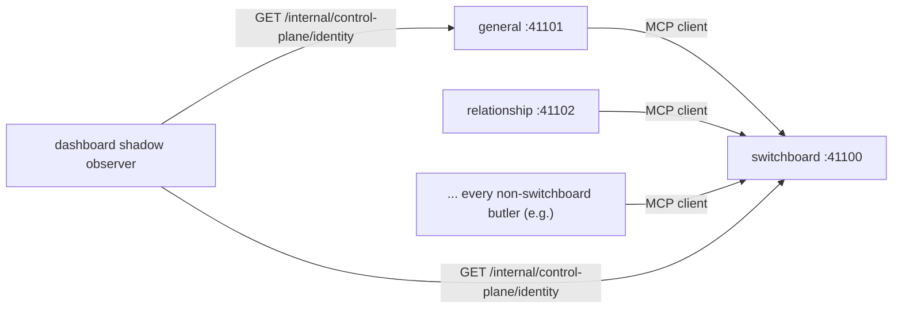
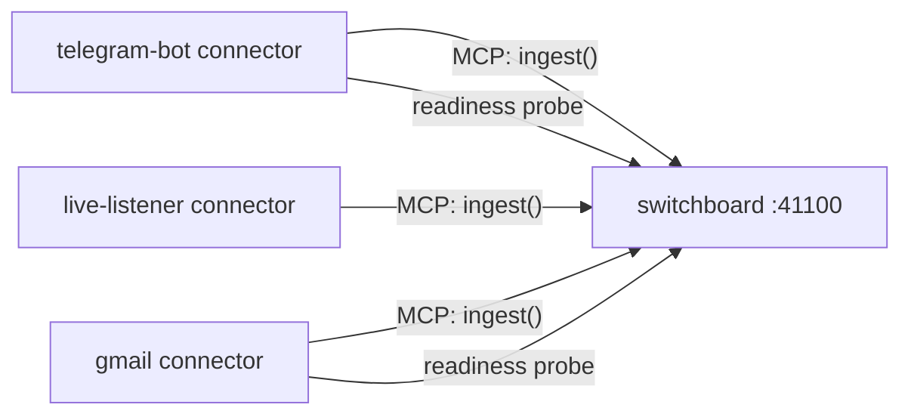
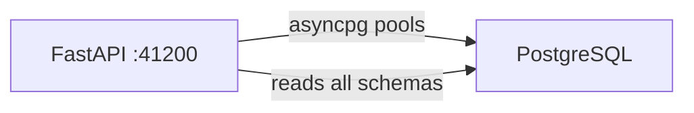

# Dependency Map

Internal and external dependencies, startup ordering constraints, and failure
blast radius analysis.

This page is a snapshot, not a contract. Butler and module lists here are
examples; `ls roster/` and `ls src/butlers/modules/` are authoritative.

---

## Internal Dependency Graph

### Module Dependencies (topological sort at startup)

Module dependencies are declared via the `dependencies` property on each Module
subclass. The `ModuleRegistry` resolves them via topological sort before
calling `on_startup()`; shutdown runs in reverse order. No module currently
declares a dependency (`grep -rn -A2 "def dependencies" src/butlers/modules`),
so startup order among enabled modules is unconstrained.

### Butler-to-Switchboard Dependency



Every non-switchboard butler opens an MCP client to the Switchboard during
startup and registers its endpoint. Routing reads the Switchboard registry,
kept fresh by daemon heartbeats; the Dashboard shadow observer probes each
daemon's identity route but does not yet hold route authority. The staged
cutover is in the
[control-plane design](../../openspec/changes/restore-butler-control-plane-liveness/design.md).

**Failure mode**: If the Switchboard is down, domain butlers cannot receive
routed messages. Their local deterministic schedules and direct MCP triggers
continue unless a separate administrative policy disables them.

### Connector-to-Switchboard Dependency



Connectors call `wait_for_switchboard_ready()` on startup, polling the
Switchboard health endpoint with exponential backoff (up to ~5 minutes).

**Failure mode**: If the Switchboard is unreachable, connectors block at startup
and cannot ingest events.

### Dashboard-to-Database Dependency



The dashboard backend creates connection pools to each butler's schema on
startup. It reads directly from butler databases -- it does not go through
butler MCP servers.

**Failure mode**: If PostgreSQL is down, the dashboard returns 500 errors.
Butler daemons also fail to start.

---

## Startup Order Constraints

The following must start before dependents can function:

```
1. PostgreSQL
   └── 2. MinIO (+ bucket setup)
       ├── 3. Switchboard butler
       │   ├── 4a. Domain butlers (general, relationship, health, ...)
       │   └── 4b. Connectors (telegram-bot, gmail, live-listener, ...)
       └── 3'. Dashboard API
```

PostgreSQL is the hard dependency for everything. MinIO / S3 is required for
blob storage, but butler daemons start without a usable blob store when the S3
configuration is absent or the configured endpoint/bucket fails validation
(blob operations fail at runtime). The Switchboard must be up before connectors
attempt ingestion, enforced by the readiness probe.

The planned public MCP surface (RFC 0039, Draft) hangs off the side of this tree and nothing
above depends on it:

```
1. PostgreSQL primary
   └── 2. Migrations, then butlers public-mcp reconcile (publication + replicated digest)
       └── 3. Owner step, run by the owner as superuser (butlers public-mcp owner-sql):
              pre-created slot and publisher grants on the primary, subscriber DDL, the
              same-instance subscription
              (initial copy), purge on narrowing, applied digest
           └── 4. butlers-public-mcp (refuses tools until replication is fresh and both the
                  replicated and the applied manifest digests match its own)
```

---

## External Dependencies

### Runtime Services (required)

| Dependency | Used By | Purpose | Failure Impact |
|---|---|---|---|
| **PostgreSQL** (pgvector/pg17) | All butlers, dashboard | Schema-isolated data storage, vector search | Total system failure -- nothing starts |
| **LLM API** (Anthropic/OpenAI/Google) | Spawner (all butlers) | LLM CLI session execution | Sessions cannot spawn; scheduled tasks queue indefinitely |

### Runtime Services (optional, degraded without)

| Dependency | Used By | Purpose | Failure Impact |
|---|---|---|---|
| **MinIO / S3** | Blob storage (attachments) | Attachment storage and retrieval | Attachment operations fail; non-blob daemon startup and core text messaging continue |
| **OpenTelemetry Collector** | Telemetry | OTLP trace/metric collection | No observability; no-op tracer/meter used instead |
| **Tempo** | Trace queries | Trace storage backend | Cannot query traces; collection unaffected |
| **Prometheus** | Metric queries | Metric storage backend | Cannot query metrics; emission unaffected |

### External APIs (per-connector/module)

Representative examples; each connector service in `docker-compose.yml` and
each module under `src/butlers/modules/` depends on its own provider API.

| Dependency | Used By | Purpose | Failure Impact |
|---|---|---|---|
| **Telegram Bot API** | telegram-bot connector, telegram module | Message polling/sending | Telegram ingestion and responses stop |
| **Telegram MTProto** | telegram-user-client connector | Userbot message access | Userbot ingestion stops |
| **Gmail API** | gmail connector | Watch/history delta email ingestion | Email ingestion stops |
| **Google Calendar API** | calendar module | Calendar CRUD | Calendar tools return errors |
| **Google Contacts API** | contacts module | Contact sync | Contact sync pauses |

### Owner-Operated Homelab Dependencies (public MCP surface only, Draft)

These belong to the owner's homelab, not this repository, and are set up as owner acts
([RFC 0039](../legends-and-lore/rfcs/0039-public-mcp-read-surface.md) Rollout). Only the public
MCP surface uses them; every failure below leaves the rest of Butlers unaffected.

| Dependency | Used By | Purpose | Failure Impact |
|---|---|---|---|
| **Cloudflare Worker** (`mcp.tze.how`) | Public MCP gateway | OAuth 2.1 + PKCE, client and user allowlist, per-call assertion signing (holds the Ed25519 private key) | Clients cannot connect |
| **GitHub OAuth** | Worker | Owner identity; the numeric GitHub id is the allowlist key | Clients cannot sign in |
| **cloudflared-mcp, traefik-mcp** (namespace `mcp-gateway` / `mcp`) | Gateway | Tunnel from the Worker's VPC binding; routing to filter-proxy | Surface unreachable |
| **filter-proxy release `butlers`** (namespace `mcp`) | Gateway | Injects the hop bearer from an ExternalSecret; forwards bytes unchanged (`FIXES` off) | Surface unreachable; any body rewrite fails the assertion body hash |
| **Uptime Kuma** (existing homelab monitor, Telegram notification) | Public MCP alerts | `json-query` monitors poll the flags `butlers_public_mcp:critical_ok` and `:warning_ok` in Prometheus, which collapse the canary, DLP, assertion-failure, bearer-refusal, bulk-read, unexpected-slot, lag and WAL-retention rules; delivery bypasses Butlers | Alerts unseen while Kuma is down. An unreachable Prometheus or an empty flag turns the monitor DOWN and notifies |

### Build-Time Dependencies

| Dependency | Purpose |
|---|---|
| **Python 3.12+** | Runtime language |
| **uv** | Package management and virtual environments |
| **Node.js 24** | Frontend build toolchain (matches CI) |
| **Docker** | Container runtime for infrastructure services |
| **Ruff** | Linting and formatting |
| **pytest** | Test execution with pytest-asyncio |
| **Alembic** | Database schema migrations |
| **Hatchling** | Python package build backend |

---

## Failure Blast Radius

### PostgreSQL down

Everything stops. No butler can start or continue operating. Dashboard returns
errors. Connectors cannot resolve credentials.

### Switchboard down

- Domain butlers continue running (local schedulers work, direct MCP calls work).
- No new external messages are routed to domain butlers.
- Connectors block or fail at ingestion.

### Single domain butler down

- Routes to that butler fail; the Switchboard registry marks it stale once its
  heartbeat TTL lapses.
- Other butlers are unaffected.

### Connector down

- The specific channel stops ingesting (e.g., no new Telegram messages).
- All other channels continue.
- Switchboard connector registry marks it stale after heartbeat TTL.

### LLM API down

- No new sessions can spawn across the fleet.
- Scheduled prompt-mode tasks queue behind the spawner semaphore.
- Job-mode scheduled tasks (Python functions) continue running.
- Existing data (state, memory, sessions) remains accessible via MCP tools.

### MinIO/S3 down

- Daemon startup continues with `daemon.blob_store = None` after the S3
  validation warning.
- Attachment upload/download fails at runtime.
- Core messaging continues for text-based ingestion and routing.
- Gmail connector attachment lazy-fetch fails.

### Public MCP surface failures (Draft, RFC 0039 D17)

No Butlers daemon depends on the public server, the projection or the gateway.

- **`postgres-<env>` down**: the projection is a second database on the primary's cluster, so it
  goes down with the primary; public tools return `unavailable` and `describe` still answers.
- **Projection database alone unavailable** (connection limit reached, or the database dropped
  and re-created): public tools return
  `unavailable`; the primary is unaffected.
- **Replication stalled**: tools refuse with `projection_stale` after 15 minutes. The primary's
  only exposure is WAL retained for the slot, bounded by `max_slot_wal_keep_size` and alerted at
  50 % of the cap (10GB on dev). An invalidated slot leaves the applied digest matching, so it
  surfaces as `projection_stale` with the slot and lag alerts; recovery is rerunning the owner
  step, which rebuilds the projection, never risking the primary.
- **Owner step pending** (first sync, a manifest change, a rebuild the owner step has started,
  or a run that stopped midway): every tool except
  `describe` refuses with `projection_apply_pending` and the warning flag is down; a narrowing
  left pending for 24 hours turns the critical flag down.
- **Shared disk full**: [Observed] dev and prod data share one 1.4T disk, 90 % full with 144G
  free, so a full disk stops both clusters and Butlers with them; the projection, its retained
  slot WAL (capped), and decoding spill files and apply WAL (not capped) add to that shared risk.
- **Gateway down**: clients cannot connect; nothing else changes.
- **Importer down**: proposals stay `received` in the inbox (capped at 1,000 undrained rows).
- **Public pod compromised**: it can read published projection data and insert capped inbox
  rows. It reaches the shared instance's PostgreSQL port, where `pg_hba` refuses every database
  but `butlers_public`, and has no route to the daemons, the dashboard or the internet.
