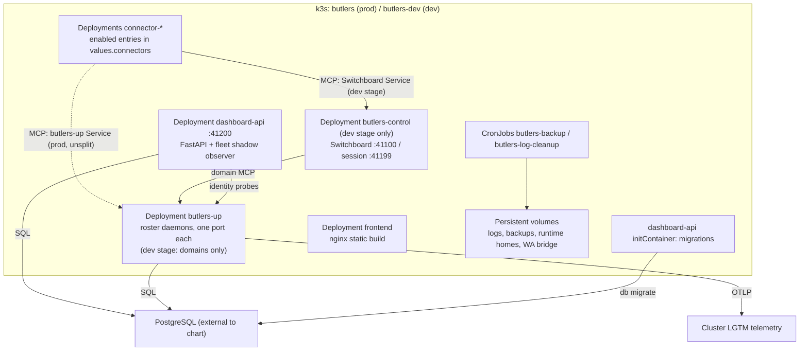

# Deployment Topology

How the Butlers system is deployed: processes, ports, and where the
authoritative configuration lives.

Helm on k3s is the production deployment path, targeting namespace `butlers`;
`butlers-dev` is the dev namespace. This page maps the repository's chart,
not a verification of a running production fleet. Workload definitions live in
`deploy/helm/butlers/templates/`, configuration in `deploy/helm/butlers/values*.yaml`,
and operator procedures in [Kubernetes Deployment](../../docs/operations/kubernetes-deployment.md).
Ports live in each `roster/{butler}/butler.toml`. These sources win when this
snapshot disagrees; fix this page. The port map below is the one other docs link to.

---

## Process Model

Production `butlers up` runs every roster butler in one Deployment; each butler
still serves its own FastMCP endpoint on its own port. Dev KEY_ABSENT_STAGE runs
Switchboard in `butlers-control` and domains in `butlers-up`
(`butlers up --exclude switchboard`). Each daemon retains its MCP port. Exactly
one control process reserves one session slot and one domain process reserves
four, preserving the owner total of five without changing the process-local
semaphore. Helm production and the production Compose launcher remain unsplit at
five. Helm `butlersControl.enabled` (set in the dev values) and the dev Compose
overlay select this topology; see
[stage boundaries and pending live proof](../../docs/architecture/key-absent-control.md).
The refusal-only session listener is separate from service health.

Connectors run as separate Deployments and submit ingress to Switchboard over
MCP. The database is external to the chart. Migrations run in the
`dashboard-api` initContainer; `make deploy-*` waits for the dashboard and
daemon rollouts. The chart also provides Services, ExternalSecrets,
NetworkPolicies and persistent volumes. See
[chart workloads](../../docs/operations/kubernetes-deployment.md#what-the-chart-runs)
for the object map and retained off-cluster components.

---

## Port Assignments

This is the single port map; other docs link here. Sources of truth: `port` in
`roster/*/butler.toml`, connector `healthPort` entries in the shared chart values
(or connector code defaults where no chart override is set), and `nodePorts`
in the dev/prod chart overlays.

### Butler MCP Ports (41100-41112)

| Butler | Type | Port |
|---|---|---|
| switchboard | staffer | 41100 |
| general | butler | 41101 |
| relationship | butler | 41102 |
| health | butler | 41103 |
| messenger | staffer | 41104 |
| finance | butler | 41105 |
| travel | butler | 41106 |
| education | butler | 41107 |
| home | butler | 41108 |
| lifestyle | butler | 41109 |
| qa | staffer | 41110 |
| chronicler | butler | 41111 |
| concierge | staffer | 41112 |

A new butler takes the next free port after the highest one in use.

### Connector Health Ports (40080-40092)

For chart-deployed connectors, these are pod-internal health ports unless a
Service exposes them. Entries outside the chart retain their connector code
defaults; live-listener remains off-cluster (see
[retained components](../../docs/operations/kubernetes-deployment.md#what-the-chart-runs)).
Each connector serves `/health` and `/metrics` on its port.

| Connector | Port |
|---|---|
| telegram-user | 40080 |
| telegram-bot | 40081 |
| gmail, whatsapp-user | 40082 (separate containers) |
| spotify | 40083 |
| google-calendar | 40085 |
| owntracks | 40086 (NodePort Service) |
| home-assistant | 40087 |
| google-drive | 40088 |
| steam | 40089 |
| google-health | 40090 |
| live-listener | 40091 |
| activitywatch | 40092 |

### Kubernetes Services and NodePorts

These are chart values, not observed live listeners. `butlers-up` exposes
41100-41112 inside the cluster; `dashboard-api` exposes 41200.

| Service | Prod NodePort (`butlers`) | Dev NodePort (`butlers-dev`) |
|---|---|---|
| `frontend` (Service port 80, nginx target 8080) | 31173 | 32173 |
| `dashboard-api-host` (Service port 41200) | 31200 | 32200 |
| `connector-owntracks-host` (Service port 40086) | 31086 | 32086 |

In the dev stage the `butlers-control` Service carries Switchboard's 41100
(unchanged for every caller) and the control session stage port 41199. The
session port is cluster-internal only: `GET /health` returns a fixed 503 and
every other route is refused; a NetworkPolicy admits only the documented
callers. It has no NodePort or host port.

PostgreSQL uses `POSTGRES_PORT` (default 5432) outside the chart. The chart
does not deploy MinIO; the retained Compose MinIO and host-port setup is
covered by [Docker Deployment](../../docs/operations/docker-deployment.md).

---

## Database Topology

One PostgreSQL database with one schema per butler plus the shared `public`
schema for cross-butler identity, model catalog, and secrets. Each butler's
role sees only its own schema and `public`, and its `search_path` is
`{butler_schema}, public`. Schema creation and Alembic migrations run in the
`dashboard-api` migrations initContainer (`db migrate`).

---

## Environment Variables

Every process reads its database target from `DATABASE_URL` or the `POSTGRES_*` variables, and
exports telemetry only when `OTEL_EXPORTER_OTLP_ENDPOINT` is set. Connectors reach the Switchboard
through `SWITCHBOARD_MCP_URL`. Runtime secrets are not environment variables: they resolve DB-first
from `butler_secrets`, with the environment as a last-resort fallback. The full operator reference
is [`docs/identity_and_secrets/environment-variables.md`](../../docs/identity_and_secrets/environment-variables.md).

---

## Configuration

- Local development setup and quality gates:
  [Dev Environment](../../docs/getting_started/dev-environment.md).
- Production deploys: `make -C deploy/helm/butlers ship-prod` builds and pushes
  images, then deploys the Helm release to namespace `butlers`.
  `make -C deploy/helm/butlers deploy-prod TAG=<tag>` deploys an already-pushed tag.
  See [Kubernetes Deployment](../../docs/operations/kubernetes-deployment.md#deploy)
  for prerequisites and the workflow.
- Retained pre-cutover off-cluster Compose path (`butlers deploy`), pending
  deletion in bu-dss7he.14:
  [Docker Deployment](../../docs/operations/docker-deployment.md#production-deploys-butlers-deploy).

---

## Dashboard owner-authentication placement

The dashboard API owns the central owner boundary, bounded WebAuthn/session
router and dedicated `dashboard_auth` persistence. Its pool logs in with
restricted Tier 0 `DASHBOARD_AUTH_DB_USER/PASSWORD`, separately from host
administrative `POSTGRES_*` access; setting a role on an administrative login
is insufficient because that session could reset its role. Trusted host CLI operations
authorize exact browser-bound registration/recovery intents; the API cannot
authorize an intent through a public endpoint. Butler runtime and generic
Secrets surfaces have no authority over this schema. Domain owner/contact
records remain separate from cryptographic HTTP authentication.

Tailscale Serve supplies the canonical HTTPS entry point; the server pins one
origin/RP hostname and trusted proxy path. Same-host dev/prod URL prefixes are
one browser security origin. Separate cookie names/state avoid collisions,
while separate trust requires distinct hostnames. Network membership does not
identify the dashboard owner. See the
[operator runbook](../../docs/identity_and_secrets/dashboard-owner-auth.md) and
[adopted design](../../openspec/changes/specify-host-authorized-dashboard-enrollment/design.md).

---

## Control-plane liveness

Each daemon serves `GET /internal/control-plane/identity`
(`src/butlers/core/control_plane_identity.py`), and the dashboard API runs a
supervised shadow observer that probes the Git-roster endpoints and records
observations. Route authority still comes from daemon-authored heartbeats; the
observer runs in shadow until the remaining stages of
`restore-butler-control-plane-liveness` land. The staged rollout, `/ready`
semantics, and deploy gating are specified in its
[design](../../openspec/changes/restore-butler-control-plane-liveness/design.md).
Docker's `/health` probe remains a process-liveness signal only.
