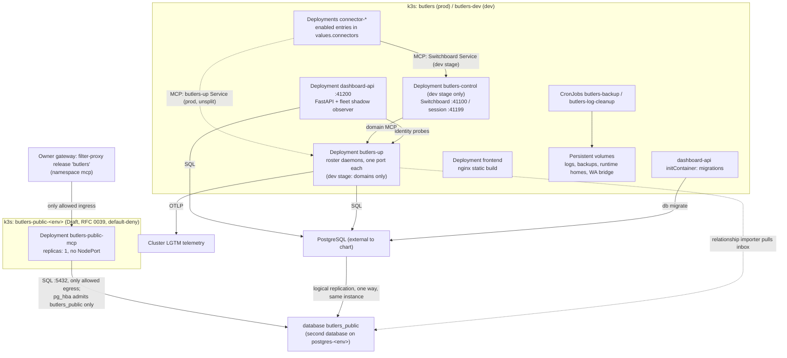

# Deployment Topology

How the Butlers system is deployed: processes, ports, and where the
authoritative configuration lives.

Helm on k3s is the production deployment path, targeting namespace `butlers`;
`butlers-dev` is the dev namespace. This page maps the repository's chart,
not a verification of a running production fleet. Workload definitions live in
`deploy/helm/butlers/templates/`, configuration in `deploy/helm/butlers/values*.yaml`,
and operator procedures in [Kubernetes Deployment](../../docs/operations/kubernetes-deployment.md).
Ports live in each `roster/{butler}/butler.toml`. These sources win when this
snapshot disagrees; fix this page. The port map below is the one other docs link to.

---

## Process Model

Production `butlers up` runs every roster butler in one Deployment; each butler
still serves its own FastMCP endpoint on its own port. Dev KEY_ABSENT_STAGE runs
Switchboard in `butlers-control` and domains in `butlers-up`
(`butlers up --exclude switchboard`). Each daemon retains its MCP port. Exactly
one control process reserves one session slot and one domain process reserves
four, preserving the owner total of five without changing the process-local
semaphore. Helm production and the production Compose launcher remain unsplit at
five. Helm `butlersControl.enabled` (set in the dev values) and the dev Compose
overlay select this topology; see
[stage boundaries and pending live proof](../../docs/architecture/key-absent-control.md).
The refusal-only session listener is separate from service health.

Connectors run as separate Deployments and submit ingress to Switchboard over
MCP. The database is external to the chart. Migrations run in the
`dashboard-api` initContainer; `make deploy-*` waits for the dashboard and
daemon rollouts. The chart also provides Services, ExternalSecrets,
NetworkPolicies and persistent volumes. See
[chart workloads](../../docs/operations/kubernetes-deployment.md#what-the-chart-runs)
for the object map and retained off-cluster components.

---

## Port Assignments

This is the single port map; other docs link here. Sources of truth: `port` in
`roster/*/butler.toml`, connector `healthPort` entries in the shared chart values
(or connector code defaults where no chart override is set), and `nodePorts`
in the dev/prod chart overlays.

### Butler MCP Ports (41100-41112)

| Butler | Type | Port |
|---|---|---|
| switchboard | staffer | 41100 |
| general | butler | 41101 |
| relationship | butler | 41102 |
| health | butler | 41103 |
| messenger | staffer | 41104 |
| finance | butler | 41105 |
| travel | butler | 41106 |
| education | butler | 41107 |
| home | butler | 41108 |
| lifestyle | butler | 41109 |
| qa | staffer | 41110 |
| chronicler | butler | 41111 |
| concierge | staffer | 41112 |

A new butler takes the next free port after the highest one in use.

### Connector Health Ports (40080-40092)

For chart-deployed connectors, these are pod-internal health ports unless a
Service exposes them. Entries outside the chart retain their connector code
defaults; live-listener remains off-cluster (see
[retained components](../../docs/operations/kubernetes-deployment.md#what-the-chart-runs)).
Each connector serves `/health` and `/metrics` on its port.

| Connector | Port |
|---|---|
| telegram-user | 40080 |
| telegram-bot | 40081 |
| gmail, whatsapp-user | 40082 (separate containers) |
| spotify | 40083 |
| google-calendar | 40085 |
| owntracks | 40086 (NodePort Service) |
| home-assistant | 40087 |
| google-drive | 40088 |
| steam | 40089 |
| google-health | 40090 |
| live-listener | 40091 |
| activitywatch | 40092 |

### Kubernetes Services and NodePorts

These are chart values, not observed live listeners. `butlers-up` exposes
41100-41112 inside the cluster; `dashboard-api` exposes 41200.

| Service | Prod NodePort (`butlers`) | Dev NodePort (`butlers-dev`) |
|---|---|---|
| `frontend` (Service port 80, nginx target 8080) | 31173 | 32173 |
| `dashboard-api-host` (Service port 41200) | 31200 | 32200 |
| `connector-owntracks-host` (Service port 40086) | 31086 | 32086 |

In the dev stage the `butlers-control` Service carries Switchboard's 41100
(unchanged for every caller) and the control session stage port 41199. The
session port is cluster-internal only: `GET /health` returns a fixed 503 and
every other route is refused; a NetworkPolicy admits only the documented
callers. It has no NodePort or host port.

The planned `butlers-public-mcp` Service (RFC 0039) lives in its own namespace, has no
NodePort, host port or Tailscale mapping, and has no port assigned yet; see
[Public MCP read surface](#public-mcp-read-surface-draft).

PostgreSQL uses `POSTGRES_PORT` (default 5432) outside the chart. The chart
does not deploy MinIO; the retained Compose MinIO and host-port setup is
covered by [Docker Deployment](../../docs/operations/docker-deployment.md).

---

## Database Topology

One PostgreSQL database with one schema per butler plus the shared `public`
schema for cross-butler identity, model catalog, and secrets. Each butler's
role sees only its own schema and `public`, and its `search_path` is
`{butler_schema}, public`. Schema creation and Alembic migrations run in the
`dashboard-api` migrations initContainer (`db migrate`).

Planned second database (RFC 0039 D2-D4, D9; Draft): `butlers_public` on the same CNPG cluster
`postgres-<env>` (owner decision OD10), with no backups of its own because it rebuilds from the
primary. The primary has one publication, `butlers_public_v1`, whose column lists and row filters
`butlers public-mcp reconcile` generates from `src/butlers/knowledge_read/projection.toml`
in the migration Job (the `dashboard-api` `db migrate` initContainer above; RFC 0039 uses OD14's
name for it) after Alembic, as the migration user; in the same transaction it writes the
replicated manifest digest. The projection has one subscription, `butlers_public_sub`. Because both live on one
instance, and because the subscription's `password_required = false` makes it superuser-only
work, the slot and subscription are one owner step (OD14): `butlers public-mcp owner-sql`
prints one idempotent SQL file that is piped through
`kubectl exec -i -n postgres-<env> <instance> -- psql -X -U postgres -d butlers -f -`, the same
path as `scripts/init-db.sql`. On dev, `make deploy-dev` does this on every deploy (OD20): after
`bootstrap-dev` and after `record-deploy.sh`, whatever it returned (its guard refuses when the
migrations did not reconcile), `scripts/k8s/public-mcp-owner-step.sh` captures the file from the
`dashboard-api` pod running the deployed tag and pipes it to the superuser `psql` in the primary;
a failure fails the deploy loudly and rolls nothing back, and after a success the same target
upgrades the public chart at the same tag. Elsewhere the owner runs it. It pre-creates the slot with
`pg_create_logical_replication_slot(..., 'pgoutput')`, creates the subscription with
`create_slot = false` on the local socket and hands it to `mcp_subscription_owner`, refreshes it,
purges and re-copies after a narrowing, and records the applied digest. It must run at the
first sync, after each manifest change and after each slot invalidation; until it runs after the
first sync or a manifest change the public server refuses with `projection_apply_pending`, and
after an invalidation with `projection_stale`. Roles: `butlers_projection_publisher` (the only
Butlers-managed `REPLICATION` role on the primary, beside CNPG's `postgres` and
`streaming_replica`; it can decode every change on the primary, so it has no password or
certificate and logs in only by local peer authentication inside the instance pods, through the
CNPG `local` `pg_ident` map, and no role is a member of it; exec into those pods, pod creation,
Secret read and `Cluster` writes in `postgres-<env>` are already superuser-equivalent),
`mcp_public_ro` (SELECT on `mcp_read` views, column INSERT on `mcp_inbox.proposals`, connection
limit 10, `statement_timeout` 2s set by `init-db.sql`), `mcp_proposals_reader` (SELECT, DELETE on
the inbox, used only by the importer) and `mcp_subscription_owner` (owns the subscription; keeps
`LOGIN` and its password copies per OD15, mounted by no Butlers workload). `pg_hba` admits both
projection roles only to `butlers_public` from the single-node pod range `10.42.0.0/24`, rejects
them everywhere else, and rejects every TCP login as the publisher; that, with the grants, is the
boundary between projection and primary, since the network cannot separate two databases on one
instance and the shared pod range cannot separate pods. The projection shares the primary's
volume, WAL, backups and restore drill (the drill drops it or keeps its subscription disabled).
`max_slot_wal_keep_size = 10GB` caps a stalled slot [Observed: homelab PR #40]. [Observed] Dev
and prod data share one 1.4T disk, 90 % full with 144G free, with PVC sizes not enforced, so a
full disk stops both clusters.

---

## Environment Variables

Every process reads its database target from `DATABASE_URL` or the `POSTGRES_*` variables, and
exports telemetry only when `OTEL_EXPORTER_OTLP_ENDPOINT` is set. Connectors reach the Switchboard
through `SWITCHBOARD_MCP_URL`. Runtime secrets are not environment variables: they resolve DB-first
from `butler_secrets`, with the environment as a last-resort fallback. The full operator reference
is [`docs/identity_and_secrets/environment-variables.md`](../../docs/identity_and_secrets/environment-variables.md).

---

## Configuration

- Local development setup and quality gates:
  [Dev Environment](../../docs/getting_started/dev-environment.md).
- Production deploys: `make -C deploy/helm/butlers ship-prod` builds and pushes
  images, then deploys the Helm release to namespace `butlers`.
  `make -C deploy/helm/butlers deploy-prod TAG=<tag>` deploys an already-pushed tag.
  See [Kubernetes Deployment](../../docs/operations/kubernetes-deployment.md#deploy)
  for prerequisites and the workflow.
- Retained pre-cutover off-cluster Compose path (`butlers deploy`), pending
  deletion in bu-dss7he.14:
  [Docker Deployment](../../docs/operations/docker-deployment.md#production-deploys-butlers-deploy).

---

## Dashboard owner-authentication placement

The dashboard API owns the central owner boundary, bounded WebAuthn/session
router and dedicated `dashboard_auth` persistence. Its pool logs in with
restricted Tier 0 `DASHBOARD_AUTH_DB_USER/PASSWORD`, separately from host
administrative `POSTGRES_*` access; setting a role on an administrative login
is insufficient because that session could reset its role. Trusted host CLI operations
authorize exact browser-bound registration/recovery intents; the API cannot
authorize an intent through a public endpoint. Butler runtime and generic
Secrets surfaces have no authority over this schema. Domain owner/contact
records remain separate from cryptographic HTTP authentication.

Tailscale Serve supplies the canonical HTTPS entry point; the server pins one
origin/RP hostname and trusted proxy path. Same-host dev/prod URL prefixes are
one browser security origin. Separate cookie names/state avoid collisions,
while separate trust requires distinct hostnames. Network membership does not
identify the dashboard owner. The planned Cloudflare path for the public MCP
surface (RFC 0039) ends at its own namespace and never routes to the dashboard. See the
[operator runbook](../../docs/identity_and_secrets/dashboard-owner-auth.md) and
[adopted design](../../openspec/changes/specify-host-authorized-dashboard-enrollment/design.md).

---

## Control-plane liveness

Each daemon serves `GET /internal/control-plane/identity`
(`src/butlers/core/control_plane_identity.py`), and the dashboard API runs a
supervised shadow observer that probes the Git-roster endpoints and records
observations. Route authority still comes from daemon-authored heartbeats; the
observer runs in shadow until the remaining stages of
`restore-butler-control-plane-liveness` land. The staged rollout, `/ready`
semantics, and deploy gating are specified in its
[design](../../openspec/changes/restore-butler-control-plane-liveness/design.md).
Docker's `/health` probe remains a process-liveness signal only. The
dashboard API's exact public `GET /ready` (owner auth exempts only that
method and path) returns the cached, content-blind semantic verdict:
`{"ready":true}` with 200, or 503 with the fixed Boolean `checks`. A supervised
`fleet_readiness` loop samples PostgreSQL, the roster, observer progress,
fleet receiver evidence, QA patrol age, supervised-loop health, and
Switchboard's internal route preflight. The request itself makes no probe,
query, or write. Deployment launchers consume this route and register no
second handler.

---

## Public MCP read surface (Draft)

Accepted design, not deployed:
[RFC 0039](../legends-and-lore/rfcs/0039-public-mcp-read-surface.md) D3, D8 and
Rollout. This is the only Butlers workload meant to be reachable from the internet, and only
through the owner's gateway.

**Gateway path (owner-operated, homelab repo).** Cloudflare Worker at `mcp.tze.how` (OAuth 2.1
with PKCE, GitHub-id allowlist, strips inbound `x-mcp-*`, signs `X-MCP-Assertion`), then the
VPC binding to `cloudflared-mcp`, then `traefik-mcp` (watches namespace `mcp` only), then the
filter-proxy release `butlers` in namespace `mcp` (injects the hop bearer, `FIXES` off). Its
`UPSTREAM_URL` is the only cross-namespace hop; no Butlers namespace joins traefik-mcp's watch
list, because its Role can read Secrets in every namespace it watches.

**Namespaces and network policy.**

| Namespace | Holds | Ingress allowed | Egress allowed |
|---|---|---|---|
| `butlers-public-<env>` (created by the chart) | `butlers-public-mcp` Deployment (chart `deploy/helm/butlers-public-mcp`), hop-bearer digest Secret, the ExternalSecret for `MCP_PUBLIC_RO_DB_PASSWORD`, verifier keyring and break-glass `disabled_domains` ConfigMaps | MCP port from the `butlers` filter-proxy pods in `mcp`; metrics port from monitoring | `postgres-<env>` instance pods on 5432; kube-dns on 53 |
| `postgres-<env>` (existing) | CNPG cluster; databases `butlers` (primary) and `butlers_public` (projection); Secrets `postgres-mcp-public-ro-user`, `postgres-mcp-proposals-reader-user` and `postgres-mcp-subscription-owner-user`; no publisher credential, because none exists | Unchanged; the public pod on 5432 would be added only if a default-deny selected the instance pods, and none does on dev | Unchanged |
| `butlers-<env>` (existing) | adds Secrets `postgres-mcp-proposals-reader-user` (mounted by the importer) and `postgres-mcp-subscription-owner-user` (mounted by nothing, OD15) | Unchanged | Unchanged |

Everything else in `butlers-public-<env>` is denied by default. On `postgres-<env>` the change
widens nothing: NetworkPolicies are additive, and a new policy on pods that had none would isolate
them from the primary's other clients, so the allow is added only where a default-deny already
selects the instance pods. [Observed: homelab report, 2026-11-04] None selects the `postgres-dev`
pods and there is no cluster-wide or CNI policy, so no policy was added. The importer and the subscription
need no new path. Because the instance pods also serve the primary, the network cannot separate
the projection from it: `pg_hba` and grants are the boundary, and the `mcp_proposals_reader`
grant and its `pg_hba` line are what limit the importer, since production `butlers up` runs every
roster butler in one pod. A live check after each deploy (and on a schedule) fails if any
NetworkPolicy or cluster-wide policy the chart did not render selects pods in
`butlers-public-<env>`, or if a policy in `postgres-<env>` admits that namespace to anything other
than the instance pods on 5432, and reports when a policy starts selecting the instance pods,
because the public pod's allow must then be added. The pod runs non-root with a read-only root filesystem,
no service-account token and `HF_HUB_OFFLINE=1`/`TRANSFORMERS_OFFLINE=1`. It runs one replica,
because the assertion replay set is in memory.

**Why not `butlers-<env>`.** [Observed] `butlers-tracker-egress` allows every pod in that
namespace egress to `0.0.0.0/0`, and NetworkPolicies are additive, so no narrower policy could
hold the public pod to the projection. **Precondition:** the `butlers-<env>` chart renders
default-deny ingress for every pod, with a contract test over the union of its policies
(`tests/scripts/test_chart_ingress_union.py`); it reaches the cluster with the next deploy, and
that deploy lands before any gateway allow rule points into Butlers.

**Owner acts** (RFC 0039 Rollout, OD5). The ordered setup for a fresh environment, with checks
for each step, is [Public MCP Read Surface](../../docs/operations/public-mcp-read-surface.md).
Per environment, declared by homelab in its CNPG chart values
(`helm/postgresql_cloudnativepg/values.<env>.yaml`) and repeated on any new cluster: on
`postgres-<env>`, database `butlers_public` and the managed roles, the ordered `pg_hba` lines that
admit `mcp_public_ro` and `mcp_proposals_reader` only to it from the node's pod range plus the
publisher's reject line, the `local` `pg_ident` line for the publisher's peer login,
`max_slot_wal_keep_size`, and the password Secrets; plus a `postgres-<env>` allow only where a
default-deny selects the instance pods. Homelab PR Tzeusy/homelab#40 applied these to dev
(`values.dev.yaml`, `10GB`, pod range `10.42.0.0/24`; no allow was needed). The namespace
`butlers-public-<env>` is the chart's, not an owner act. Automatic on dev, so not owner acts
there: the `scripts/init-db.sql` rerun with the publisher grants and `statement_timeout`
(`make deploy-dev` runs `bootstrap-dev` first) and the owner step at first sync, after each
manifest change and after each slot invalidation (`make deploy-dev` runs it after the migrations,
OD20; elsewhere it stays the one recurring owner act). Still to do: generate the Worker's Ed25519 key
and add assertion signing; deploy the `butlers` filter-proxy release with an ExternalSecret on
the dev store; add `butlers` to the Worker's `MCP_SERVERS`; add two Uptime Kuma `json-query`
monitors on the alert flags `butlers_public_mcp:critical_ok` (at `interval = 60`) and
`butlers_public_mcp:warning_ok` in the homelab's `uptimekuma-monitors.toml`, on its existing
Telegram notification. Alerting adds no ingress to `butlers-public-<env>`: Kuma polls Prometheus.
Rollout targets `dev`, which is the live system, so the first client connection exposes live
data, which the owner accepted (OD12). Prod rollout is deferred for the foreseeable future
(OD18): `butlers-public-dev` and `postgres-dev` are the only targets, and the `<env>` design
stays as the deferred prod plan.
