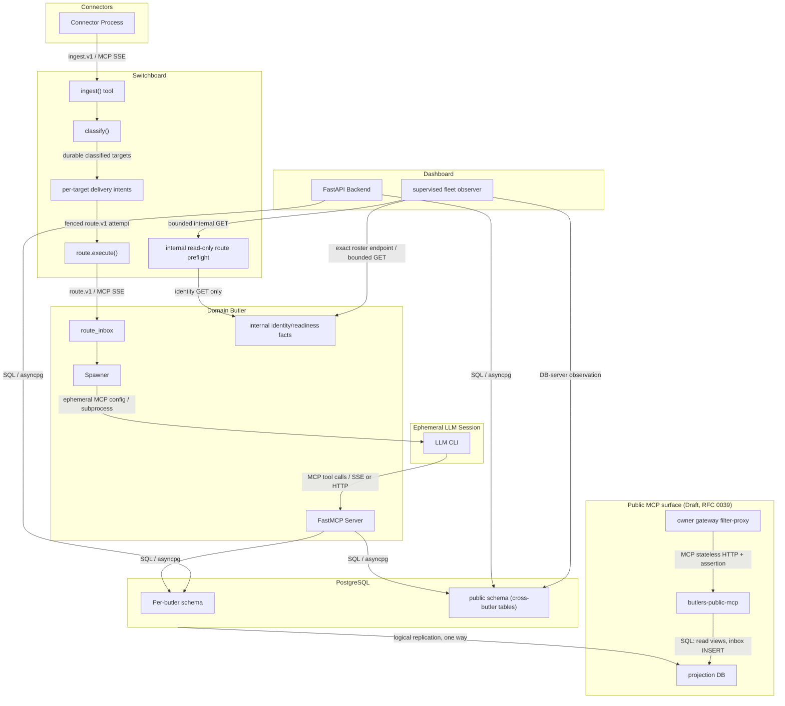

# Integration Points

How subsystems connect at their boundaries: wire protocols, envelope schemas,
and transport details.

This page is a snapshot, not a contract. Envelope schemas live in their
Pydantic models and openspec specs; when they disagree with this page, they
win. The observer and per-target intent edges in the overview are target
contracts of the open `restore-butler-control-plane-liveness` and
`recover-ingestion-target-deliveries` changes; the identity route and a shadow
observer have landed, route authority has not moved.

---

## Overview

---

## 1. Connector to Switchboard: `ingest.v1`

**Transport**: MCP tool call over SSE (via `CachedMCPClient`)

**Endpoint**: Switchboard's `ingest()` MCP tool

**Envelope schema** (`ingest.v1`, defined in `roster/switchboard/tools/contracts.py`):

| Field | Type | Required | Description |
|---|---|---|---|
| `schema_version` | `"ingest.v1"` | Yes | Fixed version string |
| `source_channel` | SourceChannel enum | Yes | `telegram_bot`, `telegram_user_client`, `email`, `voice`, `api`, `mcp`, `slack` |
| `source_provider` | SourceProvider enum | Yes | `telegram`, `gmail`, `imap`, `internal`, `live-listener`, `slack` |
| `source_endpoint_identity` | string | Yes | Connector instance identity (e.g., bot username) |
| `source_sender_identity` | string | Yes | Sender identifier within the channel |
| `external_conversation_id` | string | No | Stable conversation key (anchors, resume, history) |
| `reply_target_ref` | string | No | Per-message reply or reaction target |
| `source_thread_identity` | string | No | Notify-facing alias of `reply_target_ref`; never the conversation key |
| `received_at` | RFC3339 datetime | Yes | Timestamp of event reception |
| `content` | string | Yes | Normalized message content |
| `content_type` | string | No | MIME type hint |
| `metadata` | dict | No | Channel-specific metadata |
| `attachments` | list | No | Attachment descriptors |
| `ingestion_tier` | `"full"` / `"metadata"` | No | Ingestion depth |
| `policy_tier` | `"default"` / `"interactive"` / `"high_priority"` | No | Processing priority |

**Validation**: Pydantic model enforces channel-provider compatibility (e.g.,
`telegram_bot` channel requires `telegram` provider).

**Readiness**: Connectors call `wait_for_switchboard_ready()` before entering
their main loop, polling `GET /health` with exponential backoff.

---

## 2. Switchboard to Domain Butler: `route.v1`

**Transport**: MCP tool call over SSE (Switchboard acts as MCP client to the
target butler's MCP server)

**Endpoint**: Target butler's `route.execute()` MCP tool

**Envelope schema** (`route.v1`):

| Field | Type | Required | Description |
|---|---|---|---|
| `schema_version` | `"route.v1"` | Yes | Fixed version string |
| `request_id` | UUID | Yes | Unique request identifier |
| `source_channel` | SourceChannel | Yes | Preserved from ingest envelope |
| `source_endpoint_identity` | string | Yes | Preserved from ingest envelope |
| `source_sender_identity` | string | Yes | Preserved from ingest envelope |
| `source_thread_identity` | string | No | Preserved from ingest envelope |
| `external_conversation_id` | string | No | Preserved from ingest envelope |
| `reply_target_ref` | string | No | Preserved from ingest envelope |
| `target_butler` | string | Yes | Target butler name |
| `prompt` | string | Yes | Classified message content |
| `conversation_history` | string | No | Recent conversation context |
| `input_context` | dict/string | No | Additional routing context |
| `attachments` | list | No | Attachment references |

**Authorization**: The target butler checks `trusted_route_callers` (default:
`["switchboard"]`) to verify the caller identity. Untrusted callers are
rejected.

**Durability**: On acceptance, the target butler inserts the envelope into
`route_inbox` before returning `{"status": "accepted"}`. Processing happens
asynchronously under a fenced processing-claim lease. Startup recovery can
claim and re-dispatch ordinary accepted work (and recoverable stale work), but
an already-processing dashboard turn first reconciles its durable predecessor.
If that predecessor is not provably terminal, recovery marks the route row for
operator attention and does not automatically replay a second runtime.

**Approved ingestion recovery target (2026-09-23):** Ordinary non-dashboard
ingestion-to-domain routing has a Switchboard-owned durable per-target intent
before the first `route.execute` call. Its stable acceptance identity is
`(ingestion_event_id, target_butler, segment_id)`; the target atomically
upserts this identity with the canonical immutable payload digest and returns
the same receipt on exact duplicates. Receipt lookup compares both receiving
target and digest; changed work conflicts rather than appearing accepted. The
Switchboard retries only proven pre-acceptance no-effect attempts and settles
at `accepted` when the target owns its inbox row. Ambiguous attempts reconcile
by the same key and never create a second target row. Its per-segment intent
state is authoritative; the legacy per-butler dispatch outcome cannot collapse
two segments to one success. Source `ingested` status does not imply universal
target acceptance. Connector ingress replay,
dashboard turn recovery, Messenger delivery, and domain-event subscriptions
keep their distinct ownership and stores. Historic failed rows need a
content-blind dry run and exact owner-reviewed recovery policy.

---

## 3. Spawner to LLM CLI: Ephemeral MCP Config

**Transport**: Subprocess invocation with environment injection

**Mechanism**:

1. Spawner generates a temporary MCP config (JSON) pointing exclusively at
   this butler's MCP endpoint URL.
2. Spawner selects a runtime adapter (Claude Code, Codex, Gemini, OpenCode)
   based on model catalog resolution.
3. Spawner builds CLI arguments via the adapter's `build_args()` method.
4. Spawner injects environment variables:
   - `TRACEPARENT` -- OpenTelemetry trace context propagation
   - Declared credentials from the butler's `env_required`/`env_optional` lists
   - Model-specific API keys
5. Spawner invokes the CLI as a subprocess.

**MCP endpoint URL**: `http://localhost:{port}/mcp` (streamable HTTP) or
`http://localhost:{port}/sse` (legacy SSE).

**Concurrency control**: Two-level semaphore.
- Per-butler: `max_concurrent_sessions` (from `butler.toml`, default 1).
- Global: `BUTLERS_MAX_GLOBAL_SESSIONS` (default 3, across all butlers in-process).

**Session lifecycle**:
- `session_create()` -- DB INSERT before CLI invocation.
- CLI runs, calls MCP tools, returns.
- `session_complete()` -- DB UPDATE with exit code, token counts, cost, tool
  calls, and duration.

---

## 4. LLM Session to Butler: MCP Tool Calls

**Transport**: MCP over streamable HTTP (`/mcp`) or SSE (`/sse`)

**Server**: Butler's FastMCP instance (created with core tools in daemon startup phase 13; its SSE server starts in phase 15)

**Available tools**: Core tools (status, trigger, state_*, schedule_*,
sessions_*, notify, remind, get_attachment, module.states, module.set_enabled)
plus all tools registered by enabled modules.

**Approval gating**: Configured tools pass through the approvals module gate
before execution. The gate checks existing approval rules, risk tiers, and
expiry. If no valid approval exists, the tool call is blocked pending human
approval.

**Tool call capture**: All tool calls during a session are captured via
`ContextVar`-based tracking and persisted in the session log.

---

## 5. Dashboard to Database: Direct SQL

**Transport**: asyncpg connection pools (one pool per butler schema)

**Manager**: `src/butlers/api/db.py::DatabaseManager` -- initialized at FastAPI
startup, creates pools for each discovered butler config.

**Access pattern**: The dashboard reads directly from butler databases. It does
not proxy through butler MCP servers. This means:
- Dashboard queries can span multiple butler schemas in a single request.
- Dashboard has read access to shared identity tables.
- Dashboard writes are limited to admin operations (secrets, model catalog,
  provider settings).

**Shared dependency**: Core and discovered butler routers import `Db` (or use
`Depends(get_db)`) from `src/butlers/api/deps.py`. Both resolve the same
DatabaseManager singleton, initialized by `init_db_manager()` and closed by
`shutdown_db_manager()` in the `src/butlers/api/app.py` lifespan. Existing
best-effort reads use `OptionalDb`/`get_db_optional()` to return `None` before
initialization; pool, query and authorization errors retain their normal handling.

---

### Owner authentication before dashboard domain access

The browser first completes the dedicated WebAuthn/session contract over the
canonical HTTPS origin. Authentication-store access is bounded and separate
from domain-pool acquisition: the central boundary must establish the owner
before reading request bodies, domain records, caches or owner/contact rows.
Unsafe cookie-backed requests additionally pass synchronizer CSRF and exact
Origin validation. The resulting principal does not skip domain-specific
approval, privacy, idempotency or owner-integrity checks.

Host CLI operations use trusted administrative access for initial authorization,
recovery and mode reconciliation. The API can complete only an already-authorized
browser-bound ceremony through restricted persistence operations. No MCP tool,
connector or runtime child receives host authorization authority. See
[owner authentication](../../docs/identity_and_secrets/dashboard-owner-auth.md).

## 6. Butler to Butler: MCP via Switchboard

**Rule**: Butlers never communicate directly. All inter-butler communication
flows through the Switchboard.

**Mechanism**: A butler's LLM session can call `notify()` which routes through
the Switchboard's notification tools. There is no direct MCP client connection
between domain butlers.

**Exception**: The Switchboard itself holds MCP client connections to all
registered domain butlers for route dispatch.

The planned public MCP server (§10) is not a butler peer: it holds no MCP client to any
butler or to the Switchboard, so this rule is unchanged.

The candidate in-room voice envelopes (`voice_origin.v1`,
`voice_presence_attest.v1`) keep this rule and are specified in
[RFC 0034](../legends-and-lore/rfcs/0034-messenger-voice-egress.md); they are
not implemented.

---

## 7. Non-Switchboard Butler to Switchboard: Registration

**Transport**: MCP client connection for dispatch; backend-network HTTP GET
from the control-plane observer for liveness.

On startup, each non-switchboard butler opens an MCP client to
`{switchboard_url}/mcp` and advertises its configured endpoint; Switchboard
records it in `switchboard.butler_registry`, which daemon heartbeats keep
fresh and which routing reads today. Every daemon also serves
`GET /internal/control-plane/identity` (`butler.control.v1`: name, boot
UUIDv7, boot epoch, route-contract range, `accepting_routes`), probed by the
Dashboard's shadow observer. Migration `sw_035` adds
`switchboard.butler_registry_control_plane`, which keeps administrative
policy, observed health, and route compatibility apart.

The staged cutover (L1-L4), rollback rules, and the `/ready` contract are in
the [control-plane design](../../openspec/changes/restore-butler-control-plane-liveness/design.md).

---

## 8. Connector Heartbeat: Liveness Reporting

**Transport**: MCP tool call (`connector.heartbeat`)

**Payload**:
- `instance_id` -- stable UUID generated at process startup
- `connector_type` -- e.g., `telegram_bot`, `gmail`
- `endpoint_identity` -- e.g., bot username, email address
- `version` -- connector version string
- `counters` -- current metric values (messages ingested, errors, etc.)
- `health` -- derived health state

**Interval**: `CONNECTOR_HEARTBEAT_INTERVAL_S` (default 120s, min 30s, max 300s)

**Failure behavior**: Heartbeat failures are logged but never crash or block
ingestion.

---

## 9. Observability: Trace Propagation

**Protocol**: W3C Trace Context (`TRACEPARENT` header/env var)

**Propagation path**:
1. Connector creates a root span for each ingested event.
2. Switchboard receives the trace context via MCP call metadata.
3. Switchboard creates child spans for triage, classification, and routing.
4. Route dispatch to target butler carries trace context.
5. Target butler's route.execute creates a linked span.
6. Spawner injects `TRACEPARENT` into the LLM CLI subprocess environment.
7. The LLM CLI (if instrumented) joins the trace.

This produces an end-to-end trace from external event arrival through
classification, routing, and session execution.

---

## 10. Owner AI Client to Public MCP Server (Draft)

Accepted design, not implemented:
[RFC 0039](../legends-and-lore/rfcs/0039-public-mcp-read-surface.md) D6, D7, D10 and D17.

**Transport**: MCP streamable HTTP, stateless, JSON responses, no SSE GET. Path: client, then
the Cloudflare Worker, then `cloudflared-mcp`, then `traefik-mcp`, then filter-proxy release
`butlers` (namespace `mcp`), then the `butlers-public-mcp` Service. Placement:
[`deployment.md` §Public MCP read surface](deployment.md#public-mcp-read-surface-draft).

**Credentials on each request**:

| Header | Set by | Proves | Checked at home as |
|---|---|---|---|
| `Authorization: Bearer <UPSTREAM_BEARER>` | filter-proxy | The request passed the one filter-proxy release. Never an identity. | Constant-time compare against a file-mounted SHA-256 digest; 401 before the body is parsed |
| `X-MCP-Assertion` (compact JWS, `typ` `butlers-mcp-assertion+v1`) | Cloudflare Worker | The GitHub user (`sub`), OAuth client (`cid`), method, tool, query string and body SHA-256 of this exact call | Ed25519 against the keyring ConfigMap; JCS canonical payload; `exp = iat + 30`; `jti` replay set; `iat` not before process start |

Only `initialize`, `notifications/initialized`, `notifications/cancelled`, `ping`,
`tools/list` and `server/discover` may arrive unasserted; they return static content and open
no database connection. The verifier reuses the `runtime_probe_control` signed codec, but its
`typ` and keyring are distinct, and no RFC 0038 broker accepts it. Inbound `X-MCP-User-Id`
headers are never trusted.

**Errors**: auth failures are JSON-RPC `-32001` with `{"reason":"unauthorized"}`. Tool
failures are `isError: true` results with a fixed `error.code` (`domain_disabled`,
`projection_stale`, `projection_apply_pending`, `budget_exhausted`, `blocked`, ...).

---

## 11. Primary to Projection: Logical Replication (Draft)

**Transport**: PostgreSQL 17 logical replication, publication `butlers_public_v1` on the primary
to subscription `butlers_public_sub` on `butlers_public`, as `butlers_projection_publisher`, which
has no credential and connects over the instance's local socket by peer authentication (OD14).
Both databases live on the same CNPG cluster, `postgres-<env>` (RFC 0039 D3), so the owner step
(`butlers public-mcp owner-sql`, run as superuser through `kubectl exec`, by every
`make deploy-dev` after the migrations on dev, OD20, and by the owner elsewhere) pre-creates
the slot with `pg_create_logical_replication_slot(..., 'pgoutput')` and creates the subscription
with `create_slot = false` and `password_required = false`, then hands it to
`mcp_subscription_owner`.

**Contract** (RFC 0039 D2, D4): column lists and row filters are generated from the manifest
`src/butlers/knowledge_read/projection.toml` by `butlers public-mcp reconcile` in the migration
Job; the subscriber DDL is in the owner step; DDL is never replicated. Row-filter columns sit in each table's replica identity, so a row that later stops
matching (reclassified, restricted) arrives as a DELETE. Chronicler publishes source-owned
`episodes_public` and `rollups_public` tables, because its corrections live in an overlay a row
filter cannot see. No JSONB column is published: entity flags, finance overlays and health
values reach the projection through trigger-maintained plain columns or tables, and since OD17
every scalar leaf of a finance or health JSONB column reaches it through
`finance.json_fields_public` and `health.json_fields_public`, skipping credential-named paths.
Finance and health publish everything they hold except credentials (OD17); the other domains
stay narrow, under the breadth tier of the column denylist and literal predicate allowlists with
no contact- or identity-kind predicate, which also filter graph edges through a trigger-kept
`publish_key` (OD21). The manifest
digest and the kill-switch rows replicate via `mcp_surface`; the public pod refuses tools when
the replicated digest differs from its built-in one (`projection_version_mismatch`) and when the
digest the last owner step applied differs from it (`projection_apply_pending`). A CI contract
test asserts, on a PG17 testcontainer with all migrations applied, that the publication equals
the manifest. Narrowing the manifest makes the owner step truncate and re-copy the subscriber
tables; until it runs the surface refuses.

---

## 12. Proposal Inbox to Relationship Importer (Draft)

**Transport**: SQL pull from the Butlers side (namespace `butlers-<env>`). The Relationship job
`public_mcp_proposal_import` (`dispatch_mode = "job"`, every 5 minutes) connects to the
projection as `mcp_proposals_reader` (which `pg_hba` admits to `butlers_public` only), copies up to 100 rows from `mcp_inbox.proposals` into
`relationship.external_fact_proposals`, then deletes them. Nothing on the public side can push
into Butlers.

**Handoff**: each valid proposal is parked through a new approvals entry point,
`park_external_proposal` (collapsed presentation, never a delivery provider), as
`relationship_assert_fact` with `deduplication_key = 'external_mcp:<proposal_id>'`, no standing
rule match, no push notification and evidence limited to the client label and a digest of the
evidence URL. The importer reads the `proposals` and `all` kill switches from
`mcp_surface.controls` on the primary. The owner approves on the dashboard approvals page under a
passkey session (`POST /api/approvals/actions/{id}/approve`); the executor applies it
deterministically with `content_authority = 'third_party'` and `src = 'external_mcp:<id>'`
(RFC 0039 D13). `pending_actions.origin` is not widened.

---

## Protocol Summary

| Boundary | Protocol | Envelope | Transport |
|---|---|---|---|
| Connector -> Switchboard | MCP | `ingest.v1` | SSE |
| Switchboard -> Domain Butler | MCP | `route.v1` | SSE |
| Spawner -> LLM CLI | Subprocess | Ephemeral MCP config + env vars | stdin/env |
| LLM CLI -> Butler | MCP | Tool calls | Streamable HTTP or SSE |
| Dashboard -> Database | SQL | asyncpg queries | TCP |
| Butler -> Database | SQL | asyncpg queries | TCP |
| Connector -> Switchboard (heartbeat) | MCP | `connector.heartbeat` | SSE |
| Control plane -> daemon (liveness) | backend-network HTTP GET | `butler.control.v1` bounded facts | HTTP |
| Switchboard -> target (ingestion delivery) | MCP | stable per-target acceptance identity and receipt | Streamable HTTP or SSE |
| All -> OTel | OTLP | Traces + metrics | gRPC |
| Owner AI client -> public MCP, via gateway (Draft) | MCP | JSON-RPC + hop bearer + `X-MCP-Assertion` | Stateless streamable HTTP |
| Primary -> projection (Draft) | PostgreSQL logical replication | publication `butlers_public_v1` | local Unix socket (`/controller/run`), peer auth, same instance; no TCP |
| Public MCP -> projection (Draft) | SQL | `mcp_read` SELECT, inbox INSERT as `mcp_public_ro` | TCP 5432 |
| Relationship importer -> projection inbox (Draft) | SQL | SELECT, DELETE as `mcp_proposals_reader` | TCP 5432 |
