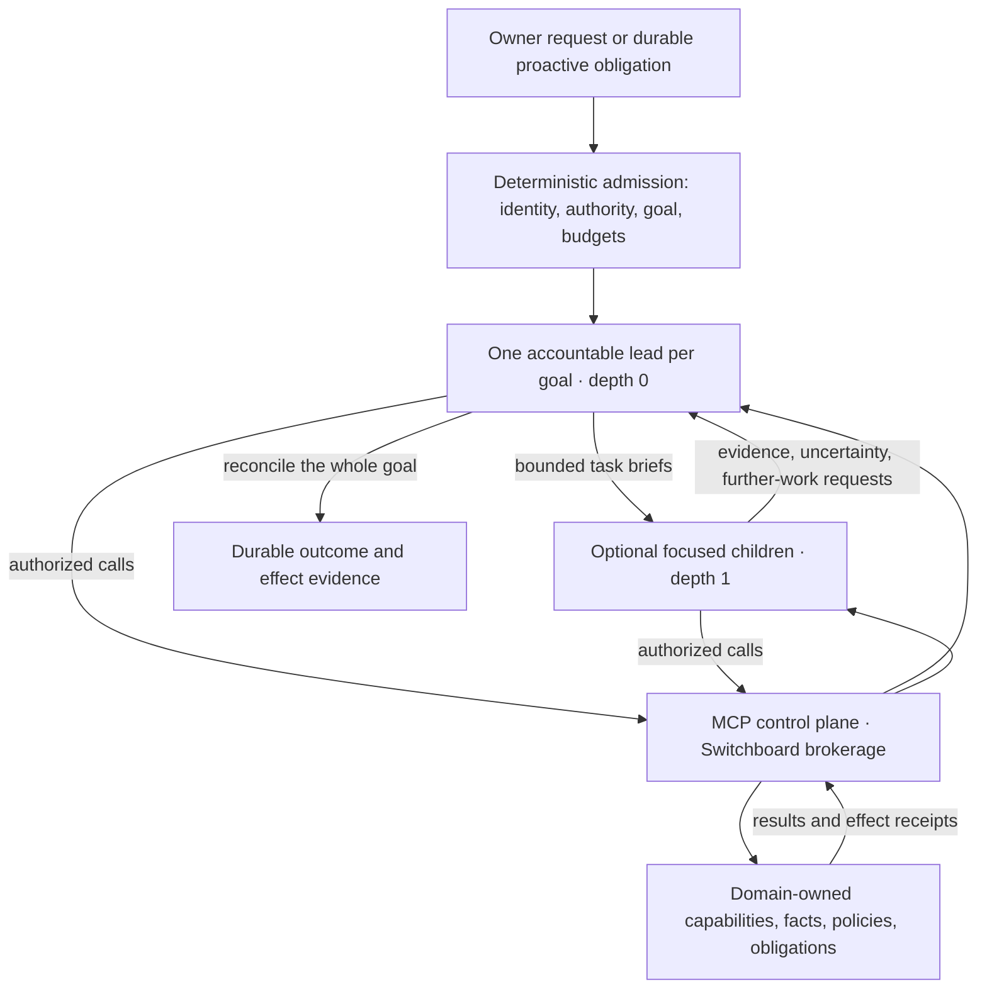

# Target Reasoning and Responsibility Map

**Status:** Owner-adopted direction, 2026-10-14; not deployed topology.

This map locates the responsibilities in the
[adopted architecture](../heart-and-soul/architecture.md). The existing
[component inventory](components.md) and [data flows](data-flow.md) describe
the running model. Host selection, wire contracts, and physical placement
belong to the successor design identified in the
[adoption record](../legends-and-lore/decisions/2026-10-14-doctrine-focused-delegation.md).

## Logical Topology

The arrows show logical responsibility, not a new API or permission. Children
cannot create descendants, route another reasoning task, or admit a fresh root
to escape their scope. The lead may finish with no children. Independent goals
can have concurrent leads; recovery preserves one fenced active lead per goal.
Deterministic runtime enforcement bounds sibling rounds as well as depth.

## Placement and Lifetime

| Responsibility | Lifetime | Current home and successor obligation |
|---|---|---|
| Domain purpose, policy, and care | Across goals and sessions | `roster/*/MANIFESTO.md`, domain modules, private schemas, schedules and commitments retain custody. A child is not a new butler. |
| Lead reasoning and focused investigation | Ephemeral invocation | Runtime sessions remain the intelligence boundary. The successor must select the lead host and governing identity explicitly; General and Switchboard are not implicitly expanded. |
| Goal admission and enforcement | Durable control-plane state | Current daemon/spawner and Switchboard ingress are integration boundaries. The successor must place lineage, scoped grants, budgets, stop fences and recovery in deterministic infrastructure. |
| Capability discovery and execution | Per-invocation scope over durable services | RFC 0027 supplies current per-butler presentation. Cross-domain discovery and invocation need their own authorization contract through the MCP control plane. |
| Memory, evidence, and effects | Beyond a model context window | Domain services retain facts and effect receipts. Goal accounting must reference them without copying private data into an unrestricted shared transcript. |
| Proactive work and delivery | Standing obligation plus bounded execution | Existing scheduler, commitment and Messenger contracts keep their owners. A proactive trigger can admit a goal without a user message or any children. |

## A Cross-Domain Goal

For a visit constrained by budget, recovery needs, and calendar commitments,
the lead retains all constraints. It can retrieve authorized domain facts
directly and commission a focused comparison or independent review when useful.
The lead reconciles incompatible findings before acting, through each
capability owner's checks and approvals. Outcomes distinguish completed,
partial, failed, and uncertain effects. Child completion alone is not success
for the whole request.

## Transition Reading Rule

Current inventories, ports, route envelopes, own-butler MCP binding and session
restrictions remain accurate operational guidance. This map introduces no new
daemon, roster identity, database schema, endpoint, or grant. Implementation
must update those snapshots alongside the approved successor RFC and explicit
OpenSpec baseline deltas; the reserved
[goal-orchestration scenarios](../../openspec/changes/generalist-lead-focused-delegation/specs/goal-orchestration/spec.md)
are the target acceptance boundary, not proof of delivery.
