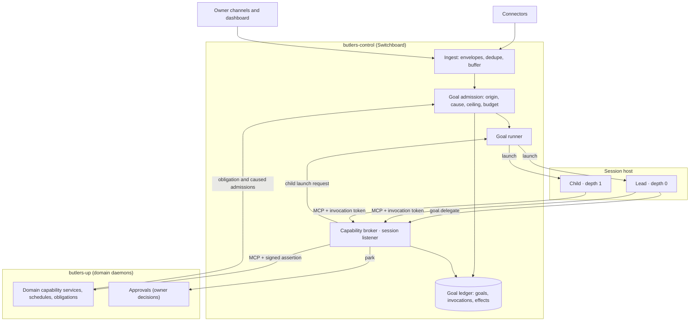

# RFC 0038: Goal Runtime and Capability Authorization

**Status:** Accepted (2026-10-14). Successor contract for the adopted
[generalist-lead doctrine](../decisions/2026-10-14-doctrine-focused-delegation.md).
The owner signed off the full design on 2026-10-14 with four amendments,
recorded as owner decisions 8 to 11: `transact` is disabled, communication with
anyone other than the owner always needs owner approval, the RFC corpus is
rewritten after the switch, and the dashboard is redesigned around one mind
with specialized regions. The owner confirmed the author-added detail in the
2026-10-14/15 walkthrough recorded in `bu-4m4e42`: `recipient_params` and the
recipient rules in D4, the
reclassification of calendar-invitation answers from `transact` to
`communicate`, the Messenger delivery carve-out in D7, the D19 direction
bullets, the proposed RFC organization, and gaps closed while writing the
baseline deltas (service-plane relays, memory consolidation and episodes,
session notes, credential flows and staging, reply delivery accounting,
runtime-failure relaunch, deterministic ingestion, device-feed origin,
model-catalog probes as model functions, the template-pinned definition, the
approvals `cancelled` status, and, from the second review, fail-closed exposure
for admission input without lineage, `administer` scheduling tools, named
relay endpoints, inert-link delivery flags and per-group consolidation goals).
All five answers are recorded in [Author-detail confirmation](#author-detail-confirmation).
D19's detailed experience contract remains in the dashboard change.
**Date:** 2026-10-14
**Tracking:** `bu-7p9ll5`
**Supersedes at cutover:** the contracts listed in
[Disposition of existing RFCs](#disposition-of-existing-rfcs).

## Summary

Every reasoning session in Butlers becomes an invocation of a **goal**. One
deterministic control plane admits goals, derives their authority, launches a
lead and optional depth-1 children, and brokers every capability call those
sessions make. Domain butlers stop spawning reasoning sessions and become
deterministic capability services that own their data, schedules, obligations,
policies and effect receipts.

Today's "a session can only reach its own butler" is a configuration
convention, not an enforced boundary (see [Context](#context-todays-boundary)).
This RFC replaces it with four mechanical checks, none of which depends on
model behavior:

1. **Sandboxed sessions.** A runtime process can reach the broker's session
   listener and its model provider and nothing else: no database, no domain
   port, no credential, no shell, file or web tool.
2. **Grants derived from origin.** Admission computes an authority ceiling from
   who or what started the goal. A model can narrow its authority; it can never
   enlarge it.
3. **Exposure-sensitive effects.** Once an invocation has read third-party
   content, directly or through stored records, consequential effects need
   per-event owner approval. Two owner rules hold for every goal whether or not
   it is exposed: communication with anyone other than the owner needs owner
   approval, and no goal can spend, book or pay, because `transact` is
   disabled.
4. **Verified calls at the domain.** The broker signs every forwarded call; a
   domain service executes a model-reachable tool only with a valid assertion
   bound to that domain, that exact tool, that argument digest and a single use.

The change is a **hard cutover**. The new runtime is built and verified without
serving traffic, then one release switches all ingress and every scheduled
prompt to goals and deletes the classify-and-route path. There is no period in
which both systems serve the owner.

## Context: today's boundary

A code survey of `main` at `b747a55a5` (2026-10-13) found that the isolation
`security.md` described is mostly configuration and prompt instruction:

- Every butler daemon runs in one process and container (`butlers up`). MCP
  servers bind inside it without caller authentication; RFC 0027 rejected
  fleet-wide caller authentication as out of its scope.
- Runtime children run with their own permission systems switched off
  (`--permission-mode bypassPermissions`, `--dangerously-bypass-approvals-and-sandbox`,
  `--sandbox=false`). They have a shell and the container's network, so a
  session can reach every butler's MCP port. The only restraint is a prompt
  rule in `roster/shared/AGENTS.md`.
- Sessions can start sessions: the `trigger` tool, prompt-mode
  `schedule_create`, `delegate_ask`, domain-event wakes, and Switchboard's
  LLM-presentable generic `route` tool, which forwards any tool call to any
  butler with a caller-asserted `source_butler`.
- Messenger sessions receive the Telegram bot token and email password in
  their environment, next to a shell, which would let a session send without
  the approval gate.
- `public.permissions` defaults to allow and fails open; pre-spawn budget gates
  fail open; tool-call and token guardrails run after the session ends.
- The approval gate writes `pending_actions.session_id` as NULL, so parked
  actions carry no session lineage.

Real enforcement does exist and is kept: per-butler `SET ROLE` database roles,
the approval gate and its exact-digest replay binding, owner-only approval
decisions, memory authority stamping, RFC 0028 actuation receipts, and
failover's no-replay rule. The goal runtime therefore does not trade away a
strong boundary for flexibility. It builds the boundary that the current
design only described.

The freeze still admits security fixes. The live gaps are tracked in
`bu-qtxebm` (generic `route` proxy), `bu-13itjw` (Messenger credentials in a
shell-capable session) and `bu-m2zcah` (query-string session id inheriting
owner authority).

## Goals and non-goals

Goals:

- Satisfy every requirement in the `goal-orchestration` and
  `capability-authorization` capabilities of the
  `generalist-lead-focused-delegation` OpenSpec change.
- Make the security boundary independent of model choice, so cheaper or faster
  models can be assigned by quality and cost alone.
- Keep domain custody, proactive obligations, approvals, private custody,
  physical-actuation receipts and credential tiers intact.

Non-goals:

- Recursive agent trees. Depth is one: lead 0, children 1.
- Code mode or programmatic tool calling. Deferred as in RFC 0027; any future
  nested executor must enforce these grants beneath its calls.
- Multi-user authority. One owner; every grant is a narrowing of the owner's.
- Replacing the approvals, insight, notify, scheduler, identity or memory
  subsystems. They remain the owners of their decisions.
- Engineering executors and model functions (D18), which are not reasoning
  sessions over owner capabilities and keep their own contracts.

## Vocabulary

| Term | Meaning |
|---|---|
| Goal | A durable unit of intent with one origin, one authority ceiling, one budget and one outcome. |
| Origin | The verified source of a goal: owner, obligation, third party or staffer. |
| Cause | The goal and effect whose consequence admitted a later goal, if any. |
| Invocation | One runtime session acting for a goal, either the lead (depth 0) or a child (depth 1). |
| Capability | A model-reachable MCP tool registered by a domain, with authorization metadata in the catalog. |
| Grant | The capabilities, resources and approval policy one invocation may use. Stored server-side; never in model context. |
| Exposure | The fact that untrusted third-party content has entered an invocation's context. Monotonic. |
| Taint | Exposure recorded on stored data written by an exposed invocation. |
| Effect | A capability call whose class is anything other than `read`. Recorded in the effect ledger. |
| Assertion | A short-lived, single-use broker signature over one forwarded call, verified by the owning domain. |

## Topology



The control plane is deterministic infrastructure in its own process.
Reasoning happens only inside the sandboxed lead and child processes on the
session host.

## Decisions

### D1. Switchboard becomes the control plane, in its own process

Switchboard already owns ingress, holds MCP clients to every butler, and is the
Rule 3 broker. After cutover its contract is: ingress, goal admission, goal
ledger, goal runner, capability broker, approval and insight brokerage. It
loses message classification and route dispatch, which have no successor.
Ingress that needs reasoning becomes a goal through admission. Deterministic
ingestion that needs none (connector gating rules such as skip, metadata-only
and low-priority; channel-bound envelopes such as wellness readings; bulk
backfill and sync) stays on the service plane and creates no goal.

Switchboard moves out of the shared `butlers-up` process into its own process
and container, `butlers-control`. Three reasons: the broker's signing key
(D7) must be readable only by the process that signs, which a shared address
space with every domain handler cannot satisfy; the control plane is the
critical path for every goal; and the session host must be able to reach the
broker without reaching any domain. `butlers-control` exposes two listeners:
the existing service listener, and a **session listener** that serves only the
broker's goal endpoint and is the only port reachable from the session host.

The lead is a role, not a butler. Its governing document is a versioned lead
policy at `roster/switchboard/goal-policy/LEAD.md`, loaded into every lead
alongside the owner profile. The lead policy also owns the reply style for
interactive owner goals, which today each butler's `CLAUDE.md` defines. The
session listener's port follows the repository's port assignment convention.
Switchboard's manifesto is amended in the cutover release to describe the
control-plane contract. General keeps its narrow capture-and-collections
manifesto and gains no authority.

A new, separate control-plane daemon was rejected: it would duplicate
Switchboard's ingress, buffer, fleet MCP clients and registry. Moving
Switchboard itself out of `butlers-up` gets the same isolation without a
second ingress.

### D2. Domain butlers become capability services

A domain daemon keeps its MCP server, modules, schema, schedules, event
subscriptions, obligations, manifesto and domain guidance. It no longer spawns
reasoning sessions. Where today a scheduled job carries a prompt, the daemon
submits an **obligation admission** to the control plane instead (D5). Where a
domain-event subscription today wakes a session, the subscriber submits a
**caused admission** carrying the event's goal lineage (D5). Deterministic
jobs and reactions (sweeps, syncs, projections) are unchanged.

The domain's `CLAUDE.md` and skills become **domain guidance**: versioned,
searchable through `guidance.search` and `guidance.load`, and attached by
reference to child briefs. The manifesto stays binding on every capability the
domain registers. Session-written notes (today's `AGENTS.md` "Notes to self")
become a `record` capability over the domain's guidance notes. Notes steer
later sessions, so the capability is flagged `owner_authority` and exposed
invocations cannot write it. Skill companion scripts are not executable from a
sandbox; each one becomes a domain capability or is retired.

Memory consolidation, which today runs as a spawned session with MCP tools,
becomes an obligation goal of the memory-owning domain with a declared
capability set, one per tenant, source domain and partition (untainted
owner-class episodes apart from all others). Episode capture moves from
per-session transcripts to the goal ledger: each domain whose capabilities a
goal called records an episode from the completed goal's outcome, carrying the
goal's stamps and taint.

### D3. Session sandbox

Invocations run on a dedicated **session host**: a container (Compose) or pod
(Kubernetes) separate from `butlers-up` and `butlers-control`. Its egress is
limited to the control plane's session listener and the configured model
providers. Kubernetes enforces this with a NetworkPolicy; Compose has no
egress policy of its own, so the session host's only route out is an egress
proxy that allowlists provider hostnames by SNI. The goal runner dispatches
launches to the session host over an authenticated control channel. The session
host never receives domain, database or connector credentials; the provider
credentials goal invocations use and the runtime OAuth volumes move from
`butlers-up` to the session host. The goal runner, which can read the
credential store, resolves each launch's model credential and stages it over
the control channel; the session host never reads the credential store or the
database. Model functions (D18) keep the narrow provider credentials their
deterministic callers use today. The existing runtime-credential flows,
Codex auth synchronization and the dashboard's CLI login, are retargeted to
the session host's credential volume through the control plane's service
listener; the session host itself exposes no inbound port to the dashboard.

Each invocation runs in its own kernel-enforced filesystem and process domain
(Bubblewrap, as `src/butlers/cli_auth/sandbox.py` already uses; the session
host must permit unprivileged user namespaces) holding only `PATH`, its staged
model credential and its MCP config. One invocation cannot read another's
token or files, and the whole descendant domain is terminated before results
are accepted.

Runtime built-in tools are disabled: no shell, filesystem, web fetch or local
MCP servers, and no provider-hosted tools (server-side web search or fetch,
remote MCP connectors, code execution), which run outside any network policy.
Adapters drop today's permission-bypass flags in favor of the runtime's
deny-all tool settings plus a strict MCP config naming only the broker. The
adapter must prove all of this per runtime and model tuple, as RFC 0027
adapters prove host filtering; an adapter that cannot is ineligible.

The sandbox is the primary boundary. Domain-side verification (D7) is defense
in depth: it stops any call that did not pass through the broker, such as one
from a process that escaped the sandbox.

### D4. Capability catalog and effect classes

The RFC 0027 tool descriptor gains authorization metadata. Every
LLM-presentable tool must declare it; an undeclared tool is not grantable, so
the catalog fails closed.

```text
owner_domain          butler that owns the handler and its data
effect_class          read | record | communicate | transact | actuate | administer
output_trust          trusted | untrusted | stamped
                      (stamped: trust is read from each returned item's stamp, D6)
output_sensitivity    ordinary | sensitive
resource_params       argument names that select a resource (entity, account, device)
safety_args           argument names an approval must pin (RFC 0021)
approval_policy       existing approvals gating config for the tool
idempotency           none | key_required
owner_authority       true when the write steers future sessions (rules, profile)
recipient_params      argument names that identify parties a call delivers content
                      to or invites (recipients, attendees, invitees, shares), any
                      class; or "undeterminable" when arguments cannot name them
```

Effect classes and their default under exposure (owner decision 3):

| Class | Examples | Under exposure |
|---|---|---|
| `read` | search memory, list transactions, read calendar | allowed |
| `record` | log a measurement, store an attributed fact, propose an insight | allowed and tainted (D6), unless `owner_authority`, which is refused |
| `communicate` | send email, reply on Telegram, notify a third party, answer a calendar invitation | per-event approval for every call, except `notify` to the owner with link previews disabled and URLs rendered inert, and standing rules whose recipient is the owner or that are template-pinned (D13) |
| `transact` | spend, pay, book | disabled for every goal (owner decision 8) |
| `actuate` | Home Assistant services | RFC 0028 risk map; consequential and protected always per-event approval |
| `administer` | change schedules, rules, permissions, module state, create obligations | per-event approval; never delegable to a child |

Two owner rules apply to every origin, grant and exposure state, lead or child:

- **Communication with anyone other than the owner needs owner approval**
  (owner decision 9). Every capability whose call can deliver content to, or
  invite, another party declares those arguments in `recipient_params`,
  whatever its effect class: message recipients, calendar attendees and
  invitees, update notifications, invitation answers and shares. The broker
  resolves each named party with the owner-resolution rule of `core-notify`: a
  party is the owner only when its identifier resolves uniquely to the live,
  unmerged, undeleted owner entity. A call that names no party is owner
  communication only when the capability declares the owner as its default
  recipient, as `notify` does. A call with any other party, including an
  unknown, ambiguous or unresolvable one, or with a party the arguments cannot
  name (a capability declared `undeterminable`, such as a reply to an existing
  thread), is non-owner communication. The broker dispatches non-owner
  communication only under per-event owner approval or a matching standing
  rule the owner created (RFC 0021, D13). Today `core-notify` and the gated
  channel tools enforce this rule; calendar writes that invite or update
  non-owner attendees are not gated today and become gated. The rule also
  binds senders outside goals: Messenger's delivery gate (D7) is the
  enforcement point for deterministic service-plane senders that call
  Switchboard `deliver()`, and defense in depth for goal sends.
- **`transact` is disabled** (owner decision 8). The catalog still classifies
  spending, paying and booking tools as `transact`, but the broker grants them
  to no goal, not even park-only, and lists them to no invocation. Enabling
  `transact` requires a new owner decision recorded as an amendment to this
  RFC or its successor. A survey of `main` at `b747a55a5` found no
  model-reachable tool that spends, pays or books. Answering a calendar
  invitation (`calendar_respond`), which the reviewed design listed as
  `transact`, is `communicate` and stays approval-gated under the rule above.
  This keeps today's behavior rather than enabling anything new:
  `calendar_respond` exists on `main` as an approval-gated tool on Messenger
  and Relationship, and it spends, pays and books nothing; classing it
  `transact` would have removed it.
  A generic gateway takes the most consequential class among the targets it
  can reach: Home Assistant's service gateway is `actuate`, under the RFC 0028
  risk map in which unknown services are protected.

Two kinds of tool are never LLM-presentable and therefore never grantable:

- **Owner-decision tools**: approve, reject and edit actions, create or promote
  standing rules, dispatch approved actions. Owner decisions arrive only
  through the dashboard and signed Telegram callbacks (RFC 0021).
- **Private-custody tools**: anything that returns RFC 0037 private-custody
  content. RFC 0037 forbids model-facing custody tools; the goal runtime keeps
  that.

Output trust has one rule: a capability whose output can include anything a
model-reachable `record` capability, a connector or a third party can write is
`stamped` or `untrusted`. `trusted` is reserved for outputs no such writer can
influence, such as sensor readings, account balances from a bank feed, or the
catalog itself. The catalog check enforces this per store: a read over a table
that any `record` capability writes cannot be declared `trusted`.

The catalog is assembled from each domain's final, approval-wrapped registry at
startup and published to the broker with schema and description digests. The
broker rejects a call whose catalog digest differs from the domain's current
registration until the catalog is republished. The broker endpoint's
`tools/list` is a grant-scoped projection; each domain's canonical MCP listing
stays complete, as RFC 0027 Invariant 8 requires.

### D5. Goal admission, origins and causes

Admission is deterministic. It never classifies content with a model. It reads
origin and cause from server-held context, never from message text or model
output.

| Origin | Established by | Ceiling |
|---|---|---|
| `owner` | RFC 0017 owner-channel authorization, or the dashboard's existing owner authentication | all grantable capabilities, subject to each tool's approval policy and the two owner rules in D4 |
| `obligation` | a schedule, subscription or commitment declared in git, or created at runtime by an `administer` effect | the declared capability set; default owner domain `read` and `record` plus owner `notify`. A runtime-created obligation's set is at most its creator's grant at creation. |
| `third_party` | inbound content whose sender is not the verified owner | `read`, non-steering `record`, owner `notify`, and **park-only** `communicate` (owner decision 7); never `transact`, `actuate` or `administer` |
| `staffer` | a staffer's infrastructure contract (QA triage, Concierge answer) | the capability set declared in that contract |

Rules:

- **Email is never owner origin by itself.** A message is owner-origin only when
  RFC 0017 authorizes its channel and sender; otherwise it is third-party.
- **Device and telemetry feeds are not messages.** Home Assistant state,
  wellness readings and other feeds that carry no message from a person wake
  reasoning only through a declared subscription, admitted with origin
  `obligation` under that subscription's capability set. Feed fields a person
  other than the owner can author (device names, notes, message bodies) are
  untrusted output under D6.
- **Exposure at admission.** Third-party goals start exposed. Owner messages
  with connector-marked forwarded or quoted spans start exposed. Staffer goals
  whose inputs include third-party content or error payloads start exposed; QA
  goals always do. A runtime-created obligation that was created under exposure
  starts every occurrence exposed.
- **Park-only grants.** A park-only capability can only produce a parked effect
  awaiting per-event owner approval; the broker never executes it directly.
- **Caused admissions.** When a domain admits a goal because of an effect or a
  domain event that an effect produced, the admission carries `caused_by_goal`
  and `caused_by_effect` from the effect's assertion lineage. The caused goal
  inherits the causing goal's exposure, its ceiling is the declared
  subscription's set intersected with the causing goal's origin ceiling, and
  its causal chain length is at most the configured limit (default 2). A
  reaction to a third-party goal's effect therefore holds no more than a
  third-party ceiling. Admission refuses and records a goal that
  would exceed it. A child cannot reach admission directly; this rule bounds
  the indirect path through declared domain reactions.

Admission writes the goal row, origin, cause, exposure, ceiling digest and
budget, then hands it to the runner. Duplicate submissions of the same ingest
envelope or obligation occurrence return the existing goal.

Known limit: text an owner pastes without quoting markers is owner input. The
exposure rule still applies to everything the goal then reads.

### D6. Exposure and taint

Exposure is tracked per invocation and per goal; both only ever increase.

An invocation becomes exposed when:

- its goal is exposed when it starts (children, replacement leads and escalated
  leads all start with the goal's exposure);
- it receives output from a capability whose `output_trust` is `untrusted`;
- it receives `stamped` output containing any item whose stamp is not owner
  authority or that carries taint;
- it receives a result from an exposed child.

When any invocation of a goal becomes exposed, the goal is marked exposed.

Domain-published admission input follows the same stamps and fails closed. A
domain event, feed record or other input a domain publishes that carries no
goal lineage starts its goal exposed unless the publishing domain stamps it as
derived only from untainted owner-authority records; a missing or unreadable
stamp counts as exposed. Ingest envelopes take their starting exposure from
the origin and span rules of D5, and an obligation's declared prompt is
trusted unless the obligation was created under exposure.

**Taint** makes exposure survive storage. The assertion carries the invoking
session's exposure (D7); a domain storing data under an exposed assertion
stamps the record as tainted, alongside today's memory content-authority stamp.
Reads over every store a `record` capability writes are `stamped` (D4), which
includes memory, facts, capture, contact notes, conversation history, goal
outcomes, insight candidates and decision memory; `context.search` returns each
item with its stamp. Owner-authored, untainted records stay trusted, so ordinary
memory reads do not expose a goal; text that an exposed goal stored from an
email exposes whichever later goal reads it back.

While exposed, the broker applies the "under exposure" column of D4 regardless
of origin. This implements the rule that a session holding untrusted input,
private data and external effect authority together needs a human in the loop.
Approvals are no longer only a property of individual tools; they are a
property of what the session has read.

Unexposed owner goals keep today's approval behavior, including standing
rules; communication with anyone other than the owner still needs owner
approval (D4).
Approvals of effects requested by exposed invocations do not count toward the
RFC 0021 promotion ladder.

### D7. Wire contract, call verification and keys

**Session tokens.** Sessions reach the broker over MCP streamable HTTP on the
session listener's goal endpoint. The runner writes the invocation's MCP config
with a bearer **invocation token**: 256 random bits, stored only as a hash,
bound to one invocation, and revoked when the invocation ends or the goal stops.
A lead's token is also bound to the goal's lead epoch, so recovery or
escalation revokes the previous lead. A child's token is not epoch-bound and
survives a lead replacement (D14).

**Listing.** `tools/list` for a token returns the grant's capabilities under
namespaced names (`<domain>__<tool>`) plus the goal tools in D8. Native deferred
loading follows RFC 0027: the goal tools and a small eager set load initially;
domain capabilities are discoverable through the runtime's tool search.
Discovery scope equals the grant; invocation is checked per call.

**Per-call checks.** For every `tools/call`, the broker runs in one database
transaction, conditional on the goal row being `running` and, for a lead, on the
lead epoch matching:

1. resolve the token to an active invocation;
2. check the capability is in the grant, resource arguments are within the
   grant's resource scope, and the budget allows another call;
3. apply the two owner rules (D4), exposure, park-only and the tool's approval
   policy;
4. for effects, insert the `effects` row and decrement the budget.

Stop takes the goal row `FOR UPDATE` (D14), so a call either commits before the
Stop or is refused after it. The broker then forwards the call to the owning
domain with an `X-Butlers-Assertion` header and records the result.

**Assertion.** An Ed25519 signature, with key id `kid`, over:

```text
aud            owner_domain of the capability
goal_id, invocation_id, depth, origin, exposed
capability     unnamespaced tool name
args_digest    SHA-256 of the RFC 8785 canonical JSON of the raw wire arguments
call_id        unique per forwarded call
effect_id      for effects; null for reads
approval_ref   for approved effects; null otherwise
exp            issue time + 60 s
```

The domain's core tool wrapper verifies, before argument coercion and before
any model-reachable handler runs: signature under a known `kid`, `aud` equal to
its own name, `exp`, capability equal to the called tool, `args_digest` equal to
the canonical digest of the raw arguments received, and `call_id` not seen
within the expiry window. It then exposes the verified lineage, including
`exposed`, to the handler as ambient context, replacing today's
spawner-derived session context. RFC 0028's executor binding, RFC 0021's
approval replay and memory authority stamping read lineage from this context
only.

**Service-plane callers.** Service-plane tools (ingest, ticks, callbacks,
dashboard management) are not LLM-presentable, are not on the session listener,
and keep their current callers. The dashboard also calls some model-reachable
tools directly today. After cutover those calls go through the control plane's
service listener, authenticated by the existing signed dashboard control client
(`RUNTIME_PROBE_CONTROL_SIGNING_KEY`), and are forwarded with an assertion whose
origin is `owner`, principal `dashboard`, and `goal_id` null. These calls
follow the two owner rules of D4 like any goal call: a dashboard call that
messages someone other than the owner is parked for owner approval unless a
standing rule matches. Any other model-reachable call without a valid
assertion is refused. Inventorying the existing direct call sites is a
dark-build task.

**Service-plane relays.** Service-to-service traffic that today rides the
generic `route` tool moves to named endpoints on the control plane's service
listener: domain-event fan-out (RFC 0022), the QA error relay, and module
runtime wiring. Each endpoint has a fixed payload schema and one target,
authenticates its calling daemon against a per-endpoint allowlist, is not
LLM-presentable, and is not on the session listener.
Domain events that an effect produced carry the effect's goal lineage, which
caused admission reads (D5).

**Removed tools.** The session-starting and proxy tools found in the survey do
not survive: the `trigger` tool, `route.execute`, the generic `route` tool and
the `delegate_*` tools are deleted at cutover; prompt-mode `schedule_create`
becomes obligation creation, an `administer` capability, as do `schedule_trigger`
and prompt-mode update, delete and toggle, and a trigger a goal makes is a
caused admission (D5); `cancel_session`
becomes owner-only Stop. `public.permissions` no longer governs sessions.
Messenger's `notify.v1` delivery termination, which today shares the
`route.execute` tool name, survives as a deterministic service-plane endpoint:
not LLM-presentable, not on the session listener, and meant to be called only
by Switchboard `deliver()`. Today that restriction is placement only; the dark
build gives the endpoint the same caller authentication as the other
service-plane relays. Its approval gate is the enforcement point of the
non-owner rule (D4) for deterministic senders and defense in depth for goal
sends. It keeps its current name until the implementation separates it from
the deleted session-dispatch role; the baseline deltas call it Messenger's
service-plane delivery endpoint.

**Signing key.** `GOAL_BROKER_SIGNING_KEY` is the second named use of the
security.md process-bound deployment control key exception (owner decision 6):

- provisioned as a file-backed deployment secret mounted only into
  `butlers-control`, never through an environment value, `CredentialStore`,
  `butler_secrets`, `entity_info` or git;
- domains receive only verification keys, as non-secret config listing the
  current and next `kid`;
- rotation publishes the next public key, restarts domains, switches the signer,
  and removes the old key after twice the assertion lifetime;
- a missing or mismatched private key makes the broker refuse every call; a
  domain without verification keys refuses every model-reachable call; neither
  falls back to an unsigned request or shared secret;
- on a control-plane restart, in-flight calls settle per D12 and revoked tokens
  stay revoked.

The broker also fails closed when the ledger or catalog is unavailable.

### D8. Goal tools

The broker serves a fixed set of goal tools that are not domain capabilities:

| Tool | Lead | Child | Purpose |
|---|---|---|---|
| `goal.delegate` | yes | no | Start a child with a brief, requested capabilities, model tier and budget share. |
| `goal.await` | yes | no | Wait for or poll child results and their effect statuses. |
| `goal.stop_child` | yes | no | Stop one child. |
| `goal.return` | no | yes | Return the child's structured result and end it. |
| `goal.complete` | yes | no | Record the goal outcome. |
| `goal.escalate` | yes | no | Hand the goal to a lead on the next model tier (D16). |
| `guidance.search`, `guidance.load` | yes | yes | Find and load domain guidance and the lead policy. |
| `context.search` | yes | yes | Deterministic fan-out over permitted domains' memory and fact search, merged with provenance and stamps. |

Only the runner starts sessions: leads on admission, recovery and escalation;
children on a lead's `goal.delegate`. A child's `tools/list` never contains
`goal.delegate` or any admission, schedule-creation, routing or obligation
tool, because those are `administer` or not presentable. The runner derives
depth from the parent invocation row; a child's request cannot assert a
parent, root or depth.

### D9. Delegation

`goal.delegate` takes:

```text
brief             objective, success conditions, supplied context references,
                  governing guidance references, expected result schema
capabilities      requested capability set and resource scope
model_tier        one of the catalog tiers allowed for children
budget_share      calls, cost and wall time drawn from the goal budget
```

The broker computes the child grant as the intersection of the request and the
lead's grant, minus `administer`, and refuses an empty or non-subset request.
Since `transact` is never in a lead's grant, no child can hold it either.
The insert that admits the child is conditional on the goal running and the
lead epoch matching, like any call. The child inherits the goal's origin and
exposure. Children are not read-only by default; they may hold `record`,
`communicate` or `actuate` capabilities the lead holds, under the same
approval, park-only and owner rules. A lead cannot approve its child's effect:
approvals resolve only through owner channels.

A child that needs more work calls `goal.return` with a `requests_for_lead`
entry. Only the lead can delegate a sibling. There is no resume: a lead that
wants follow-up delegates a new child with the earlier result as context.

### D10. Budgets

Each goal has a budget row: maximum invocations including lead replacements
and escalations, maximum concurrent children, maximum tool calls, maximum model
tokens and spend, and a deadline. Each invocation has maximum turns and tokens.
Defaults per origin live in `runtime_config` as operational tuning; they bound
work, not authority (owner decision 5).

Admission reserves the budget. `goal.delegate` and every call decrement it in
the D7 transaction, so concurrent children cannot overspend. The runner meters
model usage from the runtime's usage stream and terminates an invocation that
exceeds its turns, tokens or spend between tool calls. Unlike today's
pre-spawn gates, every budget check fails closed. Exhaustion refuses new work
and ends the goal `budget_exhausted` with whatever results and effects exist.

### D11. State machines

Goal:

```text
admitted -> running -> settling -> completed | partial | failed
running  -> stopped | budget_exhausted
running  -> awaiting_approval -> running          (lead waits on a parked effect)
running  -> recovering -> running                 (lead replaced, epoch + 1)
settling -> stopped                               (owner Stop cancels parked effects)
```

`settling` means the lead has finished but parked effects are still awaiting
owner decisions; the goal reaches its final state when they resolve.

A goal admitted from an owner message completes only when its reply reached
the owner. If the reply was not delivered, the goal ends `partial` with the
delivery failure recorded, which keeps today's interactive reply delivery
accounting.

Invocation:

```text
launching -> running -> returned | failed | timed_out | stopped | escalated
```

Effect:

```text
requested -> parked -> approved -> dispatched -> committed | failed | unknown
requested -> dispatched                           (no approval needed)
requested -> refused
parked    -> rejected | expired | cancelled
```

`unknown` means the call may have reached the domain without a settled receipt.
RFC 0028 `unverified` maps to `unknown`.

### D12. Effects, idempotency and replay

The broker never re-dispatches an effect on its own. Transport retry is allowed
only when the domain has provably not received the call. Tools declared
`idempotency = key_required` receive `effect_id` as their idempotency key and
must return the original receipt for a repeated key. Physical actuation keeps
RFC 0028 semantics: every attempt is new and an unverified attempt needs owner
reconciliation.

Within a goal, a new call with the same capability and argument digest as an
effect in `committed` or `unknown` is refused with that effect's reference. A
recovered lead receives the effect ledger in its context and cannot replay an
unknown effect without a fresh owner approval.

Child success text is not evidence. The lead reads child effect status from the
ledger through `goal.await`, and `goal.complete` records which effects the
outcome relies on.

### D13. Approvals

When a call needs approval or its grant is park-only, the broker parks it
through the owning domain's approvals module with the exact capability,
arguments and lineage (goal, invocation, depth, exposure) and returns `parked`
with the approval reference. The session may continue or end. A park-only
effect is never approved by a standing rule and always waits for the owner's
per-event approval tap. Standing rules stay in the owning domain's approvals
schema; for other parked effects, that module matches them at park time within
the exposure limits below. A permitted match approves the effect at once, and
the effect records the rule as its approval. A domain gate treats a verified
assertion whose
`approval_ref` covers the exact call digest as approval, so an approved call is
never parked twice.

The owner may approve, reject or edit (RFC 0021). On approval the broker
executes the stored call, or the owner's edited version of it, never a call
the model re-issues; the executed digest is the digest the owner approved.
Before dispatch the broker re-checks that the goal is not stopped. A stopped
goal cancels its parked effects; a goal whose lead has finished waits in
`settling` and still executes approvals that arrive.

Standing rules and the promotion ladder of RFC 0021 apply unchanged to
unexposed invocations; exposed invocations can use only the standing rules D4
exempts. A standing rule is **template-pinned** when its argument constraints
fix every content-bearing argument to an exact value or to an owner-authored
template whose slots accept only typed values (dates, amounts, identifiers),
never free text. A Stop-cancelled parked effect takes a new approvals status,
`cancelled`. At the switch, `pending_actions` created before cutover remain
executable by the approvals executor and are recorded with goal origin
`legacy`, a field separate from the approvals module's existing producer
`origin`.

### D14. Stop and recovery

Owner Stop takes the goal row `FOR UPDATE`, marks it `stopped` and revokes every
invocation token in one transaction. Every later call or delegation of that
goal is refused. The runner terminates every invocation process domain. Parked
effects are cancelled. Dispatched effects settle to their domain receipt or
`unknown`; Stop never reports a committed effect as undone.

Each running invocation holds a lease renewed by the runner. If the lead's
lease lapses, recovery increments the goal's lead epoch, which revokes the old
lead's token, and launches a replacement with the goal record, the goal's
exposure, the effect ledger and returned child results. Recovery draws from
the same budget. Children of a replaced lead keep running and report to the
new lead through `goal.await`.

Runtime failures (provider errors, quota exhaustion, launch failures,
timeouts) are classified with the existing runtime failure taxonomy. For a
retryable class the runner may relaunch the failed invocation once on the
same tier's fallback model, and only when the broker recorded no capability
call made with the failed invocation's token, because a relaunch never replays
work (D12); a relaunched lead advances the epoch exactly as recovery does, and
every relaunch counts against the goal's invocation budget.
A non-retryable failure ends the invocation `failed` and leaves the decision
to the lead or, for a lead, ends the goal `failed` with its ledger intact.

### D15. Context and memory

A lead starts with the goal input (third-party spans fenced as data), the owner
profile, the lead policy, an index of domains and their guidance, and on
recovery the ledger summary. It retrieves everything else through
`context.search`, domain read capabilities and `guidance.load`. Results carry
owner domain, sensitivity and stamps. Private-custody content is not reachable
(D4). Memory writes go through the owning domain's capabilities and keep
today's steering-memory rule: owner authority is stamped from the goal origin,
never from text, and exposed writes are tainted.

### D16. Model selection and escalation

Model choice is per invocation, resolved from `public.model_catalog` by role
(`lead`, `child`, `monitor`) and, for children, the tier the brief requests.
Because D3 to D7 do not depend on model behavior, a fast or small model is a
quality and cost decision, never a security one. Replay evaluation, not this
RFC, sets the assignments (owner decision 4). Starting defaults:

| Role | Default class | Why |
|---|---|---|
| Lead, owner and cross-domain goals | Mid or frontier reasoning model | Planning, tool search over a large catalog and reconciliation are where small models stop early or skip checks. |
| Lead, obligation monitors | Small model at low effort, structured output | Code gathers the state; the model only judges whether work is needed. |
| Child, read-only retrieval, extraction, comparison | Small model, pre-scoped capabilities | Narrow, checkable briefs; the lead verifies. |
| Child, scoped write | Mid model unless evaluation supports smaller | Effects are grant-bound and approval-gated either way. |

A lead that judges a goal beyond its model calls `goal.escalate`. The runner
ends that invocation and launches a lead on the next tier of the role's ladder
under the same goal, ceiling, exposure, effect ledger and budget, advancing the
epoch exactly as recovery does. Escalation never creates a new goal, and the
ladder is finite. This lets a monitor start on the cheapest model without
giving it a path to a new root.

A runtime is eligible for goal invocations only if it supports MCP tool calls
to the broker, proves the D3 sandbox restrictions, and passes the RFC 0027
conformance gate for the catalog size it will see.

### D17. Telemetry and audit

Every span carries `goal_id`, `invocation_id`, `depth` and, for a lead, its
`epoch`, taken from the invocation record. The ledger,
not session logs, is the record of a goal: admission decision, origin, cause,
exposure, ceiling digest, grants, delegation tree, budget consumption, effects
with receipts, approvals and the final outcome. Telemetry stores identifiers and
digests, never arguments or results.

### D18. Model use outside goals

Two kinds of model use are not goal invocations. Each keeps its own contract
and never reaches the broker or a domain capability:

- **Engineering executors.** QA investigation agents and self-healing agents
  (RFC 0015) work on the repository with a shell and a worktree. They keep
  their existing sandboxed contracts, receive no MCP config and see only the
  anonymized payloads RFC 0015 allows; the cutover stops injecting situational
  context into their prompts. The QA staffer's own triage reasoning is
  a staffer goal.
- **Model functions.** Tool-less, single-turn, structured-output calls made by
  deterministic code: connector discretion screening (forward or ignore for
  non-owner chatter; owner messages skip it), connector speech-to-text
  transcription, RFC 0036 vision probes, and model-catalog verification and
  benchmark probes, which send fixed prompts and record only measurements.
  They have no tools; any consequence comes from the deterministic code that
  reads their typed output, and their output entering a goal is third-party
  content.

Model use that today runs outside a session but composes owner-facing text or
judgment, such as briefing elaboration, chronicler narration, insight
synthesis, dashboard quick-add and memory consolidation, becomes an obligation
or owner goal at the switch rather than a model function.

Any other model use is a goal invocation. Adding a kind to this list requires
an RFC amendment. Pending OpenSpec changes that add a model path, such as
`define-dashboard-fast-answer-runtime`, must be re-scoped as goals or as a
named kind here before approval.

### D19. Owner surface: one mind, specialized regions

The dashboard stops presenting butlers as separate agents and presents
Butlers as one assistant whose domains are specialized regions of a single
mind (owner decision 11). The direction:

- **Goals are the unit of activity.** The owner sees goals, not sessions: what
  started each goal, its origin and exposure, the lead and its children, the
  regions it drew on, its effects with receipts, its parked approvals, its
  budget and its outcome, with Stop on any running goal.
- **Regions replace butler units.** The Butlers page and butler detail pages
  become region pages. A region page shows its data, standing obligations and
  schedules, capabilities and their effect classes, domain guidance, and the
  recent goals that used it. It no longer shows a domain's own sessions,
  routing log or trigger controls as if it were a separate agent. Service
  health stays visible on the system and settings surfaces as infrastructure,
  not as a separate agent.
- **Owner channels speak as one assistant.** Telegram and email replies come
  from one assistant with region attribution where it helps, instead of
  per-butler origin prefixes. The same change details it.
- **The overview shows the whole mind at once:** active goals, which regions
  each touches, obligations coming due, and decisions waiting for the owner.
- **Approvals carry lineage:** each parked effect shows the goal, the
  invocation that requested it, whether it was exposed and to what, and the
  exact call that will run.

The detailed experience contract is a separate OpenSpec change for the
`dashboard-*` capabilities, produced through design review and signed off by
the owner before implementation. Its pages are built during the dark build and
switched on by the cutover release. That change also carries the dashboard
contracts this RFC's baseline deltas leave untouched (session explorers,
per-butler tabs, trigger and routing-log views, permissions, the chat surfaces),
and defines successors for the guarantees of the removed dashboard chat lanes:
in-thread failure replies, bug-report filing to QA, the read-only answer lane,
replay-eligible dead letters, and conversation continuity, which D9's
no-resume rule makes a goal-level concern.

### Details settled during the dark build

Writing the baseline deltas surfaced details this RFC leaves to
implementation. Each is settled by the dark-build work item that owns it,
within D1 to D19 and never by weakening the two owner rules of D4:

- the mechanism by which service-plane relays and Messenger's delivery
  endpoint authenticate their calling daemon (that they authenticate it, per
  endpoint allowlist, is settled in D7);
- the format of a staffer contract's capability set (a Concierge answer is a
  staffer goal, D5);
- the admission budget for high-volume feeds, so a burst of third-party mail
  cannot exhaust goal budgets;
- how an owner's reply to an outbound prompt (a quiz, a confirmation) joins
  the goal that sent it rather than starting an unrelated owner goal;
- which approvals statuses and dashboard filters gain `cancelled` and goal
  lineage;
- a taint field on every store D6 lists that lacks one today.

## Disposition of existing RFCs

Applied in the cutover release together with the OpenSpec deltas. "Remains"
means the RFC stays authoritative; its session-attribution fields map to
invocation lineage.

| RFC | Disposition |
|---|---|
| 0001 Daemon lifecycle and triggers | Superseded in part: session dispatch and spawner triggers (D1, D2, D10, D11, D14). Daemon lifecycle and scheduler phases remain. |
| 0002 MCP tool surface and modules | Superseded in part: ephemeral MCP config and own-butler binding (D3, D7, D8). Module ABC and registration remain. |
| 0003 Switchboard routing and ingestion | Superseded in part: triage, LLM classification, thread affinity and session-dispatch `route.execute` removed; Messenger's `notify.v1` delivery termination survives (D7). Ingest envelopes, dedupe and the durable buffer remain and feed D5. |
| 0004 Identity and contact resolution | Remains; supplies owner identification for D5. |
| 0005 Observability and telemetry | Remains; D17 adds goal attributes. |
| 0006 Database schema and isolation | Remains; goal ledger tables are Switchboard-owned. |
| 0007 Dashboard and API surface | Superseded in part: session, trigger and per-butler conversation endpoints and butler-unit views (D7, D19). API conventions and other endpoints remain; direct model-reachable tool calls move to the control plane service listener (D7). |
| 0008 Deployment network security | Superseded in part: runtime children and their network (D3), container layout (D1). Networks, ports and firewall remain. |
| 0009 Situational context bus | Remains; reads are `stamped`. |
| 0010 Cross-butler briefing exception | Remains, with its QA amendment. |
| 0011 Proactive insight delivery | Remains; candidates carry taint (D6). |
| 0012 Finance transaction data model | Remains. |
| 0013 Dunbar interaction scoring | Remains. |
| 0014 Chronicler | Remains; its day-close reasoning becomes an obligation goal. |
| 0015 QA staffer pipeline | Remains; investigation agents are engineering executors (D18), QA triage is a staffer goal that starts exposed. |
| 0016 S3 blob storage | Remains. |
| 0017 Owner-routing safety | Remains; basis of owner origin (D5). |
| 0018 Connector scope | Remains. |
| 0019 Proactive egress and automation | Remains rejected/parked. Caused admissions run only declared subscriptions; they are not the parked rule engine. |
| 0020 Calendar overlay read exception | Remains. |
| 0021 Decision loop and approvals | Remains, amended: approvals carry goal lineage, exposed approvals do not count toward promotion, owner-decision tools are never grantable (D4, D6, D13). |
| 0022 Cross-process event transport | Remains; events from effects carry goal lineage for caused admissions. |
| 0023 Approval delivery intent recovery | Remains. |
| 0024 Messenger correspondence ledger (proposed) | Independent. |
| 0025 Beads projection exporter (draft) | Independent. |
| 0026 Commitment lifecycle (draft) | Commitments that need reasoning become obligations (D5). |
| 0027 Runtime tool surface discovery | Extended: one grant-scoped corpus per invocation with D4 metadata. Discovery, adapter fail-closed, no-replay and canonical-listing rules remain. |
| 0028 Home physical actuation | Remains; lineage comes from the verified assertion. |
| 0029 Expected signals | Remains. |
| 0030 System-plane read exception | Remains; Concierge answers become staffer goals over its fixed views. |
| 0031 Public entity graph projection | Remains. |
| 0032 Fleet case file | Remains. |
| 0033 Fleet cost claims | Remains. |
| 0034 Messenger voice egress (draft) | Independent; delivery stays Messenger-owned through its service-plane delivery endpoint (D7). |
| 0035 Approval reminders (proposed) | Independent. |
| 0036 Models exact-path vision proof | Remains; probes are model functions (D18). |
| 0037 General capture and private custody | Superseded in part: capture's classification and routing step becomes goal admission. Capture ledger, receipts and private custody remain; custody stays unreachable by models (D4). |

The cross-butler delegation ledger and its tools are removed: a lead calls the
capability directly or delegates to a child.

## Hard cutover

### Before the switch

- **Freeze.** No new features on classification, route dispatch, per-butler
  session spawning or cross-butler delegation. Fixes, including security fixes,
  only.
- **Dark build on main.** The control-plane process split, catalog metadata,
  ledger migrations, broker, runner, session host, sandbox profiles, verifier
  and goal tools merge to main without being wired to ingress or schedules.
  Migrations are additive.
- **Catalog completion.** Every LLM-presentable tool declares D4 metadata. CI
  fails on an undeclared tool.
- **Obligation declarations.** Every scheduled prompt and session-waking
  subscription gets a declared capability set in git.
- **Service-plane inventory.** Every direct call to a model-reachable tool from
  the dashboard or another service is routed through the control plane.
- **Owner surface.** The dashboard change for D19 is designed, signed off by
  the owner, and built without replacing the current views.
- **Native discovery.** RFC 0027's native deferred discovery and conformance
  gate are implemented for the broker endpoint and every eligible lead runtime.
  A lead cannot work over the full catalog with eager loading.

### Cutover gate

All evidence is produced in a dev namespace against the release candidate:

1. Every `goal-orchestration` and `capability-authorization` scenario, and
   every scenario of the signed D19 dashboard change, passes. Every gap listed
   in [Context](#context-todays-boundary) has a failing-before, passing-after
   test.
2. Adversarial suite, zero unauthorized effects: injected instructions in
   email, chat and calendar content attempting send, spend, actuation, rule
   writes and exfiltration (including through owner `notify` links and
   owner-directed sends); messages, calendar invitations, attendee updates and
   invitation answers reaching non-owner, unknown or ambiguous parties without
   owner approval; any `transact` grant or call; laundering
   through memory, conversation history and insight candidates; children
   attempting grandchildren through every creation path, including caused
   admissions and runtime obligations; forged, replayed, expired and
   wrong-audience assertions; stale-epoch tokens; direct calls to domain ports
   and service listeners from the sandbox; provider-hosted tool use.
3. Replay evaluation over a fixed set of recorded owner requests and
   scheduled obligations, graded by the owner rubric for whole-goal success,
   constraint preservation and corrections needed, with latency and total cost.
   The release candidate must not regress against the recorded outcomes of the
   current system.
4. Stop, lease-loss, runner-crash, escalation and key-rotation drills show
   fenced recovery with no replayed effect and no budget reset.

### The switch

One release:

- routes all ingress, obligations and session-waking subscriptions through
  admission;
- deletes classification, route dispatch, per-butler session spawning and the
  cross-butler delegation tools;
- enables assertion verification in every domain;
- switches the dashboard to the goal and region views of D19 and removes the
  session, routing-log and per-butler session views;
- applies the OpenSpec deltas, archives the change, and updates RFC statuses,
  topology pages, operational docs, `CLAUDE.md` and manifestos.

The old buffers drain before the switch: connectors keep their cursors while
Switchboard stops accepting new routes and finishes in-flight ones. The switch
release runs no destructive migration.

### After the switch: rewrite the RFC corpus

Once the switch has shipped, the RFC corpus in `about/legends-and-lore/` is
rewritten and reorganized around the goal architecture (owner decision 10).
The supersession headers and the disposition table above are interim markers,
not the end state. The rewrite folds each superseded-in-part RFC's surviving
contract into a successor, moves the replaced text to the decision history,
splits RFC 0038's lasting contracts from its cutover plan, and rebuilds the RFC
index around the new organization. The proposed organization is by subsystem
(control plane, capability services, owner surface, connectors, data); the
owner confirms it before the rewrite starts. The rewrite changes no behavior:
any contract change it uncovers goes through its own spec delta. It runs after
this change is archived, so it is tracked as its own work item rather than as
a task of this change.

### Rollback

Rollback redeploys the previous release. The goal tables stay and are ignored.
Goals in flight are marked `stopped` and their effects reported; parked effects
created by the broker are cancelled and reported, because the previous release
cannot execute them. No dual-running mode exists to fall back to, and none is
built.

## Owner decisions

| # | Decision | Recommendation | Owner answer (2026-10-14) |
|---|---|---|---|
| 1 | Host of the control plane | Switchboard, moved into its own process and container (D1). | Switchboard, own process. |
| 2 | Release scope | The cutover is a v1 milestone; v1's classifier criterion becomes replay and adversarial-suite criteria. | Yes, v1 ships on goals. |
| 3 | Exposure strictness | As D4 and D6, including the narrowed exemptions: owner `notify` with inert links, and standing rules only to the owner or template-pinned (D13). Stricter gating costs more approval taps; looser gating lets an injected session message a pinned third party. | Narrow exemptions. |
| 4 | Default model tiers | As D16; replay evaluation sets the final assignments. | Not asked; deferred to replay evaluation. |
| 5 | Default budgets | Per origin, set from replay evaluation before the switch. | Not asked; deferred to replay evaluation. |
| 6 | `GOAL_BROKER_SIGNING_KEY` | Approve as the second named process-bound deployment control key (D7). | Approved. |
| 7 | Third-party park-only effects | Allow: inbound mail can prepare a reply or booking for one-tap approval; it can never execute one. | Approved; narrowed to `communicate` by decision 8. |
| 8 | `transact` capabilities | Owner amendment at signoff. | Disabled for every goal, including park-only: "`transact` should not be enabled, I don't trust the systems that far yet." |
| 9 | Communication with non-owners | Owner amendment at signoff. | Keep the existing rule: "all communication with all entities that are NOT myself (owner) require approval." Per-event approval or an owner-created standing rule, for every goal (D4). |
| 10 | RFC corpus after cutover | Owner amendment at signoff. | Rewrite and reorganize the RFCs after the rearchitecture (Hard cutover, After the switch). |
| 11 | Dashboard | Owner amendment at signoff. | Redesign the owner surface: "specialized butlers are going to be more akin to specialized regions of the same brain" (D19). |

### Author-detail confirmation

Owner `tze` answered all five items in `bu-4m4e42` in the 2026-10-14/15
Claude Code walkthrough. The native record preserves these structured
question answers verbatim, with no owner edits; timestamps below are UTC.

| Item | Recorded at | Verbatim owner answer | Confirmed boundary and destination |
|---|---|---|---|
| 1. Recipient rules | 2026-10-14T16:40:43Z | A. As written + one-click (Recommended) | Standing rules apply to owner and scheduled goals that have not read outside content; exposed goals use only owner-addressed or fully template-pinned rules; third-party-started goals only park, and no standing rule may approve a park-only effect. A dashboard submit click is the recorded owner approval and does not count toward promotion; drafts from exposed or third-party goals reach the owner only as parked effects with lineage. Amendment: `bu-m1u7zy.1`; implementation destinations: `bu-cadcr1`, `bu-2c1g7v`, `bu-fg499t`, `bu-k2z6iw`. |
| 2. D19 dashboard brief | 2026-10-14T16:43:00Z | B. Five bullets + operator view (Recommended) | The five D19 bullets plus a read-only operator view per region (state, config, service-side failures, health; no call console); Direction 5 reversed; Direction 4's per-butler tab layout dropped, its operator-versus-resident split kept. Destination: the `bu-k2z6iw` dashboard brief. |
| 3. Calendar invitation answers | 2026-10-14T16:33:34Z | A. Keep, approval each time (Recommended) | `calendar_respond` stays `communicate`, approval-gated on every call and outside standing rules, as today; the archive keeps `REQ-module-calendar-029`. No amendment to the written calendar delta. |
| 4. Remaining author detail | 2026-10-14T16:43:37Z | A. Confirm all (Recommended) | The listed detail as written in RFC 0038 and its deltas. `bu-m1u7zy.1` removes the pending-confirmation status sentence. |
| 5. RFC organization after the switch | 2026-10-14T16:36:52Z | A. By subsystem, no gate (Recommended) | The post-switch RFC rewrite is organized by subsystem (control plane, capability services, owner surface, connectors, data) and merges through the normal agent-reviewed route with no further owner gate. Destination: `bu-bda935`. |

Item 1 authorizes exactly the recipient rules in D4, D5, D7 and D13 and
`REQ-capability-authorization-007` and `REQ-capability-authorization-016`,
with the park-only alignment and two dashboard additions recorded above.
The submit-click path follows today's recorded owner approval for the exact
`calendar_respond` command (`src/butlers/api/routers/calendar_workspace.py`,
`_respond_through_approval`); this amendment specifies that behavior and adds
no runtime implementation. It approves no message, creates or changes no
standing rule, enables no `transact` capability, grants no extension beyond
item 1, and authorizes no production change. Every answer excludes enabling
`transact` and production changes. This confirmation does not release the
hard-cutover gates or alter the private-custody boundary.

## Alternatives considered

- **Keep specialist sessions and add a read-only generalist.** Preserves two
  reasoning paths permanently. Rejected by the hard-cutover decision.
- **New control-plane daemon.** Duplicates Switchboard's ingress and registry
  (D1).
- **Verify only at the domain, no central broker.** Domains could check
  assertions, but goal budgets, lineage, exposure and delegation need one place
  that sees the whole goal.
- **Broker only, no domain verification.** One sandbox failure would expose
  every domain. Rejected; the second check is cheap.
- **Exposure as a fixed per-tool flag.** Simple, but stored third-party text
  would launder exposure, and marking all memory reads untrusted would expose
  nearly every goal. Taint stamps resolve both.
- **Model-based injection detection as the boundary.** Useful as an advisory
  signal; never as authorization, since it fails open on novel attacks.
- **OAuth 2.1 authorization server per MCP's authorization spec.** The token
  format is compatible, but interactive grant flows add nothing for
  server-minted, single-invocation tokens.
- **Universal meta-tools (`search_tools`, `invoke_tool`).** Still rejected as in
  RFC 0027; typed MCP definitions stay the interface.

## Traceability

| Requirement | Decisions |
|---|---|
| `goal-orchestration` 001 whole-goal accountability | D1, D11, D12 |
| `goal-orchestration` 002 bounded briefs | D8, D9, D15 |
| `goal-orchestration` 003 depth enforcement | D3, D5 (caused admissions), D8, D9 |
| `goal-orchestration` 004 capability ownership | D4, D5, D7 |
| `goal-orchestration` 005 finite work | D10 |
| `goal-orchestration` 006 honest outcomes | D11, D12, D14 |
| `goal-orchestration` 007 domain care | D2, D5 |
| `goal-orchestration` 008 single admission path | D1, D2, D18, Hard cutover |
| `capability-authorization` 001 sandbox | D1, D3 |
| `capability-authorization` 002 catalog metadata | D4 |
| `capability-authorization` 003 origin ceilings | D5 |
| `capability-authorization` 004 grants bound calls | D7 |
| `capability-authorization` 005 delegation narrows | D9, D13 |
| `capability-authorization` 006 exposure and taint | D4, D6 |
| `capability-authorization` 007 domain assertion check | D1, D7 |
| `capability-authorization` 008 tokens | D7, D14 |
| `capability-authorization` 009 effect ledger | D12 |
| `capability-authorization` 010 exact approvals | D11, D13 |
| `capability-authorization` 011 Stop | D14 |
| `capability-authorization` 012 audit | D17 |
| `capability-authorization` 013 caused admissions and runtime obligations | D5 |
| `capability-authorization` 014 owner decisions unreachable | D4 |
| `capability-authorization` 015 `transact` disabled | D4, D5, D9, owner decision 8 |
| `capability-authorization` 016 non-owner communication needs owner approval | D4, D6, D7, D13, owner decision 9 |
