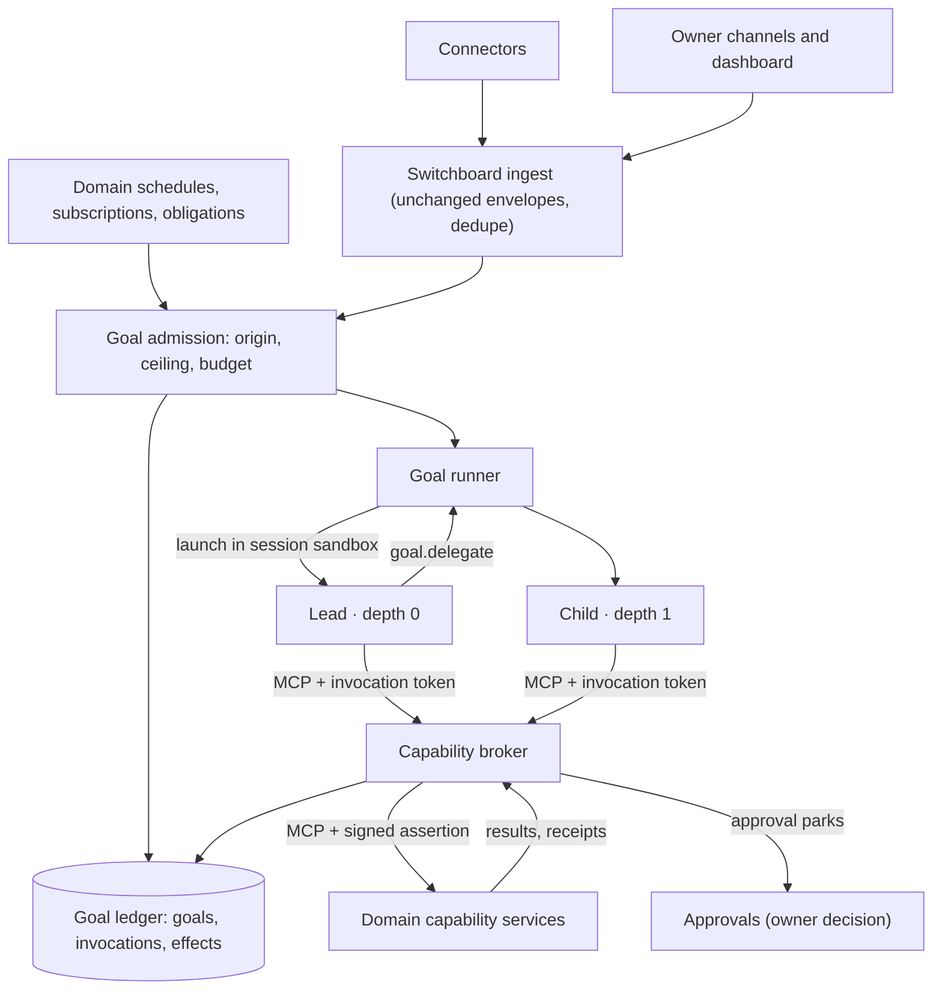

# RFC 0038: Goal Runtime and Capability Authorization

**Status:** Proposed (2026-10-14). Successor contract for the adopted
[generalist-lead doctrine](../decisions/2026-10-14-doctrine-focused-delegation.md);
owner design and release signoff pending.
**Date:** 2026-10-14
**Tracking:** `bu-7p9ll5`
**Supersedes at cutover:** the session, routing and binding sections listed in
[Superseded contracts](#superseded-contracts).

## Summary

Every reasoning session in Butlers becomes an invocation of a **goal**. One
deterministic control plane admits goals, derives their authority, launches a
lead and optional depth-1 children, and brokers every capability call those
sessions make. Domain butlers stop spawning reasoning sessions and become
deterministic capability services that own their data, schedules, obligations,
policies and effect receipts.

Today's "a session can only reach its own butler" is a configuration
convention, not an enforced boundary (see [Context](#context-todays-boundary)).
This RFC replaces it with four mechanical checks, none of which depends on
model behavior:

1. **Sandboxed sessions.** A runtime process can reach the broker and its model
   provider and nothing else: no database, no domain port, no credential, no
   shell, file or web tool.
2. **Grants derived from origin.** Admission computes an authority ceiling from
   who or what started the goal. A model can narrow its authority; it can never
   enlarge it.
3. **Exposure-sensitive effects.** Once an invocation has read third-party
   content, consequential effects need per-event owner approval.
4. **Verified calls at the domain.** The broker signs every forwarded call; a
   domain service executes a model-reachable tool only with a valid assertion
   bound to that exact tool and argument digest.

The change is a **hard cutover**. The new runtime is built and verified without
serving traffic, then one release switches all ingress and every scheduled
prompt to goals and deletes the classify-and-route path. There is no period in
which both systems serve the owner.

## Context: today's boundary

A code survey of `main` at `b747a55a5` found that the isolation `security.md`
described is mostly configuration and prompt instruction:

- Every butler daemon runs in one process and container (`butlers up`). MCP
  servers bind inside it without caller authentication; RFC 0027 rejected
  fleet-wide caller authentication as out of its scope.
- Runtime children run with their own permission systems switched off
  (`--permission-mode bypassPermissions`, `--dangerously-bypass-approvals-and-sandbox`,
  `--sandbox=false`). They have a shell and the container's network, so a
  session can reach every butler's MCP port. The only restraint is a prompt
  rule in `roster/shared/AGENTS.md`.
- Sessions can start sessions: the `trigger` tool, prompt-mode
  `schedule_create`, `delegate_ask`, domain-event wakes, and Switchboard's
  LLM-presentable generic `route` tool, which forwards any tool call to any
  butler with a caller-asserted `source_butler`.
- Messenger sessions receive the Telegram bot token and email password in
  their environment, next to a shell, which would let a session send without
  the approval gate.
- `public.permissions` defaults to allow and fails open; pre-spawn budget gates
  fail open; tool-call and token guardrails run after the session ends.
- Approval `pending_actions` rows carry no session lineage.

Real enforcement does exist and is kept: per-butler `SET ROLE` database roles,
the approval gate and its exact-digest replay binding, owner-only approval
decisions, memory authority stamping, RFC 0028 actuation receipts, and
failover's no-replay rule. The goal runtime therefore does not trade away a
strong boundary for flexibility. It builds the boundary that the current
design only described.

The freeze still admits security fixes. The live gaps are tracked in
`bu-qtxebm` (generic `route` proxy), `bu-13itjw` (Messenger credentials in a
shell-capable session) and `bu-m2zcah` (query-string session id inheriting
owner authority).

## Goals and non-goals

Goals:

- Satisfy every requirement in the `goal-orchestration` and
  `capability-authorization` capabilities of the
  `generalist-lead-focused-delegation` OpenSpec change.
- Make the security boundary independent of model choice, so cheaper or faster
  models can be assigned by quality and cost alone.
- Keep domain custody, proactive obligations, approvals, private-source
  boundaries, physical-actuation receipts and credential tiers intact.

Non-goals:

- Recursive agent trees. Depth is one: lead 0, children 1.
- Code mode or programmatic tool calling. Deferred as in RFC 0027; any future
  nested executor must enforce these grants beneath its calls.
- Multi-user authority. One owner; every grant is a narrowing of the owner's.
- Replacing the approvals, insight, notify, scheduler, identity or memory
  subsystems. They remain the owners of their decisions.

## Vocabulary

| Term | Meaning |
|---|---|
| Goal | A durable unit of intent with one origin, one authority ceiling, one budget and one outcome. |
| Origin | The verified source of a goal: owner request, domain obligation, third-party event or staffer contract. |
| Invocation | One runtime session acting for a goal, either the lead (depth 0) or a child (depth 1). |
| Capability | A model-reachable MCP tool registered by a domain, with authorization metadata in the catalog. |
| Grant | The capabilities, resources and approval policy one invocation may use. Stored server-side; never in model context. |
| Exposure | The fact that untrusted third-party content has entered an invocation's context. |
| Effect | A capability call whose class is anything other than `read`. Recorded in the effect ledger. |
| Assertion | A short-lived broker signature over one forwarded call, verified by the owning domain. |

## Topology



The control plane (admission, ledger, runner and broker) is deterministic
infrastructure inside the Switchboard daemon. Reasoning happens only inside the
sandboxed lead and child processes.

## Decisions

### D1. Switchboard becomes the control plane

Switchboard already owns ingress, holds MCP clients to every butler, and is the
Rule 3 broker. After cutover its contract is: ingress, goal admission, goal
ledger, goal runner, capability broker, approval and insight brokerage. It
loses message classification and route dispatch, which have no successor.

The lead is a role, not a butler. Its governing document is a versioned lead
policy at `roster/switchboard/goal-policy/LEAD.md`, loaded into every lead
alongside the owner profile. Switchboard's manifesto is amended in the cutover
release to describe the control-plane contract. General keeps its narrow
capture-and-collections manifesto and gains no authority.

A separate daemon was considered and rejected: it would duplicate Switchboard's
fleet MCP clients, registry and buffer while adding a second process on the
critical path, with no isolation gain because sessions are sandboxed anyway.

### D2. Domain butlers become capability services

A domain daemon keeps its MCP server, modules, schema, schedules, event
subscriptions, obligations, manifesto and domain guidance. It no longer spawns
reasoning sessions. Where today a scheduled job carries a prompt, the daemon
submits an **obligation admission** to Switchboard instead (D5). Deterministic
jobs (sweeps, syncs, projections) are unchanged.

The domain's `CLAUDE.md` and skills become **domain guidance**: versioned,
searchable through `guidance.search` and `guidance.load`, and attached by
reference to child briefs. The manifesto stays binding on every capability the
domain registers.

### D3. Session sandbox

Invocations run on a dedicated **session host**: a separate container (Compose)
or pod (Kubernetes) from `butlers-up`. Its network policy permits egress only to
the Switchboard broker endpoint and the configured model providers. The goal
runner in Switchboard dispatches launches to the session host over an
authenticated control channel; the session host never receives domain,
database or connector credentials. Provider credentials and runtime OAuth
volumes move from `butlers-up` to the session host.

Each invocation runs in its own kernel-enforced filesystem and process domain
(Bubblewrap, as `src/butlers/cli_auth/sandbox.py` already uses) holding only
`PATH`, its staged model credential and its MCP config. One invocation cannot
read another's token or files, and the whole descendant domain is terminated
before results are accepted.

Runtime built-in tools are disabled: no shell, filesystem, web fetch or local
MCP servers. Adapters drop today's permission-bypass flags in favor of the
runtime's deny-all tool settings plus a strict MCP config naming only the
broker. The adapter must prove this per runtime and model tuple, as RFC 0027
adapters prove host filtering; an adapter that cannot is ineligible.

The sandbox is the primary boundary. Domain-side verification (D7) is defense
in depth for the case where the sandbox fails.

### D4. Capability catalog and effect classes

The RFC 0027 tool descriptor gains authorization metadata. Every
LLM-presentable tool must declare it; an undeclared tool is not grantable, so
the catalog fails closed.

```text
owner_domain          butler that owns the handler and its data
effect_class          read | record | communicate | transact | actuate | administer
output_trust          trusted | untrusted   (returns third-party-authored content)
output_sensitivity    ordinary | sensitive | private_custody
resource_params       argument names that select a resource (entity, account, device)
safety_args           argument names an approval must pin (RFC 0021)
approval_policy       existing approvals gating config for the tool
idempotency           none | key_required
owner_authority       true when the write steers future sessions (rules, profile)
```

Effect classes:

| Class | Examples | Default under exposure |
|---|---|---|
| `read` | search memory, list transactions, read calendar | allowed |
| `record` | log a measurement, store an attributed fact, propose an insight | allowed unless `owner_authority` |
| `communicate` | send email, reply on Telegram, notify a third party | per-event approval, except `notify` to the owner and standing rules with every safety arg pinned |
| `transact` | spend, pay, book, accept an invitation | per-event approval |
| `actuate` | Home Assistant services | RFC 0028 risk map; consequential and protected always approved per event |
| `administer` | change schedules, rules, permissions, module state, create obligations | per-event approval; never delegable to a child |

The catalog is assembled from each domain's final, approval-wrapped registry at
startup and published to the broker with schema and description digests. The
broker rejects a call whose catalog digest differs from the domain's current
registration until the catalog is republished.

### D5. Goal admission and authority ceilings

Admission is deterministic. It never classifies content with a model. It reads
the origin from server-held context, never from message text.

| Origin | Established by | Ceiling |
|---|---|---|
| `owner` | RFC 0017 owner-channel authorization or an authenticated dashboard session | all catalog capabilities, subject to each tool's approval policy |
| `obligation` | a domain schedule, subscription or commitment declared in git | the capability set declared with the obligation; default: owner domain `read` and `record` plus owner `notify` |
| `third_party` | inbound content whose sender is not the verified owner | `read`, non-steering `record`, and proposals (approval requests, insight candidates); never `communicate`, `transact`, `actuate` or `administer` |
| `staffer` | a staffer's infrastructure contract (QA investigation, Concierge answer) | the capability set declared in that contract |

A third-party goal starts exposed. Owner text that quotes or forwards
third-party content is admitted as `owner` but starts exposed, because the
connector marks forwarded and quoted spans in the envelope.

Admission writes the goal row, its ceiling digest and its budget, then hands it
to the runner. Duplicate submissions of the same ingest envelope or obligation
occurrence return the existing goal.

### D6. Exposure rule

An invocation becomes **exposed** when its goal starts exposed, when it receives
a result from a capability whose `output_trust` is `untrusted`, or when it
receives a result from an exposed child. Exposure never clears within an
invocation. A child created by an exposed lead starts exposed.

While exposed, the broker applies the "under exposure" column of D4 regardless
of origin, and refuses `record` writes marked `owner_authority`. This
implements the rule that a session holding untrusted input, private data and
external effect authority together needs a human in the loop. It also makes
the existing approval policy uniform: approvals are no longer only a property of
individual tools, they are a property of what the session has read.

Unexposed owner goals keep today's approval behavior, including standing rules.

### D7. Wire contract and call verification

Sessions reach the broker over MCP streamable HTTP at the Switchboard endpoint
`/goal-mcp`. The runner writes the invocation's MCP config with a bearer
**invocation token**: 256 random bits, stored only as a hash, bound to one
invocation and its lead epoch, and revoked when the invocation ends or the goal
stops.

`tools/list` for that token returns the grant's capabilities under namespaced
names (`<domain>__<tool>`) plus the goal tools in D8. Native deferred loading
follows RFC 0027: the goal tools and a small eager set load initially; domain
capabilities are discoverable through the runtime's tool search. Discovery
scope equals the grant ceiling; invocation is checked per call.

For every `tools/call` the broker:

1. resolves the token to an active invocation of a running goal, rejecting
   stale epochs, stopped goals and expired tokens;
2. checks the capability is in the grant, the resource arguments are within the
   grant's resource scope, and the budget allows another call;
3. applies the exposure rule and the tool's approval policy;
4. for effects, writes an `effects` row before dispatch;
5. forwards the call to the owning domain with an `X-Butlers-Assertion` header:
   an Ed25519 signature over `goal_id`, `invocation_id`, `depth`, `origin`,
   `exposed`, `capability`, `args_digest`, `effect_id`, `approval_ref` and a
   60-second expiry;
6. records the result reference and settles the effect.

The domain's core tool wrapper verifies the assertion before any
model-reachable handler runs: signature, expiry, capability name equal to the
called tool, and argument digest equal to the received arguments. It then
exposes the verified lineage to the handler as ambient context, replacing
today's spawner-derived session context. RFC 0028's executor binding and
RFC 0021's approval replay read lineage from this context only.

Service-plane tools (ingest, ticks, callbacks, dashboard management) are not
LLM-presentable, are unreachable from the sandbox, and keep their current
callers. A model-reachable tool called without a valid assertion is refused.

The session-starting and proxy tools found in the survey do not survive: the
`trigger` tool, `route.execute`, the generic `route` tool and the
`delegate_*` tools are deleted at cutover; prompt-mode `schedule_create`
becomes obligation creation, an `administer` capability; `cancel_session`
becomes owner-only Stop. `public.permissions` no longer governs sessions; the
broker fails closed when the ledger, catalog or signing key is unavailable.

The signing key is a process-bound deployment control key: the second named use
of the security.md exception. Only the Switchboard broker process reads it;
domains receive the public key.

### D8. Goal tools

The broker serves a fixed set of goal tools that are not domain capabilities:

| Tool | Lead | Child | Purpose |
|---|---|---|---|
| `goal.delegate` | yes | no | Start a child with a brief, requested capabilities, model tier and budget share. |
| `goal.await` | yes | no | Wait for or poll child results. |
| `goal.stop_child` | yes | no | Stop one child. |
| `goal.return` | no | yes | Return the child's structured result and end it. |
| `goal.complete` | yes | no | Record the goal outcome. |
| `goal.escalate` | yes | no | Hand the goal to a lead on the next model tier (D16). |
| `guidance.search`, `guidance.load` | yes | yes | Find and load domain guidance and the lead policy. |
| `context.search` | yes | yes | Deterministic fan-out over permitted domains' memory and fact search, merged with provenance. |

A child's `tools/list` never contains `goal.delegate` or any admission,
schedule-creation, routing or obligation tool, because those are `administer`
or service-plane. The runner derives depth from the parent invocation row; a
child's request cannot assert a parent, root or depth.

### D9. Delegation

`goal.delegate` takes:

```text
brief             objective, success conditions, supplied context references,
                  governing guidance references, expected result schema
capabilities      requested capability set and resource scope
model_tier        one of the catalog tiers allowed for children
budget_share      calls, cost and wall time drawn from the goal budget
```

The broker computes the child grant as the intersection of the request and the
lead's grant, minus `administer`, and refuses an empty or non-subset request.
The child inherits the goal's origin and the lead's exposure. Children are not
read-only by default; they may hold `record`, `communicate` or `transact`
capabilities the lead holds, under the same approval rules. A lead cannot
approve its child's effect: approvals resolve only through owner channels.

A child that needs more work calls `goal.return` with a `requests_for_lead`
entry. Only the lead can start a sibling.

### D10. Budgets

Each goal has a budget row: maximum invocations including lead replacements
and escalations, maximum concurrent children, maximum tool calls, maximum model
spend and a deadline. Unlike today's pre-spawn gates, budget checks fail
closed and happen before each call, not after the session. Defaults per origin live in `runtime_config` as operational tuning;
they bound work, not authority. Admission reserves the budget; `goal.delegate`
and every call decrement it with a conditional update in the same transaction
that records the call, so concurrent children cannot overspend. Exhaustion
refuses new work and ends the goal `budget_exhausted` with whatever results and
effects exist. Spend comes from the existing session spend accounting, keyed by
invocation.

### D11. State machines

Goal:

```text
admitted -> running -> completed | partial | failed | stopped | budget_exhausted
running  -> awaiting_approval -> running        (an effect is parked)
running  -> recovering -> running               (lead replaced, epoch + 1)
```

Invocation:

```text
launching -> running -> returned | failed | timed_out | stopped
```

Effect:

```text
requested -> parked -> approved -> dispatched -> committed | failed | unknown
requested -> refused
parked    -> rejected | expired | cancelled
```

`unknown` means the call may have reached the domain without a settled receipt.
RFC 0028 `unverified` maps to `unknown`.

### D12. Effects, idempotency and replay

The broker never re-dispatches an effect on its own. Transport retry is allowed
only when the domain has provably not received the call. Tools declared
`idempotency = key_required` receive `effect_id` as their idempotency key and
must return the original receipt for a repeated key. Physical actuation keeps
RFC 0028 semantics: every attempt is new and an unverified attempt needs owner
reconciliation.

Within a goal, a new call with the same capability and argument digest as an
effect in `committed` or `unknown` is refused with that effect's reference. A
recovered lead receives the effect ledger in its context and cannot replay an
unknown effect without a fresh owner approval.

Child success text is not evidence. The lead reads child effect status from the
ledger through `goal.await`, and `goal.complete` records which effects the
outcome relies on.

### D13. Approvals

When a call needs approval, the broker parks it through the approvals module
with the exact capability, arguments and lineage (goal, invocation, depth,
exposure; today `pending_actions` records none), and returns `parked` with the
approval reference. The session may continue or end. On approval the broker
executes the stored call, not a call the model re-issues, so the approved digest
is the executed digest. A goal that has ended still executes an approved effect
and appends it to the outcome; a stopped goal cancels its parked approvals.
Standing rules and the promotion ladder of RFC 0021 apply unchanged to
unexposed invocations.

### D14. Stop and recovery

Owner Stop marks the goal `stopped` in one transaction that also revokes every
invocation token. The broker refuses new calls and delegations from that
moment. The runner terminates every invocation process domain. Parked approvals
are cancelled. Dispatched effects settle to their domain receipt or `unknown`;
Stop never reports a committed effect as undone.

Each running invocation holds a lease renewed by the runner. If the lead's
lease lapses, recovery increments the goal's lead epoch, which invalidates any
surviving token from the old lead, and launches a replacement with the goal
record, effect ledger and returned child results. Recovery draws from the same
budget. Children of a replaced lead keep running and report to the new epoch.

### D15. Context and memory

A lead starts with the goal input (third-party spans fenced as data), the owner
profile, the lead policy, an index of domains and their guidance, and on
recovery the ledger summary. It retrieves everything else through
`context.search`, domain read capabilities and `guidance.load`. Results carry
owner domain and sensitivity. `private_custody` outputs (RFC 0037) are returned only to the
invocation that requested them and are never copied into a child brief by the
broker; a lead that passes them on must do so through capability references
that the child's grant can resolve. Memory writes go through the owning
domain's capabilities and keep today's steering-memory rule: owner authority is
stamped from the goal origin, never from text.

### D16. Model selection and escalation

Model choice is per invocation, resolved from `public.model_catalog` by role
(`lead`, `child`, `monitor`) and, for children, the tier the brief requests.
Because D3 to D7 do not depend on model behavior, a fast or small model is a
quality and cost decision, never a security one. Replay evaluation, not this
RFC, sets the assignments. Starting defaults:

| Role | Default class | Why |
|---|---|---|
| Lead, owner and cross-domain goals | Mid or frontier reasoning model | Planning, tool search over a large catalog and reconciliation are where small models stop early or skip checks. |
| Lead, obligation monitors | Small model at low effort, structured output | Code gathers the state; the model only judges whether work is needed. |
| Child, read-only retrieval, extraction, comparison | Small model, pre-scoped capabilities | Narrow, checkable briefs; the lead verifies. |
| Child, scoped write | Mid model unless evaluation supports smaller | Effects are grant-bound and approval-gated either way. |

A lead that judges a goal beyond its model calls `goal.escalate`. The runner
ends that invocation and launches a lead on the next tier of the role's ladder
under the same goal, ceiling, exposure, effect ledger and budget, advancing the
epoch exactly as recovery does. Escalation never creates a new goal, and the
ladder is finite. This lets a monitor start on the cheapest model without
giving it a path to a new root.

A runtime is eligible for goal invocations only if it supports MCP tool calls
to the broker, proves the D3 sandbox restrictions, and passes the RFC 0027
conformance gate for the catalog size it will see.

### D17. Telemetry and audit

Every span carries `goal_id`, `invocation_id`, `depth` and `epoch`. The ledger,
not session logs, is the record of a goal: admission decision, ceiling digest,
grants, delegation tree, budget consumption, effects with receipts, approvals
and the final outcome. Telemetry stores identifiers and digests, never
arguments or results.

## Superseded contracts

Applied in the cutover release together with the OpenSpec deltas.

| Contract | Disposition |
|---|---|
| RFC 0001, session dispatch and spawner triggers | Replaced by D1, D2, D10, D11 and D14. Daemon lifecycle and scheduler phases remain. |
| RFC 0002, ephemeral MCP config and own-butler binding | Replaced by D3, D7 and D8. Module ABC and registration remain. |
| RFC 0003, triage, LLM classification, `route.execute`, thread affinity | Removed. Ingest envelopes, dedupe and the durable buffer remain and feed D5. |
| RFC 0008, "a session cannot spawn other sessions" | Replaced by D3, D8 and D9. Network, port and firewall contracts remain. |
| RFC 0027, per-butler corpus | Extended: one per-invocation corpus over the grant, with D4 metadata. Native discovery, adapter fail-closed and no-replay rules remain. |
| Cross-butler delegation ledger | Removed. A lead calls the capability directly or delegates to a child. |

RFCs 0005, 0006, 0009, 0010, 0011, 0014, 0017, 0020, 0021, 0026, 0028, 0030,
0033 and 0037 remain authoritative. Their session-attribution fields map to
invocation lineage.

## Hard cutover

### Before the switch

- **Freeze.** No new features on classification, route dispatch, per-butler
  session spawning or cross-butler delegation. Fixes only.
- **Dark build on main.** The catalog metadata, ledger migrations, broker,
  runner, sandbox profiles, verifier and goal tools merge to main without being
  wired to ingress or schedules. Tables are additive.
- **Catalog completion.** Every LLM-presentable tool declares D4 metadata. CI
  fails on an undeclared tool.
- **Obligation declarations.** Every scheduled prompt gets a declared
  capability set in git.
- **Native discovery.** RFC 0027's native deferred discovery and conformance
  gate are implemented for the broker endpoint and every eligible lead runtime.
  A lead cannot work over the full catalog with eager loading.

### Cutover gate

All evidence is produced in a dev namespace against the release candidate:

1. Every `goal-orchestration` and `capability-authorization` scenario passes.
   Every gap listed in [Context](#context-todays-boundary) has a failing-before,
   passing-after test.
2. Adversarial suite: injected instructions in email, chat and calendar content
   attempting send, spend, actuation, rule writes and exfiltration; children
   attempting grandchildren through every creation path; forged, replayed and
   expired assertions; stale-epoch tokens; direct calls to domain ports from the
   sandbox. Zero unauthorized effects.
3. Replay evaluation over a fixed set of recorded owner requests and
   scheduled obligations, graded by the owner rubric for whole-goal success,
   constraint preservation and corrections needed, with latency and total cost.
   The release candidate must not regress against the recorded outcomes of the
   current system.
4. Stop, lease-loss and runner-crash drills show fenced recovery with no
   replayed effect and no budget reset.

### The switch

One release:

- routes all ingress and every obligation through admission;
- deletes classification, route dispatch, per-butler session spawning and the
  cross-butler delegation tools;
- enables assertion verification in every domain;
- applies the OpenSpec deltas, archives the change, and updates RFC statuses,
  topology pages, operational docs, `CLAUDE.md` and manifestos.

The old buffers drain before the switch: connectors keep their cursors while
Switchboard stops accepting new routes and finishes in-flight ones.

### Rollback

Rollback redeploys the previous release. The goal tables stay and are ignored.
Goals in flight are marked `stopped` and their effects reported. No dual-running
mode exists to fall back to, and none is built.

## Owner decisions

| # | Decision | Recommendation |
|---|---|---|
| 1 | Host of the control plane | Switchboard (D1). |
| 2 | Release scope | The cutover is a v1 milestone; v1's classifier criterion becomes a whole-goal criterion. |
| 3 | Exposure strictness | As D4 and D6: per-event approval for consequential effects after untrusted input; owner `notify` and fully pinned standing rules exempt. |
| 4 | Default model tiers | As D16: mid or frontier leads, small monitors and read-only children, escalation ladder; replay evaluation sets the final assignments. |
| 5 | Default budgets | Per origin, set from replay evaluation before the switch. |

## Alternatives considered

- **Keep specialist sessions and add a read-only generalist.** Preserves two
  reasoning paths permanently. Rejected by the hard-cutover decision.
- **Verify only at the domain, no central broker.** Domains could check
  assertions, but goal budgets, lineage, exposure and delegation need one place
  that sees the whole goal.
- **Broker only, no domain verification.** One sandbox failure would expose
  every domain. Rejected; the second check is cheap.
- **Model-based injection detection as the boundary.** Useful as an advisory
  signal; never as authorization, since it fails open on novel attacks.
- **OAuth 2.1 authorization server per MCP's authorization spec.** The token
  format is compatible, but interactive grant flows add nothing for
  server-minted, single-invocation tokens.
- **Universal meta-tools (`search_tools`, `invoke_tool`).** Still rejected as in
  RFC 0027; typed MCP definitions stay the interface.

## Traceability

| Requirement | Decisions |
|---|---|
| `goal-orchestration` whole-goal accountability | D1, D11, D12 |
| `goal-orchestration` bounded briefs | D8, D9, D15 |
| `goal-orchestration` depth enforcement | D3, D8, D9 |
| `goal-orchestration` capability ownership | D4, D5, D7 |
| `goal-orchestration` finite work | D10 |
| `goal-orchestration` honest outcomes | D11, D12, D14 |
| `goal-orchestration` domain care | D2, D5 |
| `goal-orchestration` single admission path | Hard cutover |
| `capability-authorization` (all) | D3 to D14 |
