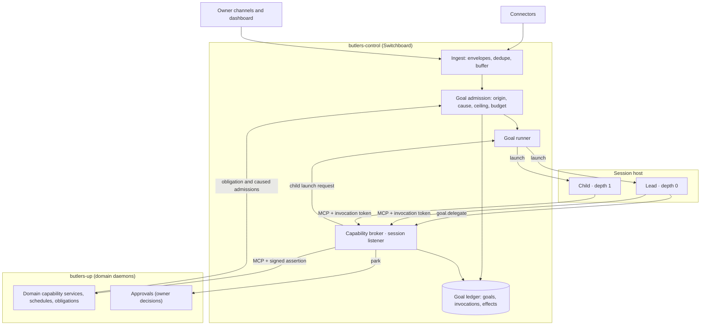

# RFC 0038: Goal Runtime and Capability Authorization

**Status:** Accepted (2026-10-14). Successor contract for the adopted
[generalist-lead doctrine](../decisions/2026-10-14-doctrine-focused-delegation.md).
The owner signed off the full design on 2026-10-14 with four amendments,
recorded as owner decisions 8 to 11: `transact` is disabled, communication with
anyone other than the owner always needs owner approval, the RFC corpus is
rewritten after the switch, and the dashboard is redesigned around one mind
with specialized regions. The owner confirmed the author-added detail in the
2026-10-14/15 walkthrough recorded in `bu-4m4e42`: `recipient_params` and the
recipient rules in D4, the
reclassification of calendar-invitation answers from `transact` to
`communicate`, the Messenger delivery carve-out in D7, the D19 direction
bullets, the proposed RFC organization, and gaps closed while writing the
baseline deltas (service-plane relays, memory consolidation and episodes,
session notes, credential flows and staging, reply delivery accounting,
runtime-failure relaunch, deterministic ingestion, device-feed origin,
model-catalog probes as model functions, the template-pinned definition, the
approvals `cancelled` status, and, from the second review, fail-closed exposure
for admission input without lineage, `administer` scheduling tools, named
relay endpoints, inert-link delivery flags and per-group consolidation goals).
All five answers are recorded in [Author-detail confirmation](#author-detail-confirmation).
D19's detailed experience contract remains in the dashboard change.
**Date:** 2026-10-14
**Tracking:** `bu-7p9ll5`
**Supersedes at cutover:** the contracts listed in
[Disposition of existing RFCs](#disposition-of-existing-rfcs).

## Summary

Every reasoning session in Butlers becomes an invocation of a **goal**. One
deterministic control plane admits goals, derives their authority, launches a
lead and optional depth-1 children, and brokers every capability call those
sessions make. Domain butlers stop spawning reasoning sessions and become
deterministic capability services that own their data, schedules, obligations,
policies and effect receipts.

Today's "a session can only reach its own butler" is a configuration
convention, not an enforced boundary (see [Context](#context-todays-boundary)).
This RFC replaces it with four mechanical checks, none of which depends on
model behavior:

1. **Sandboxed sessions.** A runtime process can reach the broker's session
   listener and its model provider and nothing else: no database, no domain
   port, no credential, no shell, file or web tool.
2. **Grants derived from origin.** Admission computes an authority ceiling from
   who or what started the goal. A model can narrow its authority; it can never
   enlarge it.
3. **Exposure-sensitive effects.** Once an invocation has read third-party
   content, directly or through stored records, consequential effects need
   per-event owner approval. Two owner rules hold for every goal whether or not
   it is exposed: communication with anyone other than the owner needs owner
   approval, and no goal can spend, book or pay, because `transact` is
   disabled.
4. **Verified calls at the domain.** The broker signs every forwarded call; a
   domain service executes a model-reachable tool only with a valid assertion
   bound to that domain, that exact tool, that argument digest and a single use.

The change is a **hard cutover**. The new runtime is built and verified without
serving traffic, then one release switches all ingress and every scheduled
prompt to goals and deletes the classify-and-route path. There is no period in
which both systems serve the owner.

## Context: today's boundary

A code survey of `main` at `b747a55a5` (2026-10-13) found that the isolation
`security.md` described is mostly configuration and prompt instruction:

- Every butler daemon runs in one process and container (`butlers up`). MCP
  servers bind inside it without caller authentication; RFC 0027 rejected
  fleet-wide caller authentication as out of its scope.
- Runtime children run with their own permission systems switched off
  (`--permission-mode bypassPermissions`, `--dangerously-bypass-approvals-and-sandbox`,
  `--sandbox=false`). They have a shell and the container's network, so a
  session can reach every butler's MCP port. The only restraint is a prompt
  rule in `roster/shared/AGENTS.md`.
- Sessions can start sessions: the `trigger` tool, prompt-mode
  `schedule_create`, `delegate_ask`, domain-event wakes, and Switchboard's
  LLM-presentable generic `route` tool, which forwards any tool call to any
  butler with a caller-asserted `source_butler`.
- Messenger sessions receive the Telegram bot token and email password in
  their environment, next to a shell, which would let a session send without
  the approval gate.
- `public.permissions` defaults to allow and fails open; pre-spawn budget gates
  fail open; tool-call and token guardrails run after the session ends.
- The approval gate writes `pending_actions.session_id` as NULL, so parked
  actions carry no session lineage.

Real enforcement does exist and is kept: per-butler `SET ROLE` database roles,
the approval gate and its exact-digest replay binding, owner-only approval
decisions, memory authority stamping, RFC 0028 actuation receipts, and
failover's no-replay rule. The goal runtime therefore does not trade away a
strong boundary for flexibility. It builds the boundary that the current
design only described.

The freeze still admits security fixes. The live gaps are tracked in
`bu-qtxebm` (generic `route` proxy), `bu-13itjw` (Messenger credentials in a
shell-capable session) and `bu-m2zcah` (query-string session id inheriting
owner authority).

## Goals and non-goals

Goals:

- Satisfy every requirement in the `goal-orchestration` and
  `capability-authorization` capabilities of the
  `generalist-lead-focused-delegation` OpenSpec change.
- Make the security boundary independent of model choice, so cheaper or faster
  models can be assigned by quality and cost alone.
- Keep domain custody, proactive obligations, approvals, private custody,
  physical-actuation receipts and credential tiers intact.

Non-goals:

- Recursive agent trees. Depth is one: lead 0, children 1.
- Code mode or programmatic tool calling. Deferred as in RFC 0027; any future
  nested executor must enforce these grants beneath its calls.
- Multi-user authority. One owner; every grant is a narrowing of the owner's.
- Replacing the approvals, insight, notify, scheduler, identity or memory
  subsystems. They remain the owners of their decisions.
- Engineering executors, model functions and dashboard fast answers (D18),
  which are not reasoning sessions over owner capabilities and keep their own
  contracts.

## Vocabulary

| Term | Meaning |
|---|---|
| Goal | A durable unit of intent with one origin, one authority ceiling, one budget and one outcome. |
| Origin | The verified source of a goal: owner, obligation, third party or staffer. |
| Cause | The goal and effect whose consequence admitted a later goal, if any. |
| Invocation | One runtime session acting for a goal, either the lead (depth 0) or a child (depth 1). |
| Capability | A model-reachable MCP tool registered by a domain, with authorization metadata in the catalog. |
| Grant | The capabilities, resources and approval policy one invocation may use. Stored server-side; never in model context. |
| Exposure | The fact that untrusted third-party content has entered an invocation's context. Monotonic. |
| Taint | Exposure recorded on stored data written by an exposed invocation. |
| Effect | A capability call whose class is anything other than `read`. Recorded in the effect ledger. |
| Assertion | A short-lived, single-use broker signature over one forwarded call, verified by the owning domain. |

## Topology



The control plane is deterministic infrastructure in its own process.
Reasoning happens only inside the sandboxed lead and child processes on the
session host.

## Decisions

### D1. Switchboard becomes the control plane, in its own process

Switchboard already owns ingress, holds MCP clients to every butler, and is the
Rule 3 broker. After cutover its contract is: ingress, goal admission, goal
ledger, goal runner, capability broker, approval and insight brokerage. It
loses message classification and route dispatch, which have no successor.
Ingress that needs reasoning becomes a goal through admission. Deterministic
ingestion that needs none (connector gating rules such as skip, metadata-only
and low-priority; channel-bound envelopes such as wellness readings; bulk
backfill and sync) stays on the service plane and creates no goal.

Switchboard moves out of the shared `butlers-up` process into its own process
and container, `butlers-control`. Three reasons: the broker's signing key
(D7) must be readable only by the process that signs, which a shared address
space with every domain handler cannot satisfy; the control plane is the
critical path for every goal; and the session host must be able to reach the
broker without reaching any domain. `butlers-control` exposes two listeners:
the existing service listener, and a **session listener** that serves only the
broker's goal endpoint and is the only port reachable from the session host.

The lead is a role, not a butler. Its governing document is a versioned lead
policy at `roster/switchboard/goal-policy/LEAD.md`, loaded into every lead
alongside the owner profile. The lead policy also owns the reply style for
interactive owner goals, which today each butler's `CLAUDE.md` defines. The
session listener's port follows the repository's port assignment convention.
Switchboard's manifesto is amended in the cutover release to describe the
control-plane contract. General keeps its narrow capture-and-collections
manifesto and gains no authority.

A new, separate control-plane daemon was rejected: it would duplicate
Switchboard's ingress, buffer, fleet MCP clients and registry. Moving
Switchboard itself out of `butlers-up` gets the same isolation without a
second ingress.

### D2. Domain butlers become capability services

A domain daemon keeps its MCP server, modules, schema, schedules, event
subscriptions, obligations, manifesto and domain guidance. It no longer spawns
reasoning sessions. Where today a scheduled job carries a prompt, the daemon
submits an **obligation admission** to the control plane instead (D5). Where a
domain-event subscription today wakes a session, the subscriber submits a
**caused admission** carrying the event's goal lineage (D5). Deterministic
jobs and reactions (sweeps, syncs, projections) are unchanged.

The domain's `CLAUDE.md` and skills become **domain guidance**: versioned,
searchable through `guidance.search` and `guidance.load`, and attached by
reference to child briefs. The manifesto stays binding on every capability the
domain registers. Session-written notes (today's `AGENTS.md` "Notes to self")
become a `record` capability over the domain's guidance notes. Notes steer
later sessions, so the capability is flagged `owner_authority` and exposed
invocations cannot write it. Skill companion scripts are not executable from a
sandbox; each one becomes a domain capability or is retired.

Memory consolidation, which today runs as a spawned session with MCP tools,
becomes an obligation goal of the memory-owning domain with a declared
capability set, one per tenant, source domain and partition (untainted
owner-class episodes apart from all others). Episode capture moves from
per-session transcripts to the goal ledger: each domain whose capabilities a
goal called records an episode from the completed goal's outcome, carrying the
goal's stamps and taint.

### D3. Session sandbox

Invocations run on a dedicated **session host**: a container (Compose) or pod
(Kubernetes) separate from `butlers-up` and `butlers-control`. Its egress is
limited to the control plane's session listener and the configured model
providers. Kubernetes enforces this with a NetworkPolicy; Compose has no
egress policy of its own, so the session host's only route out is an egress
proxy that allowlists provider hostnames by SNI. The goal runner dispatches
launches to the session host over an authenticated control channel. The session
host never receives domain, database or connector credentials; the provider
credentials goal invocations use and the runtime OAuth volumes move from
`butlers-up` to the session host. The goal runner, which can read the
credential store, resolves each launch's model credential and stages it over
the control channel; the session host never reads the credential store or the
database. Model functions (D18) keep the narrow provider credentials their
deterministic callers use today. The existing runtime-credential flows,
Codex auth synchronization and the dashboard's CLI login, are retargeted to
the session host's credential volume through the control plane's service
listener; the session host itself exposes no inbound port to the dashboard.

Each invocation runs in its own kernel-enforced filesystem and process domain
(Bubblewrap, as `src/butlers/cli_auth/sandbox.py` already uses; the session
host must permit unprivileged user namespaces) holding only `PATH`, its staged
model credential, its MCP config and adapter-owned file pointers. A file pointer
is an environment variable the runtime adapter sets whose value is only the path
of a file or directory staged inside that invocation's own domain, such as
Gemini's `GEMINI_SYSTEM_MD` and `GEMINI_CLI_SYSTEM_SETTINGS_PATH`. A pointer's
value is never secret, and the files it names hold no secret other than the
staged model credential and the invocation's own MCP config. One invocation cannot
read another's token or files, and the whole descendant domain is terminated
before results are accepted.

Runtime built-in tools are disabled: no shell, filesystem, web fetch or local
MCP servers, and no provider-hosted tools (server-side web search or fetch,
remote MCP connectors, code execution), which run outside any network policy.
Adapters drop today's permission-bypass flags in favor of the runtime's
deny-all tool settings plus a strict MCP config naming only the broker. The
adapter must prove all of this per runtime and model tuple, as RFC 0027
adapters prove host filtering; an adapter that cannot is ineligible.

The sandbox is the primary boundary. Domain-side verification (D7) is defense
in depth: it stops any call that did not pass through the broker, such as one
from a process that escaped the sandbox.

### D4. Capability catalog and effect classes

The RFC 0027 tool descriptor gains authorization metadata. Every
LLM-presentable tool must declare it; an undeclared tool is not grantable, so
the catalog fails closed.

```text
owner_domain          butler that owns the handler and its data
effect_class          read | record | communicate | transact | actuate | administer
output_trust          trusted | untrusted | stamped
                      (stamped: trust is read from each returned item's stamp, D6)
output_sensitivity    ordinary | sensitive
resource_params       argument names that select a resource (entity, account, device),
                      each optionally selection-bound (D7)
safety_args           argument names an approval must pin (RFC 0021)
approval_policy       existing approvals gating config for the tool, plus an
                      approval mode: default | always_per_event (D13)
idempotency           none | key_required
owner_authority       true when the write steers future sessions (rules, profile)
recipient_params      argument names that identify parties a call delivers content
                      to or invites (recipients, attendees, invitees, shares), any
                      class; or "undeterminable" when arguments cannot name them
```

Effect classes and their default under exposure (owner decision 3):

| Class | Examples | Under exposure |
|---|---|---|
| `read` | search memory, list transactions, read calendar | allowed |
| `record` | log a measurement, store an attributed fact, propose an insight | allowed and tainted (D6), unless `owner_authority`, which is refused |
| `communicate` | send email, reply on Telegram, notify a third party, answer a calendar invitation | per-event approval for every call, except `notify` to the owner with link previews disabled and URLs rendered inert, and standing rules whose recipient is the owner or that are template-pinned (D13) |
| `transact` | spend, pay, book | disabled for every goal (owner decision 8) |
| `actuate` | Home Assistant services | RFC 0028 risk map; consequential and protected always per-event approval |
| `administer` | change schedules, rules, permissions, module state, create obligations | per-event approval; never delegable to a child |

Two owner rules apply to every origin, grant and exposure state, lead or child:

- **Communication with anyone other than the owner needs owner approval**
  (owner decision 9). Every capability whose call can deliver content to, or
  invite, another party declares those arguments in `recipient_params`,
  whatever its effect class: message recipients, calendar attendees and
  invitees, update notifications, invitation answers and shares. The broker
  resolves each named party with the owner-resolution rule of `core-notify`: a
  party is the owner only when its identifier resolves uniquely to the live,
  unmerged, undeleted owner entity. A call that names no party is owner
  communication only when the capability declares the owner as its default
  recipient, as `notify` does. A call with any other party, including an
  unknown, ambiguous or unresolvable one, or with a party the arguments cannot
  name (a capability declared `undeterminable`, such as a reply to an existing
  thread), is non-owner communication. The broker dispatches non-owner
  communication only under per-event owner approval or a matching standing
  rule the owner created (RFC 0021, D13). Today `core-notify` and the gated
  channel tools enforce this rule; calendar writes that invite or update
  non-owner attendees are not gated today and become gated. The rule also
  binds senders outside goals: Messenger's delivery gate (D7) is the
  enforcement point for deterministic service-plane senders that call
  Switchboard `deliver()`, and defense in depth for goal sends.
- **`transact` is disabled** (owner decision 8). The catalog still classifies
  spending, paying and booking tools as `transact`, but the broker grants them
  to no goal, not even park-only, and lists them to no invocation. Enabling
  `transact` requires a new owner decision recorded as an amendment to this
  RFC or its successor. A survey of `main` at `b747a55a5` found no
  model-reachable tool that spends, pays or books. Answering a calendar
  invitation (`calendar_respond`), which the reviewed design listed as
  `transact`, is `communicate` and stays approval-gated under the rule above.
  This keeps today's behavior rather than enabling anything new:
  `calendar_respond` exists on `main` as an approval-gated tool on Messenger
  and Relationship, and it spends, pays and books nothing; classing it
  `transact` would have removed it.
  A generic gateway takes the most consequential class among the targets it
  can reach: Home Assistant's service gateway is `actuate`, under the RFC 0028
  risk map in which unknown services are protected.

**Owner tightening, rule inputs and categories.** The owner may impose
`never` or `always_ask` by capability, region or effect class. These are
selectors of the existing S1 policy `scope` (capability/resource), not another
policy record or grant: capability selects the catalog's exact capability
identity; region selects capabilities by their catalog `owner_domain`; effect
class selects capabilities by their catalog `effect_class`. Resource scope
continues to narrow those capabilities. Match these selectors against the
current catalog on every call, including new capabilities in a selected region
or class; do not freeze a one-time expansion that silently drops a restriction
after publication. An unresolved selector or unreadable current catalog cannot
be treated as an empty permissive match. Existing S1 id, monotonic version,
constraint, expiry, owner-action identity, CAS and audit fields are unchanged.
`never` refuses and `always_ask` parks the exact otherwise-permitted effect;
neither grants a tool, widens a resource/selection scope, clears a label or
removes another approval constraint.

A standing rule's typed slots accept values supplied by the owner, a device or
deterministic code. A different principal may supply a slot only when the
owner's rule-creation card explicitly permits **that rule's own recipient** to
fill **that exact slot**. This is not permission for arbitrary third parties,
for other slots or for free text; missing or mismatched supplier provenance
makes the rule ineligible. A valid slot does not declassify its value or change
D6's per-invocation exposure and held typed-value/cited-label boundaries.

After an invocation reads sensitive data, a standing rule for communication to
anyone other than the owner must explicitly name every applicable sensitive
category the invocation read: `health`, `finance`, `location`, `routine`,
`relationship_notes`, `credentials` (S1). Missing category coverage makes the
rule ineligible and parks an otherwise-permitted call for per-event owner
approval; an independently refused call stays refused. Unknown labels
retain S1's all-category restriction. Naming categories is necessary, not
sufficient: recipient/template pins, slot provenance, grant/currentness,
selection, exposure, park-only and `always_per_event` constraints still apply.

Two kinds of tool are never LLM-presentable and therefore never grantable:

- **Owner-decision tools**: approve, reject and edit actions, create or promote
  standing rules, dispatch approved actions. Owner decisions arrive only
  through the dashboard and signed Telegram callbacks (RFC 0021).
- **Private-custody tools**: anything that returns RFC 0037 private-custody
  content. RFC 0037 forbids model-facing custody tools; the goal runtime keeps
  that.

Output trust has one rule: a capability whose output can include anything a
model-reachable `record` capability, a connector or a third party can write is
`stamped` or `untrusted`. `trusted` is reserved for outputs no such writer can
influence, such as sensor readings, account balances from a bank feed, or the
catalog itself. The catalog check enforces this per store: a read over a table
that any `record` capability writes cannot be declared `trusted`.

The catalog is assembled from each domain's final, approval-wrapped registry at
startup and published to the broker with schema and description digests. The
broker rejects a call whose catalog digest differs from the domain's current
registration until the catalog is republished. The broker endpoint's
`tools/list` is a grant-scoped projection; each domain's canonical MCP listing
stays complete, as RFC 0027 Invariant 8 requires.

### D5. Goal admission, origins and causes

Admission is deterministic. It never classifies content with a model. It reads
origin and cause from server-held context, never from message text or model
output.

| Origin | Established by | Ceiling |
|---|---|---|
| `owner` | RFC 0017 owner-channel authorization, or the dashboard's existing owner authentication | all grantable capabilities, subject to each tool's approval policy and the two owner rules in D4 |
| `obligation` | a schedule, subscription or commitment declared in git, or created at runtime by an `administer` effect | the declared capability set; default owner domain `read` and `record` plus owner `notify`. A runtime-created obligation's set is at most its creator's grant at creation. |
| `third_party` | inbound content whose sender is not the verified owner | `read`, non-steering `record`, owner `notify`, and **park-only** `communicate` (owner decision 7); never `transact`, `actuate` or `administer` |
| `staffer` | a staffer's infrastructure contract (QA triage, Concierge answer) | the capability set declared in that contract |

Rules:

- **Email is never owner origin by itself.** A message is owner-origin only when
  RFC 0017 authorizes its channel and sender; otherwise it is third-party.
- **Audio preserves authorship only through qualified ASR.** The transcript of
  the verified owner's own non-forwarded Telegram voice note, Telegram audio
  file or authenticated dashboard recording is owner input when produced by
  the instruction-free ASR-class transform defined in D18. The connector or
  dashboard ingress holds and binds the sender authorization, actual source
  media, forwarding/quotation/embedding evidence, transform identity and
  successful outcome, and exact transcript to the original ingest identity;
  no payload field, transcript words or model output establishes these facts.
  Forwarded, quoted, embedded, non-owner and room audio remains third-party
  material. An owner forwarding such material stays the enclosing sender, but
  the goal starts exposed and the material is fenced as data. If transformed
  span boundaries cannot be established, mark the whole affected transcript.
  Missing or mismatched evidence cannot authorize owner-authored speech;
  retries and replay retain the original deduplicated admission and can never
  upgrade authorship or reduce exposure. Failure supplies no invented words.
  Independently authenticated captions or typed text retain their own handling.
- **Device and telemetry feeds are not messages.** Home Assistant state,
  wellness readings and other feeds that carry no message from a person wake
  reasoning only through a declared subscription, admitted with origin
  `obligation` under that subscription's capability set. Feed fields a person
  other than the owner can author (device names, notes, message bodies) are
  untrusted output under D6.
- **Exposure at admission.** Third-party goals start exposed. Owner messages
  with connector-marked forwarded or quoted spans start exposed. Staffer goals
  whose inputs include third-party content or error payloads start exposed; QA
  goals always do. A runtime-created obligation that was created under exposure
  starts every occurrence exposed.
- **Park-only grants.** A park-only capability can only produce a parked effect
  awaiting per-event owner approval; the broker never executes it directly.
- **Caused admissions.** When a domain admits a goal because of an effect or a
  domain event that an effect produced, the admission carries `caused_by_goal`
  and `caused_by_effect` from the effect's assertion lineage. The caused goal
  inherits the causing goal's exposure, its ceiling is the declared
  subscription's set intersected with the causing goal's origin ceiling, and
  its causal chain length is at most the configured limit (default 2). A
  reaction to a third-party goal's effect therefore holds no more than a
  third-party ceiling. Admission refuses and records a goal that
  would exceed it. A child cannot reach admission directly; this rule bounds
  the indirect path through declared domain reactions.

Admission writes the goal row, origin, cause, exposure, ceiling digest and
budget, then hands it to the runner. Duplicate submissions of the same ingest
envelope or obligation occurrence return the existing goal.

Known limit: text an owner pastes without quoting markers is owner input. The
exposure rule still applies to everything the goal then reads.

### D6. Exposure and taint

Exposure is tracked per invocation and per goal; both only ever increase.

An invocation becomes exposed when:

- its goal is exposed when it starts (children, replacement leads and escalated
  leads all start with the goal's exposure);
- it receives output from a capability whose `output_trust` is `untrusted`;
- it receives `stamped` output containing any item whose stamp is not owner
  authority or that carries taint;
- it receives a result from an exposed child.

When any invocation of a goal becomes exposed, the goal is marked exposed.

Domain-published admission input follows the same stamps and fails closed. A
domain event, feed record or other input a domain publishes that carries no
goal lineage starts its goal exposed unless the publishing domain stamps it as
derived only from untainted owner-authority records; a missing or unreadable
stamp counts as exposed. Ingest envelopes take their starting exposure from
the origin and span rules of D5, and an obligation's declared prompt is
trusted unless the obligation was created under exposure.

**Taint** makes exposure survive storage. The assertion carries the invoking
session's exposure (D7); a domain storing data under an exposed assertion
stamps the record as tainted, alongside today's memory content-authority stamp.
Reads over every store a `record` capability writes are `stamped` (D4), which
includes memory, facts, capture, contact notes, conversation history, goal
outcomes, insight candidates and decision memory; `context.search` returns each
item with its stamp. Owner-authored, untainted records stay trusted, so ordinary
memory reads do not expose a goal; text that an exposed goal stored from an
email exposes whichever later goal reads it back.

While exposed, the broker applies the "under exposure" column of D4 regardless
of origin. This implements the rule that a session holding untrusted input,
private data and external effect authority together needs a human in the loop.
Approvals are no longer only a property of individual tools; they are a
property of what the session has read.

Unexposed owner goals keep today's approval behavior, including standing
rules; communication with anyone other than the owner still needs owner
approval (D4).
Approvals of effects requested by exposed invocations do not count toward the
RFC 0021 promotion ladder.

### D7. Wire contract, call verification and keys

**Constraint order and urgency.** Apply the S1 intersections in order:
current catalog/origin/grant, invocation exposure/category/slot constraints,
owner law, mode tightening, then health/admission restrictions. The per-call
transaction and existing goal/effect locks fence the current policy version
before an effect is committed for forwarding. A committed tightening is seen
by the next call; a call racing that fence either commits under the prior
version before the tightening or is held/refused under the new one. A retry
cannot restore an earlier policy version. Record the holding/refusing stage
and every constraining term and version in the typed receipt, without content
or secret-bearing arguments; do not claim that an unreadable stage passed.
Committed effects remain honestly recorded, not described as undone. Missing
or stale invocation binding and unknown origin never acquire authority from
policy or urgency.

Only an allowlisted deterministic safety producer, a matching current
owner-authored break-through rule, or an obligation explicitly flagged for
break-through by the owner at creation may bypass quiet-hours or sleep
suppression. The delivery boundary verifies server-held producer identity or
persisted owner provenance, not a caller's label or message. Model invocations,
including owner-started goals, cannot choose high priority; model-presentable
`notify` has no priority/urgency argument. Missing, unknown, stale, revoked or
spoofed urgency provenance is routine for suppression, not an exception.
Retries and fallback cannot raise urgency. Record the classification/cause
without message content. A verified suppression exception does not bypass
capability, recipient, category, grant, approval, Stop, mode or health rules;
it changes only the quiet/sleep hold that the owner authorized. Pre-switch
notify enforcement belongs to .3, and first-switch `deliver()` enforcement to
.22; neither changes this authority boundary.

**Session tokens.** Sessions reach the broker over MCP streamable HTTP on the
session listener's goal endpoint. The runner writes the invocation's MCP config
with a bearer **invocation token**: 256 random bits, stored only as a hash,
bound to one invocation, and revoked when the invocation ends or the goal stops.
A lead's token is also bound to the goal's lead epoch, so recovery or
escalation revokes the previous lead. A child's token is not epoch-bound and
survives a lead replacement (D14).

**Listing.** `tools/list` for a token returns the grant's capabilities under
namespaced names (`<domain>__<tool>`) plus the goal tools in D8. Native deferred
loading follows RFC 0027: the goal tools and a small eager set load initially;
domain capabilities are discoverable through the runtime's tool search.
Discovery scope equals the grant; invocation is checked per call.

**Per-call checks.** For every `tools/call`, the broker runs in one database
transaction, conditional on the goal row being `running` and, for a lead, on the
lead epoch matching:

1. resolve the token to an active invocation;
2. check the capability is in the grant, resource arguments are within the
   grant's resource scope, and the budget allows another call;
3. apply the two owner rules (D4), exposure, park-only and the tool's approval
   policy;
4. for effects, insert the `effects` row and decrement the budget.

Stop takes the goal row `FOR UPDATE` (D14), so a call either commits before the
Stop or is refused after it. The broker then forwards the call to the owning
domain with an `X-Butlers-Assertion` header and records the result.

**Owner selection records.** Some resource scopes must be exactly what the
owner picked, such as the sources an owner checklist may read. A capability
opts in by declaring those resource parameters selection-bound in its catalog
entry (D4). The control plane holds a **selection record** for each owner
pick: id, subject (owning domain and subject reference), capability, an exact,
bounded set of resource identifiers, the authenticated owner action that wrote
it (actor, owner surface, request id, time), and state `active` or `revoked`
with revoke time and actor. Only an authenticated owner action on the D19
owner surface, through a control-plane endpoint, writes or revokes a record;
the request id makes a repeated submit resolve to one record, and a record is
immutable except for that one-way revoke. Goals, standing rules, approvals,
service-plane relays, domains and connectors cannot write one, and no tool that
writes one is LLM-presentable or grantable (D4). A selection reaches a goal
only through the owner-origin admission (D5) of the owner-surface action that
wrote or referenced it; third-party, obligation, staffer and caused admissions
carry none, and a selection named in message text, model output, arguments,
envelopes or rule slots is ignored. When minting a grant, the broker sets the
scope of each selection-bound parameter to exactly the identifiers of that
active record; with no record the scope is empty and the capability is neither
listed nor callable. Delegation intersects that scope (D9). Step 2 of the
per-call check also requires the record to be active, so a revoke refuses the
next call in the same transaction that serializes Stop; reads already returned
are not recalled. A selection is not an effect, so no approval, "Approve all"
tap or standing rule creates or extends one, and selection-bound reads keep
their effect class, output trust and sensitivity.

**Assertion.** An Ed25519 signature, with key id `kid`, over:

```text
aud            owner_domain of the capability
goal_id, invocation_id, depth, origin, exposed
capability     unnamespaced tool name
args_digest    SHA-256 of the RFC 8785 canonical JSON of the raw wire arguments
call_id        unique per forwarded call
effect_id      for effects; null for reads
approval_ref   for approved effects; null otherwise
exp            issue time + 60 s
```

The domain's core tool wrapper verifies, before argument coercion and before
any model-reachable handler runs: signature under a known `kid`, `aud` equal to
its own name, `exp`, capability equal to the called tool, `args_digest` equal to
the canonical digest of the raw arguments received, and `call_id` not seen
within the expiry window. It then exposes the verified lineage, including
`exposed`, to the handler as ambient context, replacing today's
spawner-derived session context. RFC 0028's executor binding, RFC 0021's
approval replay and memory authority stamping read lineage from this context
only.

**Service-plane callers.** Service-plane tools (ingest, ticks, callbacks,
dashboard management) are not LLM-presentable, are not on the session listener,
and keep their current callers. The dashboard also calls some model-reachable
tools directly today. After cutover those calls go through the control plane's
service listener, authenticated by the existing signed dashboard control client
(`RUNTIME_PROBE_CONTROL_SIGNING_KEY`), and are forwarded with an assertion whose
origin is `owner`, principal `dashboard`, and `goal_id` null. These calls
follow the two owner rules of D4 like any goal call: a dashboard call that
messages someone other than the owner is parked for owner approval unless a
standing rule matches. Any other model-reachable call without a valid
assertion is refused. Inventorying the existing direct call sites is a
dark-build task.

**Service-plane relays.** Service-to-service traffic that today rides the
generic `route` tool moves to named endpoints on the control plane's service
listener: domain-event fan-out (RFC 0022), the QA error relay, and module
runtime wiring. Each endpoint has a fixed payload schema and one target,
authenticates its calling daemon against a per-endpoint allowlist, is not
LLM-presentable, and is not on the session listener.
Domain events that an effect produced carry the effect's goal lineage, which
caused admission reads (D5).

**Removed tools.** The session-starting and proxy tools found in the survey do
not survive: the `trigger` tool, `route.execute`, the generic `route` tool and
the `delegate_*` tools are deleted at cutover; prompt-mode `schedule_create`
becomes obligation creation, an `administer` capability, as do `schedule_trigger`
and prompt-mode update, delete and toggle, and a trigger a goal makes is a
caused admission (D5); `cancel_session`
becomes owner-only Stop. `public.permissions` no longer governs sessions.
Messenger's `notify.v1` delivery termination, which today shares the
`route.execute` tool name, survives as a deterministic service-plane endpoint:
not LLM-presentable, not on the session listener, and meant to be called only
by Switchboard `deliver()`. Today that restriction is placement only; the dark
build gives the endpoint the same caller authentication as the other
service-plane relays. Its approval gate is the enforcement point of the
non-owner rule (D4) for deterministic senders and defense in depth for goal
sends. It keeps its current name until the implementation separates it from
the deleted session-dispatch role; the baseline deltas call it Messenger's
service-plane delivery endpoint.

**Signing key.** `GOAL_BROKER_SIGNING_KEY` is the second named use of the
security.md process-bound deployment control key exception (owner decision 6):

- provisioned as a file-backed deployment secret mounted only into
  `butlers-control`, never through an environment value, `CredentialStore`,
  `butler_secrets`, `entity_info` or git;
- domains receive only verification keys, as non-secret config listing the
  current and next `kid`;
- rotation publishes the next public key, restarts domains, switches the signer,
  and removes the old key after twice the assertion lifetime;
- a missing or mismatched private key makes the broker refuse every call; a
  domain without verification keys refuses every model-reachable call; neither
  falls back to an unsigned request or shared secret;
- on a control-plane restart, in-flight calls settle per D12 and revoked tokens
  stay revoked.

The broker also fails closed when the ledger or catalog is unavailable.

### D8. Goal tools

The broker serves a fixed set of goal tools that are not domain capabilities:

| Tool | Lead | Child | Purpose |
|---|---|---|---|
| `goal.delegate` | yes | no | Start a child with a brief, requested capabilities, model tier and budget share. |
| `goal.await` | yes | no | Wait for or poll child results and their effect statuses. |
| `goal.stop_child` | yes | no | Stop one child. |
| `goal.return` | no | yes | Return the child's structured result and end it. |
| `goal.complete` | yes | no | Record the goal outcome. |
| `goal.escalate` | yes | no | Hand the goal to a lead on the next model tier (D16). |
| `guidance.search`, `guidance.load` | yes | yes | Find and load domain guidance and the lead policy. |
| `context.search` | yes | yes | Deterministic fan-out over permitted domains' memory and fact search, merged with provenance and stamps. |

Only the runner starts sessions: leads on admission, recovery and escalation;
children on a lead's `goal.delegate`. A child's `tools/list` never contains
`goal.delegate` or any admission, schedule-creation, routing or obligation
tool, because those are `administer` or not presentable. The runner derives
depth from the parent invocation row; a child's request cannot assert a
parent, root or depth.

### D9. Delegation

`goal.delegate` takes:

```text
brief             objective, success conditions, supplied context references,
                  governing guidance references, expected result schema
capabilities      requested capability set and resource scope
model_tier        one of the catalog tiers allowed for children
budget_share      calls, cost and wall time drawn from the goal budget
```

The broker computes the child grant as the intersection of the request and the
lead's grant, minus `administer`, and refuses an empty or non-subset request.
Since `transact` is never in a lead's grant, no child can hold it either.
The insert that admits the child is conditional on the goal running and the
lead epoch matching, like any call. The child inherits the goal's origin and
exposure. Children are not read-only by default; they may hold `record`,
`communicate` or `actuate` capabilities the lead holds, under the same
approval, park-only and owner rules. A lead cannot approve its child's effect:
approvals resolve only through owner channels.

A child that needs more work calls `goal.return` with a `requests_for_lead`
entry. Only the lead can delegate a sibling. There is no resume: a lead that
wants follow-up delegates a new child with the earlier result as context.

### D10. Budgets

Each goal has a budget row: maximum invocations including lead replacements
and escalations, maximum concurrent children, maximum tool calls, maximum model
tokens and spend, and a deadline. Each invocation has maximum turns and tokens.
Defaults per origin live in `runtime_config` as operational tuning; they bound
work, not authority (owner decision 5).

Admission reserves the budget. `goal.delegate` and every call decrement it in
the D7 transaction, so concurrent children cannot overspend. The runner meters
model usage from the runtime's usage stream and terminates an invocation that
exceeds its turns, tokens or spend between tool calls. Unlike today's
pre-spawn gates, every budget check fails closed. Exhaustion refuses new work
and ends the goal `budget_exhausted` with whatever results and effects exist.

### D11. State machines

The following goal diagram is the pre-switch `sw_047` representation. The
proposed dated S2 amendment defines the target states and complete lossless
mapping, subject to its reserved adoption. Invocation and effect states below
remain unchanged.

Goal:

```text
admitted -> running -> settling -> completed | partial | failed
running  -> stopped | budget_exhausted
running  -> awaiting_approval -> running          (lead waits on a parked effect)
running  -> recovering -> running                 (lead replaced, epoch + 1)
settling -> stopped                               (owner Stop cancels parked effects)
```

`settling` means the lead has finished but parked effects are still awaiting
owner decisions; the goal reaches its final state when they resolve.

A goal admitted from an owner message completes only when its reply reached
the owner. If the reply was not delivered, the goal ends `partial` with the
delivery failure recorded, which keeps today's interactive reply delivery
accounting.

Invocation:

```text
launching -> running -> returned | failed | timed_out | stopped | escalated
```

Effect:

```text
requested -> parked -> approved -> dispatched -> committed | failed | unknown
requested -> dispatched                           (no approval needed)
requested -> refused
parked    -> rejected | expired | cancelled
```

`unknown` means the call may have reached the domain without a settled receipt.
RFC 0028 `unverified` maps to `unknown`.

### D12. Effects, idempotency and replay

The broker never re-dispatches an effect on its own. Transport retry is allowed
only when the domain has provably not received the call. Tools declared
`idempotency = key_required` receive `effect_id` as their idempotency key and
must return the original receipt for a repeated key. Physical actuation keeps
RFC 0028 semantics: every attempt is new and an unverified attempt needs owner
reconciliation.

Within a goal, a new call with the same capability and argument digest as an
effect in `committed` or `unknown` is refused with that effect's reference. A
recovered lead receives the effect ledger in its context and cannot replay an
unknown effect without a fresh owner approval.

Child success text is not evidence. The lead reads child effect status from the
ledger through `goal.await`, and `goal.complete` records which effects the
outcome relies on.

### D13. Approvals

When a call needs approval or its grant is park-only, the broker parks it
through the owning domain's approvals module with the exact capability,
arguments and lineage (goal, invocation, depth, exposure) and returns `parked`
with the approval reference. The session may continue or end. A park-only
effect is never approved by a standing rule and always waits for the owner's
per-event approval tap. Standing rules stay in the owning domain's approvals
schema; for other parked effects, that module matches them at park time within
the exposure limits below. A permitted match approves the effect at once, and
the effect records the rule as its approval. A domain gate treats a verified
assertion whose
`approval_ref` covers the exact call digest as approval, so an approved call is
never parked twice.

The owner may approve, reject or edit (RFC 0021). On approval the broker
executes the stored call, or the owner's edited version of it, never a call
the model re-issues; the executed digest is the digest the owner approved.
Before dispatch the broker re-checks that the goal is not stopped. A stopped
goal cancels its parked effects; a goal whose lead has finished waits in
`settling` and still executes approvals that arrive.

**One tap and narrow step-up.** Ordinary approve, reject, edit and dispatch
remain one tap after the existing owner, exact stored-call, current-version,
Stop and grant checks. Step-up is required only to create or promote a standing
rule, Vouch, Contain, or loosen a mode. Being owner-only under D4 does not itself
require step-up. Rule creation/promotion uses the dashboard's authenticated
owner session and independent passkey factor on a different device from the
Telegram phone. A Telegram request without that confirmation gets a
non-mutating open-dashboard handoff, never an automatic approval. The same
step-up boundary applies when the existing Vouch, Contain and mode-loosening
owners implement their actions; it does not activate those held consumers or
change factor custody.

The step-up nonce binds the authenticated owner/session, action kind and
identity, exact action digest (including recipients and arguments), current
action/policy version, and expiry. Verify those bindings, revocation and
unconsumed state and consume it atomically with the authorized owner transition
and its audit receipt. A missing, invalid, expired, revoked, wrong-owner,
wrong-session, wrong-action or stale-version nonce refuses that transition;
a changed action or digest needs a fresh confirmation. A failed transaction
commits neither mutation nor consumption. Concurrent decisions on the same
current action/version have one winner across dashboard and Telegram. Retrying
the same completed action reads back that outcome, not another rule or effect;
replay cannot authorize a second or different action. A presentation ACK,
callback token, delivery fallback or model text is not a step-up nonce. No
nonce overrides Stop, a revoked grant/selection or current effect constraints.

Standing rules and the promotion ladder of RFC 0021 apply unchanged to
unexposed invocations; exposed invocations can use only the standing rules D4
exempts. A standing rule is **template-pinned** when its argument constraints
fix every content-bearing argument to an exact value or to an owner-authored
template whose slots accept only typed values (dates, amounts, identifiers),
never free text.

A capability whose catalog entry declares the approval mode
`always_per_event` is applied as park-only in every grant that includes it,
whatever the goal's origin, cause or exposure, lead or child. The declaration
travels with the tool's descriptor, so no butler configuration, owner policy or
standing rule can remove it, and a tool that declares it without an approvals
gate in its owning butler is not grantable. No standing rule approves such a
call, no rule can be created for the capability, the gate's owner-directed
auto-approve does not apply, and its approvals never count toward promotion.
The per-event approval is the owner's approval of the parked call or of the
owner's edit, the owner's own submit on the owner surface, or one "Approve all"
tap on a decision set that shows every item's exact call and recipients with
per-item untick; an approved wait envelope never pre-approves a later call.
The mode adds nothing to any ceiling. `calendar_respond` declares it
(author-detail item 3), and so do
capabilities whose effects must always be the owner's own act, such as
confirming an owner checklist revision.

A Stop-cancelled parked effect takes a new approvals status,
`cancelled`. At the switch, `pending_actions` created before cutover remain
executable by the approvals executor and are recorded with goal origin
`legacy`, a field separate from the approvals module's existing producer
`origin`.

### D14. Stop and recovery

Owner Stop takes the goal row `FOR UPDATE`, marks it `stopped` and revokes every
invocation token in one transaction. Every later call or delegation of that
goal is refused. The runner terminates every invocation process domain. Parked
effects are cancelled. Dispatched effects settle to their domain receipt or
`unknown`; Stop never reports a committed effect as undone.

Each running invocation holds a lease renewed by the runner. If the lead's
lease lapses, recovery increments the goal's lead epoch, which revokes the old
lead's token, and launches a replacement with the goal record, the goal's
exposure, the effect ledger and returned child results. Recovery draws from
the same budget. Children of a replaced lead keep running and report to the
new lead through `goal.await`.

Runtime failures (provider errors, quota exhaustion, launch failures,
timeouts) are classified with the existing runtime failure taxonomy. For a
retryable class the runner may relaunch the failed invocation once on the
same tier's fallback model, and only when the broker recorded no capability
call made with the failed invocation's token, because a relaunch never replays
work (D12); a relaunched lead advances the epoch exactly as recovery does, and
every relaunch counts against the goal's invocation budget.
A non-retryable failure ends the invocation `failed` and leaves the decision
to the lead or, for a lead, ends the goal `failed` with its ledger intact.

### D15. Context and memory

A lead starts with the goal input (third-party spans fenced as data), the owner
profile, the lead policy, an index of domains and their guidance, and on
recovery the ledger summary. It retrieves everything else through
`context.search`, domain read capabilities and `guidance.load`. Results carry
owner domain, sensitivity and stamps. Private-custody content is not reachable
(D4). Memory writes go through the owning domain's capabilities and keep
today's steering-memory rule: owner authority is stamped from the goal origin,
never from text, and exposed writes are tainted.

### D16. Model selection and escalation

Model choice is per invocation, resolved from `public.model_catalog` by role
(`lead`, `child`, `monitor`) and, for children, the tier the brief requests.
Because D3 to D7 do not depend on model behavior, a fast or small model is a
quality and cost decision, never a security one. Replay evaluation, not this
RFC, sets the assignments (owner decision 4). Starting defaults:

| Role | Default class | Why |
|---|---|---|
| Lead, owner and cross-domain goals | Mid or frontier reasoning model | Planning, tool search over a large catalog and reconciliation are where small models stop early or skip checks. |
| Lead, obligation monitors | Small model at low effort, structured output | Code gathers the state; the model only judges whether work is needed. |
| Child, read-only retrieval, extraction, comparison | Small model, pre-scoped capabilities | Narrow, checkable briefs; the lead verifies. |
| Child, scoped write | Mid model unless evaluation supports smaller | Effects are grant-bound and approval-gated either way. |

A lead that judges a goal beyond its model calls `goal.escalate`. The runner
ends that invocation and launches a lead on the next tier of the role's ladder
under the same goal, ceiling, exposure, effect ledger and budget, advancing the
epoch exactly as recovery does. Escalation never creates a new goal, and the
ladder is finite. This lets a monitor start on the cheapest model without
giving it a path to a new root.

A runtime is eligible for goal invocations only if it supports MCP tool calls
to the broker, proves the D3 sandbox restrictions, and passes the RFC 0027
conformance gate for the catalog size it will see.

### D17. Telemetry and audit

Every span carries `goal_id`, `invocation_id`, `depth` and, for a lead, its
`epoch`, taken from the invocation record. The ledger,
not session logs, is the record of a goal: admission decision, origin, cause,
exposure, ceiling digest, grants, delegation tree, budget consumption, effects
with receipts, approvals and the final outcome. Telemetry stores identifiers and
digests, never arguments or results.

### D18. Model use outside goals

Three kinds of model use are not goal invocations. Each keeps its own
contract. Engineering executors and model functions never reach the broker or
a domain capability. A dashboard fast answer reaches only allowlisted read
capabilities, and only through deterministic code calling the broker, never
through its model calls:

- **Engineering executors.** QA investigation agents and self-healing agents
  (RFC 0015) work on the repository with a shell and a worktree. They keep
  their existing sandboxed contracts, receive no MCP config and see only the
  anonymized payloads RFC 0015 allows; the cutover stops injecting situational
  context into their prompts. The QA staffer's own triage reasoning is
  a staffer goal.
- **Model functions.** Tool-less, single-turn, structured-output calls made by
  deterministic code: connector discretion screening (forward or ignore for
  non-owner chatter; owner messages skip it), connector speech-to-text
  transcription, RFC 0036 vision probes, and model-catalog verification and
  benchmark probes, which send fixed prompts and record only measurements.
  They have no tools; any consequence comes from the deterministic code that
  reads their typed output, and their output entering a goal is third-party
  content except for the narrow authorship-preserving transform below.
- **Dashboard fast answers** (later owner decision `bu-u5euwb.21`). A narrow
  path that answers the owner's dashboard question from live data without a
  goal. Its model calls are model functions; what sets the kind apart is that
  deterministic code reads data between them and the result is an
  owner-facing answer. Its contract:
  - *Scope.* Only a question the owner types into the authenticated dashboard
    (owner origin, D5). It is read-only: it produces no effect, parks no
    approval, starts no goal, child or obligation, and writes nothing but its
    one reply and its audit records.
  - *Admission.* Deterministic control-plane code checks the turn's
    eligibility, then makes one model-function call that returns a typed plan:
    whether the turn is an eligible question and which reads, at most three,
    answer it. The model holds no tools, MCP config, invocation token or
    capability, and deterministic code validates the plan before acting on
    it. This binary eligibility choice, between this fast answer and an
    ordinary owner goal, is the only model classification before admission; it
    selects no route, butler, origin, ceiling or goal, so D1's removed route
    classification gains no successor here. The call may be retried
    once on the same model, before any read, only when its output fails the
    schema.
  - *Reads.* Deterministic code, not the model, makes each planned read. Each
    names a capability on a fixed, checked-in allowlist whose current catalog
    entry (D4) is `read`, grantable, has no `approval_policy` gate, approval
    mode `default` and no selection-bound `resource_params`; current owner
    `never` tightening still applies. A plan naming anything else is rejected
    whole before its first read. Each read's capability and arguments are fixed
    by the validated plan; no read result selects or parameterizes another
    read. The
    broker forwards each read exactly as it forwards a dashboard
    service-plane call (D7): origin `owner`, principal `dashboard`, `goal_id`
    null, under a signed assertion the owning domain verifies. The allowlist
    narrows the owner's ceiling and never widens it. Tool visibility,
    discovery metadata, catalog search provenance and ranking grant no
    authority. Broadening the allowlist needs an owner decision.
  - *Phrasing.* Exactly one model-function call, with no retry, composes one
    answer from the validated read results, which enter it fenced as data.
    The answer's sources are derived by server code from the reads; the
    model cannot add or change them.
  - *Output and attribution.* One idempotent reply in the thread that asked,
    attributed as a fast answer with its model calls and reads, not as a goal
    or goal outcome. Reads and model calls are audited by identifier and
    digest (D17); its spans and audit records carry its runtime identity in
    place of `goal_id` and `invocation_id`, outside the goal ledger. When any
    read's output is `untrusted`, or `stamped` with an item that is not
    untainted owner authority (D6), the reply renders URLs inert with link
    previews disabled, as D4 requires of owner `notify` under exposure. The
    stored reply is stamped as non-owner model output, so any goal that reads
    it, including as thread context at admission, is exposed (D6).
  - *Stop and replay.* One durable runtime identity, owned by the control
    plane and registered against the asking message before the first model
    call, spans every call and the reply. Owner Stop on that message fences
    every later read, model call and reply, and is confirmed only after
    in-flight work settles. There is no provider failover, and no uncertain
    attempt is replayed: an unknown reply outcome is settled from its durable
    receipt or reported as unknown.
  - *Fallback.* Before the first read starts, any ineligibility,
    unavailability, schema or provider failure, or uncertainty ends the fast
    answer and the unchanged message goes to owner-goal admission (D5);
    nothing the fast answer produced enters that goal's admission, origin,
    ceiling or exposure. A Stop admits no goal. Once a read has started,
    nothing re-executes the turn: a failed read or phrasing call ends in an
    honest failure reply, never a fabricated answer.

  The kind is built on the control plane in the dark build and switched on by
  the cutover release; it does not extend today's classification path, which
  stays frozen and is deleted at the switch. Its mechanics (lease and recovery
  timings, reply observation windows, the allowlist's entries, model
  resolution and latency evidence) belong to the re-scoped
  `define-dashboard-fast-answer-runtime` change.

**Instruction-free ASR-class transcription** preserves the source's authorship,
not a model's asserted authorship. It takes only audio and fixed server-held
decoding configuration, no task or conversation instructions, tools or
capabilities, and transcribes rather than composes, summarizes, translates or
answers. Only a verified implementation of this class and its bound successful
outcome can preserve the owner authorship of the D5 sources. A tool-less
instructable model, an outcome's `stt_backend` label or transcript text cannot
qualify itself. All other model-function outputs remain third-party. ASR never
removes source forwarding, quotation, embedding, room or non-owner provenance,
and never raises the source's authority. An unavailable, timed-out, cancelled,
empty or unacceptable result creates no transcript or owner-audio admission.
Finite engineering-configured byte, decoded-duration and execution bounds and
owned cleanup still apply, with no outside speech-service or instructable-model
fallback. `payload.transcription` remains outcome metadata, not authorization.

Model use that today runs outside a session but composes owner-facing text or
judgment, such as briefing elaboration, chronicler narration, insight
synthesis, dashboard quick-add and memory consolidation, becomes an obligation
or owner goal at the switch rather than a model function. Dashboard fast
answers are the single named exception.

Any other model use is a goal invocation. Adding a kind to this list requires
an RFC amendment. `define-dashboard-fast-answer-runtime` is re-scoped to the
dashboard fast-answer kind above (`bu-u5euwb.28`) before approval. Any other
pending OpenSpec change that adds a model path must be re-scoped as goals or
as a named kind here before approval.

### D19. Owner surface: one mind, specialized regions

The dashboard stops presenting butlers as separate agents and presents
Butlers as one assistant whose domains are specialized regions of a single
mind (owner decision 11). The direction:

- **Goals are the unit of activity.** The owner sees goals, not sessions: what
  started each goal, its origin and exposure, the lead and its children, the
  regions it drew on, its effects with receipts, its parked approvals, its
  budget and its outcome, with Stop on any running goal.
- **Regions replace butler units.** The Butlers page and butler detail pages
  become region pages. A region page shows its data, standing obligations and
  schedules, capabilities and their effect classes, domain guidance, and the
  recent goals that used it. It no longer shows a domain's own sessions,
  routing log or trigger controls as if it were a separate agent. Service
  health stays visible on the system and settings surfaces as infrastructure,
  not as a separate agent.
- **Owner channels speak as one assistant.** Telegram and email replies come
  from one assistant with region attribution where it helps, instead of
  per-butler origin prefixes. The same change details it.
- **The overview shows the whole mind at once:** active goals, which regions
  each touches, obligations coming due, and decisions waiting for the owner.
- **Approvals carry lineage:** each parked effect shows the goal, the
  invocation that requested it, whether it was exposed and to what, and the
  exact call that will run.

The detailed experience contract is a separate OpenSpec change for the
`dashboard-*` capabilities, produced through design review and signed off by
the owner before implementation. Its pages are built during the dark build and
switched on by the cutover release. That change also carries the dashboard
contracts this RFC's baseline deltas leave untouched (session explorers,
per-butler tabs, trigger and routing-log views, permissions, the chat surfaces),
and defines successors for the guarantees of the removed dashboard chat lanes:
in-thread failure replies, bug-report filing to QA, the read-only answer lane,
replay-eligible dead letters, and conversation continuity, which D9's
no-resume rule makes a goal-level concern.

### Details settled during the dark build

Writing the baseline deltas surfaced details this RFC leaves to
implementation. Each is settled by the dark-build work item that owns it,
within D1 to D19 and never by weakening the two owner rules of D4:

- the mechanism by which service-plane relays and Messenger's delivery
  endpoint authenticate their calling daemon (that they authenticate it, per
  endpoint allowlist, is settled in D7);
- the format of a staffer contract's capability set (a Concierge answer is a
  staffer goal, D5);
- the admission budget for high-volume feeds, so a burst of third-party mail
  cannot exhaust goal budgets;
- how an owner's reply to an outbound prompt (a quiz, a confirmation) joins
  the goal that sent it rather than starting an unrelated owner goal;
- which approvals statuses and dashboard filters gain `cancelled` and goal
  lineage;
- a taint field on every store D6 lists that lacks one today.

## Disposition of existing RFCs

Applied in the cutover release together with the OpenSpec deltas. "Remains"
means the RFC stays authoritative; its session-attribution fields map to
invocation lineage.

| RFC | Disposition |
|---|---|
| 0001 Daemon lifecycle and triggers | Superseded in part: session dispatch and spawner triggers (D1, D2, D10, D11, D14). Daemon lifecycle and scheduler phases remain. |
| 0002 MCP tool surface and modules | Superseded in part: ephemeral MCP config and own-butler binding (D3, D7, D8). Module ABC and registration remain. |
| 0003 Switchboard routing and ingestion | Superseded in part: triage, LLM classification, thread affinity and session-dispatch `route.execute` removed; Messenger's `notify.v1` delivery termination survives (D7). Ingest envelopes, dedupe and the durable buffer remain and feed D5. |
| 0004 Identity and contact resolution | Remains; supplies owner identification for D5. |
| 0005 Observability and telemetry | Remains; D17 adds goal attributes. |
| 0006 Database schema and isolation | Remains; goal ledger tables are Switchboard-owned. |
| 0007 Dashboard and API surface | Superseded in part: session, trigger and per-butler conversation endpoints and butler-unit views (D7, D19). API conventions and other endpoints remain; direct model-reachable tool calls move to the control plane service listener (D7). |
| 0008 Deployment network security | Superseded in part: runtime children and their network (D3), container layout (D1). Networks, ports and firewall remain. |
| 0009 Situational context bus | Remains; reads are `stamped`. |
| 0010 Cross-butler briefing exception | Remains, with its QA amendment. |
| 0011 Proactive insight delivery | Remains; candidates carry taint (D6). |
| 0012 Finance transaction data model | Remains. |
| 0013 Dunbar interaction scoring | Remains. |
| 0014 Chronicler | Remains; its day-close reasoning becomes an obligation goal. |
| 0015 QA staffer pipeline | Remains; investigation agents are engineering executors (D18), QA triage is a staffer goal that starts exposed. |
| 0016 S3 blob storage | Remains. |
| 0017 Owner-routing safety | Remains; basis of owner origin (D5). |
| 0018 Connector scope | Remains. |
| 0019 Proactive egress and automation | Remains rejected/parked. Caused admissions run only declared subscriptions; they are not the parked rule engine. |
| 0020 Calendar overlay read exception | Remains. |
| 0021 Decision loop and approvals | Remains, amended: approvals carry goal lineage, exposed approvals do not count toward promotion, owner-decision tools are never grantable, and no standing rule targets or approves an `always_per_event` capability (D4, D6, D13). |
| 0022 Cross-process event transport | Remains; events from effects carry goal lineage for caused admissions. |
| 0023 Approval delivery intent recovery | Remains. |
| 0024 Messenger correspondence ledger (proposed) | Independent. |
| 0025 Beads projection exporter (draft) | Independent. |
| 0026 Commitment lifecycle (draft) | Commitments that need reasoning become obligations (D5). |
| 0027 Runtime tool surface discovery | Extended: one grant-scoped corpus per invocation with D4 metadata. Discovery, adapter fail-closed, no-replay and canonical-listing rules remain. |
| 0028 Home physical actuation | Remains; lineage comes from the verified assertion. |
| 0029 Expected signals | Remains. |
| 0030 System-plane read exception | Remains; Concierge answers become staffer goals over its fixed views. |
| 0031 Public entity graph projection | Remains. |
| 0032 Fleet case file | Remains. |
| 0033 Fleet cost claims | Remains. |
| 0034 Messenger voice egress (draft) | Independent; delivery stays Messenger-owned through its service-plane delivery endpoint (D7). |
| 0035 Approval reminders (proposed) | Independent. |
| 0036 Models exact-path vision proof | Remains; probes are model functions (D18). |
| 0037 General capture and private custody | Superseded in part: capture's classification and routing step becomes goal admission. Capture ledger, receipts and private custody remain; custody stays unreachable by models (D4). |

The cross-butler delegation ledger and its tools are removed: a lead calls the
capability directly or delegates to a child.

## Hard cutover

### Before the switch

- **Freeze.** No new features on classification, route dispatch, per-butler
  session spawning or cross-butler delegation. Fixes, including security fixes,
  only.
- **Dark build on main.** The control-plane process split, catalog metadata,
  ledger migrations, broker, runner, session host, sandbox profiles, verifier
  and goal tools merge to main without being wired to ingress or schedules.
  Migrations are additive.
- **Catalog completion.** Every LLM-presentable tool declares D4 metadata. CI
  fails on an undeclared tool.
- **Obligation declarations.** Every scheduled prompt and session-waking
  subscription gets a declared capability set in git.
- **Service-plane inventory.** Every direct call to a model-reachable tool from
  the dashboard or another service is routed through the control plane.
- **Owner surface.** The dashboard change for D19 is designed, signed off by
  the owner, and built without replacing the current views.
- **Native discovery.** RFC 0027's native deferred discovery and conformance
  gate are implemented for the broker endpoint and every eligible lead runtime.
  A lead cannot work over the full catalog with eager loading.

### Cutover gate

All evidence is produced in a dev namespace against the release candidate:

1. Every `goal-orchestration` and `capability-authorization` scenario, and
   every scenario of the signed D19 dashboard change, passes. Every gap listed
   in [Context](#context-todays-boundary) has a failing-before, passing-after
   test.
2. Adversarial suite, zero unauthorized effects: injected instructions in
   email, chat and calendar content attempting send, spend, actuation, rule
   writes and exfiltration (including through owner `notify` links and
   owner-directed sends); messages, calendar invitations, attendee updates and
   invitation answers reaching non-owner, unknown or ambiguous parties without
   owner approval; any `transact` grant or call; laundering
   through memory, conversation history and insight candidates; children
   attempting grandchildren through every creation path, including caused
   admissions and runtime obligations; forged, replayed, expired and
   wrong-audience assertions; stale-epoch tokens; direct calls to domain ports
   and service listeners from the sandbox; provider-hosted tool use; dashboard
   fast answers whose plan or read results attempt a read off the allowlist, a
   fourth read, a tool call or any effect.
3. Replay evaluation over a fixed set of recorded owner requests and
   scheduled obligations, graded by the owner rubric for whole-goal success,
   constraint preservation and corrections needed, with latency and total cost.
   The release candidate must not regress against the recorded outcomes of the
   current system.
4. Stop, lease-loss, runner-crash, escalation and key-rotation drills show
   fenced recovery with no replayed effect and no budget reset.

### The switch

One release:

- routes all ingress, obligations and session-waking subscriptions through
  admission;
- deletes classification, route dispatch, per-butler session spawning and the
  cross-butler delegation tools;
- enables assertion verification in every domain;
- switches the dashboard to the goal and region views of D19 and removes the
  session, routing-log and per-butler session views;
- applies the OpenSpec deltas, archives the change, and updates RFC statuses,
  topology pages, operational docs, `CLAUDE.md` and manifestos.

The old buffers drain before the switch: connectors keep their cursors while
Switchboard stops accepting new routes and finishes in-flight ones. The switch
release runs no destructive migration.

### After the switch: rewrite the RFC corpus

Once the switch has shipped, the RFC corpus in `about/legends-and-lore/` is
rewritten and reorganized around the goal architecture (owner decision 10).
The supersession headers and the disposition table above are interim markers,
not the end state. The rewrite folds each superseded-in-part RFC's surviving
contract into a successor, moves the replaced text to the decision history,
splits RFC 0038's lasting contracts from its cutover plan, and rebuilds the RFC
index around the new organization. The proposed organization is by subsystem
(control plane, capability services, owner surface, connectors, data); the
owner confirms it before the rewrite starts. The rewrite changes no behavior:
any contract change it uncovers goes through its own spec delta. It runs after
this change is archived, so it is tracked as its own work item rather than as
a task of this change.

### Rollback

Rollback redeploys the previous release. The goal tables stay and are ignored.
Goals in flight are marked `stopped` and their effects reported; parked effects
created by the broker are cancelled and reported, because the previous release
cannot execute them. No dual-running mode exists to fall back to, and none is
built.

## Owner decisions

| # | Decision | Recommendation | Owner answer (2026-10-14) |
|---|---|---|---|
| 1 | Host of the control plane | Switchboard, moved into its own process and container (D1). | Switchboard, own process. |
| 2 | Release scope | The cutover is a v1 milestone; v1's classifier criterion becomes replay and adversarial-suite criteria. | Yes, v1 ships on goals. |
| 3 | Exposure strictness | As D4 and D6, including the narrowed exemptions: owner `notify` with inert links, and standing rules only to the owner or template-pinned (D13). Stricter gating costs more approval taps; looser gating lets an injected session message a pinned third party. | Narrow exemptions. |
| 4 | Default model tiers | As D16; replay evaluation sets the final assignments. | Not asked; deferred to replay evaluation. |
| 5 | Default budgets | Per origin, set from replay evaluation before the switch. | Not asked; deferred to replay evaluation. |
| 6 | `GOAL_BROKER_SIGNING_KEY` | Approve as the second named process-bound deployment control key (D7). | Approved. |
| 7 | Third-party park-only effects | Allow: inbound mail can prepare a reply or booking for one-tap approval; it can never execute one. | Approved; narrowed to `communicate` by decision 8. |
| 8 | `transact` capabilities | Owner amendment at signoff. | Disabled for every goal, including park-only: "`transact` should not be enabled, I don't trust the systems that far yet." |
| 9 | Communication with non-owners | Owner amendment at signoff. | Keep the existing rule: "all communication with all entities that are NOT myself (owner) require approval." Per-event approval or an owner-created standing rule, for every goal (D4). |
| 10 | RFC corpus after cutover | Owner amendment at signoff. | Rewrite and reorganize the RFCs after the rearchitecture (Hard cutover, After the switch). |
| 11 | Dashboard | Owner amendment at signoff. | Redesign the owner surface: "specialized butlers are going to be more akin to specialized regions of the same brain" (D19). |

### Author-detail confirmation

Owner `tze` answered all five items in `bu-4m4e42` in the 2026-10-14/15
Claude Code walkthrough. The native record preserves these structured
question answers verbatim, with no owner edits; timestamps below are UTC.

| Item | Recorded at | Verbatim owner answer | Confirmed boundary and destination |
|---|---|---|---|
| 1. Recipient rules | 2026-10-14T16:40:43Z | A. As written + one-click (Recommended) | Standing rules apply to owner and scheduled goals that have not read outside content; exposed goals use only owner-addressed or fully template-pinned rules; third-party-started goals only park, and no standing rule may approve a park-only effect. A dashboard submit click is the recorded owner approval and does not count toward promotion; drafts from exposed or third-party goals reach the owner only as parked effects with lineage. Amendment: `bu-m1u7zy.1`; implementation destinations: `bu-cadcr1`, `bu-2c1g7v`, `bu-fg499t`, `bu-k2z6iw`. |
| 2. D19 dashboard brief | 2026-10-14T16:43:00Z | B. Five bullets + operator view (Recommended) | The five D19 bullets plus a read-only operator view per region (state, config, service-side failures, health; no call console); Direction 5 reversed; Direction 4's per-butler tab layout dropped, its operator-versus-resident split kept. Destination: the `bu-k2z6iw` dashboard brief. |
| 3. Calendar invitation answers | 2026-10-14T16:33:34Z | A. Keep, approval each time (Recommended) | `calendar_respond` stays `communicate`, approval-gated on every call and outside standing rules, as today; the archive keeps `REQ-module-calendar-029`. No amendment to the written calendar delta. |
| 4. Remaining author detail | 2026-10-14T16:43:37Z | A. Confirm all (Recommended) | The listed detail as written in RFC 0038 and its deltas. `bu-m1u7zy.1` removes the pending-confirmation status sentence. |
| 5. RFC organization after the switch | 2026-10-14T16:36:52Z | A. By subsystem, no gate (Recommended) | The post-switch RFC rewrite is organized by subsystem (control plane, capability services, owner surface, connectors, data) and merges through the normal agent-reviewed route with no further owner gate. Destination: `bu-bda935`. |

Item 1 authorizes exactly the recipient rules in D4, D5, D7 and D13 and
`REQ-capability-authorization-007` and `REQ-capability-authorization-016`,
with the park-only alignment and two dashboard additions recorded above.
The submit-click path follows today's recorded owner approval for the exact
`calendar_respond` command (`src/butlers/api/routers/calendar_workspace.py`,
`_respond_through_approval`); this amendment specifies that behavior and adds
no runtime implementation. It approves no message, creates or changes no
standing rule, enables no `transact` capability, grants no extension beyond
item 1, and authorizes no production change. Every answer excludes enabling
`transact` and production changes. This confirmation does not release the
hard-cutover gates or alter the private-custody boundary.

### Later owner decisions

| Recorded | Decision | Effect on this RFC |
|---|---|---|
| 2026-10-20T14:46Z, `bu-p5umi2.4` = A | Commits Butlers to an "always per-event" approval mode that no standing rule can satisfy, matching `bu-qlx055` = A (decision sets, wait envelopes) and `bu-o3638f` = A (standing-rule slots and categories). | D4 `approval_policy` gains the `always_per_event` mode and D13 applies it. Text conforming to the decision is adopted through independent conformance review (owner rule, 2026-10-21). |
| 2026-10-20T14:46Z, `bu-p5umi2.4` = A (OQ1) | A grant's resource scope binds to the owner's exact selection through a control-plane selection record written only from the owner dashboard, not a General-owned record. | D4 `resource_params` may be selection-bound and D7 adds owner selection records. Adopted through the same conformance review. |
| 2026-10-24T14:30Z, `bu-u5euwb.21` = C | Names dashboard fast answers as a D18 kind, instead of withdrawing `define-dashboard-fast-answer-runtime` or rewriting it as a goal. Adopted D18 reopens for this one kind only; owner latency work on the goal path (`bu-dhloi1.12`) continues unchanged. | D18 gains the dashboard fast-answer kind as the single exception to its owner-composition rule, and the change is re-scoped to it (`bu-u5euwb.28`). Amendment text: `bu-u5euwb.27`, adopted through the same conformance review. |
| 2026-10-24T14:30Z, `bu-u5euwb.22` = A | A goal invocation's environment may also hold adapter-owned, non-secret pointers to files staged inside its own sandbox; secrets stay limited to the staged model credential (beside the MCP config D3 already admits). | D3 admits adapter-owned file pointers and `REQ-core-spawner-010` follows. Text only: each adapter still proves D3 eligibility per runtime and model tuple, and runtime activation stays a separate authorization. |

## Proposed shared switch and M7 interfaces (2026-10-24)

**Exact-text review carrier: bu-dhloi1.19; adoption pending.** This section and
its explicitly identified D6/D11 successor wording are the concrete amendment
for the recorded two-cutover answer, not an assertion of implementation or
activation. The current accepted contract applies until the required
independent conformance review and reserved exact-text adoption are recorded.
Adoption of this text is not permission to deploy or execute either cutover.
The requirement, source-owner and approval maps are in the active change's
[shared contract coverage](../../../openspec/changes/generalist-lead-focused-delegation/shared-contract-coverage.md).

### S0. Representation and version discipline

Unless named otherwise, IDs are UUIDs, generations/epochs/versions are
nonnegative 64-bit integers (CAS increments by one; overflow refuses), digests
are SHA256 of versioned canonical UTF-8 JSON, times are finite UTC instants,
and zones are validated IANA names. References resolve through the owning
service under grants, never ambient cross-schema SQL. Arrays are unique,
bounded sets; unknown fields/types/versions refuse rather than normalize away.
Null means explicitly absent, never an empty permission or current evidence.
Effective engineering limits are validated positive finite runtime_config
snapshots; a missing snapshot refuses work rather than removing a bound.
State changes and their immutable audit/identity receipt commit together.

### S1. Labels, descriptors and authorization

The six sensitivity categories are exactly `health`, `finance`, `location`,
`routine`, `relationship_notes`, `credentials`. A label is version 1 with
`label_instr` (I: instruction provenance), `label_data` (D: data provenance),
and `label_sens` (C: a subset of those categories). I and D are sets of opaque,
server-resolved principal references, not sender text or model assertions.
The principal kinds are `owner`, `owner_device`, `domain`, `external`, `world`;
domain/external references use registered opaque identities, never an email,
credential or payload. Existing content-authority stamps determine whether a
principal is owner-authoritative; a principal name alone grants nothing.
Unknown or unreadable provenance is `{world}` in I and D, and all six in C
when sensitivity is unknown. Reject unknown category/kind/schema versions;
never drop an unknown member to make a call admissible.

Join is component-wise set union. An invocation's label only increases,
including across callbacks, queues, receipts, storage, child results and
recovery. A read joins returned labels before its result can reach a model;
a write binds the invoking label, writer goal/invocation, and a closed
`exposure_cause` enum (`ingress`, `read`, `child`, `inbox`, `recovery`,
`legacy_unknown`) in the same call/fence transaction. Stamped readers include
memory, facts, capture, notes, history, episodes, insight and decision stores.
Missing stamp or failed label persistence refuses the operation; an unlabelled
result is not a trusted empty response. Successful writes cannot lose labels
when their producer retries or a deferred writer resumes.

For the proposed first-switch target, this paragraph replaces only D6's
start-from-goal-aggregate bullet and clarifies its goal exposure reporting
sentence: the call policy uses the actual invocation and its
input/cause/predecessor chain, not a reporting aggregate as a substitute. The goal retains the union
for audit and outcome reporting. A clean sibling already running independently
is not contaminated just by that aggregate, but a child inherits its caller,
a returned child contaminates its reader, and a replacement/escalated lead
inherits its predecessor, consumed inbox and recovered context/effects.
Unknown legacy lineage retains at least the old Boolean restriction. At the
first switch, free text and typed values carrying third-party/unknown data
retain D6 exposure: no reminder-date, cited-evidence or typed-shape laundering.
The M7 typed-value semantic choice remains held on `bu-4c7nvp.1.1`, and
cited-label steering remains held on `bu-7ry1sy`.

The descriptor extension has `categories` (set of the six names), `depends_on`
(set of declared dependency IDs), and `interactive_profiles` (set of registered
profile IDs). This augments, never replaces, D4 effect/trust/sensitivity,
resource/recipient arguments, approval mode and owner-authority metadata.
`bu-dhloi1.6` owns the single descriptor change for labels/categories;
`bu-dhloi1.14` adds dependency declarations after it;
`bu-dhloi1.12` adds the `owner-fast` profile after .14. Missing metadata is
ungrantable; metadata, discovery, a profile or a condition cannot grant a tool.

A tighten-only policy record has `id`, `scope` (capability/resource),
`version` (positive monotonic integer), `constraint` (`never`, `always_ask`),
`expires_at` (null or finite future time), owner-action identity and audit
receipt. The owner-authenticated control-plane surface alone writes it using
expected-version CAS; no model capability, domain or connector does. The
broker evaluates catalog/origin/grant, invocation exposure/category/slot
constraints, owner law, mode tightening and health/admission restrictions in
that order, recording every constraining term/version in a typed receipt.
`never` refuses; `always_ask` parks the exact otherwise-permitted effect.
Neither grants, clears taint nor overrides always-per-event/selection rules.
Unreadable policy refuses; an expired term ceases only its own tightening and
never restores a revoked grant. A concurrent tightening affects the next call,
not the truth of already committed effects. .18 owns the separate owner-law,
mode, urgency and step-up policy wording; these are only its structural slots.

### S2. Waiting, epochs, inbox, plans and migration

The source baseline is actual main `5d4a979aba57b24da0f6c14734197c381d111bbf`,
`roster/switchboard/migrations/047_goal_ledger.py` (`sw_047`), followed directly
by `050_admission_attempt_bindings.py` (`sw_050`) and
`051_record_only_admission_reason.py` (`sw_051`), and
`src/butlers/core/goal_ledger.py`, not a proposed `control.goals` schema.
Allocations sw_048/sw_049 are held and are not delivered chain members.
Keep `switchboard.goals`, `invocations`, `effects`, `budgets`,
`admission_decisions` and `goal_inbox` identities, foreign keys, immutable
admission/source-key deduplication and ordinary runtime-role fences.
The landed sw_050 `admission_attempt_bindings` backfill and immutable
`attempt_id/source_key/decision_id` binding, composite decision/source FK,
Switchboard-only runtime RLS and refusal to downgrade durable rows remain
mandatory. Ledger `existing()`/`bind_attempt()` must resolve every returned
attempt to its original canonical decision. The landed sw_051 terminal reason
`recorded_without_goal` remains a durable no-goal disposition; preserve its
atomic locked constraint replacement and refusal to downgrade while such rows
exist. Neither a record-only attempt nor a replay can mint a new goal.

The first-switch target goal states are `admitted`, `running`, `waiting`,
`completed`, `partial`, `failed`, `stopped`, `budget_exhausted`.
`admitted -> running -> waiting -> admitted` may repeat only through a recorded
wake. Terminal states admit no wake. Waiting releases the runtime slot, not
the goal budget, effect history or obligations. Completion still requires the
owner reply's genuine delivery receipt and honest dependent-effect outcomes.

| Record | Required fields and invariant |
|---|---|
| Goal extension | `legacy_status` (original status), `label_version/I/D/C`, `thread_id`, `plan_version`, `wait_generation`; existing origin/ceiling/config/catalog digests and budgets remain immutable except existing permitted counters |
| Epoch | `(goal_id, epoch)` unique; predecessor invocation, `reason` (`initial`, `wake`, `recovery`, `escalation`), input/inbox refs, label snapshot, grant digest, durable launch intent and state `pending/launching/running/finished/failed`; one live lead remains enforced by the existing partial unique index |
| Thread | UUID PK; owner entity, channel and opaque conversation key with a unique `(owner,channel,key)` identity; goals reference this one owner thread registry by FK, not a second waiting-thread table |
| Plan | `(goal_id,version)` PK; predecessor version, premise/source refs, bounded step refs, created epoch and digest; append-only; goal/envelope `(goal_id,plan_version)` FKs bind it; changed premise creates a new version, never edits the approved one |
| Wait envelope | UUID PK, original goal/epoch, immutable predicate definitions/digest and source set, generation-owned condition-instance IDs, finite deadline, positive maximum wakes, consumed wakes, permitted source set, grant snapshot/digest, plan version/digest, label snapshot, approval effect/ref if required, generation and state `open/fired/expired/cancelled`; no arbitrary text predicate |
| Inbox extension | One discriminated inbox as S2.1 below; retain every existing reply binding, source/decision uniqueness, role fence and historical consumption; new input kinds never fabricate reply effects |
| Wake intent | Stable `(envelope_id,generation,fire_event_id)` identity, successor epoch and outbox state `pending/claimed/launched/failed`; unique successor per fired generation; no receipt is an instruction to replay an effect |

#### S2.1. Discriminated admission and one-time inbox consumption

The existing inbox is extended, not replaced by a second queue. Every row keeps
`id UUID PK`, `goal_id UUID NOT NULL`, `decision_id UUID NOT NULL UNIQUE`,
`source_key TEXT NOT NULL UNIQUE`, `source_ref TEXT NOT NULL`, original
`created_at`, and immutable label/input provenance. Add `input_kind` with exactly
`owner_reply`, `owner_non_reply`, `condition_fire`; `event_id UUID NULL`;
`envelope_id UUID NULL`; `envelope_generation BIGINT NULL`; `consumed_epoch
BIGINT NULL`; and immutable `legacy_consumed BOOLEAN NOT NULL DEFAULT false`.
The kind-specific constraints are:

| Input kind | Trusted source identity / admission | Delivery/effect and event bindings |
|---|---|---|
| owner_reply | Existing verified message source key/ref and joined canonical decision; no caller-asserted owner | `delivery_ref TEXT NOT NULL` and `reply_effect_id UUID NOT NULL`; retain the existing composite FK `(goal_id,reply_effect_id)` to effects; event_id may be absent when the original ingress had no UUID; envelope fields null |
| owner_non_reply | Verified same-thread owner message source key/ref, within S2's running join fence; source_kind=message, joined reason=input_joined | Both delivery_ref and reply_effect_id NULL; event_id is the original ingress UUID if present, otherwise NULL; envelope fields null; no prior outgoing reply is required |
| condition_fire | Trusted evaluator SourceRef(kind=occurrence, id=`condition:<envelope UUID>`, occurrence=`gen:<generation>:event:<fire-event UUID>`), joined reason=condition_joined; source_ref retains this id and decision.occurrence_key retains the occurrence | delivery_ref/reply_effect_id NULL; event_id, envelope_id and envelope_generation NOT NULL, bound to that envelope generation/fire receipt for this goal; never a fake message or reply effect |

All source_key values retain the existing SourceRef.key algorithm: SHA256 of
UTF-8 json.dumps([kind,id,occurrence], sort_keys=True, separators=(",",":"));
occurrence is NULL for messages. The evaluator alone constructs condition
components from its durable fire receipt, not a caller-supplied string.
Owner message source keys retain the verified transport's original identity,
not a model-supplied dedup token. Existing message/occurrence/feed/domain/staffer
source_kind values remain unchanged. The target admission decision adds the
same immutable input_kind discriminator, nullable for decisions without an
inbox input (initial admission, refusal or record-only). New joined inbox
decisions require the matching non-null kind; validated historical reply joins
backfill owner_reply. The new input_joined/condition_joined reasons are allowed
only with result=joined and the matching kind. Existing
reply_joined/new_goal/refusal/recorded_without_goal reasons keep their exact
meaning. The native admission writer derives all fields; a caller cannot
select a joined reason or authenticate itself by providing them. Refused or
record-only decisions create no inbox row, goal or wake. A condition joins the
existing goal without resetting its budget or counting as a new-goal admission.

Keep decision/source uniqueness and sw050 attempt bindings. Add a validated
unique decision key `(id,goal_id,source_key)` and composite inbox FK to it;
its goal/source must match the original canonical decision. Envelope-generation
and consumption-epoch FKs bind `(goal_id,envelope_id,generation)` and
`(goal_id,consumed_epoch)` to their owning records. A condition row's event_id additionally matches that
generation's immutable fire event/receipt. No cross-goal event/effect
binding is accepted. Only the existing restricted admission/evaluator writer
can insert; only the fenced goal runner consumes. Retain Switchboard runtime
RLS, immutable source fields and non-grantable writer authority.

Consumption changes `(consumed_at,consumed_epoch)` atomically from `(NULL,NULL)`
to `(finite server time, actual running epoch)` once, under that goal/epoch's
Stop/lease fence. Every other column is immutable. A duplicate read returns the
existing tuple without changing it; another epoch, timestamp rewrite or partial
tuple update refuses. For original already-consumed rows alone, migration sets
legacy_consumed=true, keeps the exact non-null consumed_at, and leaves
consumed_epoch=NULL rather than inventing a historical epoch. Such rows are
never consumed again. All unconsumed legacy rows have legacy_consumed=false
and use the new two-column transition when first consumed. New rows cannot set
the legacy marker; it requires the bounded migration role/backfill.

Before activation, classify every old inbox row as owner_reply, retain its
non-null delivery/effect/source/decision fields and validate its existing
same-goal effect FK. Add/backfill the discriminator/legacy marker and composite
keys, then atomically replace the reply-only NOT NULL/check constraints and
consumed_at-only trigger with the discriminated checks and one-time tuple
trigger. Keep the old trigger until its replacement is installed in the same
transaction; no unguarded writer interval. Preserve all old timestamps/rows and
sw050/sw051 reasons, RLS and downgrade refusals. Parity must prove old reply
joins still work before new kinds are admitted. Rollback holds new-kind
admission/consumption and retains rows/epochs; never coerce a new row to a fake
reply or deploy an old consumer that would redeliver a consumed legacy row.

Creating an envelope checks the current condition snapshot before subscribing.
The evaluator's conditional `open -> fired` CAS, wake-count increment, inbox
entry and durable launch intent commit atomically. A failed launch before any
invocation starts may retry that same intent within its deadline; lease/crash
recovery cannot mint another successor. New grants intersect the original
ceiling, previous envelope, current policy and causing input. A plan change or
new exposure cannot extend a wait. Owner approval binds the exact effect and
envelope digest; it allows bounded follow-ups inside that envelope only. An
exposed run cannot extend it. Waiting solely for the owner's answer needs no
additional approval; that answer is still authenticated and cannot approve an
unrelated effect. Deadline/horizon exhaustion produces `partial` with pending
work and receipts; it never silently executes or loses a parked effect.

#### S2.2. Cumulative subsequent wakes under one approval

An envelope's UUID, original approval/digest, AST/condition source set, plan
binding, original deadline and maximum_wakes are immutable. consumed_wakes is
a cumulative counter across all generations, initially 0. Each immutable generation registration is keyed `(goal_id,envelope_id,generation)` with its condition
instance IDs, predecessor fire/epoch and registration cursor. Its winning
fire cursor and unique successor intent are append-only receipts, never
rewritten registration facts; generation starts 0 and increases by one without reuse.
Conditions are generation-owned instances of the same immutable predicate,
not mutated fired instances or a second evaluator.

After its unique successor has actually run and returns to waiting, only the
fenced lifecycle owner may request rearm. In one goal/envelope lock/CAS
transaction, verify that the successor belongs to this exact fired generation,
no live competing lead exists, the goal is nonterminal/not Stopped,
consumed_wakes < maximum_wakes and the original deadline has not passed.
The AST, source set, plan/digest and approval must be unchanged; effective grants
must be the same or narrower and invocation labels retain every accumulated
join. This reuses the approval only within those unchanged bounds. Added
sources, changed plan/predicate/effect arguments, later deadline, larger maximum
or any widening require a genuinely new envelope and whatever original approval
that envelope requires; exposure cannot extend it. A new envelope never erases
old cumulative history or grants permission through that history.

Rearm atomically appends generation+1, snapshots the durable source cursor,
creates its condition instances and moves envelope fired→open; count/approval/
deadline remain unchanged. The new replay cursor starts at the prior fire
cursor; the current snapshot high-water is recorded separately and cannot
advance consumption past unseen events. Evaluate the complete interval after
the prior fire through that high-water, then continue its durable stream. The preceding fire cursor/event is its exclusive
lower bound. A source arriving between this snapshot and commit is caught by
the same durable replay stream, not a lossy subscription. Only a new eligible
trusted event after that bound may trigger another generation. Already-true
levels may contribute to an all/any result but cannot themselves manufacture
another wake; the old owner input, settled effect, transition or fixed at tick
is not a new event. A fixed at leaf fires at most once per envelope. This
adds no repeating timer or advanced M7 predicate.

Each winning fire increments the cumulative counter exactly once and commits
its condition cursor/result, fired state, condition_joined decision/inbox binding, one successor epoch and outbox intent
in one transaction. Generation/event uniqueness and the same goal fence apply
to rearm/fire/launch. Concurrent rearm retries return the existing generation;
a crash before commit leaves the old fired generation, and after commit resumes
the new cursor without a second generation/count. Launch retry claims the same
intent and consumes that inbox tuple once, never counts a second wake. Stop or
expiry winning the lock prevents rearm/fire/launch; a prior committed winner
remains honest history, with pending launch cancelled by Stop. When pending work requests another wait, deadline or
count exhaustion expires that wait with partial/pending receipts, no reset or
new approval invented. Old generation events cannot fire a newer generation.

Stop locks/fences the goal, cancels open envelopes/pending wake intents and
pending decisions, revokes tokens and prevents a post-Stop launch. A call/fire
that commits first remains in history; one that loses the fence is refused.
Inbox delivery occurs between tool calls under the same Stop fence. A running
same-chat non-reply joins only the single matching owner goal within an
engineering-configured window of 2–10 minutes, with a receipt/thread chip and
`/new`. Ambiguous/out-of-window input starts a separate admitted goal. A
waiting goal joins only by exact reply/button binding. A stop word stops the
old goal and starts separate admitted work; it is not an unfenced new turn.

| Current landed sw_047 → sw_050 → sw_051 state/data | Lossless target disposition |
|---|---|
| admitted / running | Same state and original identity; recover a live lease through the existing epoch fence before any new lead |
| settling | waiting on the exact outstanding effects, or the original terminal outcome if every dependency settled; preserve all parked effect IDs and receipts |
| awaiting_approval | waiting on the exact approval/effect binding; missing legacy binding remains held with explicit unavailable evidence, never auto-approved |
| recovering | admitted with a recovery intent and incremented epoch only after old-lead fencing; no new admission, budget reset or dispatch |
| completed / partial / failed / stopped / budget_exhausted | Identical terminal state and dependent effect outcomes |
| invocation statuses / effects | Preserve every current status, including launching/escalated and requested/parked/approved/dispatched/unknown/refused/rejected/expired/cancelled; uncertain dispatch stays unknown |
| admission attempts / recorded_without_goal | Preserve every immutable source-to-canonical decision binding and composite FK, including backfilled rows; replay returns the existing decision; a record-only terminal result stays goal-less; keep runtime RLS and durable-row downgrade refusal |
| inbox / origin / exposure / receipts | Preserve decision/source uniqueness, consumed_at, thread refs, ceiling, joined exposure, immutable origin/cause and original receipt/delivery/prompt bindings; unknown labels fail closed |

Migrations retain a per-row source status and conversion receipt, verify counts,
FKs, pending effects, inbox consumption and authority before enabling readers,
and refuse inconsistent input rather than guessing a completion/approval.
Serial order is schema/constraints and restrictive role functions, labelled
producer adapters, backfill/replay with original identity, shadow readers,
parity verification, then one admitted switch to enforcement/sole writers.
No permanent dual-writing or second ledger is permitted. A rollback before
activation keeps old readers and new receipts; after activation disable new
admission/wakes and redeploy only a compatible old reader, keeping all effect
and label evidence. Never reverse labels, replay uncertain effects, reopen a
cancelled decision or destructively downgrade newly written data.

### S3. One perception registry and trusted writer interface

`public.situation_slots`, `public.timeline`, `public.owner_modes`, typed
condition instances and suppression records are shared coordination projections.
Domain source-region stores remain the record of truth. These replace, at the
named future activation, the old context projection; they do not authorize
`public.life_records`, a sibling owner_clock, observations or presence store.

Registry entries declare `kind`, schema version, owning domain/writer role,
primitive type (`boolean`, finite number, bounded enum, timestamp, opaque
reference), bounds/enum, category set, freshness policy, and read visibility.
Bounded products/sets of these declared primitives have fixed field/enum schemas,
not free JSON. No arbitrary title, prose, URL or raw coordinate is a typed primitive. Writer
identity is derived from the authenticated database/service role and declared
kind, never a request's `writer` field or a grantable generic record tool.

#### S3.1. Initial kind, alias and mode wire registry

The following is the closed initial registry (schema_version=1). UUID references
resolve under the existing owner/domain grants; no arbitrary string is a ref.
All reads retain labels and S5's availability-only restriction for exposed or
third-party goals. Detail visibility below is owner-authenticated or explicitly
granted private domain detail, never a grant created by this table. Each source
has a validated finite freshness profile; migration caps fresh_until at its
original expires_at and existing per-signal maximum in context_bus.py. Missing
profile/evidence is unknown. No legacy timestamp/TTL is renewed by conversion.

| Canonical kind | Exact typed value / subject | Sole projection writer and visibility | Legacy/read aliases (never an extra store or writer) |
|---|---|---|---|
| owner.place | Product `{presence: inside / outside, place_ref: UUID|null, locality_ref: UUID|null}`; subject actual owner UUID; refs resolve named place or elsewhere+city/country, never raw coordinates | Home Dots .17 reducer; location category, owner-only timeline | owner.presence aliases this kind; at_home/in_space/away feed their original source-labelled evidence to Home, not direct slot writes or a second presence table; unmapped room text stays an opaque source ref/unknown |
| owner.activity | Set of at most8 enum members `traveling,sleeping,meeting,focused,exercising,sick,socializing,commuting`; subject owner UUID | .21's deterministic activity projection, preserving each authorized producer's evidence/expiry; categories routine plus health for sleeping/sick/exercising | Each of those8 legacy signals maps to its same enum member; concurrent assertions remain separately attributable, never a priority-picked arbitrary winner |
| owner.clock | Product `{zone: validated IANA name, basis: phone / owner / home / utc_fallback / owner_confirmed_booking, evidence_ref: UUID}`; subject owner UUID | .21; location/routine detail | owner_clock is a read alias only; phone fix changes zone with notice+undo, booking/flight-only evidence asks once; no automatic change from an unconfirmed booking |
| system.dep | Enum `available,degraded,blind,down,held,unconfigured`, with S6 closed cause/source age; subject registered dependency UUID | .14 health reducer; privacy-filtered health/holding reason under existing surface policy | system.dep.<registered-id>, including system.dep.conditions, resolve to this kind+subject; no arbitrary suffix creates a kind |
| expect.window | Product `{start: UTC,end: UTC,deviation: pending|within|missed, expectation_kind: registered enum}` with start<end; subject confirmed routine UUID | Chronicler's confirmed bu-xxfkhk feeder; routine category | expect.<registered-kind>[subject] resolves to this row; draft/inferred routines create no expectation or obligation |
| home.sensing | Enum `available,degraded,unavailable`; subject configured Home sensing-group UUID | Home deterministic health projection; permitted Home detail only | Historical home.sensing name is canonical; all-inputs-unmeasurable is the slot state, not a fabricated available value |
| owner.mode | Set of the8 mode IDs below, with separate finite duration/hold/source refs in owner_modes; subject owner UUID | .21 owner-authenticated mutation only at first switch; routine/health/location labels as applicable | Read projection of owner_modes only, not a second slot copy; no mode entry from a legacy activity alias |
| owner.suppression | Product `{active: boolean, record_ref: UUID|null}` referencing the existing versioned suppression/DND record; NULL ref only for confirmed configured absence, never unavailable read; subject owner UUID | Existing canonical attention/DND mutation owner; .21 adapter retains that authority | dnd aliases this record/read; existing generation/replay, bounded-read unavailable and exact expiry semantics remain |

The actual twelve legacy signal names are all accounted for above. Original
Travel/Health/General/Relationship/Home/Switchboard producer permissions,
verified owner invocation requirements and source records remain; adapters
submit typed evidence only through the named reducer interface, never gain
canonical slot mutation by copying a legacy writer string. Multiple old source
assertions/receipts remain evidence refs with their individual expiry; if an
input cannot be safely mapped it stays unknown with its source record retained,
and parity blocks that consumer's activation. No deletion or silent all-clear.

The closed git mode IDs are exactly `asleep`, `travel`, `house_unattended`,
`sick`, `focus`, `hosting`, `holiday`, `emergency`. Display phrase “house
unattended” aliases house_unattended; sleep/asleep aliases asleep and
focus/focused aliases focus only when explicitly referring to an owner mode.
Activity sleeping/focused does not itself mutate a mode. “In flight” is a
travel-derived posture flag, not a ninth mode. Unknown/custom IDs refuse.
The eight names come from the recorded closed-list direction bu-u33sb7 and
its historical pursuit carrier (218607d8e, feat-situation-modes); their wire
slugs are fixed here for .9/.21. Owner-only duration/holds/break-through edits,
.5 step-up on loosening, sick exemptions, owner-confirmed travel-only absence
arming and wake brief earliest 06:00/fallback 09:30 remain as recorded there.
No automatic entry rule, desk selector or mode-policy activation is added;
.18 retains policy wording and .21 the separately authorized switch.

| Projection | Required identity and fields |
|---|---|
| situation_slots | UUID PK; `(kind,subject_entity)` unique with `NULLS NOT DISTINCT` (or equivalent separate partial indexes for null/non-null); state `known/unknown/unmeasurable/unconfigured`, typed value or opaque ref, source, observed_at, fresh_until, evidence refs, I/D/C, generation, registered writer |
| timeline | Stable event UUID plus unique `(source,event_key)`; kind, nullable subject, class `transition/record/occurrence/point`, operation `assert/retract`, nullable retracts_event_id, at/confirmed_at/late as S3.2, effective span, observed_at, IANA zone/lived date, bounded typed measures, source refs, labels and generation; no second copy of source prose |
| owner_modes | Versioned projection of declared mode IDs, effective interval, source/ref, label, generation and cause; .18 owns tightening policy, .21 activation, not the registry writer |
| conditions / suppressions | Stable ID, registry kind/subject or goal binding, immutable predicate/source boundary, finite interval, generation, source/ref, label and state; existing approval/attention authority is not replaced by an anonymous bool |

The stable event UUID is UUIDv5 with namespace
`e90a74c8-7ccd-5de7-b5f8-c82bc75e0c32` and the canonical JSON array
`["perception-event-v1", source, event_key]` as its name. Source is a registered
opaque source ID; event_key is its immutable ingestion/occurrence identity
(max 256 UTF-8 bytes), not observed time alone. Unique source/event-key and
UUID constraints both apply; a collision or digest mismatch refuses. Replay
must use the original key, never a newly generated UUID.

The one trusted writer API accepts `(kind, subject, source, event_key,
expected_generation, observed_at, effective_span, typed_value_or_ref,
evidence_refs, labels, at, confirmed_at, retracts_event_id=null)`. The registry derives the writer and validates type,
source authority, finite times and permitted kind before DML. A retry with the
same source/event key and digest returns the same event/receipt; changed bytes
under that key refuse. CAS loss returns conflict/current generation, never
last-writer-wins. Successful CAS updates one slot generation and appends its
transition event/receipt atomically. Stale evidence cannot move a current slot
backward; late data can append explicitly historical timeline evidence without
changing present state. Reducer-specific hysteresis belongs to its named owner,
not a second ingestion or authority API.

#### S3.2. Confirmation, late evidence and history-preserving retraction

A transition additionally stores from_state/to_state (the four slot states)
and from_value/to_value under the kind schema, with a value NULL exactly when
its state is not known. These fields are NULL for non-transition records.
A place leave specifically means known inside→known outside; an unknown prior
state cannot fabricate one. The CAS writer captures the actual prior slot,
not a caller-asserted from_value.

For new timeline assertions, `at` is the effective UTC transition/occurrence
instant from the source; `confirmed_at` is the finite UTC instant at which the
owning reducer durably confirmed it, with confirmed_at>=at. Both are immutable
source-event facts reused on replay, not regenerated from retry wall time.
`observed_at` remains the underlying observation time. `late BOOLEAN` is derived
and stored as confirmed_at-at>15 minutes (exactly 15 is not late), never accepted
as a caller override. Historical imported rows lacking confirmation keep an
explicit legacy-unknown confirmation receipt and cannot become real-time
wake evidence by inventing confirmed_at. All fields are in the event digest.

A normal event has operation=assert and retracts_event_id=NULL. Home Dots .17
alone confirms leave/enter using its existing three-minute/two-fix/SSID-veto
and symmetric-enter rules; this contract changes none of that hysteresis. A
confirmed re-entry within 10 minutes of a prior leave's at uses the same writer
API with retracts_event_id=that original leave UUID. The target must be an
existing asserted owner.place leave for the same owner/source/reducer lineage;
its at must precede the re-entry at by at most 10 minutes. Missing/foreign/
non-leave target, unearned reducer authority or out-of-window retraction refuses
before DML. Input sources remain authorized projections; no Home cross-schema
coordinate read or new raw retention is permitted.

The one slot CAS transaction appends the new enter assertion and a separate
history-preserving retraction record targeting that leave, plus its receipt.
The enter assertion keeps operation=assert and target NULL; the request's
retracts_event_id parameter creates only its bound auxiliary retraction.
The retraction has class=record, operation=retract, target UUID NOT NULL,
typed_value/from_value/to_value/from_state/to_state=NULL and the enter's
at/confirmed_at/late with the union of enter and original leave labels; it does not delete
or update the original leave. Its source is the same reducer and event_key is
`retract:<enter-event UUID>:<leave-event UUID>`; the S3 UUIDv5 rule derives its
stable event ID. A same-kind/subject target FK and unique retract target
constrain it; one enter/CAS may not create multiple retractions. The tuple and
both event/receipt inserts commit or roll back together, with one slot
increment, never a second CAS/lock protocol. Duplicate enter/retraction replay
returns both original receipts; changed key bytes or concurrent stale CAS
refuse without an orphan record or loss of history. Historical late input may
append its labelled history/retraction under the same target checks, but cannot
move current state backward or reverse an already committed downstream effect.

`timeline.query` returns immutable original records, operation/target,
confirmed_at/late and derived `retracted` (true iff a valid target record
exists); filters/pagination must include the target relation in one consistent
snapshot, even when the retraction is outside the page/window. Default real-time
transition readers and the evaluator skip late or retracted assertions and
never treat a retraction record itself as a new transition/absence. Owner-only
Home/Chronicles history renders the original leave with its retraction link and
late status, not a deleted edge. Four-state situation reads still obey slot
freshness. S4's separate10-minute event-age horizon also applies; neither rule
relabels old data fresh. Already fired work/effects retain honest receipts;
a retraction alone cannot replay, undo or authorize them. Old readers that lack
these flags cannot activate until .21 parity proves this disposition. Rollback
holds the new reader/reducer, retains all events/targets and canonical receipts,
and cannot fall back to a competing presence/clock store.

Read APIs return state, typed value/ref, source/age/freshness, labels and
availability reason. A known value past fresh_until reads as unknown with its
last value separately labelled stale; it is not current knowledge. Configured
healthy absence, unconfigured producer and all-inputs-unmeasurable are distinct.
Missing transport/failed producer is not an all-clear. Raw coordinates stay in
the connector/domain; model place is a named place or elsewhere plus city/country.
Transition history retains 400 days under the recorded visibility answer;
existing raw-fix expiry and vitals discoverability are not changed here.

`bu-dhloi1.9` owns representation and restrictive writer roles; Dots
`bu-jv1moa.17` consumes this exact event/CAS API for owner.place reduction.
`bu-dhloi1.21` owns clock/modes and actual consumer activation;
`bu-dhloi1.14` owns system.dep projection; `bu-xxfkhk` owns confirmed expect.*
feeding. Representation is usable dark without .6 activation. No current
scheduler/notification/preamble reader changes just because the tables exist.

### S4. Minimal conditions and deterministic evaluator

The first-switch predicate is a tagged AST with leaves `decision(subject_id,
outcome)`, `owner_input(goal_id,binding_ref)`, `effect_settled(effect_id,
status_set)`, `at(instant,zone)` and `transition(kind,subject,from,to)`.
`all`/`any` combine at most16 leaves to depth2; no text expressions, code,
arbitrary SQL, implicit subscribers or model evaluation. Unknown tags, fields,
state values, undeclared sources, excessive depth/size (8KiB canonical JSON)
or a grant/source mismatch refuse before registration. Referenced decision,
inbox and effect identities must belong to the bound goal/subject.

An instance stores id, canonical predicate/digest, goal/envelope ref, immutable
source set and grant digest, finite expiry, cursor, generation, current result
`true/false/unknown`, and state `open/fired/expired/cancelled`.
`register` checks the current consistent snapshot and returns instance/receipt;
`evaluate` accepts only trusted source events and advances the durable cursor;
`consume_fire` claims the unique fire intent, not an arbitrary launch command.
These APIs are deterministic infrastructure, not LLM tools to widen sources.

Evaluation joins labels and records event identity, snapshot generation,
result/reason and cursor in the same transaction as `open -> fired` and the
outbox intent. Duplicate/reordered/replayed events cannot re-fire. Unknown or
unmeasurable inputs evaluate unknown, never false/healthy. `all` requires all
true; `any` requires one true; otherwise known false wins only when logically
sufficient, and remaining unknown stays explicit. Transition leaves ignore
real-time events older than10 minutes; historical evidence remains recorded.
An `at` leaf crossed by a clock jump fires once late before expiry, never
replays each missed tick. Time resolves from owner clock, configured home zone,
then UTC, with source/age; no hidden local-machine/Singapore timezone default.

Each condition instance is keyed to its envelope generation. S2.2 alone
creates the next generation with its exclusive prior-fire cursor and unchanged
approval/count/deadline bounds; a fired instance itself is never reset.
Restart resumes its durable cursor and replays to the same unique intent.
Evaluator unavailability retains work and reports `system.dep.conditions`;
no guessed wake or fake healthy snapshot. Scheduler delivers trusted time
occurrences; it does not introduce another expression language. Watches and
advanced temporal composition are M7, not first-switch activation.

### S5. Starting context, read purity and owner-fast profile

`context.search` accepts bounded `query`, opaque entity anchors, `as_of`,
optional `[since,until)` window, regions/kinds and `k`; grants and labels are
server-derived. Version1 engineering defaults are query1024 UTF-8 bytes,
16 anchors,16 regions/kinds, k1–20,1000ms per-domain and2000ms total deadline,
and4096 tokens for the complete packet. Effective finite positive limits are
snapshotted from runtime_config with the request; missing/invalid limits refuse.
These are bounded initial settings, not measured latency claims or authority.
Budget changes cannot widen source/category permissions.

The starting envelope has version, goal/epoch/plan, immutable lead-policy and
owner-profile digests, effective clock/source, authorized situation, open
loops/decisions, recall items, domain index, budget/deadline snapshot,
availability map and digest. Stable policy/profile/contract bytes precede the
cache breakpoint; all dynamic evidence follows it. Children receive only the
brief and narrowed relevant envelope, not daemon/domain session composition.
Read calls may append their own immutable ledger receipt but never update fact
reference_count, last_referenced_at, authority, rule priority or ranking.
Any later read-history ranking fold needs its separately adopted owner-only,
unexposed contract; this spec does not enable one.

Recall uses rank-level fusion, not unrelated raw domain scores. Each whole
item includes source/region/reference, age, category and authority/taint label,
conflict-set ID and source evidence. Order of credence is explicit owner
correction/endorsement, owner-authored evidence, domain-sourced evidence, then
attributed third-party/unknown; this orders display, never grants trust or
silently resolves conflicts. Timeout marks that domain degraded; all-failed
is unavailable, not an empty success. Budget truncation omits whole items with
reason/count, never clips a reference or label away from its body.

Only owner-authored text and otherwise permitted typed data may inline; other
material stays an opaque broker-resolved reference. Resolving it still joins
its actual D6 label; a shape does not make a typed-value exception. Exposed and
third-party goals get only owner availability (`busy_until` or unknown), never
place/health/routine details. Default recall excludes all six sensitive
categories. Explicit search is grant/category checked and its owner card names
the categories; it cannot bypass the availability-only situational view,
private custody, exposure restrictions or raw-coordinate exclusion.

`owner-fast` is a versioned interactive profile, not a new role or runtime.
Its fields are profile ID/revision, lead role, stable policy/profile digests,
finite runtime-config budget refs and eager capability IDs. Eager IDs are
chosen from replay and intersected with the current grant; they never grant.
Model Resolution's existing role/tier/priority/eligibility and escalation
rules remain unchanged. Reserve one owner-origin slot within total capacity
five; waiting releases a slot, recovery reclaims through the lease fence.
Content-free timings correlate ingest, admission, queue, runtime start,
first-visible sign, first answer word and final delivery; absent timing is
unknown, not zero. First switch records comparable median/p95 baselines only.

### S6. Owner delivery, acknowledgement and recovery

One canonical ledger subject references exactly one existing effect/decision,
goal answer or pending ask; it is not another approval authority. Fields are
subject UUID/kind, owner entity, source goal/effect or ask ref, immutable content
and action digests, generation, state `pending/delivered/acknowledged/decided/
cancelled/expired/unknown`, typed urgency/holding-reason slots and receipt refs.
Presentation rows carry subject/generation, authenticated route/surface,
provider delivery ref, retry key and state `pending/sent/failed/unknown/retracted`.
Many presentations share one canonical decision/ack. Recipients come from the
live owner identity and trusted route, never model-provided surface text.

An action token binds subject, action, exact argument/recipient digest,
owner/surface, generation, nonce and finite expiry; store only its verifier.
Tokens use an unpredictable 256-bit nonce and SHA256 verifier; tokens and
provider IDs are not telemetry or push payload. A token is not authentication.
The authenticated callback preserves the existing owner/route allowlist,
auth-before-body/pool and CSRF/Origin contract, validates every binding and the
current subject fence. Subject CAS, effect approval/decision and receipt are atomic; duplicate
callbacks return the same outcome. Ack is not approval. Changed arguments,
wrong owner/surface, expired/stale token or generation refuses without effect.
Winning action invalidates every competing presentation token; attempt
retraction, but failed retraction leaves harmless stale UI, never a live action.

Retry uses unique `(subject,surface,generation)`. Ambiguous provider send stays
unknown with a receipt and is reconciled, never blindly retried as new success.
Initial answers use the original reply target. Desk-first 3-minute fallback,
presence-based selection, streaming and advanced Why/push surfaces remain
later-owned. A push interface may carry only a fixed non-sensitive cause and
opaque subject reference; no title, health/location value, message, URL action
token or credential. Opening it requires normal owner authentication before
subject details/actions. Urgency, step-up and platform provisioning remain
.18/.22/operational policy, not a grant from this schema.

`bu-dhloi1.13` is the sole delivery identity/token writer and migrates existing
RFC0023 approval-delivery, attention and decision presentation references with
an explicit source-to-subject map. Shadow reads prove parity before the atomic
sole-writer switch; no permanent second callback family or double dispatch.
Rollback disables new delivery/actions, preserves verifier generations,
receipts and old-ID mappings, and never makes stale callbacks executable.

Capability health (.14) uses `available/degraded/blind/down/held/unconfigured`
plus source age/generation and closed cause IDs `oauth_revoked`,
`credential_missing`, `provider_unavailable`, `domain_unreachable`,
`signal_unmeasurable`, `policy_held`, `not_configured`, `unknown`.
An unreadable projection returns `state=null, availability=unknown`; this is
not an extra healthy state or an exception string. Unreadable projection is
unknown: preserve normal authorization and underlying call checks, never
report healthy or grant access. Known down returns capability_unavailable
without waiting for a timeout. One generation-CAS reducer publishes system.dep
through .9. Terminal failed/budget-exhausted/admission-refused owner asks with
no delivery create one model-free cause line and one pending-ask ID. Recovery
coalesces one Run/Drop subject; Run admits new work under current rules once,
Drop never runs it, and age over 24h expires dropped(stale), not auto-replay.

### S7. Gateway and later static-key interface

One reviewed git workload profile declares authenticated workload identity and
two disjoint route classes. An internal peer entry binds the exact source
workload principal, destination service principal, verified service-discovery
identity, transport/protocol and destination port. Both endpoints authenticate;
a caller header, DNS spelling or membership in a private address range is not
authority. Only that exact reviewed peer/port is allowed, including the existing
session-host→control-plane listener or deliberately declared beads-export/Dolt
leg where its profile already authorizes it. Wrong peer/port/source/protocol,
undeclared internal destination or identity mismatch is default-denied; there
is no CIDR-wide exemption, new peer/host authorization or implicit lateral route.

External entries instead bind exact public DNS hostname/port and workload
identity through the shared gateway. On this external route Host/SNI/request
identity must agree; refuse IP literals, metadata, private/link-local/LAN/tailnet
destinations and undeclared endpoints, including every redirect (3xx is a
refusal, not an implicit second host or internal-peer grant). DNS/connection
rebinding must not turn a declared public host into a forbidden address.
An external request can never fall back to the internal-peer route. There is
no runtime widening API or model-supplied identity header for either class.
Multiple additive network policies must not leave another open path. Gateway outage denies external egress, records a
content-free cause, and preserves connector cursors with finite backoff.
Audit includes workload/host/byte counts/verdict, never payload, token or header.

Later static-key support requires an explicitly registered non-OAuth endpoint,
separate workload profile and credential handle, gateway-side custody and
provider-specific header placement. Models and requesting workloads receive no
key; logs, errors and redirects cannot disclose it. Missing eligibility or
custody proof refuses. There is no fallback to a caller key, arbitrary URL,
other workload's credential, live host addition or analysis-host admission.
`bu-dhloi1.15` owns gateway enforcement; `bu-dhloi1.25` owns later static-key
implementation/provisioning conditions. These interfaces authorize no secret
read, credential use, host change, deployment or research execution.

### S8. Two cutovers and closure boundaries

The first switch includes conservative labels, representation and named
perception/clock/reducer successors, waiting/epochs, minimal evaluator,
read-pure context, owner-delivery identity, catalog/health interfaces,
owner-fast baseline measurement and declared gateway enforcement. Representation
may land dark before its producer/reader activation; existing .17 context,
ASR and selection/approval contracts stay in force until their named successor.

M7 separately owns typed boundary enforcement and its held semantic decision,
decision-set UX/approval, streaming/Stop, live capability selection, advanced
conditions/watches, procedure distillation and healing. Current per-event
approval semantics and their decision-set/wait-envelope guards are retained;
this split does not suspend them while M7 builds its richer surface. M7
absolute latency targets are no-tool 4s median/10s p95, first-visible 1s p95 and
first-word 2s median/4s p95; no first-switch performance acceptance is inferred
from those targets. Exposure-causes/approval observations have no invented
numeric tap ceiling.

Before .19 closes, independent normative review and reserved exact-text
adoption identify the immutable adopted commit, downstream owners consume that
commit, and the coordinator applies the candidate requirement/source/boundary
map to existing M6 `bu-enbrs2` after verifying real edges. M6 cannot archive or
release the old contract while selected first-switch successors are absent,
and must not depend on M7/later consumers. A source draft, green authoring
checks or an owner direction alone is not that handoff, actual runtime proof,
release approval or operational authorization.


## Alternatives considered

- **Keep specialist sessions and add a read-only generalist.** Preserves two
  reasoning paths permanently. Rejected by the hard-cutover decision.
- **New control-plane daemon.** Duplicates Switchboard's ingress and registry
  (D1).
- **Verify only at the domain, no central broker.** Domains could check
  assertions, but goal budgets, lineage, exposure and delegation need one place
  that sees the whole goal.
- **Broker only, no domain verification.** One sandbox failure would expose
  every domain. Rejected; the second check is cheap.
- **Exposure as a fixed per-tool flag.** Simple, but stored third-party text
  would launder exposure, and marking all memory reads untrusted would expose
  nearly every goal. Taint stamps resolve both.
- **Model-based injection detection as the boundary.** Useful as an advisory
  signal; never as authorization, since it fails open on novel attacks.
- **OAuth 2.1 authorization server per MCP's authorization spec.** The token
  format is compatible, but interactive grant flows add nothing for
  server-minted, single-invocation tokens.
- **Universal meta-tools (`search_tools`, `invoke_tool`).** Still rejected as in
  RFC 0027; typed MCP definitions stay the interface.

## Traceability

| Requirement | Decisions |
|---|---|
| `goal-orchestration` 001 whole-goal accountability | D1, D11, D12 |
| `goal-orchestration` 002 bounded briefs | D8, D9, D15 |
| `goal-orchestration` 003 depth enforcement | D3, D5 (caused admissions), D8, D9 |
| `goal-orchestration` 004 capability ownership | D4, D5, D7 |
| `goal-orchestration` 005 finite work | D10 |
| `goal-orchestration` 006 honest outcomes | D11, D12, D14 |
| `goal-orchestration` 007 domain care | D2, D5 |
| `goal-orchestration` 008 single admission path | D1, D2, D18, Hard cutover, later owner decision `bu-u5euwb.21` |
| `capability-authorization` 001 sandbox | D1, D3 |
| `capability-authorization` 002 catalog metadata | D4 |
| `capability-authorization` 003 origin ceilings | D5 |
| `capability-authorization` 004 grants bound calls | D7 |
| `capability-authorization` 005 delegation narrows | D9, D13 |
| `capability-authorization` 006 exposure and taint | D4, D6 |
| `capability-authorization` 007 domain assertion check | D1, D7 |
| `capability-authorization` 008 tokens | D7, D14 |
| `capability-authorization` 009 effect ledger | D12 |
| `capability-authorization` 010 exact approvals | D11, D13 |
| `capability-authorization` 011 Stop | D14 |
| `capability-authorization` 012 audit | D17 |
| `capability-authorization` 013 caused admissions and runtime obligations | D5 |
| `capability-authorization` 014 owner decisions unreachable | D4 |
| `capability-authorization` 015 `transact` disabled | D4, D5, D9, owner decision 8 |
| `capability-authorization` 016 non-owner communication needs owner approval | D4, D6, D7, D13, owner decision 9 |
| `capability-authorization` 017 always-per-event approval mode; `module-approvals` 003 and 005; `autonomy-tracker` 001 | D4, D5, D13, later owner decision `bu-p5umi2.4` |
| `capability-authorization` 018 owner selection records bind selection-bound resource scopes | D4, D5, D7, D9, later owner decision `bu-p5umi2.4` (OQ1) |
