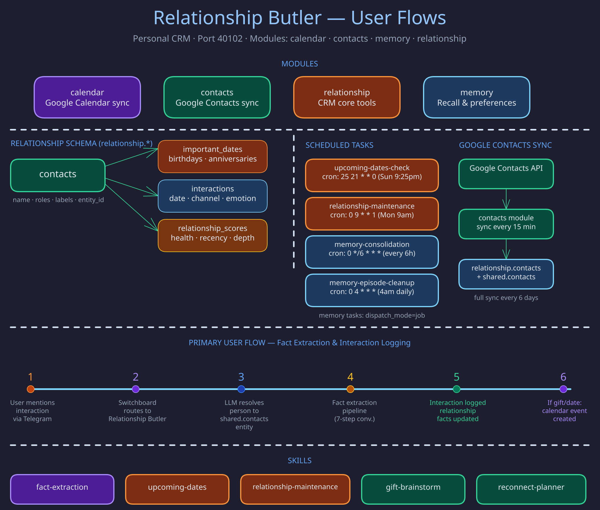

# Relationship Butler

A personal CRM: contacts, relationships, important dates, interactions, gifts, loans, and
reminders, so the owner never forgets what matters about the people in their life. Data is
entity-first: every contact links to a shared entity, and facts attach to the entity.

- **Identity and scope:** [`roster/relationship/MANIFESTO.md`](../../roster/relationship/MANIFESTO.md)
- **Required behavior:** [`butler-relationship` spec](../../openspec/specs/butler-relationship/spec.md)
- **Schedules, modules, and port:** [`roster/relationship/butler.toml`](../../roster/relationship/butler.toml)
- **Entity model:** [Identity Model](../concepts/identity-model.md)

## Stale-contact source authority

Elapsed time alone does not prove a contact has gone quiet. A contact can be surfaced as overdue
(in insight scans, the weekly maintenance message, the reconnect planner, the Contacts overdue
panel, or the attention rail) only when exactly one server-attested producer was expected to
record the next interaction, and the heartbeat for that exact producer endpoint is healthy. A
healthy sibling endpoint never substitutes; stale, missing, unhealthy, or mixed provenance makes
the contact `unmeasurable` and pauses every nudge. Caller-settable `extra_metadata.source` is not
producer authority. `unmeasurable` describes the instrument, not the owner's behavior, so an
empty overdue list is not an all-clear.

The channel-to-producer mapping lives in the `butler-relationship` spec and
[RFC 0029](../../about/legends-and-lore/rfcs/0029-expected-signals-and-honest-absence.md). For
triage, check the contact's expected-signal state and exact producer, then that same connector
endpoint's heartbeat.

## Effective time on structural facts

`relationship.entity_facts` rows can say *when* a relationship held, separately from when the
assertion was made (`created_at`), observed (`observed_at`, `last_seen`), how certain it is
(`conf`), and whether the assertion version is current (`validity`). None of those ever defaults
or derives an effective bound. The contract is the
[`relationship-fact-effective-time`](../../openspec/changes/relationship-fact-effective-time/design.md)
change; the wire rules live in `roster/relationship/tools/fact_temporal.py`.

- **Packet.** `effective_period_id` names one occurrence of a triple (NULL is the default
  occurrence every legacy row uses). The interval is half-open `[effective_from, effective_to)`
  with a precision per bound: `instant`, `day`, `month`, `year` or `unbounded`. A NULL bound with
  NULL precision is **unknown**; a NULL bound with `unbounded` is an explicit open end. Unknown
  never means "for all time". Coarse bounds normalize to UTC unit starts, and an upper bound to
  the first instant after its unit (`2024-05`/`month` stores `2024-06-01T00:00:00Z`).
- **Writer modes.** With no temporal argument (omitted and `null` are identical) a write is
  *ordinary*: it targets the default occurrence and copies whatever packet that row already has
  into any provenance replacement. Any non-null bound, precision or period id is an *explicit*
  packet; a different packet for an occupied occurrence is refused, never silently corrected.
  `corrects_fact_id` is a compare-and-swap correction of one exact active version; a stale
  target fails without writing. Parked owner approvals carry all six temporal keys canonically
  and freeze the resolved mode and base version in `fact_approval_context`.
- **Readers stay assertion-current.** Existing queries select `validity = 'active'` only; an
  active row whose interval closed in the past is still returned. As-of reads belong to a
  separate change.
- **Transition stage, no live cutover.** Migration `rel_035` adds the columns, checks and the
  occurrence index but keeps `uq_ef_spo_active`, the deployed writer's conflict target. While
  that index exists every temporal argument fails `temporal_cutover_pending` before approval
  parking or any write, so only unknown default rows can exist. Dropping it is a later cutover
  migration that is not in the chain; it needs proof that no old writer is live and that every
  production mutator in `tests/contracts/test_entity_facts_mutator_inventory.py` preserves
  occurrences or refuses first. Until then, rollback is: drain the transition writer, restore
  the old one, optionally downgrade `rel_035` (facts and rel_034 evidence, coverage and approval
  context survive). The downgrade refuses once the legacy index is gone or any temporal value
  exists; after cutover, recovery rolls forward. The cutover is a plain hard cutover: every
  database client is stopped and G refuses while any other client is connected, as drafted in
  the [effective-time cutover notes](../operations/relationship-effective-time-cutover.md).
- **Mutator fences.** Entity merge locks and plans every affected fact first, repoints rows with
  their packets and evidence intact, and refuses `temporal_occurrence_collision` before any write
  rather than collapse an occurrence that carries effective time. An exact collision between
  unknown defaults keeps the source's row only if it alone is verified, and otherwise the target's,
  whatever the confidence of either; the survivor receives the other row's evidence. Hash-addressed
  contact routes, SPO retraction and `prefers-channel` refuse (`temporal_mutator_unsupported` /
  `temporal_occurrence_ambiguous`) whenever they would have to choose between occurrences or drop a
  packet. `contact_merge` does every write in one transaction that starts with the entity merge
  authority, the only writer of the entities' facts. It therefore has the authority's locks,
  refusals, graph edge repair and audit row, its facts never move without the source's
  `merged_into`, and a refused entity merge refuses the contact merge. A forget and a memory
  entity delete both remove the entity's `contact_entity_map` row in their own transaction, so that
  contact reads as not found. A contact still bridged to a removed entity (a delete from before that
  unlink, or a merged-away entity) gets a `ValueError` naming it, and nothing moves. It re-points the contact's `important_dates`, `relationships`,
  `group_members`, `contact_labels`, `addresses`, `tasks` and `life_events`, dropping a group or
  label row the target already has. A date both contacts hold under one label, month and day merges
  to one row keeping any known year; two different known years stay as two rows. Only the rebind
  settlement
  runs after commit. The rebind ledger recovers a missed settlement, because each daemon's idle sweep
  settles pending receipts and retries failed ones. `contact_merge` logs a failed receipt only for
  Relationship's own schema, the one it settles itself; every other schema is still `pending` when
  it returns. Two contacts of one entity collapse without touching it. A contact value edit re-locks its hash-selected row before retracting it and refuses
  `contact_fact_changed` (409) if the row was retracted or re-valued meanwhile. Entity forget
  retracts every occurrence as-is and removes their graph edges, and a forgotten or deleted entity
  cannot then be merged on either side. Forget and `DELETE /api/memory/entities/{id}` hold the entity
  row `FOR UPDATE` until their marker commits, so a merge or rebind either finishes first and has
  its references retired too, or waits and refuses. The memory delete retires facts across pools
  before its marker, so a crash can leave retired facts on an unmarked entity, which a retry
  completes; Google/Steam hard deletes keep their all-version cascade. The email enrichment reap
  takes the same lock per placeholder, skipping any another transaction holds for its next run, and
  repeats its no-references check under that lock. The route runs one delete
  at a time per process, because each holds a pool connection while its fan-out takes others.
  A memory `store_fact` property write takes its entities `FOR KEY SHARE`, in ascending id order,
  before its first fact lock, and a Dunbar tier pin (tool or route) does the same before retracting
  the old override, so either racing a forget or delete waits instead of deadlocking.
- **Lock order.** Every `entity_facts` write locks `public.entities` rows before fact rows,
  each set in ascending id order. Both merges take their entities `FOR UPDATE` first; the central
  writer (and the contact value edit that calls it) takes the subject and any entity object
  `FOR KEY SHARE` (`_lock_fact_entities`) before its first fact lock, so a correction racing a
  merge waits instead of deadlocking. A caller that makes several writer calls in one transaction
  (`promote_entity`'s `initial_facts`) takes all of their entities in one ascending batch
  (`_lock_fact_entities_batch`) before the first, so the order holds across calls too, and likewise
  takes the union of their identity slots once, after the entities. `loan_settle` takes the loan's
  entity before the loan row, because its successor insert needs that entity's foreign key, and
  refuses while that entity has `merged_into` set, because a merge moves `facts` after its commit
  and would miss a successor written during that move.
  Retract/verify-only paths write no FK column and take no entity lock. Any other write that waits
  out a merge still lands on the tombstoned source; whether those writers refuse or follow
  `merged_into` is open (bu-gm93xc).

## Meeting debrief

An ended calendar occurrence the owner attended with other people gets one
`relationship.meeting_debriefs` row, keyed `(event_id, occurrence_start)`, so a recurring series
is debriefed per occurrence. The zero-LLM `meeting_debrief` job (daily, 18:00) records the rows
and proposes one batched insight ("Anything agreed?") through the insight broker. A declined
meeting, a solo block, free (transparent) time, an all-day event and a butler-generated event are
never debriefed, and neither is a meeting whose other attendees are all not `active` in
`public.entities.posture`; such a person is never named in the prompt, and posture is re-read at
prompt time.

The owner's reply is recorded by `meeting_debrief_answer` (guided by the `meeting-debrief`
skill): `none_agreed`, or commitments created through `create_commitment` with
`evidence_opened = {source: "meeting_debrief", event_id, occurrence_start, debrief_id}`. The
counterparty must be an attendee of that meeting; an attendee with no resolved entity gives a
null counterparty, never a dropped commitment. `sphere` (`work` or `personal`) is stored on the
commitment only when the owner declares it. The next calendar prep envelope for that person
carries the commitment.

Three consecutive unanswered batches drop the cadence to once a week (the batch that crosses the
threshold says so); any answer restores the daily cadence.

The Calendar page shows a Debrief card fed by `GET /api/relationship/meeting-debriefs/pending`,
which returns what `meeting_debrief_pending` returns (a failed read is `debriefs_available: false`,
never an empty list). A reply from the card is sent as `"<number>: <text>"` to the Relationship
pinned dashboard conversation, so it reaches the `meeting-debrief` skill without classification.
Not built yet: a "work commitments" filter on the condition ledger, and deriving `sphere` from
endpoint custody.

## Meeting card

Twenty minutes before a meeting with at least one other, non-declined attendee, the zero-LLM
`meeting_card_push` job queues one card on the insight broker's timed lane (bu-jv1moa.9; openspec
change `add-meeting-card`). It sends nothing itself, so quiet hours, `dnd`/`sleeping` holds and the
daily cap are the broker's; `meeting` and `focused` do not hold it. It is dark: `MEETING_CARD_LIVE`
is off and no schedule exists, so activation is one owner-approved change.

The card is a fixed template read from the prep envelope `calendar/prep/<event_id>`: title and
time, location, each named attendee with the date they last met, "You owe" and "Waiting on"
commitments, and a link to the dashboard Calendar page. A missing envelope, or one stamped for a
different start, gives "No prep context yet." Dedup is `(event_id, start)`, so a moved meeting
earns one new card. The meeting selection and exclusions are the debrief's. A non-`active` person
is never named; the meeting is still carded without them. Invite text is stripped of markup and a
location never renders as a link (a URL shows only its defanged host).

Not built: the "Debrief later" button (no signed tap sink fits a timed insight), leave-by timing
(needs travel legs, bu-jv1moa.7), the last message topic (the Relationship role cannot read the
messenger prep envelope), and a per-event dashboard link (the Calendar page has none).

## Owner anchor-address geocoding

Chronicler needs to know where the owner's home and work are; Relationship owns the address
facts, so it converts them (bu-r3fmja.3; openspec change `chronicler-situational-inference`).
The deterministic hourly `relationship_geocode_owner_addresses` job (no session, no model;
`roster/relationship/tools/owner_address_geocoding.py`) geocodes **only** the owner's anchor
addresses:
active literal `has-address` facts on

1. the owner entity (`'owner' = ANY(public.entities.roles)`);
2. an entity the owner has an active `works-at` edge to;
3. a `place` entity the owner has an active `rental-location` or `lives-at` edge to.

No contact's address and no location trail is ever sent to a geocoder. Merged or deleted
entities are skipped.

**Registering a work address.** Tell Relationship "I work at Acme; Acme's address is 1 Example
Way, Singapore 012345". That records an owner `works-at` edge to the Acme organization entity
and a `has-address` fact on Acme (not on the owner). The next run geocodes it.

**Providers.**

- Singapore addresses (the text names Singapore, ends in country code `SG`, or carries a 6-digit
  postal code and names no other country) go to OneMap search
  (`https://www.onemap.gov.sg/api/common/elastic/search`, first result's `LATITUDE`/`LONGITUDE`,
  confidence 0.9). An empty OneMap result falls back to Nominatim.
- Everything else goes to Nominatim (`https://nominatim.openstreetmap.org/search?format=json&limit=1`,
  confidence 0.7) with the fixed User-Agent `butlers-relationship-geocoder/1.0` and at least one
  second between requests.
- OneMap credentials are optional. To search with a bearer token from OneMap's `getToken`
  endpoint, open `/secrets` in the dashboard, choose **Add credential**, then **System secret**,
  and add keys `ONEMAP_EMAIL` and `ONEMAP_PASSWORD` with target `relationship`. Without them, or
  when the token request fails, search runs unauthenticated. They are resolved through
  `CredentialStore` from the database only, never from the environment.
- Outbound HTTPS needs no extra declaration: butler pods already have public egress (only
  private ranges are fenced).

**`relationship.address_geocodes`** (rel_038) holds one row per anchor `has-address` fact:
`fact_id` (PK, FK to `entity_facts`, cascades on delete), `address_sha256` (SHA-256 of the
stripped fact text), `status` (`resolved` / `not_found` / `failed`), `lat NUMERIC(7,5)` and
`lon NUMERIC(8,5)` (present exactly when resolved), `provider` (`onemap` / `nominatim`),
`confidence`, `attempts`, `geocoded_at` and `next_attempt_at`. A geocode is current only when its
`address_sha256` matches the fact's text; Chronicler must ignore stale or unresolved rows.
Beyond Relationship, only `butler_chronicler_rw` can read it (SELECT only).

**When a fact is geocoded.** A fact is due when it has no row, its text hash changed, or a
`not_found`/`failed` retry is due. HTTP 429/5xx, other non-2xx responses, timeouts and malformed
bodies are `failed`; an empty result is `not_found`. Both back off 1 h, 6 h, 24 h, then doubling
up to 7 days. A run handles at most 20 facts (new or changed text first), is serialised by an
advisory lock, and deletes the rows of facts that are no longer anchors (for example after the
owner leaves a job). A `resolved` row is never re-queried until its text changes.

**Privacy.** The job never logs or returns address text or coordinates: log lines carry fact
ids, statuses and providers, httpx's own request log line is suppressed for these calls (its URL
contains the address), and the job returns counts only.

## Owner-chat commitment candidates

Promises the owner makes in their own one-to-one WhatsApp and Telegram chats become
**candidates**, which the owner answers on a signed confirm card (bu-jv1moa.11; openspec change
`add-owner-chat-commitment-candidates`, REQ-commitment-lifecycle-011 to -017). A candidate is
not a commitment. Only the owner's Track tap creates one. The routed extraction path
(REQ-commitment-lifecycle-007) is unchanged.

**Dark.** `COMMITMENT_CANDIDATES_LIVE` in `roster/relationship/tools/commitment_candidates.py`
is `False` until the signed-confirm composition is installed (bu-atc3xi). The job
`commitment_candidate_scan` is registered but has no schedule in `butler.toml`. While dark a
run reads no spans and writes no cursor; lapse and purge still run.

**Producing a candidate.** The deterministic, model-free job reads pages from Switchboard's
`owner_chat.spans` relay as `relationship` (see `docs/architecture/service-plane.md`). The
relay returns only the owner's own unforwarded messages from private chats, with the single
counterparty identity. For each one the job:

1. skips a message whose `source_key` (SHA-256 of channel, endpoint, chat, provider message id
   and direction) already has a row or tombstone;
2. resolves the counterparty with `resolve_contact_by_channel`. It must be a live entity that
   is neither the owner nor unidentified;
3. runs `detect_commitment` with `now` set to the message's event time in the owner's timezone,
   so relative deadlines anchor to the message, not to processing time;
4. refuses an action longer than 120 characters (it is never truncated), and stores the
   detector marker only as a fixed category (`first_person_will`, `first_person_going_to`,
   `first_person_obligation`, `relay_told`, `relay_promised`), never the matched text, which in
   the relay forms ("I told <name> I'll") carries a third party's name. A form with no category
   is refused; rel_042 CHECKs both;
5. writes nothing when an active commitment or a live candidate already has the fingerprint.

The cursor (`state` key `commitment_candidates:cursor`, the projection's
`(received_at, inbox_id)`) is written only after a page's candidates commit. A replay, a crash
before the cursor write, or two concurrent runs therefore converge on one candidate per message.
Any relay or database failure stops the run without moving the cursor.

**`relationship.commitment_candidates`** (rel_042) stores the detected action, deadline, kind,
confidence, marker category, fingerprint, counterparty entity, channel, the evidence reference
(`ingestion_event_id`, `provider_message_id`) and the `untrusted_origin` taint. It never stores
the message text. Its states are `pending`, `carded`, `tracked`, `done`, `ignored`, `superseded`
and `lapsed`. A CHECK makes every terminal row a content-free tombstone: source key, state,
timestamps, `confirm_id`, and the commitment fingerprint only when tracked.
`relationship.commitment_candidate_receipts` (keyed by `confirm_id`) is for the sink.

**Card.** After reducing, a live scan runs the card step
(`roster/relationship/tools/commitment_candidate_cards.py`) when the switch passes it, even if
the relay was unavailable. Under a row lock it gives each pending candidate one card snapshot,
unless the candidate is within 30 seconds of lapse (lapsed), its fingerprint is already active
(superseded), the counterparty's posture is not `active` (deferred, stays pending) or the owner
has no numeric Telegram chat (stays pending). The snapshot fixes the prompt: "To:" name,
optional "Due:", the quoted action, the owner recipient and a timeout of at most 24 hours and
never past the lapse. The confirm is requested outside the lock with the candidate id as key,
so a repeated step returns the same confirm; the candidate becomes `carded` with its
`confirm_id`. An unanswered card expires and is never re-sent.

**Sink.** `relationship.commitment_candidate` (registered by `relationship_confirm_sources` in
`src/butlers/core/confirm_authority.py`) accepts `track`, `done` and `ignore` only. `prepare`
rebuilds the prompt from the snapshot and refuses a pending candidate whose posture or owner
recipient changed since. `apply_disposition` runs in one transaction: a stored receipt for the
`confirm_id` is returned unchanged; otherwise it locks the candidate (first terminal wins, a
later tap gets `already_<state>`), calls `create_commitment` on Track only when the fingerprint
is not already active (the routed commitment keeps its own evidence), tombstones the row and
writes the receipt. Track evidence records `source=owner_chat_candidate`, the channel, the
ingestion event and provider message ids, the marker, the candidate and confirm ids, and
`applied_at` (the sink's application time; the transport keeps the answer time).

**Lapse and retention.** A live candidate lapses silently at `event_time + 14 days`; nothing is
sent to the owner. Tombstones are deleted once their event is more than 14 days old. The
projection never returns older events, so a deleted tombstone cannot be re-proposed.

**Known gap.** Single-message envelopes (Telegram backfill, ingest retry, chat-id fallback)
carry no per-entry authorship facts. Owner messages that arrive that way never become
candidates.

## Entity life-graph reads

Two owner-only reads back the entity page's "what do I owe them, when did we last meet" doors
(`openspec/changes/entity-chronicles-and-commitment-doors`). Both run `_assert_owner_role` (403
`owner_required`) and then `_assert_entity_exists` (404 `Entity not found`) before any source read,
and neither writes, calls an LLM or notifies.

- `GET /api/relationship/entities/{id}/activity?source=all|relationship|chronicler` selects which
  contributions execute; omitted means `all`, and any other value is a 422 before either fetch.
  `relationship` reads both local stores (narrative and identity) and never acquires a Chronicler
  client, so it cannot inherit Chronicler degradation. `chronicler` runs no Relationship fact
  query. Selection happens before `total`, daily bins, ordering
  (`ts DESC NULLS LAST, (src, COALESCE(store, ''), id) ASC`) and the `limit`/`offset` slice.
  A Chronicler row that is not an object, lacks a valid episode UUID, or lacks a parseable
  `canonical_start_at`/`start_at` is excluded, the readable rows stay, and the response is
  `degraded=true` with `chronicler_activity_unavailable`. Chronicler rows still arrive only
  through `chronicler_list_episodes(participant_entity_id=...)` over MCP, so organizer and
  participant links count.
- `GET /api/relationship/entities/{id}/commitments?limit=1..200&offset>=0` returns open or aging
  commitment-class `public.owner_conditions` rows whose counterparty is the entity and whose
  direction is `owner_to_other` or `other_to_owner`, across every originating source, ordered
  `first_detected_at DESC, fingerprint ASC`. It reads through
  `butlers.core.commitments.list_entity_commitment_page`, which returns the page and the total
  from one statement. Items carry only `kind`, `direction`, `summary`, `deadline`,
  `escalation_level` and `fingerprint`. Any source failure returns 200 with `items=[]`,
  `total=0`, `degraded=true` and `commitment_source_unavailable`, never a zero.

The entity page renders a Commitments section from the second read (Meeting Prep row vocabulary,
no mutation affordance) and a Shared Chronicles preview from
`activity?source=chronicler&limit=5&offset=0`. The preview duplicates, and does not replace, the
unified activity timeline. Each preview row opens `/chronicles?date=<owner-local day>&episode=<id>`.
Meeting Prep attendee names link to `/entities/{entity_id}` with the full current Calendar query
appended verbatim; an attendee without a nonblank id stays plain text.

## Implementation Notes

### Meeting debrief answer transactions

The answer handler holds the debrief row and rechecks answerability in the same owning
transaction as every public `create_commitment` call and the final state update. The additive
internal `transaction_connection` option retains the ordinary pool wrapper; it must not reacquire
the held pool connection, so a size-one pool works. Batch preflight reuses common validation.
Required propagated graph/final-state failures and cancellation before commit roll back the batch,
including changes to existing confirmations. Typed invalid responses follow rollback; captured/
none_agreed follow commit. Lost commit acknowledgment remains uncertain, and durable row-lock
retry cannot append a second answer. The job's stale unaskable expiry rechecks pending.

Creation and reconfirmation use `snapshot_complete=False` and produce no resolved transition,
so they do not generate premise amendments. The existing resolved-only premise hook retains its
savepoint/best-effort ordinary-error behavior; this existing partial conformance does not waive the
mandatory resolved-enqueue contract. Conditional enqueue commit/rollback proof uses a real
resolution control. Counterparty/null, evidence, declared sphere and current prompt posture policy
are preserved. Answer-time posture (.69) and free-text/LLM verification (.66) remain separately
uncompleted. The source PR retains separate baseline and corrected-source receipts: the actual
before-fix head `220cf3eb` executed 23 migrated PG cases with 10 causal failures and 13 passing
controls in CI 37286612106. Corrected-source named PG proof, independent review and the protected
gate remain required; source inspection and collection alone are not runtime proof.

- `relationship.facts` is a multi-valued log store: `activity` and `interaction_*` carry many
  active rows per `(entity_id, predicate)`. Contradiction detection in
  `run_fact_retraction_curation` (`roster/relationship/jobs/relationship_jobs.py`) is therefore
  gated to the `_CONTRADICTION_FUNCTIONAL_PREDICATES` allowlist, so a new log predicate can never
  flood approvals. Cardinality cannot be read from `entity_predicate_registry`, which covers only
  the `entity_facts` store.
- `run_interaction_sync_job` reads `switchboard.message_inbox` directly, so `scripts/init-db.sql`
  grants `butler_relationship_rw` read-only access to schema `switchboard` (plus matching default
  privileges).
- Calendar interaction sync reads `relationship.calendar_events` explicitly through the
  Relationship role. It consumes the local Calendar module projection, including its attendee
  metadata, rather than falling back to a public or another butler's projection.
  Calendar query failures increment the existing `errors` result counter and log the failure;
  a missing table emits a warning. The shared checkpoint remains unchanged after a failed
  calendar query, preserving the bounded interval for the next scheduled run while committed
  message interactions deduplicate. A successful empty read advances normally. The scheduler
  still records the returned dict as dispatch success, so callers must inspect `errors`.
- Routine Calendar provider polling remains disabled by default in the checked-in Relationship
  configuration. Existing internal projection, explicit force-sync and mutation projection
  paths remain available. Reading this table proves local consumption only; it does not prove
  provider ingestion or deployed source population, and does not subscribe to foreign schemas.
- `POST /api/relationship/contacts/sync` dispatches to the `contacts_sync_now` MCP tool with
  `{"provider": "google", "mode": "incremental|full"}`. `mode` is strict, and credential failures
  surface as `400` errors pointing at `/api/oauth/google/start`.
- `relationship.facts` and `relationship.predicate_registry` belong to the memory module; domain
  triple-store work uses `relationship.entity_facts` and `relationship.entity_predicate_registry`.
  Interaction facts use `subject='entity:{entity_id}'` (`interaction_log` / `interaction_list`
  still resolve legacy contact UUIDs).
- Active-surface queries share one filter excluding `metadata.archived = true`, `archived_at`,
  `tombstone = true`, `deleted_at` and `merged_into`.
- Dunbar decay counts connector LLM-extraction facts as mentions unless
  `extra_metadata.source == "interaction_sync"`; `email`, `interview` and `calendar_event`
  interactions weigh `0.2`.

## Upcoming date push

The registered `upcoming_dates` tool selects only `public.entities.posture = 'active'`
in both contact-anchored and contactless entity-anchored UNION arms. Existing listed/archive
mapping, ordering, anniversaries and year wrapping remain in effect. The 08:00
`upcoming-dates-check` job calls `upcoming_dates(days_ahead=7)`: an empty successful read
is silent, and a failed read raises, so it never becomes a reminder or an all-clear. A
successful read with dates sends one templated message through the owner-notify boundary
(`roster/relationship/tools/reminders.py`).

Memorial, quiet and no_contact people remain available to appropriate history/display readers.
Reactivation makes the date eligible again. The separately adopted calendar remembrance overlay
retains its own policy; this birthday push introduces no memorial opt-in or changed posture writer.

## Related Pages

- [Switchboard Butler](switchboard.md) -- routes people-related messages here
- [General Butler](general.md) -- handles freeform data that is not contact-specific

### Fact authority and reported channels

The central writer derives verified content from its private admitted report or a separately
recorded owner confirmation, never from caller confidence. Third-party kinship at confidence
0.95 parks for approval. Gap closure reads the persisted fact's report and confirmation, not
the current session. Candidates cannot answer an established identity gap.

Identity fact APIs carry original reporter availability and owner confirmation separately.
The contact card shows reported channels awaiting adoption, protected exact Adopt/Reject
controls and receipt-based recovery after an uncertain response. Narrative facts retain their
existing behavior. Entity merge locks candidate identity slots and all active facts before the
first write; moving a candidate does not activate it or rewrite its reporter.
