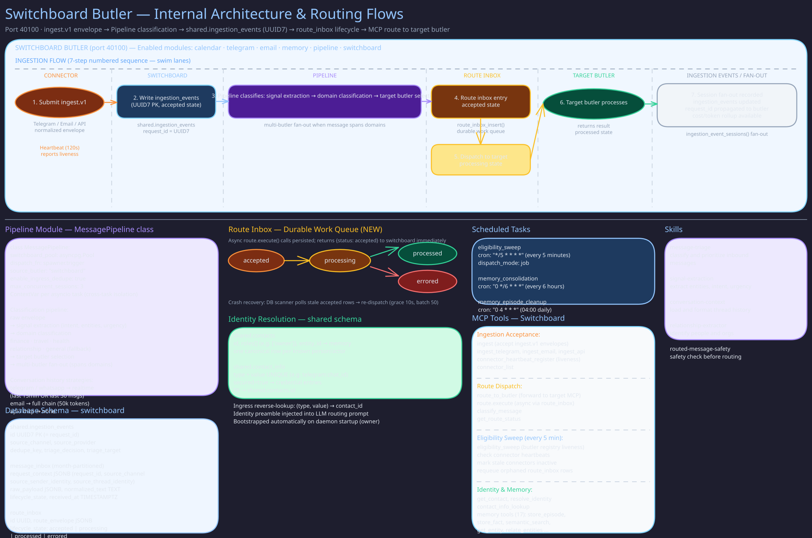

# Switchboard Butler

The single ingress and routing control plane. It assigns request context, resolves sender
identity, classifies and decomposes each message, dispatches segments to specialist butlers, and
relays every butler's `notify()` to Messenger. It owns no domain logic.

- **Identity and scope:** [`roster/switchboard/MANIFESTO.md`](../../roster/switchboard/MANIFESTO.md)
- **Required behavior:** [`butler-switchboard` spec](../../openspec/specs/butler-switchboard/spec.md)
- **Schedules, modules, and port:** [`roster/switchboard/butler.toml`](../../roster/switchboard/butler.toml)

## Insight outcome efficacy (observe-only)

The daily `insight_outcome_sweep` job (05:52 UTC) enrolls terminal premise-bound insights into
`public.insight_outcomes`, settles whether each premise resolved, then rolls the settled rows of
the last 90 days up into `public.insight_class_efficacy`: one row per origin butler, category,
priority band (`low` under 50, `normal`, `urgent` at 90 and above) and day. Treated is
`delivered`/`coalesced`; the holdout is `held_budget`/`held_context`; `unmeasurable` rows count in
neither arm. Under five measured rows in either arm the verdict is `unmeasured`. Otherwise it is
`effective` when the treated arm resolves at least 20 points more often, or about as often at no
more than half the holdout's median time; `self_resolving` when the holdout resolves at least 60%
of the time and the treated arm does not resolve clearly more often (or clearly faster); else
`ignored`. `GET /api/attention/efficacy` returns the
latest row per class and band, and the Trust Console's attention-ledger panel lists them. By
default (`outcome_shaping = observe`) nothing reads the verdicts to shape delivery.

### Shaping on the owner's say-so

`insight_settings.outcome_shaping` is `observe` (the default) or `shape`. Nothing in the
repository writes it: turning `shape` on is an owner act, taken directly on the settings row, and
setting it back to `observe` restores the unshaped broker at the next cycle. Under `shape`, a
routine delivery cycle reads each candidate's latest verdict in its priority band and:

- makes a `self_resolving` class **digest-only**: its candidates are never sent standalone, take
  no delivery slot, ride only a delivery already going out, and otherwise stay pending (and so
  expire as natural holdouts, which keeps the measurement honest);
- gives an `effective` class the baseline weight instead of the click proxy's;
- cites the counts in `category_budget_reasons`;
- never shapes the urgent band, the `break_through` category, the urgent-only sub-cycle, or a
  verdict older than 14 days.

A `useful` reply on the class after its demotion began restores it until the verdict changes; a
`never` reply still mutes. A class that becomes `self_resolving`, or `ignored` with no feedback in
30 days, is announced once, as one line riding a delivery (counts included, with the useful "keep"
and mute "quiet" doors on one of the class's delivered candidates), at most once per class per 30
days. A delivery whose class has a fresh measured verdict in its own band gets no engagement row,
so the 60-minute any-message mark, the category weight and the 14-day auto-off rate never count
it (urgent-band, unpremised and unmeasured deliveries keep the proxy). Riders take no daily send
slot. Per-class state (`shaping_state`) records the verdict
seen, since when, and when the owner was last told.

Read a verdict as a correlation, not an effect:

- **Holdout selection is biased.** Nothing is withheld at random. A candidate is held because the
  day's budget ran out or the owner's context said wait, so the held arm skews toward
  lower-ranked candidates and busy days, and it can differ from the treated arm in ways that
  also change whether the premise resolves.
- **The treated window is shorter after a delay.** Both arms are timed and windowed from
  `proposed_at`, because a holdout has no exposure time. A candidate delivered late (quiet hours,
  a coalesced digest) has less of its 14-day window left after the owner sees it, and its time
  to resolve includes time before the owner was told. Both effects understate a nudge's effect.

## Related Pages

- [Switchboard Routing](../concepts/switchboard-routing.md) -- how a message is routed, end to end
- [Messenger Butler](messenger.md) -- the delivery plane `notify()` is relayed to
- [General Butler](general.md) -- fallback routing target
