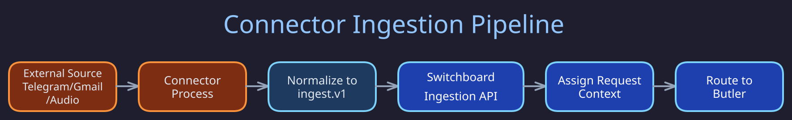
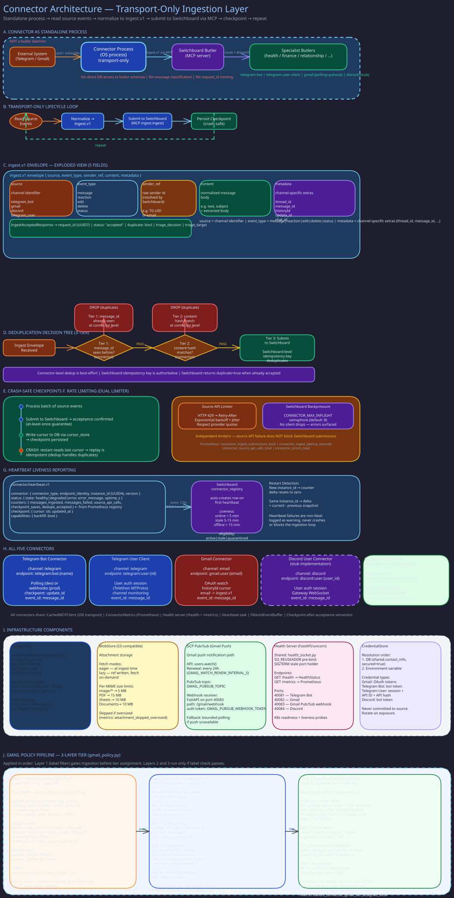

# Connector Architecture Overview

> **Purpose:** Explain what connectors are, their responsibilities, transport model, and how they submit events to the Switchboard.
> **Audience:** Developers building or operating connectors.
> **Prerequisites:** Familiarity with the [Switchboard butler role](../concepts/switchboard-routing.md).

## Overview





Connectors are transport adapters that bridge external messaging systems (Telegram, Gmail, audio devices, etc.) into the Butlers ecosystem. They read events from source APIs, normalize them into a canonical envelope format, and submit them to the Switchboard's ingestion API. Connectors are deliberately thin -- they own the transport layer and nothing else.

## What Connectors Are

A connector is an independent process (or co-located daemon) that:

1. Reads source events or messages from an external system.
2. Normalizes source payloads into the `ingest.v1` envelope format.
3. Submits envelopes to the Switchboard via MCP tool call (`ingest`).
4. Persists a resume cursor so it can restart safely after crashes.
5. Sends periodic heartbeats to report liveness and operational statistics.

Connectors run independently from the Switchboard daemon lifecycle. The preferred deployment model is one process per connector type, though in-process connectors are allowed as long as they use the same canonical ingest path.

## Connector Responsibilities

### Connectors MUST

- Read source events/messages from an external system (Telegram, email, webhook, audio, etc.).
- Normalize source payloads into `ingest.v1` envelopes.
- Submit to the canonical Switchboard ingest API via MCP tool call.
- Persist connector-local resume state (cursor/offset/high-water mark) in the database via the `cursor_store` module.
- Enforce source-side rate limiting (provider quotas, 429 handling, jittered backoff).
- Enforce ingest-side backpressure (bounded in-flight requests, retry policy).
- Send periodic heartbeats to the Switchboard (every 2 minutes by default).
- Implement crash-safe, restart-safe behavior with at-least-once delivery.

### Connectors MUST NOT

- Classify messages (that is a Switchboard responsibility).
- Route directly to specialist butlers.
- Mint canonical `request_id` values (Switchboard assigns these at ingest acceptance).
- Bypass Switchboard ingestion with direct target-butler calls.

## Transport Model

Connectors submit envelopes via **MCP tool call** (`ingest`) to the Switchboard MCP server. Transport is SSE-based MCP (`fastmcp.Client`), not HTTP POST. The MCP server endpoint is configured via the `SWITCHBOARD_MCP_URL` environment variable.

The Switchboard responds with `202 Accepted` semantics: ingest is accepted for async processing, and the response includes a canonical request reference. Duplicate submissions for the same dedupe identity return the same canonical request reference and are treated as success, not error.

### Submission Flow

```
External Source --> Connector --> [normalize to ingest.v1] --> MCP tool call (ingest) --> Switchboard
                                                                                            |
                                                                         request_id assigned <--
                                                                         classification + routing -->
```

## Data Source Modes

Connectors support two source models:

- **Push/webhook connectors:** The source pushes events to the connector (e.g., Telegram webhooks, Gmail Pub/Sub), which forwards them to the Switchboard.
- **Pull/poll connectors:** The connector periodically fetches new events from the source API (e.g., Telegram `getUpdates`, Gmail history polling), then forwards each to the Switchboard.

Each newly observed source message/event is ingested as one canonical ingress record.

## Endpoint Identity Auto-Resolution

Connectors auto-resolve their endpoint identity at startup from the source API. No environment variable is needed:

| Connector | Resolution method | Example identity |
|---|---|---|
| Telegram bot | `getMe()` | `telegram:bot:@mybot` |
| Telegram user client | `get_me()` | `telegram:user:@username` |
| Gmail | `google_accounts.email` | `gmail:user:alice@gmail.com` |
| Live listener | Device config | `live-listener:connector` |

## Idempotency and Deduplication

Connectors must always send stable source identity fields (`channel`, `endpoint_identity`, `external_event_id`). The Switchboard owns the deduplication decision at the ingest boundary. Connectors must treat duplicate acceptance as success.

Canonical dedupe key guidance per provider:

- **Telegram:** `update_id` + receiving bot identity
- **Email:** RFC `Message-ID` + receiving mailbox identity
- **API/MCP:** caller idempotency key or deterministic payload hash + source identity + bounded time window

## Untrusted Spans and Channel Kind

RFC 0038 D5 starts an owner goal exposed when the owner's message carries someone else's text.
Connectors mark that text. The dark accepted-source adapter reads canonical retained input under
`ClosedGoalProfile.HARNESS`, verifies the sender independently, and returns frozen ordered segments.
Marked ranges and attribution labels serialize as structural JSON data, including attachment-only
markers; delimiter-looking text cannot escape them. Verified owner origin stays owner while starting
exposed. Unknown or unreadable evidence refuses admission; known bad ranges cover the whole text.
Current routing, schedules and dashboard do not call this adapter. Helpers live in
`butlers.ingestion_spans`.

- `payload.untrusted_spans`: `{kind, start, end, origin_identity?, origin_display_name?}` records,
  with `kind` one of `forwarded`, `quoted` or `embedded`. `[start, end)` are Python `str` indices
  into `normalized_text` after the contract strips its surrounding whitespace. A connector that
  knows a message carries such text but cannot locate it marks the whole text. The contract turns
  a span that does not fit into a whole-text span, and when a bearer scrub rewrites the text, each
  kind collapses to one whole-text span. The forwarding owner stays `sender.identity`.
- `event.in_reply_to_ref`: a provider reference to the replied-to message (`<chat_id>:<message_id>`
  on Telegram). The replied-to text is not in `normalized_text`, so it is not marked; admission
  resolves the reference, so a reply to the butler's own message is not exposed by the reply alone.
- Channel kind is registered per connector, not set per envelope (`REQ-connector-base-spec-003`).
  A device or telemetry feed passes `channel_kind=CHANNEL_KIND_FEED` to `ConnectorHeartbeat`, which
  sends it as `capabilities.channel_kind`. Switchboard keeps it on the `connector_registry` row and
  drops an unrecognised value, and admission resolves it with `registered_channel_kind(pool,
  connector_type, endpoint_identity)`. An unregistered or undeclared connector is a message
  channel after a successful registry read; a failed read refuses rather than downgrading a feed.
  `ingest.v1` has no channel-kind field, so an envelope cannot move itself onto the feed path.

The closed harness sends registered feeds to a trusted deterministic receiver that owns its domain
store. Unmatched feeds retain a terminal record-only disposition across attempts and kind drift, without a
goal or runner. Only a matching Git-owned subscription
(domain, event type, exact/default capabilities and declaration digest) yields an obligation.
This seam introduces no live subscription engine. A canonical accepted request always uses the same
`SourceRef("message", request_id)` for dedupe, including feed/message disposition changes.

Opaque reply locators resolve against stored transport, endpoint, conversation and recipient
provenance, independently of the current reply destination. Known inbound content without a trusted
stamp is exposed. Stored bot effects use actual producing-goal exposure. Live owner prompts join
through one immutable inbox row with goal-before-effect locks and expiry/state rechecks after waits;
Stop, terminal or expired prompts become new owner intent without caused-goal linkage. Unknown or
foreign locators do not infer continuity. A join only increases exposure and preserves origin,
ceiling, admitted exposure, causes and budget.

Deploy receiver/schema before marker/reference producers (`extra="forbid"`), and complete buffered
and filtered replay propagation before enabling a consumer. The current trusted harness remains
closed: no live activation, model launch or signing-key mount. Rollback disables consumption before
removing readers or propagation.

| Connector | What it marks |
| --- | --- |
| Telegram bot | A forward marks the whole text as `forwarded`, with the original author. `blockquote` entities become `quoted` spans. `external_reply` (a reply to another chat) marks the whole text as `quoted`. A same-chat reply sets `in_reply_to_ref`. |
| Telegram user client | A forward (`fwd_from`) marks its text or batch line. Locked Telethon blockquote entities use UTF-16 offsets mapped through HTML escaping for single events and transcript prefixes for batches. Provider quote/external-reply metadata with no reliable body range marks the whole body. Ordinary same-chat replies carry the provider `in_reply_to_ref`; they do not mark new text by themselves. |
| Live listener | Existing explicit textual forward/quote markers in the transcript use the same span parser. Filtered transcript privacy tiers preserve only exposure kinds. Arbitrary spoken or pasted text without a known marker is not inferred to be quoted. |
| WhatsApp | A forward (the bridge's `content.is_forwarded`) marks its whole text, or its own line in a batch. WhatsApp names no original author. A quoted reply carries its bridge `quoted_message_id` as `event.in_reply_to_ref`; no earlier text is inserted or marked. Batched history retains each reply locator. A one-message batch also carries `in_reply_to_ref`; a mixed batch cannot bind several reply targets to one event, so it conservatively marks the quoted-reply message line and retains that exposure through privacy replay. |
| Gmail | A forward marker line marks a `forwarded` span to the end of the text. `-----Original Message-----` and `>` quote runs (with an `On … wrote:` line) mark `quoted` spans. A `Fwd:` subject without a marker marks the whole text, and an attached `message/rfc822` marks the whole text as `embedded`. Selected HTML blockquote/cite structure also survives visible-text and whitespace normalization, HTML escaping and bearer scrubbing. MIME preference is unchanged. Metadata-only envelopes retain known exposure kinds conservatively over their subject-only text without fetching body attachments. |
| Home Assistant, ActivityWatch, OwnTracks, Steam, Google Health | Register `channel_kind = "feed"` on every heartbeat. |

## Checkpoint Persistence

All connectors persist their resume cursor in the database via the `cursor_store` module (`butlers.connectors.cursor_store`). The canonical storage location is the `switchboard.connector_registry` table, keyed by `(connector_type, endpoint_identity)`.

Startup flow:

1. Create an asyncpg pool via `create_cursor_pool_from_env()`.
2. Call `load_cursor(pool, connector_type, endpoint_identity)`.
3. If a cursor exists, resume from that position.
4. If `None` (first run), initialize from the source API and write the baseline via `save_cursor()`.

No file-based cursor storage is used. All checkpoint state lives in the database.

## Self-Registration via Heartbeat

Connectors self-register on their first heartbeat -- no manual pre-configuration is required. The Switchboard creates a `connector_registry` row and begins tracking liveness. See [Heartbeat Protocol](heartbeat.md) for details.

## Environment Variables (Common)

| Variable | Required | Description |
|---|---|---|
| `SWITCHBOARD_MCP_URL` | Yes | SSE endpoint URL for Switchboard MCP server |
| `CONNECTOR_POLL_INTERVAL_S` | For poll connectors | Poll interval in seconds |
| `CONNECTOR_MAX_INFLIGHT` | No (default: 8) | Ingest concurrency cap |
| `CONNECTOR_HEARTBEAT_INTERVAL_S` | No (default: 120) | Heartbeat interval in seconds |
| `CONNECTOR_HEARTBEAT_ENABLED` | No (default: true) | Disable for dev/testing |

Provider-specific credentials must come from environment or secret manager, never committed config.

## Authentication

Connector authentication uses bearer tokens issued by the Switchboard. Token scope must match the connector's source identity (`channel`, `provider`, `endpoint_identity`). See [API Authentication](../identity_and_secrets/cli-runtime-auth.md) for token lifecycle details.

## Available Connectors

Static discovery and buffered-preview fallback labels derive from the frozen data
in `src/butlers/connectors/catalog.py`. `GET /api/ingestion/connectors/available`
returns exactly `connector_type`, `channel`, `provider` and `display_name` for each
framework-deployable connector, independently of registered instances. Its
channel/provider fields use the connector's canonical emitted identity, including
local/Compose Live Listener even though the Helm chart has no Live Listener entry.

Canonical connector identities, legacy safe display labels, accepted ingress
pairs and deployment targets are distinct projections. A display alias does not
register a connector or authorize OAuth. The catalog contains no credentials.
This is the first consolidation slice: connector configuration, OAuth/default
registries and health/deployment wiring retain their existing mechanisms until
their own verified slices land. The environment table above still describes the
current runtime configuration.

- [Telegram Bot](telegram-bot.md) -- Bot API polling/webhook connector
- [Telegram User Client](telegram-user-client.md) -- MTProto user-client live stream
- [Gmail](gmail.md) -- Gmail API history polling and Pub/Sub push
- [Live Listener](live-listener.md) -- Ambient audio capture, VAD, and transcription
- [Heartbeat Protocol](heartbeat.md) -- Liveness reporting (all connectors)
- [Attachment Handling](attachment-handling.md) -- Gmail attachment fetch policy
- [Gmail Ingestion Policy](gmail-ingestion-policy.md) -- Tiered email processing
- [Metrics](metrics.md) -- Connector statistics and dashboard visibility

## Verification

To confirm connectors are operating within their defined responsibilities:

```bash
# 1. Active connectors appear in the registry with liveness state
psql -h localhost -U butlers -d butlers -c \
  "SELECT connector_type, endpoint_identity, state, last_heartbeat_at
   FROM switchboard.connector_registry ORDER BY connector_type;"
# Expected: each running connector (gmail, telegram_bot, etc.) shows state='online'
#           with last_heartbeat_at within the last 2 minutes

# 2. Cursor state is DB-backed (not file-based)
psql -h localhost -U butlers -d butlers -c \
  "SELECT connector_type, endpoint_identity, cursor_value, updated_at
   FROM switchboard.connector_registry ORDER BY updated_at DESC LIMIT 5;"
# Expected: cursor_value is a non-null checkpoint (history ID, update_id, etc.)
#           for each active connector; no file under /tmp or /var/lib/connectors

# 3. Connectors never route directly to domain butlers (only to Switchboard)
# Check ingestion_events source: all events should come through the ingest tool
psql -h localhost -U butlers -d butlers -c \
  "SELECT source_provider, source_endpoint_identity, COUNT(*) as events
   FROM switchboard.ingestion_events
   WHERE received_at > NOW() - INTERVAL '1 hour'
   GROUP BY source_provider, source_endpoint_identity;"
# Expected: only known connector identities appear; no rows with source_provider='internal'
#           from domain butlers bypassing the Switchboard

# 4. Connector rate limiting is enforced (no 429 errors spike in metrics)
curl -s "http://localhost:9090/api/v1/query?query=connector_errors_total{error_type='rate_limit'}" \
  | python3 -m json.tool | grep value
# Expected: zero or low count; spikes indicate rate limit misconfiguration

# 5. Backpressure counter stays near zero under normal load
curl -s "http://localhost:9090/api/v1/query?query=connector_ingest_submissions_total{status='error'}" \
  | python3 -m json.tool | grep value
# Expected: error count is near zero; rising errors indicate Switchboard backpressure
```

## Implementation Notes

- WhatsApp `pair_required` is a waiting state, not a failure. `BridgeSubprocessManager`
  (`src/butlers/connectors/bridge_manager.py`) treats it as startup-ready unconditionally, and
  `WhatsAppUserClientConnector._sse_event_loop` checks `is_awaiting_pairing` before its generic
  degraded-stop branch, so a bridge mid-QR-scan is never torn down. Only terminal reasons
  (pairing timeout, invalidated session, unreachable) break the loop.
  `WhatsAppUserClientConnector._maybe_resolve_pending_endpoint_identity()`
  (`src/butlers/connectors/whatsapp_user_client.py`) is re-run on each healthy pass so the
  `"whatsapp:pending"` placeholder resolves once the bridge reports `connected`.
- Discretion's small-group bypass (`group_size_bypass_max`) must gate on an allow-list
  `chat_type in {"group", "supergroup"}` as well as `participant_count`: DMs report
  `participant_count=2` and broadcast channels resolve counts too, so a count-only or
  `!= "private"` check bypasses discretion for them.
- `whatsapp-bridge` dispatches whatsmeow events serially on one goroutine: never make a blocking
  network call inside a handler (use the `internal/events.GroupInfoCache` pattern: serve the cached
  value, refresh in the background). There is no Go CI job; run
  `go build && go vet && go test -race && gofmt -l .` locally.
- Spotify: prefer the resolved `context_name` in `normalized_text` and `payload.raw.context_name`;
  raw URI suffixes are a fallback, or entity extraction stores Spotify IDs as names.
- WhatsApp `Client outdated (405)` loops mean the pinned `go.mau.fi/whatsmeow` is stale: update
  `whatsapp-bridge/go.mod` and confirm a live connect. It is not a re-pair condition.
- An optional connector whose credentials arrive at runtime through the dashboard must park, not
  crashloop: keep a sentinel endpoint identity plus a degraded heartbeat
  (`google_health:degraded`, `steam:no_accounts`, `spotify:unconfigured`, the Google managers' idle
  mode). Keep the connector's own endpoint identity (`self._endpoint_identity`, e.g. in
  `src/butlers/connectors/google_health.py`) empty while parked; only metrics, policy and heartbeat
  labels use
  the sentinel. Only "never connected" is non-fatal, via its own exception subclass
  (`SpotifyCredentialsUnconfiguredError`); every post-configuration fault stays loud. Env-var
  connectors (telegram, whatsapp, activitywatch) that fail `Config.from_env()` are a
  deployment misconfiguration and should crash.
- `switchboard.connector_registry` has two producers on one `(connector_type, endpoint_identity)`
  key: the `connector.heartbeat` tool (one row per process) and `cursor_store.save_cursor` (one row
  per checkpoint). Since sw_031 the role is persisted in `operational_role` (`runtime_instance`,
  `checkpoint`, `unknown`) with `parent_endpoint_identity`; the vocabulary is
  `butlers.connectors.registry_roles`. Only `runtime_instance` rows carry liveness authority;
  heartbeat promotion is one-way; `save_cursor` stamps `checkpoint` on INSERT only, never in its
  `ON CONFLICT` branch. Never derive the role from the identity string, surface `unknown` as
  `unclassified`, and make every new writer declare a role and every new consumer filter by it.

## Filtered preview bearer redaction

`FilteredEventBuffer.record()` scrubs `subject_or_preview` before it enters the in-memory queue.
It uses the existing bearer detector and typed placeholders, provider-domain hints from the envelope,
and aggressive numeric-code detection for the actual Telegram service sender `777000` or an envelope
service participant. Provider and sender-domain hints are untrusted display metadata: the preview
seam accepts bounded provider slugs or DNS names, rejects URLs, paths, code-bearing numeric labels
and labels containing a detected link secret, and uses a fixed connector label (or `unknown`) as
fallback. Comparisons collapse DNS/slug separators, so dotted numbers or dotted/underscored token
fragments cannot disguise the same bearer value. It validates every resulting placeholder label,
including old unsafe placeholders, so
the replacement cannot reintroduce a code or token through its label. Genuine safe domains and
safe existing placeholders remain intact; numeric-domain behavior in other detector callers is
unchanged. On detector/extraction failure it withholds the preview as null without logging its
contents. None, ordinary numbers and date/time guards retain existing detector semantics.
Payloads, replay/drop decisions, status and other columns are unchanged;
this is not a claim that every payload or producer log is free of secrets, and it does not produce
an authentication artifact.

`record()` also scrubs the buffered `full_payload` envelope (the shared `scrub_envelope` that
connectors apply before submit) and `error_detail`, so new filtered, errored and replayed rows
carry typed placeholders; a detector failure withholds that text without changing the row's status.

Filtered-event replay retains `payload.untrusted_spans` and `event.in_reply_to_ref` from
message-capable policy, batch/discretion and error producers. Unchanged retained text keeps the
exact span records. When privacy omits a body, bearer scrubbing changes it, NUL removal moves its
offsets or the detector fails, known exposure kinds conservatively cover the whole retained text
(or `[no text]` placeholder). Discarded bodies and bearer values are never restored to recover
offsets. Malformed-present markers remain rejectable by canonical ingest validation; replay never
silently deletes them. Repeated scrubbing and sanitization retain the exposure facts.

The forwarding owner remains the sender. The opaque replied-message locator stays distinct from
`reply_target_ref`: it confers no origin, feed selection, goal or effect authority, and only later
admission resolves it. Replay removes stored `drop_context` metadata while preserving these two
envelope fields. Object and legacy-string JSONB rows are both supported. Older rows that never
stored a marker or reference cannot recover it; there is no historical backfill.

The authorized replay API still queues only under the connector's replay-safety policy. Drains
retain their `FOR UPDATE SKIP LOCKED`/status transaction: a competing drain skips actively locked
rows, and a failed submit remains `replay_failed` until an explicit replay request. Submission
followed by uncertain status persistence may be delivered again with the same event identity for
existing ingest deduplication. This is not an exactly-once transport guarantee or a live routing
switch.

The [bearer material custody audit](bearer-material-custody-audit.md) records the exact
source inventory, connector stores, inbox readers and synthetic seam evidence. Its
full-payload, replay, logging and legacy-row findings are separate from this preview
contract; unresolved durable and vendor boundaries remain unknown.

The discretion evaluator scrubs message text before its context window, prompt, log line and
dispatcher call, so the discretion model sees the same typed placeholders ingest persists.

`scripts/scrub_filtered_event_previews.py` is a one-shot historical preview repair, never a startup
job or migration. The CLI defaults to dry run and requires an explicit existing database target and
operator identity through the normal database environment helpers. It never provisions credentials
or grants, and never prints a DSN, sender, subject, code or row payload. Source implementation and
disposable tests do not authorize live `--apply` or writer quiescence. Separately authorize those
operations and establish that writers are fixed or quiescent before claiming a historical cutoff
complete. No deployed inventory has been inspected for this change.

An example command shape is `uv run --no-sync python scripts/scrub_filtered_event_previews.py
--cutoff <timestamp-with-offset> --batch-size 500` under the existing operator's protected environment.
Dry run reports potential changes; `--apply` irreversibly replaces previews. There is no recovery of
redacted bearer text and code rollback does not restore it. Each bounded apply batch locks rows in
`(received_at,id)` order, without SKIP LOCKED, changes only the preview, commits, then reads back through
a separate acquisition. Receipt fields are content-free counts, phase, cutoff, last verified cursor,
detector SHA256, error class and SQLSTATE. A rollback is INCOMPLETE; a lost commit/readback acknowledgement
is UNKNOWN and retains the previous cursor. Restart using both `--resume-time` and `--resume-id`, or
repeat the cutoff from the beginning: placeholders are idempotent. Retention deletions are not reversed
or extended. Backdated rows inserted behind a cursor by an old writer require a new complete pass.
A dry run is not a stable-snapshot or applied-repair claim.

Evidence stores follow the same rule: OwnTracks `raw_payload` strings, Google Drive cached file
names and the ActivityWatch `window_title` column are scrubbed before the write, and a detector
failure skips that evidence write instead of storing raw text. One gap remains: ActivityWatch
`raw_payload` still stores the raw window title, URL and tab title until `bu-506glj` lands.

## Related Pages

- [Connector Interface Contract](../api_and_protocols/ingestion-envelope.md) -- Full normative spec including `ingest.v1` envelope schema
- [Switchboard Butler Role](../concepts/switchboard-routing.md) -- Ingestion authority
- [API Authentication](../identity_and_secrets/cli-runtime-auth.md) -- Token lifecycle

## Home Assistant event bearer custody

The HA connector's state and recursive attribute content uses the shared ingestion bearer scrubber before filtering/discretion, submission, filtered-event buffering, person-history writes, and wellness emission. It withholds the shared detector's recognized keyword OTPs and reset/magic links in both normalized text and raw duplicates. The adapter also checks the existing assembled label/state normalization context before discretion retains it and projects recognized redactions into matching content copies. Each available state is checked under its own friendly name and units as well as the actual transition, so new or missing metadata cannot erase old-state context. Contextual projection replaces only complete selected lexical values, including quoted or prose echoes, and protects existing placeholders. Quotes and opening brackets may precede a copied value; closing brackets and sentence punctuation may follow it. Other leading punctuation, internal punctuation, signs, and unit symbols stay part of a distinct value: fractional decimals, decimal amounts and compound identifiers containing selected digits remain exact. Its ordered alignment uses bounded scans and refuses unestablished edits with a fixed content-free error. The HA adapter does not enable Telegram's aggressive bare-number mode; ordinary readings and enum states keep their existing representation and event identity.

Scrub failure withholds the affected content and logs a fixed warning. Replay protects outgoing content without restoring withheld values or backfilling old rows. The transient REST comparison cache retains provider values for correct diff membership; only its copied downstream event is admitted to content consumers. This connector guarantee does not claim remediation of the separate module-owned HA entity snapshot/cache or the shared full-payload/error-custody investigations. No notification capability, allowlist, or authentication behavior is changed.


### Provider quote normalization boundaries

Quote metadata is representation, not verified origin, recipient, selection or
D7 authority. A Telethon reply-header quote offset indexes the earlier message,
not the owner's new body; it must never index that body. Gmail marks only the
selected MIME body's structural citation ranges, leaving surrounding owner text
unmarked when boundaries survive. Known but unlocatable quote content uses the
existing whole-text rule. Filter/error/replay privacy rewrites collapse retained
kinds onto their actual replacement text; they do not retain hidden quote bodies.
Unmarked pasted text remains the RFC 0038 D5 known limit. These normalizers do not
invoke providers or grant accepted-source authentication (.9 owns that boundary).


### Static consumer projections (S2)

The catalog now supplies the unchanged accepted wire pairs, heartbeat types,
channel-default policy keys, stored-history strategies, OAuth manifests and
closed public recovery metadata. API scope/auth dataclasses remain adapters;
status computation, redaction and credential custody are unchanged. Connector,
provider and channel selectors are distinct: Telegram preserves both connector
members, email preserves unsupported IMAP, and wellness preserves both sources.
Auth aliases do not register a connector. Historical Discord remains readable
without an active registration or recovery surface.

Canonical/legacy WhatsApp point to existing Passport pairing, ActivityWatch is
local environment configuration with no remote enrollment, and Live Listener
needs no remote authorization. No expiry or grant is inferred from static data.
The small frontend recovery file is generated with
`python scripts/render_connector_catalog.py`; `--check` verifies its exact bytes.
It is separate from API DTO generation. Google Health remains explicit opt-in;
all consent sets and manifest versions remain unchanged, including the disclosed
pre-existing Spotify identity-scope mismatch.

Connector runtimes now obtain their fixed channel/provider/type from a strict
canonical descriptor lookup. Identity environment variables and their redundant
Compose leaves are removed; aliases cannot select a runtime row. Home Assistant
retains its wellness emission, and Live Listener retains its underscore runtime
type and hyphenated stored-event identity. Endpoint, cursor, event and idempotency
keys retain their existing spellings. Operational, secret and per-account
configuration remains with its runtime consumer. Gmail shares parser stages while
preserving each entrypoint's boolean rules and validation order; per-account
metadata, DB-resolved credentials and account health port zero are unchanged.
Spotify no longer carries its two unused identity settings. S4 health-kit,
service/bind and deployment work remains required and unfinished.
