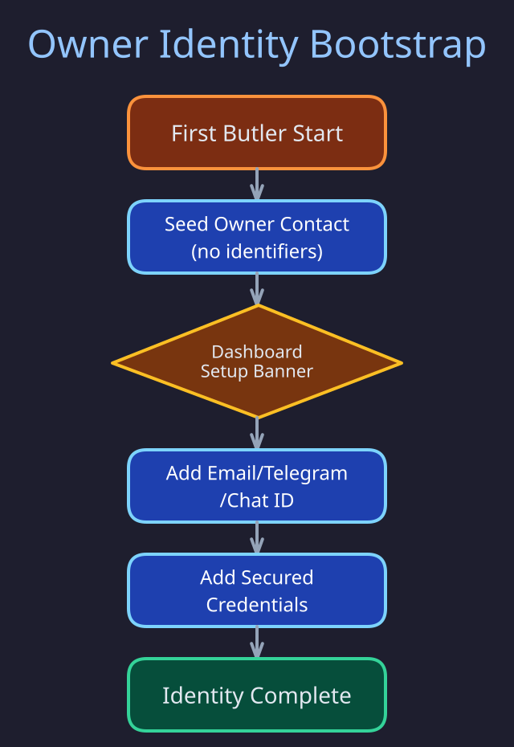

# Owner Identity

> **Purpose:** Explain how the owner entity is bootstrapped, how identity fields are configured, and how secured credentials are managed.
> **Audience:** Users setting up Butlers for the first time, developers extending identity resolution.
> **Prerequisites:** [Schema Topology](../data_and_storage/schema-topology.md), [Identity Model](../concepts/identity-model.md).

## Overview



Every daemon startup idempotently ensures exactly one **owner entity** exists in `public.entities`
with `roles = ['owner']` (`src/butlers/owner_bootstrap.py` `_ensure_owner_entity`). It starts with
no channel identifiers: the owner configures their identity through the dashboard so butlers can
recognize them across channels and so contact sync does not create a duplicate of them.

## Bootstrap Flow

1. If no entity carries the `owner` role, insert one (`canonical_name = 'Owner'`,
   `entity_type = 'person'`); otherwise reuse it.
2. On the Relationship daemon only, mirror the owner's `telegram_chat_id` `entity_info` row into a
   canonical `telegram:<chat_id>` `has-handle` fact in `relationship.entity_facts`, because
   identity resolution and the approval gate read facts, not `entity_info`.

Both steps are non-fatal no-ops when the tables do not exist yet.

## Configuring Identity

Open the owner entity's detail page in the dashboard and use the setup banner's dialog to add:

### Standard Identity Fields

- **Email** -- Your primary email address. Used for email identity resolution and contact sync deduplication.
- **Telegram handle** -- Your `@username`. Used for Telegram contact matching.
- **Telegram chat ID** -- Numeric ID for direct message delivery. Send `/start` to `@userinfobot` on Telegram to find yours.

### Secured Credentials

For butlers that act on your behalf (sending emails, connecting to Telegram as your user account):

- **Email password** -- App password for SMTP/IMAP access. Stored as `secured=true` in `public.entity_info`.
- **Telegram API ID** -- From [my.telegram.org](https://my.telegram.org). Required for user-client (MTProto) connections.
- **Telegram API hash** -- From [my.telegram.org](https://my.telegram.org). Paired with the API ID.
- **Telegram user session** -- MTProto session string for the Telegram user-client connector.

Secured entries are stored in PostgreSQL with `secured=true` and masked in the dashboard API. List responses exclude raw values; a "Reveal" button provides on-demand access.

## Setup Banner

The owner entity's detail page shows a setup banner while the owner lacks a real name, email, or
Telegram handle, judged from the entity's own detail and linked contacts. Non-secret channel handles are written
as `relationship.entity_facts` triples so the owner becomes resolvable; only secured credentials go
to `public.entity_info`.

## Identity Resolution

Owner recognition uses the shared resolution path in
[Identity Model](../concepts/identity-model.md): a message whose channel handle resolves to the owner
entity gets the `[Source: Owner (entity_id: ...), via <channel>]` preamble, and contact sync matches
the owner's email and handle instead of creating a duplicate person.

### Endpoint Custody Holds

A lost, stolen or replaced owner channel can be held in `public.custody_holds` (core_293,
openspec change `endpoint-custody-holds`). A hold names one canonical owner endpoint target by
`public.custody_target_digest(predicate, object)`, a SHA-256 over the typed fact form
`public.resolve_owner_triple` matches: `has-email` and `has-handle` values are trimmed and
lower-cased, `has-phone` values are digits only. The table stores the digest, never the raw
identifier. While a hold is active, that definer
returns no owner row for any candidate that matches the held fact. Its owner-only consumers
therefore treat the endpoint as not owner: Telegram approval callbacks are acknowledged without a
decision, Switchboard accepted-source ingress gets no owner stamp, and owner-recipient handoff and
approval corroboration refuse the owner bypass. A held fact still counts toward ambiguity, and the
owner's other unheld endpoints keep resolving.

Phone spellings do not share one normalized form (`+65 8765 0123` and `87650123` digest
differently), so a hold on one owner phone fact also demotes every phone fact of the same entity
with the same trailing eight digits, whatever that sibling's validity (core_296; core_295 used the
candidate suffix rule, which is not transitive across a 12-digit and an 8-digit spelling). Every
candidate the definer matches to a stored phone shares its trailing eight digits, so no chain of
spellings escapes the hold; the class is deliberately wider than the candidate rule and fails
closed. A writer therefore does not have to find every spelling, and a spelling added or retired
after the hold stays covered. The core_145 exact-predicate mode
(`p_predicate` other than `owner-channel`) only matches `has-email`, `has-handle` and `has-phone`,
the predicates a hold can name; any other predicate resolves no owner.

Hold history is append-only: generations are monotonic per target and never reset, rows cannot be
deleted or truncated, and the only permitted change is a single `released_at` stamp. Row level
security with no policy keeps every runtime role from reading or writing holds. The table, the
content-blind `public.custody_target_held(predicate, object)` read, the digest function it calls
and the history guard all belong to the database owner (core_295 moved the last two off the
migration executor), so no runtime-assumable role can replace code a hold check runs. The core_293
downgrade refuses while any hold is active.

#### Protected hold, release and replace (core_347)

The one writer is `public.custody_engine_apply`, reached only through two entry points:

- `public.custody_dashboard(action, p)`: EXECUTE for `dashboard_auth_api` alone. The dashboard
  routes under `/api/custody` call it through `OwnerAuthService.custody_call`. It takes the
  `dashboard_auth` singleton lock first, then checks the configured origin, the current cookie
  session and, for a mutation, its CSRF token, in the transaction that commits the command. A
  session revoked, expired or out of epoch before that commit cannot hold or release. API-key
  header authority is refused.
- `public.custody_host(action, p)`: no grant at all. The host's administrative login runs it as
  the database owner (`butlers custody hold|release|replace|status|list`). A mutation needs an
  explicit `confirm`, and it takes the same singleton lock first.

A hold names owner channel facts by `relationship.entity_facts` id, never by raw identifier. Each
must be an active literal `has-email`, `has-handle` or `has-phone` fact of one live owner entity,
and an unheld target must resolve to that owner alone through `resolve_owner_triple`, so an
identifier shared with another entity is refused (`unresolved_target`). The selected set is held
atomically under one episode, reusing the episode of any already-held target; selecting targets
from two active episodes is refused. Release and replace name one hold and its expected
generation, so a stale release of generation G never clears a later hold. Replace is a release
that refuses (`still_bound`) while the owner still has an active fact for the target, or for a
phone any spelling with the same trailing eight digits: a replaced endpoint never regains owner
authority. The owner retires the old binding first.

Each committed command opens or reuses one fleet case per episode
(`endpoint_custody:<episode_id>`), adds content-blind evidence (hold id, target kind, generation,
reason; no identifier or digest) and writes an immutable receipt in `public.custody_commands`, all
in one transaction. Any failure rolls back the hold, case, evidence and receipt together. The
receipt is keyed by the caller's command id with a digest of the canonical request: repeating a
command returns the stored result with `replayed: true`, and reusing its id for a different request
is refused (`command_conflict`). A lost acknowledgement is read back by command id
(`GET /api/custody/commands/{id}`, `butlers custody status`); `unknown_command` means it never
committed. Concurrent commands serialize on the singleton, then on sorted per-target advisory
locks; two holds of one target converge on one episode and case. Release does not close the case:
closing a lost-device recovery case belongs to the later recovery slice.

Receipts follow the hold posture: row level security with no policy, owned by the database owner,
no runtime grant (`butlers.db_authority.grants`). The core_347 downgrade refuses while any receipt
exists.

The cheap owner-resolved LOCK (`endpoint_lock`, any surviving owner channel including
unauthenticated email) and the supported-process source protocol (P-CUSTODY-1c) are not built:
both wait for the RFC 0038 cutover, which freezes new cross-butler delegation and is expected to
replace P-CUSTODY-1c with broker assertions. The direct `resolve_contact_by_channel` routing path
and the security-question flow are later slices of bu-s11n0s.1.

#### Egress fence and owner-default fallback

Messenger's adapters refuse a send before any provider traffic when an endpoint in it is held
(`butlers.core.custody_egress`). The check asks only `public.custody_target_held`, so the adapter
never reads the hold table. The bot itself is not an owner channel fact, so it cannot be held.
The fenced paths are:

- Email: `EmailModule._send_email` (send and reply) checks the recipient and the cached bot-scope
  sending account.
- Telegram: `_send_message` (send and reply), `_send_files`, `_edit_message_text` and
  `_react_to_message` check the recipient chat as `has-handle telegram:<chat id>`. A refused
  ingest lifecycle reaction is logged and skipped, so ingest is not interrupted. Removing an
  inline keyboard carries no content and is not fenced.
- The informational confirm edit (`telegram_confirms.messenger_confirm_delivery`'s `edit`) asks
  the Telegram module's fence before `editMessageText`.
- WhatsApp: `WhatsAppModule._send_message` and `_reply_to_message` check the recipient and the
  bridge's own account. A recipient JID is matched as its `has-handle` JID forms and, on
  `s.whatsapp.net`, as `has-phone` for every suffix of its number with at least eight digits and
  for the number with any one- or two-digit prefix (so a held `0065…` spelling matches); a bare
  number is matched the same way plus its JID. This mirrors core_296's phone rule, a suffix
  relation with a length difference of at most two. Holds store only a digest, so each spelling
  is its own target (about 115 per number), all asked in one query. The account is the phone the
  bridge reports in `/status`, checked the same way, so a hold on the owner's
  `has-handle <digits>@s.whatsapp.net` fact (how the owner's WhatsApp is stored) or on its phone
  refuses every send; when the bridge reports none, the send refuses (`eligibility_unknown`). The module reads custody
  through the butler pool it receives at startup.
- The chronicler's daily gap interview (`TelegramInlineButtonTransport.deliver_interview`), which
  posts to the owner's chat directly. A refusal is "not delivered", so the day is not marked asked.

Registered tools, route.execute delivery commands, approval-card handoff, approved execution of a
parked send and deferred flush reach Messenger's adapters through these methods. Connector replies
are not fenced here; their owner authority comes from `resolve_owner_triple`, which already refuses
owner for a held endpoint.

Known unfenced paths and limits:

- Google Calendar invitations sent with `sendUpdates=all` (`modules/calendar/google.py`), outside
  REQ-007's Messenger scope (bead bu-s11n0s.94).
- A hold placed only on a username-form Telegram fact (`telegram:alice`) does not fence sends,
  which are addressed by chat id. The adapters know only the chat id, and learning the username
  would cost a `getChat` call; relating a held handle to its owner's chat-id fact belongs in a
  database-side check.
- A held phone spelling three or more digits longer than the number, or one that differs inside
  it (a trunk-`0` local form such as `087650123` against `6587650123`), is not matched. core_296's
  suffix rule does not match either.

The fence fails closed and does not share the permissions matrix's handling of a
failed read: no pool, a lookup error, a non-boolean answer or an unnameable target refuses with
`eligibility_unknown`, which is safe to retry. A held endpoint refuses with `endpoint_held`, which
is not retried. The approval-card handoff records either refusal as a pre-provider `safe_retry`.

`notify()` with no channel, recipient or entity is an owner-default notice. When the owner's
Telegram target is held or unreadable, the notice goes to the owner's email if that address is
provably unheld. When no owner target is provably unheld, it returns
`endpoint_held`/`eligibility_unknown` and writes a `failed` attention-ledger row with that reason.
Nothing is sent in that case. A forced channel or recipient is never retargeted; the adapter fence
refuses it.

Keeping a parked message and flushing it on release belongs to the recovery slice.

### Credential Resolution

Module startup code resolves credentials from the owner entity's `entity_info`:

```python
from butlers.credential_store import resolve_owner_entity_info

api_id = await resolve_owner_entity_info(pool, "telegram_api_id")
api_hash = await resolve_owner_entity_info(pool, "telegram_api_hash")
session = await resolve_owner_entity_info(pool, "telegram_user_session")
```

The function queries `public.entities` for the owner, then fetches the matching `entity_info` row, preferring primary entries.

## Security Model

Since Butlers is a user-federated platform (each user owns their instance), the security model is straightforward:

- Credentials are stored in PostgreSQL in the `public.entity_info` table.
- The user controls the database directly.
- API-level masking prevents accidental exposure in dashboard responses.
- No encryption at rest (the user owns the infrastructure).

## Entity Structure

```
public.entities
├── id: UUID
├── canonical_name: "Owner"
├── entity_type: "person"
└── roles: ["owner"]

public.entity_info (for the owner entity)
├── (entity_id, "email") -> "user@example.com"
├── (entity_id, "telegram") -> "@username"
├── (entity_id, "telegram_chat_id") -> "123456789"
├── (entity_id, "telegram_api_id") -> "12345" (secured)
├── (entity_id, "telegram_api_hash") -> "abc..." (secured)
├── (entity_id, "google_oauth_refresh") -> "1//..." (secured)
└── ...
```

## Verification

To confirm the owner entity bootstrap, identity fields, and credential resolution are operating as described:

```bash
# 1. Verify exactly one owner entity exists in public.entities
psql -h localhost -U butlers -d butlers -c \
  "SELECT id, canonical_name, entity_type, roles
   FROM public.entities
   WHERE 'owner' = ANY(roles);"
# Expected: exactly one row with roles including 'owner' and entity_type = 'person'

# 2. Verify the owner's channel handles are resolvable facts
psql -h localhost -U butlers -d butlers -c \
  "SELECT ef.predicate, ef.object
   FROM relationship.entity_facts ef
   JOIN public.entities e ON e.id = ef.subject
   WHERE 'owner' = ANY(e.roles) AND ef.validity = 'active'
     AND ef.predicate IN ('has-email', 'has-handle')
   ORDER BY ef.predicate;"
# Expected: at least a has-email row and a has-handle row of the form telegram:<chat_id>

# 3. Confirm secured credentials are stored in entity_info with secured=true
psql -h localhost -U butlers -d butlers -c \
  "SELECT ei.type, ei.secured
   FROM public.entity_info ei
   JOIN public.entities e ON e.id = ei.entity_id
   WHERE 'owner' = ANY(e.roles)
   ORDER BY ei.type;"
# Expected: telegram_api_id, telegram_api_hash, telegram_user_session all have secured = true

# 4. Confirm the owner entity resolves
curl -s http://localhost:41200/api/relationship/owner/setup-status
# Expected: {"entity_id": "<owner uuid>"}; the owner's detail page shows no setup banner
```

## Related Pages

- [Identity Model](../concepts/identity-model.md) -- Entity anchor, channel facts, resolution
- [Credential Store](../data_and_storage/credential-store.md) -- DB-first secret resolution
- [OAuth Flows](oauth-flows.md) -- Google OAuth credential storage
