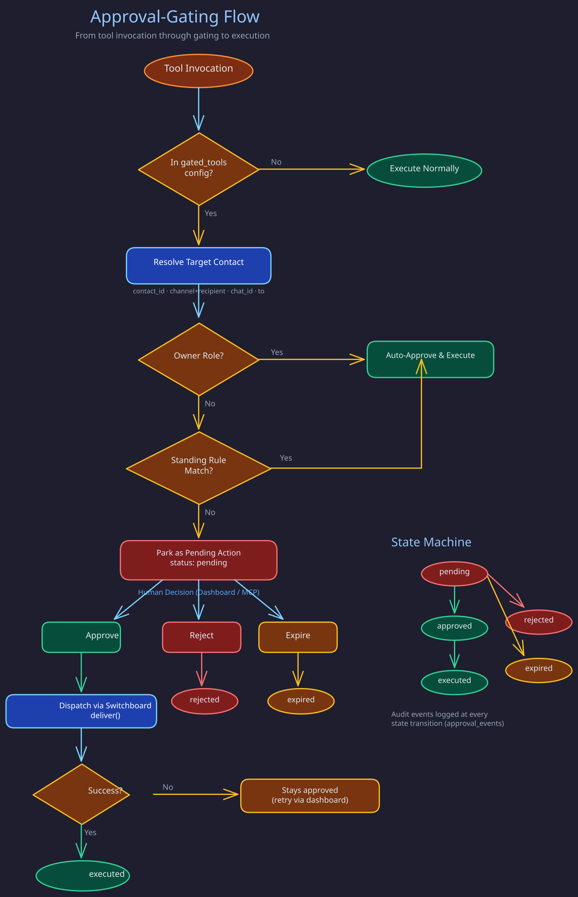

# Approvals Module

> **Purpose:** Human-in-the-loop approval mechanism that intercepts high-impact tool invocations, parks them for review, and supports standing rules for auto-approval.
> **Audience:** Contributors and module developers.
> **Prerequisites:** [Module System](module-system.md).

## Overview



The Approvals module is an execution-control module that butlers load locally. It intercepts configured high-impact tool invocations before execution, parks unapproved invocations as durable pending actions, and supports manual approve/reject/expire workflows plus standing approval rules for auto-approval of repeatable safe patterns.

This is how the system ensures that butlers cannot send emails to strangers, post messages to non-owner contacts, or execute other sensitive operations without explicit human authorization.

Source: `src/butlers/modules/approvals/` -- `module.py` (tools), `gate.py` (interception), `executor.py` (execution), `rules.py` (matching), `events.py` (audit), `redaction.py`, `retention.py`, `sensitivity.py`.

## Configuration

Enable in `butler.toml`:

```toml
[modules.approvals]
enabled = true
default_expiry_hours = 48
default_risk_tier = "medium"    # low | medium | high | critical

[modules.approvals.gated_tools]
email_send_message = {}
email_reply_to_thread = { expiry_hours = 24, risk_tier = "high" }
telegram_send_message = {}
telegram_reply_to_message = {}
```

Only tools listed in `gated_tools` are intercepted. Tools are gated strictly by config -- there are no implicit defaults based on tool name patterns.

## Two-Layer Gating

The approval gate operates at two independent layers, both enforcing gating:

**Layer 1 -- MCP tool wrapping** (`gate.py`): Intercepts gated tool calls at the MCP boundary. Primary gate for direct LLM tool invocations.

**Layer 2 -- `route.execute` inline gate** (`core_tools/_routing.py`): The Messenger butler's `route.execute` handler calls channel module methods directly, bypassing MCP tool wrappers. An inline gate re-enforces role-based gating at this layer. A plain send or reply it parks is stored as the registered native tool (`telegram_send_message`, `telegram_reply_to_message`, `email_send_message`, `email_reply_to_thread`, `whatsapp_send_message`) with that handler's arguments, so the card shows the registered preview and approval replays the native tool once. Inert-link and file deliveries have no native argument for those facts; they keep the exact routed envelope and their cards are Open only. So does a plain delivery whose native tool this Messenger does not register (email without `send_tools`), since approval could not replay it. An owner-approved `notify` that arrives with a Switchboard attestation of its source's verified single-use proof is not parked again: the shared approval matcher honours it for that exact routed envelope only, and only on the kernel-admitted Switchboard hop.

### Role-Based Auto-Approval

1. **Owner-targeted**: Actions targeting the owner contact are auto-approved immediately (owners are pre-trusted).
2. **Known non-owner**: Standing rules are checked. Match -> auto-approve and execute. No match -> park as `pending`.
3. **Unresolvable target**: Parked as `pending` (conservative default).

## Tools Provided

Tools are registered in `ApprovalsModule.register_tools` (`src/butlers/modules/approvals/module.py`);
read it for the current names and signatures. The families:

- **Queue** -- list, show, count, approve, reject and expire pending actions, and query executed
  actions for audit. Approval executes immediately only when an owning executor is available;
  otherwise `dispatch_approved_action` later runs the approved action through the owning daemon's
  original tool handler.
- **Standing rules** -- create (directly or from a pending action with suggested constraints),
  list, show and revoke the rules described below.
- **Autonomy suggestions** -- list, confirm or dismiss suggested promotions and demotions of a
  tool's approval posture.

## Standing Rules

Creating rules (directly, from an action, or with approval) and confirming an
autonomy promotion require the dashboard's fresh action-bound passkey step-up.
An authenticated MCP actor or Telegram callback cannot create standing
permission. They receive `dashboard_step_up_required` with `/approvals` as the
dashboard door. Ordinary approval, rejection, revocation and demotion remain
available under their existing authority. See
[standing-rule confirmation](../identity_and_secrets/dashboard-owner-auth.md#standing-rule-confirmation)
for the exact session/nonce transaction, backup and deployment boundaries.

Standing rules auto-approve matching invocations. A rule matches when all of these hold:

- Tool name matches.
- Rule is active and not expired.
- `use_count < max_uses` when bounded.
- Argument constraints match (typed: `exact`, `pattern`, `any`; legacy: `"*"` wildcard).

Matching precedence is deterministic: constraint specificity (descending) -> bounded scope before unbounded -> newer rule before older -> lexical rule ID tiebreaker.

### Constraint Suggestions

`suggest_rule_constraints` and `create_rule_from_action` use sensitivity classification:

1. Module-declared tool metadata (`ToolMeta.arg_sensitivities`) -- checked first.
2. Heuristic sensitive argument names (`to`, `recipient`, `email`, `url`, `amount`, etc.).
3. Default: non-sensitive.

Sensitive args get `{"type": "exact", "value": ...}`; non-sensitive args get `{"type": "any"}`.

### Standing-reply template drafts (inactive)

The owner can save, edit, inspect and revoke typed standing-reply template drafts
(`src/butlers/modules/approvals/reply_templates.py`, routes under
`/api/approvals/reply-templates`). A draft has no approval authority:

- **Drafted** -- saved in `standing_reply_template_drafts`, never in `approval_rules`.
  The gate reads only `approval_rules`, so a draft is never matched, claimed or executed.
- **Previewed** -- `POST /api/approvals/reply-templates/{id}/preview` reports whether a
  hypothetical call matches (`matched`, `eligible`, `reasons`) and always returns
  `authority: "none"`. An unresolved or unpinned recipient, a missing content argument or
  an unknown parameter makes it ineligible. The recipient resolves through the gate's own
  target resolution.
- **Activated** -- not implemented. There is no activation endpoint, no promotion into
  `approval_rules` and no `active` field (requests carrying one are refused with 422).
  Activation, broker enforcement, per-window limits and receipts belong to bu-jv1moa.28.

The dashboard's `/approvals` page carries the editor (the "Standing-reply drafts" section,
`frontend/src/components/approvals/reply-template-drafts-panel.tsx`): author, edit, inspect,
revoke (explicit confirm) and preview. Every preview shows `authority: none`, and the
section has no activation control.

Every route requires the owner's verified dashboard session; API-key, connector-callback and
runtime callers get 403 `owner_dashboard_session_required`, and no MCP tool exposes drafts.
Edits and revokes carry `expected_revision` (stale: 409 `stale_revision`); edits have no
idempotency key, so retrying a committed edit returns 409. A create replayed with the same
`idempotency_key` and request returns the draft that key created, in its current state (also
after an edit or revoke): replays compare against the immutable `create_request_digest`, and the
same key with a different request returns 409 `idempotency_key_reused`.

Grammar: one template per content-bearing argument of the send tool (`text` for
`telegram_send_message`; `subject` and `body` for `email_send_message`), matched against the
whole value. Templates are fixed text plus `{name:type}` slots of type `date`, `time`,
`datetime`, `duration`, `amount` or `count`; adjacent slots and slot-only templates are
refused, as are free-text, identifier, URL and recipient slots. Each draft pins one or more
live `public.entities` recipients. WhatsApp and Telegram user-client send tools are refused
permanently (owner decision bu-bup68v); other tools are refused as unsupported.

## Action Lifecycle

Valid status transitions:

```
pending -> approved | rejected | expired | cancelled
approved -> executed | abandoned
rejected, expired, executed, abandoned, cancelled -> (terminal)
```

`cancelled` applies only to actions with RFC 0038 goal lineage: when a goal is
stopped, `goal_park.cancel_goal_effects` takes exactly the actions whose broker
effects were cancelled (never one already dispatched) and cancels the pending ones through
`transition_pending_action` (an `action_cancelled` event; owner prompts are
fenced with the `action_rejected` delivery reason code) and abandons its
approved, never-executed actions (`action_abandoned`). The dashboard's decided-history
filter includes it. Goal lineage (`goal_id`, `goal_invocation_id`,
`goal_depth`, `goal_exposed`, `goal_origin`, migration `approvals_020`) is set
only by the capability broker's park path
([Capability Broker](../architecture/capability-broker.md)); `goal_origin` is
separate from the producer `origin`, and `legacy` is reserved for actions
created before the cutover. Approving an action whose lineage is exposed never
counts toward standing-rule promotion. A park also records `goal_rule_possible` (the broker's park-time "may a standing rule match" answer; explanation only) and, when exposed, `goal_exposure_cause`
(migration `approvals_023`): the invocation's closed S1 `exposure_cause` (`ingress`, `read`,
`child`, `inbox`, `recovery`, `legacy_unknown`), read by the broker under the goal lock. NULL means
unknown (an unexposed lineage, or a row that recorded none); it never comes from the model or
the call arguments.

Both owner surfaces show the same lineage lines, built once by `lineage_facts` from that park record: the
Telegram card ("Parked by a goal") and the dashboard approval detail (`goal.facts` on
`ApprovalGoalLineage`). The lines are a closed vocabulary (goal, origin, exposed by, standing rule), never
model claims or call arguments; an unrecorded fact reads "Unknown". They explain and never authorize.

The owner decides a goal action on the usual surfaces (dashboard approve, the
module `approve_action` tool, `operations.approve_action`): the decision is
recorded and the result carries `execution_code: goal_effect_requires_broker`,
but nothing runs it there; the capability broker reads the decision and runs
the effect. An edit to a goal action's arguments is refused with that code.
Every legacy run path (the shared executor, dispatch-by-id, both retry routes)
refuses a goal action with the same typed code.

All actual execution — auto-approved actions and manually approved actions dispatched by their owning butler — uses the shared `execute_approved_action()` path. It holds a database row lock from its approved/null eligibility check through handler invocation and the successful terminal write, so an Abandon request cannot win after a side effect starts. A successful action becomes `executed` only after its result and immutable audit event are persisted. If a handler is unavailable or fails, the action remains `approved` with no execution result so the operator can retry, reject, or dashboard-abandon it. The exception is a send that may already have gone out (an uncertain transport outcome, or a Telegram effect-uncertain or partial-delivery marker): it is recorded `executed` with `{status: outcome_unknown, delivery_confirmed: false}` and never retried, because Retry could message a non-owner twice (REQ-runtime-attention-outbox-002). An already-executed replay returns the stored result without re-running the tool.

`abandoned` is a terminal, dashboard-only recovery outcome for an action that was
previously approved but intentionally left unexecuted. It requires a non-blank
reason and appends an immutable `action_abandoned` event in the same transaction.
There is no MCP, Telegram callback, automatic, bulk, or scheduled abandonment
path.

## Risk Tiers

Tools and actions are classified into risk tiers: `low`, `medium`, `high`, `critical`. Higher tiers (`high`, `critical`) require narrower constraints (at least one `exact` or `pattern`) and bounded scope (`expires_at` or `max_uses`) for standing rules.

## Database Tables

The module owns tables in the hosting butler's schema (Alembic branch: `approvals`):

- `pending_actions` -- durable queue and audit log for gated invocations. Ordinary terminal actions are retained for 90 days; rejected or abandoned ordered `memory_entity_merge` / legacy `entity_merge` actions remain as durable owner decisions so curation cannot reopen the same pair.
- `approval_rules` -- standing rules for auto-approval. Its optional `created_from` action ID is historical provenance, so a retained rule does not block deletion of its terminal source action after that action's 90-day window.
- `standing_reply_template_drafts` -- inactive owner-authored reply templates (see above); revoked drafts are retained, and downgrading `approvals_019` refuses while any draft exists.
- `approval_events` -- append-only immutable audit log. Its `action_id` and `rule_id` are historical provenance, so deleting a terminal action after its 90-day window or an inactive rule after its 180-day window neither mutates nor deletes the event; events retain their separate 365-day audit window. New non-null action and rule references are still validated when an event is written.

## Dependencies

None. The approvals module is a leaf module. Other modules interact with it indirectly through the daemon's gate-wiring mechanism.

## Implementation Notes

- Dormant RFC 0023 recovery uses the explicit
  [approval delivery authority transport](../runtime/approval-delivery-authority.md).
  Protected peer admission and the owning source's durable presentation proof
  are separate prerequisites. Ordinary TCP or caller correlation cannot enable
  recovery, and constructing the opt-in transport does not activate rollout.
- The recovery worker reports each scan/claim/handoff outcome on
  `approval_delivery_worker_outcomes_total{schema,stage,outcome,reason}` and a matching log
  line. Labels come only from the closed vocabularies in
  `src/butlers/core/approval_delivery_worker.py` (`OBSERVATION_OUTCOMES`, `SAFE_REASON_CODES`);
  identifiers, recipients, callback material, provider references and exception text never
  appear. A handoff outcome is recorded only after its repository write commits; a refused
  compare-and-set records `start_refused`/`write_refused`, and a failed transaction records only
  `scan/failed`. Observer failures are swallowed and never change the action or presentation.
- Only `transition_pending_action` (`delivery_lifecycle.py`) may move an action out of
  `pending`. `tests/contracts/test_relationship_pending_actions_choke_point.py` pins the full
  inventory of `UPDATE pending_actions SET status` writers; the other writers move `approved` to
  `executed`/`abandoned` and must bind `ActionStatus.APPROVED` as their guard.

- Owner-entity mutations park for approval unless `src` is in `_OWNER_AUTO_APPLY_SOURCES`
  (`roster/relationship/tools/relationship_assert_fact.py`): owner self-registration plus
  `_TRUSTED_INTERNAL_SOURCES` (structured derivation such as `interaction_sync`). Prose-extraction
  jobs are deliberately untrusted (RFC 0017). The dashboard API rejects any auto-apply `src`
  (`roster/relationship/api/models.py::_reject_trusted_internal_src`), and the MCP wrapper hardcodes
  `src="relationship"`.
- Butlers that cannot read `relationship.entity_facts` recognise the owner through
  `public.resolve_owner_triple` (SECURITY DEFINER), called by
  `identity.resolve_owner_channel_via_definer()` when normal resolution returns None. An actively
  held endpoint (core_293, see [Endpoint Custody Holds](../identity_and_secrets/owner-identity.md#endpoint-custody-holds))
  never resolves to owner there.
- Every channel gate delegates to `identity.resolve_channel_contact_with_owner_corroboration()`,
  which tests ambiguity across all live matching entities before filtering to the owner. The bypass
  goes only to exactly one active identifier on one live, non-merged, non-deleted owner entity;
  every other case, including lookup errors, fails closed.
- Decision paths (the `approve_action`, `reject_action` and `expire_stale_actions` MCP tools, backed
  by `ApprovalsModule._approve_action`, `ApprovalsModule._reject_action` and
  `ApprovalsModule._expire_stale_actions` in `src/butlers/modules/approvals/module.py`) use
  compare-and-set
  writes (`... WHERE status='pending'`). Expiry is a decision boundary: approve and defer paths
  expire a still-pending action whose `expires_at` has passed instead of acting on it.
  Dashboard approve-with-edits restores the locked original arguments on a refused decision
  before committing, preserving an expiry transition without persisting the refused edit.
- `execute_approved_action` is idempotent per `action_id`: a per-action lock serialises it, an
  `executed` action replays its stored `execution_result`, and the terminal write happens only
  from `approved`.
- Dashboard approval, Telegram approval taps and Retry dispatch stored `notify` calls to the
  owning butler's `dispatch_approved_action`, like every other tool; the API process never calls
  Switchboard `deliver` itself. The owning daemon's executor
  (`src/butlers/modules/approvals/approved_notify.py`) sends a `notify.v1` envelope: the approved
  intent and delivery fields stay inside `delivery`, with `request_context` on the envelope; the
  owning daemon supplies both `origin_butler` and `source_butler`. It never resolves or substitutes
  a recipient. Where the cohost approval topology exists, the envelope carries a single-use source
  proof so Messenger honours the approval instead of parking it twice. That is the only supported
  topology for approved non-owner sends (cohosted `butlers up`, source approvals worker flag on).
  In a single `butlers run`, on split hosts, or with the worker flag off, Messenger parks a
  second, previewable native approval instead, by design
  ([approval delivery authority](../runtime/approval-delivery-authority.md#supported-topology-and-the-fallback)).
  This handoff runs inside the shared executor's row lock. A failed delivery, a refused proof, or
  a second park leaves the action `approved` with a null execution result.
- Calendar mutation replay (the eight tools in `CALENDAR_APPROVAL_TOOLS`,
  `src/butlers/modules/calendar_approval.py`) first checks the requested tool name and argument
  digest against the locked approved row; a mismatch refuses before dispatch. The executor then
  dispatches, and binds the execution context to, the canonical public call built from the stored
  row. Rows parked before bu-svqpzo.1 carry a literal `_approval_bypass: true` marker (and, for
  `calendar_update_event_instance`, `clear_entity_ids: false`); only those exact values are dropped.
  Any other value or unknown key refuses before effect. The marker is never forwarded and grants
  nothing; delete this retirement once no pending calendar row carries it.
  A row for a tool that takes `calendar_id` must bind it concretely: rows parked before bu-eio2my
  with `calendar_id: null` are refused before effect (the owner never saw the calendar a replay
  would resolve to) and must be re-requested.
- `ButlerDaemon._apply_approval_gates()` (`src/butlers/daemon.py`) falls back to registered MCP
  tool handlers when an approved action's
  `tool_name` is not a gated original, so module-queued actions for non-gated tools can execute.
- A producer calling `park_pending_action()` outside the MCP gate persists a declared owner, a
  registered tool name and exact kwargs, and the owning daemon validates that handler signature at
  startup. If no safe command can be replayed (secret-bearing requests), reject before parking with
  a redacted audit signal; never repair historic rows by guessing.
- `approval_events` rows are insert-only: trigger `trg_approval_events_immutable` rejects `UPDATE`
  and `DELETE`.
- Standing-rule precedence is deterministic (`constraint_specificity_desc`, `bounded_scope_desc`,
  `created_at_desc`, `rule_id_asc`). `high` and `critical` tiers require a constrained rule (at least
  one arg constraint plus `expires_at` or `max_uses`); rules created from an action at those tiers
  default to `max_uses=1`.

The dashboard action, flat-list, history and dossier responses expose additive
`origin: "prepared" | null` from the stored pending action. Only the exact stored
`prepared` value earns the neutral Prepared label in the rail and dossier;
absent, malformed and unrecognized values remain Origin unknown. This label is
independent of status, expiry, permissions and delivery evidence. Intended
non-send without delivery evidence is not a failed push, while independently
recorded failure or uncertain delivery remains visible even for a prepared action.

- A notification review link is a dossier locator, not an approval capability. The dashboard's
  qualified `GET /api/approvals/{id}?review_source=messenger` repeats a bounded lookup over
  every configured approvals source. A missing pool, failed read, duplicate UUID, or wrong source
  withholds the dossier; ordinary unqualified lookup and decision permissions stay unchanged.
  Configuration is retained before provisioning, so a failed pool cannot disappear from this check.

## Approval cards show the exact stored call

The owner push for a single parked action (Telegram) renders the call itself, not
the assistant's description of it. A per-tool preview registry
(`src/butlers/modules/approvals/previews.py`) turns the stored `tool_args` into
fact lines: for email sends every To, Cc and Bcc address, the subject
and the full body; for Telegram, WhatsApp and `notify` sends the recipient and
text. A `telegram_react_to_message` preview shows the exact stored chat, positive
native message ID and emoji on both Telegram and the dashboard. Message IDs must
be integers (not booleans), and chat and emoji must be nonempty text. Missing or
malformed fields and unknown reaction kwargs, including empty future arguments,
offer Open only. The assistant's `why`, `blast_radius` and `reversibility` sit under
"Assistant says" as claims, with URLs defanged (`hxxps://a[.]b/c`) and each
span rendered in code formatting so it stays literal after the transport's HTML
escaping. "Started by" names the owning butler (and marks prepared actions).

Approve and Reject are offered only when the whole call is shown and the card
fits about 3,500 UTF-16 code units (Telegram's own measure, so an emoji counts
twice). Otherwise the card says why and offers Open only:
no registered preview, an argument the preview cannot show (for example
attachments or a reply markup), a recipient that cannot be enumerated, a body
with backticks, any C0/C1 control character (other than a newline) or Unicode
format character such as a bidi override or zero-width space in a shown value
(these can forge the transport's placeholders or reorder what the owner reads), an
over-budget call, or an `administer` or protected or
consequential tool. Register a preview with `register_preview(tool, renderer,
effect_class=...)`; an unregistered tool is Open only by design.

Each presented card records `args_digest` (SHA-256 of the canonical JSON of the
stored call) on its `approval_delivery_presentations` row, written under the
action's row lock when the handoff starts; the handoff does not start if the
stored call changed since it was rendered, and a card never records a NULL
digest. A connector-authenticated Telegram tap carries only the action id, so the
approve endpoint refuses it with 409 "changed since shown" when any presented
digest differs from the stored call, and the tap edits the message to say nothing
was executed. This check applies to card taps only: a dashboard approval binds to
the call the dashboard displayed, and dashboard edits are the owner's explicit
change. The dashboard dossier and summary review dialog expose only a complete registered
owner-safe `call_preview`, including the tool identity and argument digest from the
same stored row. Both approval API routes require that `displayed_call` and
compare it under the pending-row lock before any owner edit, status/audit write
or dispatch. Missing, malformed, stale or unshowable calls execute nothing.
Summary actions first open the complete review; the five-second undo callback
retains that exact reviewed snapshot even if a later fetch sees a different call.
No raw secret-field fallback or truncated preview earns an Approve button.
Rows presented before migration 018 carry no digest and are not checked.
Migration 018's downgrade refuses while any presentation carries a digest.

## Canonical owner delivery (dark)

With `public.owner_delivery_rollout.enabled`, a single card carries single-use `od1` tokens
instead of `apr1` HMAC tokens, bound to one owner-delivery subject per action; a decision on
any surface (or by any other path through `transition_pending_action`) stales every other
card's buttons and queues them for retraction. See
[Owner delivery](../api_and_protocols/owner-delivery.md). Default off; nothing changes
until it is enabled.

## Related Pages

- [Module System](module-system.md)
- [Calendar Module](calendar.md) -- uses approval integration for overlap overrides
- [Email Module](email.md) -- tools gated by approvals
- [Telegram Module](telegram.md) -- tools gated by approvals

### Calendar canonical preparation

Calendar response admission is a module-owned startup extension of the real
approval gate, not caller metadata or a private handler API. The gate validates
its public arguments and dossier, then invokes the registered canonical
preparer before recipient exemptions or standing-rule matching. The preparer
freezes the provider-proven target and atomically persists its command and
ordinary pending action through one owning connection. Other gated tools keep
their existing policy and notification-recovery behavior.

Startup refuses an enabled response capability without its actual registered
gate and owning executor. Dispatch uses the captured original handler and the
existing task/tool/argument execution context; direct or inherited child-task
calls cannot write. Dashboard response decisions reuse `approve_owning_action`
with exact persisted arguments, no edits and `create_rule=False`. An already
approved command may recover through that same owning dispatch; its independent
committed attempt fence prevents a repeated provider write. RFC 0023 recovery
remains notification-only and retains its default-off authority boundary.

### Domain producers without unrelated generic gates

`[modules.approvals].enabled` continues to control generic `gated_tools`
wrapping and its mandatory reverse coverage for declared write tools. The
optional typed `domain_producers` list accepts only `calendar` and
`google_drive`, without duplicates, and defaults to empty. It enables only
those modules' own pending-action producers while leaving unrelated gates and
standing-rule policy unchanged. The owning approvals module, queue pool and
already-wired executor must all be active; configuration alone is insufficient.

For example, a calendar owner can load actions with `enabled=false` and
`domain_producers=["calendar"]`. This preserves its existing Spotify and other
module behavior while giving guest invitations the same-owner approval path.
A producer flag and the descriptive catalog marker grant no execution authority:
only an authenticated owner decision and exact stored-call executor context do.

## Decision set read view (dark)

`GET /api/decision-sets/{set_id}[?version=]` (owner only) and
`modules/approvals/decision_set_view.py` show one decision set version (`core/decision_sets.py`)
as the owner will be asked to decide it. A set stores only each item's capability, stored-argument
digest and recipient, so the view reads each item's exact call from its parked `pending_actions`
row (read only from the approvals pool of the item's capability domain, as the broker parked it; a copy in any other pool is ignored and an id found in two pools is `changed`), recomputes the argument digest and
rebuilds the call through the S1 or catalog preview. The item then carries the rebuilt facts and
the broker's lineage facts (`lineage_facts`). An item whose row is missing, unreadable (pool
failure, named in `meta.sources_degraded`), no longer pending, owned by another goal, changed since
parking, or without a complete exact preview is `exact: false` with a closed `reason` and no
facts; one such item, a version that is not `open` or an elapsed set makes the whole set not
`decidable` and the owner reviews each call on its approval page. The view grants nothing and
never accepts arguments: deciding goes through `DecisionSetResolver.decide`, which rechecks every
row and digest under the goal lock. `unticked_outcome` is the producer's `UNTICKED_OUTCOME`, so the
card words what happens to an unticked item from that value alone.
