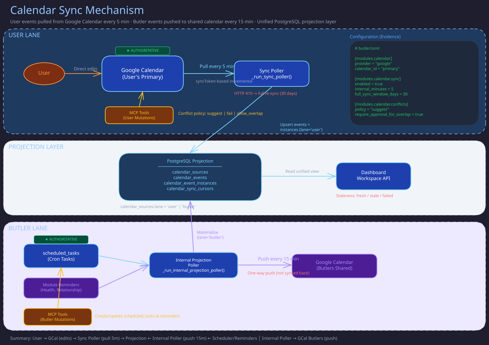

# Calendar Module

> **Purpose:** Provider-agnostic calendar integration with event CRUD, conflict detection, sync, and a workspace projection model for the dashboard.
> **Audience:** Contributors and module developers.
> **Prerequisites:** [Module System](module-system.md).

## Overview



The Calendar module gives butlers the ability to read and write calendar events through a provider-agnostic interface. Google Calendar is the v1 provider, with the architecture designed for future iCloud/CalDAV support.

Key capabilities:

- **Event CRUD** -- create, read, update, delete events with timezone-aware scheduling.
- **Conflict detection** -- pre-write overlap checking with configurable policies (suggest alternatives, fail, or allow with approval gate).
- **Butler-managed events** -- dedicated subcalendar for butler-generated schedules and reminders, tagged with `BUTLER:` prefix.
- **Polling-based sync** -- periodic sync from the provider with local projection for fast dashboard queries.
- **Attendee data** -- retain provider attendee/RSVP details on events and attendee fields on event create/update. Standalone attendee add/remove tools are retired.
- **Approval integration** -- overlap overrides and high-impact actions (e.g., cancelling events with external attendees) route through the approvals module.

Source: `src/butlers/modules/calendar/` (the public module class is in `__init__.py`).

## Configuration

Enable in `butler.toml`:

```toml
[modules.calendar]
provider = "google"
account = "user@gmail.com"        # optional: specific Google account
calendar_id = "primary"            # optional: auto-discovered if omitted
timezone = "America/New_York"

[modules.calendar.conflicts]
policy = "suggest"                 # "suggest", "fail", or "allow_overlap"
suggestion_count = 3

[modules.calendar.sync]
enabled = true
interval_minutes = 5
full_sync_window_days = 30
```

### Credentials

Google Calendar uses OAuth2 refresh-token exchange. Credentials are resolved via the shared credential store:

- `GOOGLE_OAUTH_CLIENT_ID` and `GOOGLE_OAUTH_CLIENT_SECRET` from `butler_secrets`.
- Refresh token from `public.entity_info` on the owner entity (or the specific Google account entry in `public.google_accounts`).

When `calendar_id` is not explicitly configured, the module auto-discovers or creates a shared "Butlers" subcalendar.

## Tools Provided

Tools are registered in `CalendarModule.register_tools` (`src/butlers/modules/calendar/__init__.py`); read
it for the current names and signatures. The families:

- **Event CRUD** (`calendar_*_event`, `calendar_*_event_instance`) -- read and
  write provider events; every create/update runs through the conflict engine below. Instance
  tools edit or delete one occurrence of a recurring event.
- **Butler-managed events** (`calendar_*_butler_event`) -- schedules and reminders the butler owns,
  including enable/disable.
- **Reminders** (`reminder_*`) -- reminders stored as native calendar events attributed to the
  calling butler.
- **Planning** -- `calendar_find_free_slots` (read-only availability finder) and
  `calendar_propose_event` (stages a pending proposal for review without writing to the provider).
- **Calendar and sync management** -- list calendars, set the primary calendar, check sync
  status, and force a sync cycle.

The retired `attendees` group registers no tools, even when explicitly listed. Default and empty
group configurations still expose every retained group. Approval-bound invitation responses and
their historical-owner fence retain their existing registration and authority contracts.

## Conflict Detection

Every create/update operation runs through the conflict engine before writing:

- **`suggest`** (default): Returns up to N alternative time slots when overlap is detected.
- **`fail`**: Rejects the operation with an error listing conflicting events.
- **`allow_overlap`**: Proceeds with the write. When the approvals module is co-loaded, an overlap approval may be enqueued for high-impact operations.

The check reads all owner time, not just the calendar the write lands on (REQ-module-calendar-046).
The target calendar goes through the provider's free/busy. Every other owner calendar (sources
with role `owner` or `butler`, plus the primary even before it has a source row) is read from the
stored projection, with cancelled, free, owner-declined and quarantined-invitation rows excluded, so an outsider's
invite cannot veto a write; an updated event is excluded by its event id. Another person's shared
calendar is never consulted, and a source switched off in the sources toggle is left out; the result then carries `conflict_check: "partial"` and `skipped_calendars`, and a no-park replan move is declined. If an owner calendar has no successful sync within twice the configured poll
interval (10 minutes at the 5 minute default, as the sync deadman computes it), or any read fails, the write is refused with "Couldn't
read your calendars to check for overlaps. Try again, or allow overlap to write anyway." (a replan
move is declined as `conflict_check_unavailable`). Under the `allow_overlap` policy an unavailable
check does not block the owner's write and claims no conflict.

### Day sheet push

The dashboard-api process also runs a supervised `day_sheet_push` loop
(`src/butlers/jobs/day_sheet_push.py`, REQ-butler-general-010), dark unless
`DAY_SHEET_PUSH_ENABLED` is set. Between 22:30 and 23:30 owner-local it sends the owner-local
tomorrow's `render_day_sheet_text` to Telegram through `owner_notify`, from the same
`query_calendar_day_sheet` fan-out as `GET /api/calendar/workspace/day-sheet`, so the message and
the dashboard share one projection and one digest. A delivered ledger row for the digest ends the
day; a failed or suppressed send retries. It records `day_sheet/pushed/<date>` and
`day_sheet/pushed/latest` in the general butler's state, which the `eod-tomorrow-prep` prompt reads.

### Overcommitment owner conditions

The dashboard-api process runs a supervised `calendar_overcommitment` loop
(`src/butlers/jobs/calendar_overcommitment.py`, REQ-owner-condition-ledger-007) that scans
`[owner-local midnight today, + N days)` with the radar's own `query_calendar_conflicts` and
reconciles `public.owner_conditions` under source `calendar:overcommitment`. Only `warning`
`overlap` and `overloaded_day` issues qualify; `back_to_back` never does. An overlap's identity
is a pair of provider identities (`origin_ref`, plus start for a recurring occurrence), not
instance ids, because the dedup survivor rotates between butler schemas as each one syncs. The
radar's own overlap `pair_id` uses the same provider-identity pair, so a pending fix proposal
(`calendar_event_proposals.source_event_id`) stays attached across a resync; the join also
accepts the legacy instance-based pair id so proposals stored before that change still attach. An
overloaded day's identity is its owner-local date. Condition text carries the kind, date,
severity, overlap minutes and entry ids, or meeting hours and event count, never a title,
attendee or location.

A scan with a failed schema fan-out confirms what it saw and resolves nothing. A tick with no
Switchboard pool, an unreadable owner timezone, or an unread dedup store reconciles nothing.
Environment: `CALENDAR_OVERCOMMITMENT_CHECK_INTERVAL_S` (default 1800) and
`CALENDAR_OVERCOMMITMENT_LOOKAHEAD_DAYS` (default 7, 1..90).

## Workspace Projection

The module maintains a local projection of calendar data for the dashboard at `/butlers/calendar`. The projection store normalizes both external provider events and internal butler schedules/reminders into unified records. A background projector refreshes this data periodically (default: every 15 minutes) and on sync completion.

Projection sources:

- **Provider events** -- synced from Google Calendar.
- **Scheduled tasks** -- butler cron schedules projected as calendar entries.
- **Butler reminders** -- reminder-type events from the butler's domain.

Projection authorship is normalized before write-through: blank or sentinel
`source_butler` values fall back to the module's canonical butler name (and
then `DEFAULT_BUTLER_NAME`), while blank `source_session_id` values are stored
as `NULL`.

Projection status is tracked as `fresh`, `stale`, or `failed`.

Lane reads never wear calm they cannot back (REQ-module-calendar-047). The proposals lane
(`view=proposals`) returns `proposals_available` and `proposals_dropped_rows`, and the overlays
lane and day briefing return `overlays_available`. A failed read returns HTTP 200 with the flag
`false`, and the dashboard shows "Proposals unavailable" or an overlays-unavailable state instead of
"Nothing awaiting your review" or "No domain context"; a confirmed-empty read keeps the calm text.
When some rows loaded the banner reads "Some proposals couldn't be loaded; this list may be
incomplete."; a row that cannot be converted is counted, not fatal, and each schema read has a 5
second deadline.

## Source roles

Calendar discovery registers every calendar the account can see, so a partner's shared calendar,
holidays and birthdays sit beside the owner's own. Each `calendar_sources` row therefore carries a
`time_role` (`owner`, `household_member`, `other_person`, `team`, `subscription`, `holidays`,
`birthdays`, `butler`, `unclassified`) and a `role_basis` (`provider_inferred` or
`owner_confirmed`).

- Roles come from provider facts only: the primary flag, the holiday and birthday calendar id
  shapes, and the resolved Butlers calendar. Never a title. A writable non-primary calendar is
  `unclassified`.
- `unclassified` fails safe: its events are the owner's time only when the owner is a non-declined
  attendee.
- One predicate, `counts_as_owner_time` in `butlers.core.temporal.calendar_source_roles`, decides
  owner time for the context producers, the conflict radar, meeting debrief and card, calendar
  prep, working location and the default free-slot search.
- An `owner_confirmed` role is never overwritten by discovery.

## Organizer verdict

Every provider event carries one trust verdict for its organizer, stamped into the event's
`metadata` as `organizer_verdict`, `lure_badges` and `verdict_version`
(REQ-module-calendar-039/040). The verdict is `owner`, `known_entity`, `known_domain`,
`vouched`, `first_contact`, `blocked` or `unknown`. `organizer_verdict()` in
`src/butlers/modules/calendar/organizer_verdict.py` is pure: it takes server-verified provider
fields and the results of two owner-owned lookups, and has no parameter for a title, description,
location or any other free text, so third-party text can never raise an invitation's trust.

- **Inputs.** The projection runs under the hosting butler's role, which cannot read the identity
  tables or Switchboard's ingestion rules, so it calls two read-only SECURITY DEFINER functions
  from core_370: `public.organizer_identity_class(email)` (one exact address in, a class out, no
  names or ids) and `public.organizer_policy_rules()` (the enabled global and Google Calendar
  connector rules, evaluated with the connector's own first-match engine).
- **Failure never admits.** An unreadable lookup stamps `unknown` with `lookup_failed: true`, which
  quarantines like `first_contact`; the sweep re-selects those rows (still bounded, after unstamped
  and stale ones) so they are evaluated again once the store reads. Only the owner's own address
  needs no lookup. The policy definer returns only the matchable rule types and columns.
- **Stamping.** The projection stamps each provider event as it writes it. A bounded sweep
  (`SWEEP_BATCH` events per sync pass) stamps rows with no stamp or an older `verdict_version`, so
  events projected before the verdict existed are covered without a backfill migration.
- **Quarantine.** `first_contact`, `blocked`, `unknown` and unstamped `needsAction` invitations are
  quarantined (REQ-module-calendar-041): no time held, no load or conflict, no prep, card or
  debrief, and no title or description in a prompt. The owner's own accept or decline always wins.
  One predicate gates every reader: `is_quarantined_invitation` (Python) is folded into
  `is_owner_attending` and `asserts_owner_time`, so the radar, day load, day sheet, prep, meeting
  card, debrief, household context, context producers, working location and the relationship
  interaction sync all skip a quarantined invitation, including one on the owner's own calendar.
  Readers that filter in SQL before a `LIMIT` (the Chronicler calendar adapter) use the twin
  `QUARANTINED_INVITATION_SQL`; a parity test runs both on a real Postgres, and a contract test
  fails when a SQL statement reading `calendar_events` carries neither the predicate nor an inline
  `-- quarantine-exempt: <reason>` comment. The provider-direct tools `calendar_list_events` and
  `calendar_get_event` read the provider, so each event is checked against the verdict stamped on
  its stored row (one batched lookup, the series row for a recurring instance): a quarantined,
  unstamped or unreadable-stamp invitation comes back as a stub with its time, `organizer_verdict`
  and the fixed title `[quarantined invitation]`, never its description, attendees or location. `GET /api/calendar/workspace/invitations` returns a separate `quarantined` list with
  time, verdict and lure badges only, and reports `issues_available = false` when a row has no
  verdict. Provider free/busy (`calendar_find_free_slots`) is the provider's own answer and is not
  affected.
- **Vouch and Block.** `POST /api/calendar/workspace/organizer-decision` (owner-only; body is the
  entry id and `vouch` or `block`, never an address) writes calendar-connector ingestion rules,
  one per registered calendar endpoint in one transaction, and re-stamps the organizer's stored
  events at once (REQ-module-calendar-042). The organizer address is read from the stored event.
  Block writes `block` and Vouch writes `pass_through` in `connector:google_calendar:<endpoint>`
  scopes only, so the same sender's email is never blocked. A verb is idempotent and removes the
  opposite rules it wrote and keeps manual rules. The Vouch (priority 10) is evaluated first: a
  same-scope block at a lower priority number, or at 10 and older, still wins, and a global block
  always wins. Concurrent verbs on one organizer serialise on an advisory lock. A Vouch only lifts an
  otherwise first-contact organizer to `vouched` (trusted). A calendar endpoint registered later is
  covered for trust, because the verdict reads every calendar scope; only the connector's
  ingest-time suppression of a Block is per endpoint. The Switchboard's 5-minute eligibility sweep copies the verbs' rules (by `created_by`,
  never manual rules) onto endpoints registered later, idempotently.
- **Not yet stamped.** The lure badges that need hidden-guest-list, conference-host and link facts
  (`hidden_guest_list_large`, `organizer_domain_mismatch_conference`, `external_link_present`) wait
  for the Google mapping to carry those fields; `from_gmail` and `mass_invite` are stamped now.

## Calendar event participants

The projection writes one `calendar_event_participants` row per attendee address of every provider
event (REQ-module-calendar-043), so a synced meeting has people on it the way a butler-created one
does. A row is an invited claim: it carries the address (normalized, never shown), the organizer's display name only for an
unresolved or ambiguous address (untrusted, never shown), a role, the RSVP status and a resolution state. It is never an interaction or an encounter.

- **Resolution.** A pure function over exact, normalized addresses (REQ-module-calendar-044): one
  live `has-email` claimant is `exact`; two or more is `ambiguous` and names no one; none is
  `unresolved`; the owner's own address is `owner`; a room or resource address is `resource`. No
  model, no fuzzy or name matching, no entity created from a stranger.
- **The cross-schema read.** `public.attendee_identity_claims(text[])` (SECURITY DEFINER, pinned
  `search_path`, at most 200 addresses, exact match, no names, merged, deleted and unidentified
  entities excluded) is executable only by the runtime roles of butlers that enable `[modules.calendar]`
  (`db_authority.roles.module_roles`, read from the roster). Readers get the entity's own name.
- **Failure.** A failed read never fails the event write: prior rows and `resolver_version` stay, a
  counter (`butlers.calendar.participant_resolution_failed`) increments, and readers get
  `available=false`, not an empty list.
- **Quarantine.** A quarantined invitation (REQ-module-calendar-041) has no provider-derived rows.
  The owner's accept lifts it on the next sync.
- **Merge.** Entity rebind repoints participants with the calendar links (REQ-module-calendar-045).
- **Backfill.** A bounded sweep derives rows for events whose stored rows do not match their
  attendees (none, stale, changed list); an event attempted in the last hour is skipped so a failing
  one cannot hold the window; it re-checks quarantine per event and never reads quarantined text.

## Connector sync

The Google Calendar connector captures events separately from this module's own sync. Its sync
filters, sync-token cursor and degraded-health reasons are in
[Google Calendar connector](../connectors/google-calendar.md).

### Household context

A `household_member`, `other_person` or `team` source may carry `role_subject_entity_id` (core_368,
a reference to `public.entities`), which the owner sets with the role in `POST
/api/calendar/sources/role`. Events on those sources that the owner is not attending are not owner
time, but they are readable as attributed context.

- `GET /api/calendar/workspace/household-time` groups them by subject. The conflict scan, the
  free-slot result and the meeting card show the same events as context
  (`household_context`, "Also on Alex's calendar: 14:00-15:00").
- Opaque by construction: window, role and subject name only. No title, location, description or
  attendee leaves the read, for any non-owner role (`HouseholdEvent` has no such field).
- Never load: they add no conflict, day load or busy time, and `unclassified`, `subscription`,
  `holidays`, `birthdays` and `butler` sources appear nowhere in the read. The calendar context
  producer reports their count as `household_events` and sets no signal. Every surface (free slots,
  meeting card, producer) selects them by overlap with its window through one shared read, so an
  already-running event, an all-day event and a recurring occurrence are all found.

## Rate Limiting

Ordinary Google Calendar API calls include retry logic for `429 Too Many Requests` and `503 Service Unavailable` with exponential backoff (max 3 retries, base 1s).

## Database Tables

The module does not own dedicated Alembic migrations (`migration_revisions()` returns `None`). Sync state is persisted to the butler's existing state store (KV JSONB) under keys prefixed with `calendar::sync::`.

## Dependencies

None. The calendar module is a leaf module. When the approvals module is co-loaded, the daemon wires an approval enqueuer callback via `set_approval_enqueuer()`.

## Package ownership

`butlers.modules.calendar` remains the real import surface. Its `__init__.py` defines the
single `CalendarModule` and directly exports the existing types and helpers from their
owners. Plain behavior mixins operate on that same module instance; static tool registrars
run synchronously inside `register_tools` and preserve typed callable signatures and order.

- `models.py`, `constants.py`, `errors.py`, and `time_helpers.py`: validated values and primitives.
- `provider.py`, `google.py`, `google_mapping.py`, and `oauth.py`: the provider contract,
  Google transport/conversion and token lifecycle.
- `event_tools.py`, `butler_events.py`, `tools.py`, and `response_tools.py`: registered callables.
- `mutations.py`, `recurrence.py`, and `conflicts.py`: existing permission, audit, action-log,
  recurrence and availability behavior.
- `projection.py`, `internal_projection.py`, `sync.py`, and `sync_queue.py`: the single live
  projection and sync engine, including durable force-sync commands and internal sources.
- `reminders.py`: native reminder operations, due dispatch and reminder tool registration.

The external `calendar_response.py` and `calendar_response_fence.py` retain their existing
single implementations. This mechanical split does not change response ownership, retire
the fence, add a response-only registration group or introduce a shared mutation runner.
The later authorized sync-engine cutover must remove the single implementation in these
owners, without keeping a second engine. Every Calendar package Python file is limited to
2,000 physical lines and `CalendarModule.register_tools` to 300 lines.

## Implementation Notes

- Existing `calendar.write` effect checks refuse a missing permission pool, failed read or malformed row with a typed transient `PermissionUnavailable` before provider writes and workspace mutation preparation. A readable missing row remains default-allow; explicit revocations and approvals still apply. Every fresh or deferred execution rechecks state without a new retry loop. The staged bu-30sah4 fix protects effects first; bu-svqpzo.3 owns the remaining shared callers and final fail-closed policy including spawn.

- `GET /api/calendar/workspace/invitations` reads the current provider projection
  without provider requests or RSVP writes. Only an explicit `self=true`, exact
  `needsAction` status and literal `response_status_explicit=true` marker admit an
  unanswered occurrence. Google parsing retains this projection-only provenance in an ordered
  `attendee_status_provenance` companion binding email and status; projected
  attendees remain exactly the unchanged MCP payloads. Unmarked legacy/defaulted
  status is unknown, omitted and suppresses empty/calm admission until ordinary
  sync supplies genuine provenance; reads never backfill it.
- Invitation lookup discovers bounded-window identities, then includes relevant
  same-origin tombstones and moved copies before deduplication and final window,
  eligibility and keyset slicing. A stale unanswered copy cannot resurrect a
  newer accepted, cancelled or out-of-window copy. The window is at
  most 90 days, limit at most 200, and cursors bind range/timezone. Organizer
  absence stays unknown; an organizer-attendee fallback is labelled. Radar doors
  contain only actually observed matching occurrence IDs. Source or conflict
  failure retains successful rows with unavailable status and named degraded
  sources. The Calendar strip preserves these states during refresh and has no
  response action or mutation receipt; invitation response authority is separate.

- `CalendarConfig` requires `provider`; `calendar_id` is optional and resolved at startup.
- Core `scheduled_tasks` carries calendar-linkage columns (`timezone`, `start_at`, `end_at`,
  `until_at`, `display_title`, `calendar_event_id`) with bounds checks and a partial unique index on
  `calendar_event_id`. `calendar_event_id` is only ever the id Google returned; a butler-authored
  task's stable handle lives in `calendar_link_id` (core_377). Each mirrored task records
  `mirror_state` (`pending`, `mirrored`, `failed`, `retiring`), its last error and attempt count: a
  failed push or delete keeps the provider id and is retried every sync, an unchanged task sends
  nothing, and calendar sync health reports the failing counts and marks the internal scheduler
  source failed.
- `calendar_set_primary` writes the fleet-shared default-target key first (an error, with nothing
  changed, if it cannot) and every calendar butler re-reads that key when it resolves a tool call,
  so one change applies to all without a restart.
- `CalendarModule._sync_calendar` materializes unified projection rows: provider deltas upsert into
  `calendar_events` + `calendar_event_instances`, and internal scheduler/reminder sources refresh
  into the same tables with deterministic `origin_ref` linkage. Checkpoints live in
  `calendar_sync_cursors` (`provider_sync`, `projection`); each refresh records status in
  `calendar_action_log`. Projection writes hard-gate on `to_regclass(...) IS TRUE`, so pre-migration
  databases no-op.
- Google's resource `eventType` (not a connector change kind) is kept verbatim on
  `CalendarEvent.event_type` and `calendar_events.event_type` (core_341): `default`,
  `outOfOffice`, `focusTime`, `workingLocation`, `fromGmail`, `birthday` or a future value (up to
  64 printable characters; anything else is `default`, nothing is inferred from titles).
  A `workingLocation` event's `workingLocationProperties` become `working_location`
  (`{type: homeOffice, label: "home office"}`, or `officeLocation`/`customLocation` with their own
  non-empty label, cleaned and bounded to 256 characters), else NULL; building/desk ids, the
  summary and `location` are never substituted. It is stored as two text columns,
  `working_location_type` and `working_location_label` (both or neither), not JSONB: finance
  and health publish their JSONB columns through a declared map that must match exactly, and
  plain columns stay unpublished unless the projection manifest lists them. Every provider sync
  replaces both fields (a
  dropped location clears). They are read-side only: tool payloads include them, no create/update
  input or Google write body carries them, and list/sync requests omit `eventTypes` so every
  type is returned. Older rows are `default`/NULL; the core_341 downgrade keeps the columns.
  Test inputs for these shapes live in `tests/fixtures/google_calendar_typed_events/`. They are
  synthetic, shaped after the public Events resource reference, and hashed in a manifest that
  declares each file's expected typed fields. They are not captured payloads, so the recorded
  payload obligation stays open.
- Consumers of the type (bu-s11n0s.4 S2). `outOfOffice` and `workingLocation` are declared
  statuses, not meetings (`calendar_provenance.STATUS_EVENT_TYPES`, matched case-sensitively):
  - General's calendar context producer: a typed `focusTime` event is `focused` whatever its
    title; a working-location event never asserts `meeting`; an active out-of-office event
    (timed or all-day, not butler-generated) suppresses `focused` and asserts nothing itself.
    An attended meeting overlapping it still holds `meeting`: the owner's own meeting is the
    stronger signal (people take calls while away). No owner mode is entered.
  - In the conflict radar both add zero day-load hours. The candidate carries
    `counts_toward_day_load=False`, and only the overloaded-day sum reads it. An opaque
    out-of-office block still overlaps and chains back to back, as any busy time does. A free
    (transparent) one is skipped by the attendance rule. A `focusTime` block is ordinary busy
    time.
  - Relationship and email meeting prep, the meeting card, the meeting debrief and the
    connector's starting-soon notices skip both. A prep key left from before an event became
    a status is pruned on the next run, because the keep-set holds only selected events.
  - The insight broker is unchanged. It reads the bus, not the calendar, so an out-of-office-only
    calendar writes no `meeting` and holds nothing under it. A real meeting and DND still hold.
  - Out-of-office is calendar context only (bu-u33sb7): it never writes the legacy `away`
    signal (that maps to `owner.place`) and never enters an owner mode, since automatic entry
    is limited to asleep, in flight and house unattended. Mode entry from it would need an
    owner-confirmed M7 proposal.
  - Working location is a typed read, not a signal (S3).
    `butlers.modules.calendar.working_location.current_working_location(conn, now=, zone=)`
    runs one SELECT on `calendar_events` and writes nothing.
    - Eligible: active, confirmed `workingLocation` events with a normalized location, not
      butler-generated and not self-declined.
    - Selection: timed over all-day, then the latest start, then the shortest, then the
      smallest event id.
    - It returns only `type`, `label` and `until`. `until` is the earlier of the event end
      and the next owner-local midnight in `zone`, so DST days end at the real midnight.
    - A naive `now` or an unknown zone is refused before the read.
    - Nothing calls it yet. Publishing it is deferred to a perception kind
      (`owner.work_location`) at the M7/.21 switch, so the retiring context bus gets no new
      writer.
- `calendar_sync_status` / `calendar_force_sync` report `projection_freshness` (`last_refreshed_at`,
  `staleness_ms`, per-source `fresh|stale|failed`). Dashboard `calendar_force_sync(queue=true)`
  commands are durable `calendar_action_log` rows: the worker starts even with polling disabled,
  leases one `running` command at a time, coalesces one pending successor, and restart recovery
  requeues interrupted work without losing full-recovery intent.
- Reminders are native-only (`calendar_events` with `source_kind='internal_reminders'`); the retired
  `reminders` table is migration history, never a fallback or fixture. The Butlers provider-calendar
  mirror stores its provider id in `calendar_events.metadata.provider_event_id`; series deletion
  removes the provider copy before the authoritative local row.
- Workspace: `/butlers/calendar` (`CalendarWorkspacePage.tsx`) reads `GET /api/calendar/workspace`
  and `/workspace/meta` via `use-calendar-workspace.ts`. Tests cover URL-backed `view=user|butler`,
  butler-lane grouping, and the butler-event create/edit payload shapes. The workspace is an
  operator view (bu-q11586.7): the dashboard no longer edits, deletes, drags, dedups, exports or
  undoes Google events, and `POST /api/calendar/workspace/user-events` accepts `action: "create"`
  only (the quick-add confirmation). The `dashboard-*` OpenSpec specs list that route and
  `/butler-events`, `projection_freshness` and `request_id`. Every calendar MCP write tool,
  including the provider update/delete and recurrence-scope tools, stays registered for
  butlers and chat except the separately retired standalone attendee add/remove tools.
- `src/butlers/modules/calendar/models.py::_normalize_recurrence()` rejects any rule containing `\n` or
  `\r` (iCalendar injection) and
  checks `FREQ` / `DTSTART` / `DTEND` case-insensitively. `CalendarEventCreate` and
  `CalendarEventUpdate` normalise `recurrence_rule` before any provider call.
- Recurring writes with naive datetime boundaries require an explicit `timezone`, and
  recurring update/delete tools accept `this`, `following` and `series` scopes.
- Conflict preflight always runs on `calendar_create_event` and on `calendar_update_event` only when
  the start/end window changes. Legacy policy values normalise (`allow` to `allow_overlap`, `reject`
  to `fail`).
- With `allow_overlap` and `conflicts.require_approval_for_overlap = true`, an overlapping write
  returns `status="approval_required"` and queues a `pending_actions` row carrying the executable
  tool name and args (the bound calendar, resolved policy and `request_id` included). The gate opens
  only while the approvals executor replays that exact call (`get_approval_execution_context` for
  the tool name and argument digest; for `calendar_update_event` the canonical
  `calendar_approval_args` form), so an approved overlap write runs once instead of re-parking.
  With approvals unavailable it returns `approval_unavailable` and never writes.
- Before provider writes, whole-series and following-scope update/delete count affected
  occurrences in the existing 90-day recurrence projection window. At least ten occurrences
  requires approval; `this` and fewer than ten continue without an impact approval. Large
  series/following edits and high-impact butler-event delete/toggle refuse with
  `approval_unavailable` when no approval enqueuer is wired, with no provider or native effect.
  The refusal is stored as a terminal no-effect workspace result, so repeating its `request_id`
  returns the same refusal rather than a phantom pending approval. After enabling approvals,
  use a new request ID. Exact executor replays retain the parked calendar and argument binding.
- Malformed provider payloads raise `ValueError`; `CalendarAuthError` is reserved for auth and
  transport failures. `src/butlers/modules/calendar/google.py::_GoogleProvider` validates credentials
  before creating its owned `httpx.AsyncClient`, so a credential error cannot leak a client.
- Read tools (`calendar_list_events`, `calendar_get_event`) go through the active
  `CalendarProvider`, and a per-call `calendar_id` override never mutates the configured default.
- Projection tables (`calendar_sources`, `calendar_events`, `calendar_event_instances`,
  `calendar_sync_cursors`, `calendar_action_log`) are core tables in every migrated schema, keyed
  for idempotency by `UNIQUE (source_id, origin_ref)`, `UNIQUE (event_id, origin_instance_ref)` and
  `UNIQUE (idempotency_key)`, with GiST range indexes for window queries.
- Workspace mutations (`POST /api/calendar/workspace/user-events` with `action: "create"` and
  `/butler-events`, envelope `{butler_name, action, request_id?, payload}`) proxy to MCP tools and return projection freshness
  (from the tool, else `calendar_sync_status`). A repeat `request_id` replays the stored
  `calendar_action_log` result instead of re-executing.
- Approval gates (high-impact butler-event delete/toggle, large `series`/`following` recurrence
  edits) cannot be skipped by any tool argument. A gated tool runs without parking only while the
  approvals executor replays the exact stored call: it checks `get_approval_execution_context`
  for its own tool name and the digest of its canonical public arguments. That canonical form
  comes from `calendar_approval_args` (`src/butlers/modules/calendar_approval.py`), which both
  the gates (to build the parked `tool_args`) and the tools (to check the context) use. It
  includes every public parameter with its default and stores datetimes as ISO strings; the
  tools parse them back at entry. When the call omits `calendar_id`, the gate binds the calendar
  it resolved at park time (`bind_calendar_approval_calendar`), so the approved digest names the
  calendar the owner saw and a later default-calendar change cannot redirect the replay (overlap
  gates bind it the same way). The same context lets a replay resume its own pending
  `calendar_action_log` row; any other caller is told the mutation is still queued.
- `POST /api/calendar/workspace/sync` keeps the raw `query_calendar_sources` fan-out, picks one
  canonical owner per calendar (enabled, `core` capability, freshest) and sends it a single
  `calendar_force_sync(queue=true)`, answering `202`. The module persists and serialises the command
  in `calendar_action_log` with `running` recovery, so a browser timeout never cancels provider
  work.

## Related Pages

- [Module System](module-system.md)
- [Approvals Module](approvals.md)

## Approval-bound invitation responses

`calendar_respond` is opt-in (`response_enabled = true`) and requires the
explicit `response` group, an enabled owning approval gate and the captured shared
executor. Only the Messenger and Relationship source configurations install
this capability. Messenger selects only `groups = ["response"]`; Relationship
selects `groups = ["core", "response"]` and retains normal Calendar startup.
Omitted or empty groups retain the full tool surface. An explicit group list
with responses enabled must include `response`; `core` alone does not select it.

Response-only startup resolves the configured account and canonical DB-backed
credentials and constructs the lazy provider. It does not discover or create
calendars, restore or persist calendar targets, clean source ledgers, recover or
drain force-sync commands, or start sync/internal projection pollers. Response
admission still requires the existing eligible projected source and verified
credential account; missing projection state never triggers discovery or
backfill. Successful approved responses retain their existing projection updates.
Both owners keep the direct historical `calendar_response_fence_status` read,
including when response execution is disabled. An invitation owned by a different
daemon is not rerouted to borrow it. Public arguments are the projection occurrence `entry_id`, an
accepted/declined/tentative choice, a UUID `request_id` and `send_updates`
(default `none`; `all` and `externalOnly` are explicit notification choices).

The actual registered pre-gate preparer resolves the owning pool, source,
credential account, live calendar access role, explicit self participant and
provider occurrence/ETag. It atomically parks the immutable command with its
pending action in the existing owning tables. A caller cannot supply private
bindings or select an account, ETag, actor, recipient, approval or bypass.
Standing rules and owner-recipient exemptions do not execute this operation.

Authenticated `POST /api/calendar/workspace/respond` composes that exact command
with the existing verified decision/audit and owning dispatch. The executor
binds the original arguments to its own task and a verified human decision.
Token readiness precedes a separately committed one-attempt fence. The dedicated
Google participant-only PATCH sets `attendeesOmitted=true`, sends only the
verified self response, and includes `If-Match`; it never uses the generic
401/429/503 write retry path. Existing operations retain their retry behavior.

Cancellation, restart or an unattributable provider result retains uncertainty.
Neither a fresh request key, provider readback, source-row replacement nor
ordinary approval retention clears the physical-target fence. The existing
action-log record is retained; any future action-log retention must preserve an
unresolved fence. An attributable provider response is committed before
projection, so projection failure remains applied-with-projection-unavailable.

Physical-target admission spans the fixed historical response owners Messenger
and Relationship. Each retains its own command and approval. While holding the
existing target advisory transaction lock, the claimant checks its own log and
calls the peer's content-blind `calendar_response_fence_status` through
Switchboard. The read tool stays registered when response execution is disabled.
It returns only a protocol-bound clear/unresolved/unavailable verdict. A fresh
random advisory nonce plus the claimant backend PID lets the peer verify both
locks in its own database through ordinary-role `pg_locks`; a different database,
old protocol, incomplete roster, missing peer or malformed unresolved evidence
cannot authorize egress. No cross-schema SQL or new shared writable table is used.

Coordination uses a separate ordinary-role pool of two connections per daemon,
one outgoing claim at a time and a ten-second coordination deadline. A peer
probe only reads its own log and never calls another peer. The transaction uses
READ COMMITTED, and the marker commits before lock release and provider I/O.
Normal approval executor row locks remain unchanged. Failed coordination leaves
the durable command phase intact; retry rechecks that phase, including an
ambiguous commit, rather than resetting it. Status queries return bounded EXISTS
results, not historical payloads. A new response owner requires extending the
historical census on every existing owner before enabling writes.

Deployment must disable new response execution and drain both existing writers
before activating this protocol on both daemons. Confirm ordinary-role lock
visibility and both peer tools before re-enabling responses; a partial rollout
cannot establish the cross-owner invariant while an old writer remains active.
If rollout fails, keep responses disabled and preserve the owning logs. Rolling
back to active old writers would restore the bypass. No migration or additional
database grants are required. Future history retention must preserve all
unresolved markers and their historical owners.

The mounted controls use the same typed handler for contextual, keyboard and
palette actions. Receipt state survives inbox-row removal; outcome refresh
reuses the original key and never optimistically labels an invitation accepted.
The dashboard offers no Undo for an invitation answer: the `/undo/{action_id}`
route was removed with the operator-view cut (bu-q11586.7), so a receipt reports
the outcome only. The module's server-owned inverse reservation
(`reserve_response_inverse`) and the stored-inverse receipt read below are
unchanged.

Response review links use the existing approval dossier with the distinct
`review_source=calendar:<owning-butler>` read selector. The server checks the
complete configured approvals-source census and the exact command/pending
private binding before selecting that pool. Missing, duplicate, degraded or
changed bindings withhold review; the Messenger notification-review selector
retains its separate admission. Rejected/expired approvals remain terminal on
registered replay and cannot reappear as a new pending decision.

### Response receipt recovery

Invitation controls use the physical schema that owns the displayed entry, not
another schema selected for logical source health. A freshest copy in a butler
without response capability remains visible without response controls; the UI
does not substitute an older supported copy. A matching writable response owner
retains its controls.

`GET /api/calendar/workspace/responses/{command_id}?source_butler=<owner>` reads
the existing durable response receipt. `inverse=true` follows the original
command's stored inverse claim and verifies the inverse's reciprocal command
binding. Both reads repeat complete approval-owner admission and do not dispatch,
approve, reserve, or call a provider. The mounted receipt keeps this identity when
an inbox row disappears or the undo HTTP reply is lost. A pending inverse remains
pending until the existing approval executor completes it; its owner-qualified
approval dossier is the execution recovery door. An unavailable read retains the
last known receipt and does not replay the original response.

### Party-reaching mutations

Creating an invitation or changing an event with non-owner or unresolved
attendees requires owner approval. Every attendee must pass the existing
ambiguity-safe identity resolver; one owner address cannot hide another guest.
The module checks inherited attendees before updates and notifying deletions.
For Google deletion, explicit `send_updates="none"` suppresses notifications;
`None` omits the provider flag, so its audience is conservatively gated.
See [Google's deletion contract](https://developers.google.com/workspace/calendar/api/v3/reference/events/delete).

Without a wired approvals producer, a party-reaching call returns
`approval_unavailable` before provider mutation. Existing permission, conflict,
series-impact and request-id replay checks still apply. Only the executor's
exact stored call can pass the new party boundary. Configured standing-rule
authority retains the existing generic approvals gate and safety-argument rules.

Dashboard guest creates remain on the selected calendar owner's credentials and
calendar. Every configured calendar owner has approvals capability; no unrelated
tool gates or rules are added. The authenticated owner submission approves only
the pending call whose digest the module returned, and the locked owning
approval checks that exact call again before dispatch. This self-submission
contributes no autonomy promotion history. Approved-but-undispatched remains
truthful rather than claiming an event was created.

The original bu-fg499t dashboard update/delete/undo wording refers to retired
surfaces: owner decision `bu-kf3n4i=A`, current dashboard-api requirement and
retirement commit `c064141c31f6b715911ede7e09cbe64a907b7c5d` (PR4901) retain
create-only dashboard mutation. Update/delete remain HTTP422 and undo remains
absent; the corresponding MCP mutation gates are covered instead.

Party approval receipts bind the complete stored call, owning butler, currently
verified Google account and concrete calendar. A retry with the same request ID
reuses its pending receipt only when these still match; changed invitations or
default destinations refuse. Rejected, expired and executed decisions are never
reactivated. This checks current module/account binding; it does not add a
cross-restart credential-generation fence or an atomic provider ACL/write CAS.

Approved party execution resolves its unique durable projection receipt by the
executor's action ID, including when the caller omitted `request_id`. The
receipt binds the fetched effective attendee set as well as the current owning
provider/account/calendar; any drift, missing or ambiguous receipt refuses
before mutation, including before an owner-only shortcut. Inherited
`attendees=None` remains unchanged in the stored call. Existing-event approved
non-owner mutations also require the fetched event version. Google update,
delete and recurrence writes carry that same snapshot ETag as `If-Match`;
concurrent changes return HTTP412 without silently refetching and retrying the
approved effect. A missing version refuses before effect. This protects that
event resource, not external calendar ACL changes or a multi-write transaction.
Owner-only legacy overlap/series approvals retain their original authority;
a generic overlap approval never authorizes a non-owner audience without the
owning party receipt.
