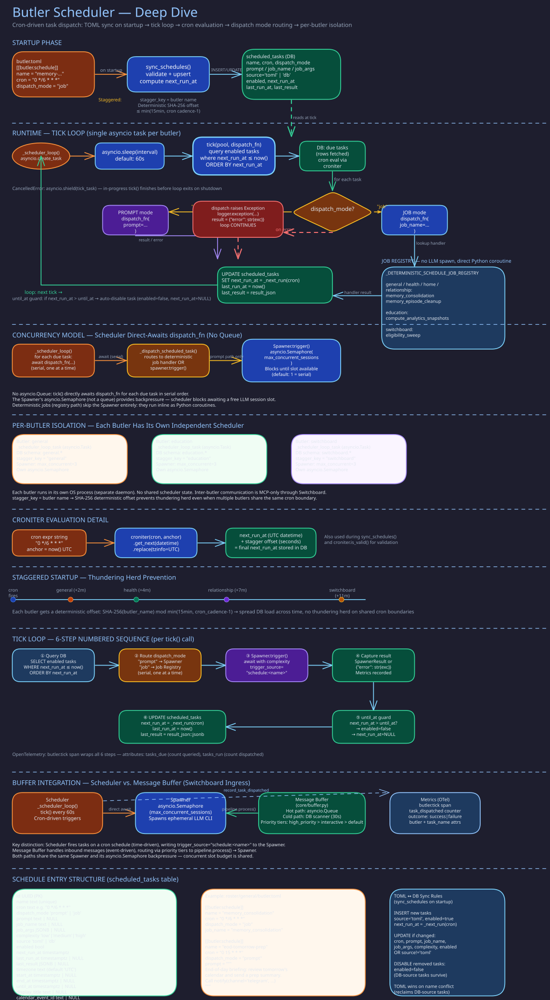

# Scheduler Execution

> **Purpose:** Describe the cron-driven task scheduler: tick loop, TOML-to-DB sync, staggering, dispatch modes, and task lifecycle.
> **Audience:** Developers configuring scheduled tasks, operators troubleshooting missed schedules, architects understanding the dispatch model.
> **Prerequisites:** [Trigger Flow](../concepts/trigger-flow.md), [LLM CLI Spawner](spawner.md).

## Overview



The scheduler (`src/butlers/core/scheduler.py`) is a cron-driven task dispatch system. At daemon startup, it syncs schedule definitions from `butler.toml` into the `scheduled_tasks` database table. During operation, the daemon periodically calls `tick()`, which evaluates cron expressions and dispatches due tasks to the spawner. The scheduler supports two dispatch modes, deterministic staggering, complexity-aware model selection, and automatic task expiry.

## Explicit owner break-through at creation

A cookie-authenticated, CSRF-checked dashboard request may opt in with
`interrupt_owner: true` and one canonical UUID `X-Butlers-Creation-Operation`.
The existing owner-auth service issues a purpose-separated, hash-only creation
ticket. It is not a D13 standing-permission factor and is never an MCP tool
argument. The API sends its unpersisted nonce in per-call MCP metadata; it does
not modify the cached client's headers. The daemon checks the raw RFC8785
argument digest and receiver before entering the owning schedule transaction.

That one physical-database transaction checks the current auth/session fence,
consumes the ticket, creates the actual definition and seals its immutable
stamp and closed result. Unknown-commit retry with the same operation returns
the original task UUID. It never recreates a deleted task or blesses an edited
definition. A changed operation payload, wrong receiver/session, expired ticket
or revoked authority refuses. Ordinary model creation has no stamp.

`tick()` carries the claimed task UUID and original due occurrence through
private invocation context. A bare task UUID, trigger name or model-provided
request context is insufficient. Both `notify` and the direct Insight delivery
consumer use the same current persisted evaluator. Only the scheduler's mutable
execution bookkeeping is excluded from the definition digest; edits to the
owning definition invalidate its creation stamp. TOML sync and model edits do
not retroactively opt in. The last valid `until_at` occurrence atomically records a
separate final-claim witness while auto-disabling the task. The immutable
creation stamp still includes `enabled`; the witness binds the actual original
due occurrence and disabled definition, and survives completion bookkeeping.
Explicit definition edits or disable revoke the witness, including an already
disabled request. Revoked occurrence tombstones prevent a cached final invocation
from regaining authority after re-enable. The fixed domain-role function derives
the witness from the actual same-transaction row and current creation stamp;
callers cannot supply a final flag or definition digest.

## Migrated storage and historical triggers

The scheduler requires the current migrated schema. It does not probe
`information_schema` or hide missing task/deadline/event-chain/deferred storage
behind legacy projections. Storage faults remain visible. Existing optimistic
claims, NULL-safe CAS, continuity, policy decisions, deferred retry/coalescing
and expiry keep their current semantics.

`calendar_event_end` is no longer writable or detected. Create and explicit
trigger updates refuse before database access; historical rows remain
readable/listable/deletable and inert. No data rewrite, remap or replay occurs.

## TOML-to-DB Sync

On startup, `sync_schedules()` reconciles `[[butler.schedule]]` entries from the butler's TOML config with the `scheduled_tasks` table:

- **New tasks** are inserted with `source='toml'` and `enabled=true`.
- **Changed tasks** (cron expression, prompt, dispatch mode, job name, job args, or complexity changed) are updated in place. Tasks previously created at runtime (`source='db'`) that share a name with a TOML schedule are reclaimed to `source='toml'`.
- **Removed tasks** (present in DB with `source='toml'` but absent from the current TOML) are disabled by setting `enabled=false`.

Each synced task gets a computed `next_run_at` based on its cron expression and optional stagger offset.

### Schedule timezone

Hour-pinned cron fields are evaluated in the owner's configured general timezone, so `0 23 * * *` fires at 23:00 owner-local. A `[[butler.schedule]]` entry may set `timezone` (an IANA name) to pin its own zone instead, and sync stores it on the row. Use this for infrastructure schedules whose comment states a UTC time. Pin real UTC with `timezone = "Etc/UTC"`: the literal `"UTC"` (like an empty or missing value) is the sentinel that follows the owner timezone, so it cannot pin. `timezone = "UTC"` (any case) or a blank value is refused with an error naming `Etc/UTC`, as is an unknown zone. A change to only the declared timezone updates the existing row.

### Always-quiet warning

When sync can read the owner quiet window (`public.approvals_policy`), it logs one warning per prompt-mode schedule that references `notify` but whose every firing in the next week, including the stagger allowance, falls inside that window, because its notifications would always be held or dropped. The lint never rejects a schedule or blocks sync, and it stays silent when there is no usable policy, the cron is irregular, or the schedule is job-mode or does not notify.

## Dispatch Modes

Scheduled tasks support two dispatch modes, configured via `dispatch_mode`:

### Prompt Mode (default)

The task's `prompt` string is sent to the spawner, which spawns an LLM session. This is for tasks that require reasoning --- summarizing calendars, drafting emails, analyzing data. The scheduler emits a warning if neither the prompt text nor any referenced skill's `SKILL.md` contains the string `notify` (case-insensitive), catching tasks whose results would be silently discarded.

### Job Mode

The task's `job_name` maps to a registered Python function that runs directly without spawning an LLM. This is for deterministic maintenance work: memory consolidation, analytics computation, eligibility sweeps.

Job mode also fits owner reminders whose text has a fixed shape. Relationship `upcoming-dates-check` and `relationship-maintenance` render a template from an existing read, and Chronicler `chronicler_gap_interview` asks yesterday's gap interview through the same service as its MCP tool. A job reaches the owner through `butlers.jobs.owner_notify.send_owner_telegram`: the `notify.v1` send through Switchboard `deliver` on the client `dispatch_scheduled_task` binds for the handler call, with one attention-ledger row per outcome. Unlike `notify()`, a quiet-hours or context-bus suppression drops the send rather than deferring it.

## The Tick Loop

The daemon calls `tick()` at a regular interval. Each tick:

1. **Query due tasks** --- `SELECT` from `scheduled_tasks` where `enabled = true AND next_run_at <= now()`, ordered by `next_run_at`.

2. **Dispatch each task** --- For prompt-mode tasks, calls `dispatch_fn(prompt=..., trigger_source="schedule:<task-name>", complexity=...)`. For job-mode tasks, calls `dispatch_fn(job_name=..., job_args=..., trigger_source="schedule:<task-name>")`.

3. **Update state** --- After dispatch (success or failure), advances `next_run_at` to the next cron occurrence, sets `last_run_at` to now, and stores the dispatch result in `last_result` (JSONB).

4. **Handle expiry** --- If a task has an `until_at` timestamp and the next computed run would exceed it, the task is auto-disabled (`enabled=false`, `next_run_at=NULL`).

5. **Record metrics** --- Each dispatch increments a `task_dispatched` counter with `butler`, `task_name`, and `outcome` (success/failure) attributes. The tick span records `tasks_due` and `tasks_run` as OTel attributes.

Dispatch failures are logged but do not prevent subsequent tasks from running. The error is stored in `last_result` for operator visibility.

## Task Continuity (opt-in)

A prompt-mode task can set `continuity = true` (per-task, default `false`) to have the scheduler inject what its previous run concluded into its next dispatched prompt. The task's own session calls the `carry_forward(task_name, content)` core tool to record that conclusion; the record lives in the shared `public.task_continuity` ledger, keyed by `(butler_name, task_name)` for the single "live" row and `(butler_name, task_name, session_id)` so calling it twice in one session updates the same row rather than duplicating it.

At the next opted-in dispatch, `tick()` reads that live row and appends a `## Task Continuity — <task_name>` block naming the previous session, its age, and its content --- or, if the task has run under continuity but never called `carry_forward`, an honest "the last run recorded no carry-forward" block, never silence. This is a general primitive for the pattern the chronicler's day-close cache implements bespoke (`src/butlers/chronicler/day_close_writer.py`); migrating that hook onto this layer is a deliberate non-goal until a regression test proves equivalence.

## Staggering

When multiple butler instances share the same cron schedule, simultaneous dispatch would create a thundering herd. The scheduler applies deterministic staggering:

- A `stagger_key` (typically the butler name) is hashed with SHA-256.
- The hash is mapped to an offset in seconds, bounded by `min(max_stagger_seconds, cron_interval - 1)`.
- The offset is added to the computed `next_run_at`.

The default `max_stagger_seconds` is 900 (15 minutes). The offset never exceeds the cron interval minus one second, ensuring a task does not stagger past its next scheduled occurrence.

## Complexity Tiers

Each scheduled task can set a `complexity` tier (the `Complexity` enum in
`src/butlers/core/model_routing.py`; see [Model Routing](model-routing.md#complexity-tiers)). A
missing value defaults to `Complexity.WORKHORSE`. A stored retired tier (`medium`, `high`, ...) is
remapped to its canonical successor rather than collapsed, and any other unrecognized value
degrades to `WORKHORSE` with a warning (`_parse_complexity_from_db_row`).

## Scheduled Task Rows

`scheduled_tasks` is created in `alembic/versions/core/core_001_foundation.py` and extended by
later core migrations (deadlines, token budgets, calendar linkage, delegation wake, continuity).
Invariants worth knowing: `name` is unique per butler schema, `source` is `toml` or `db` and decides
whether `sync_schedules()` owns the row, and an expired task is left with `enabled=false` and
`next_run_at=NULL`.

## Verification

To confirm the scheduler behavior described here matches the running system:

```bash
# 1. Scheduled tasks are synced from TOML on startup
psql -h localhost -U butlers -d butlers -c \
  "SELECT name, cron, dispatch_mode, source, enabled, next_run_at, last_run_at
   FROM general.scheduled_tasks ORDER BY next_run_at;"
# Expected: tasks with source="toml" matching entries in roster/general/butler.toml

# 2. Task last_run_at advances after each tick
# Wait for the next tick interval (check butler.toml for tick interval, typically 60s).
# Then re-run the query above and confirm last_run_at changed for due tasks.

# 3. trigger_source follows "schedule:<task-name>" convention
psql -h localhost -U butlers -d butlers -c \
  "SELECT trigger_source, COUNT(*) FROM general.sessions
   WHERE trigger_source LIKE 'schedule:%'
   GROUP BY trigger_source ORDER BY count DESC LIMIT 10;"
# Expected: rows for each scheduled task that has fired

# 4. Stagger offsets differ between butlers on the same cron
# Compare next_run_at for the same cron expression across two butlers:
psql -h localhost -U butlers -d butlers -c \
  "SELECT 'general' AS butler, name, cron, next_run_at FROM general.scheduled_tasks WHERE source='toml'
   UNION ALL
   SELECT 'health' AS butler, name, cron, next_run_at FROM health.scheduled_tasks WHERE source='toml'
   ORDER BY cron, butler;"
# Expected: matching cron tasks show different next_run_at values (stagger applied)

# 5. Auto-disabled tasks have enabled=false and next_run_at=NULL
psql -h localhost -U butlers -d butlers -c \
  "SELECT name, enabled, next_run_at, until_at FROM general.scheduled_tasks
   WHERE until_at IS NOT NULL;"
# Expected: tasks past their until_at show enabled=false, next_run_at=NULL
```

## Implementation Notes

- `sw_038` supplies `public.qa_local_schedule_policy()` for QA's separately
  wired scheduler consumer. It accepts no arguments, requires effective
  `SET ROLE butler_qa_rw`, and returns only `policy_state` and
  `policy_provenance` for `qa`. The role-less audit pool is not an authorized
  caller. SQLSTATE `42501` is denied, `P0002` is missing policy, and `22023`
  is malformed policy; transport/function absence is unavailable. Consumers
  must suppress new admission on these outcomes, never reuse cached `active`.
  The migration retains the function and ACL on downgrade because migration
  state cannot prove that all readers were retired. Remove it only after a
  separately reviewed replacement; policy rows and owner holds are unchanged.
- QA's consumer is `read_qa_schedule_policy()` in `src/butlers/core/scheduler.py`. For
  `butler_name == "qa"`, `tick()` ignores `eligibility_pool`, the receiver-cutover flag and the
  legacy route resolver. It reads the projection through its primary `pool`, which the daemon wires
  to QA's own `SET ROLE butler_qa_rw` pool, once before the deadline/cron passes and again
  immediately before every deadline dispatch and every cron claim. Nothing is cached. Results map to
  the closed `QaSchedulePolicy` enum: `allow` for `active` with any valid provenance (so TTL-derived
  `active/legacy_ttl` keeps patrolling); `administrative_hold` for `paused|quarantined`;
  `owner_review_hold` for `review_required/operator`; `legacy_ambiguous` for
  `review_required/legacy_ambiguous`; and `missing`, `malformed`, `denied` or `unavailable` for a
  missing row, a bad shape or pair, a role refusal, or any other failure (including a missing pool).
  Any value other than `allow` stops new admission. Logs carry only the category, never row, SQL or
  exception text. A refused cron task is left unclaimed, so it runs exactly once after the hold
  lifts and does not trigger catch-up. Work that was already launched keeps running.
  `asyncio.CancelledError` propagates and does not authorize anything. Other butlers keep the
  `src/butlers/core/scheduler.py::_butler_dispatch_gated()` path.
- `sw_053` generalises that projection as `public.butler_local_schedule_policy()` for every other
  butler. It takes no arguments, derives the butler name from the effective
  `SET ROLE butler_<name>_rw` (anything else is refused with `42501`) and returns `butler_name`,
  `policy_state` and `policy_provenance` (`P0002` when no row exists). EXECUTE is granted only to
  `butler_*_rw` roles. Under the receiver cutover `_butler_dispatch_gated()` calls it through the
  butler's own role-verified pool (the daemon wires `eligibility_pool` to `daemon.db.pool` for every
  butler under the cutover, and for the switchboard always). A missing row or any state other than
  `active` holds dispatch; a refusal, an absent function or a row naming another butler fails open,
  like other gate errors. Without the cutover only the switchboard gates, because the legacy
  resolver reads switchboard tables that runtime roles cannot see. Downgrade keeps the function.

- `job_args` JSONB can round-trip through asyncpg as a JSON string: serialize dicts explicitly on
  write and normalize back to dicts before diffing, validation merges, list responses or dispatch.
- Scheduler context must match across the background loop, the `tick` tool and
  `schedule_trigger`: resolve it through `ButlerDaemon._build_scheduler_runtime_context()` and
  prepare prompt-mode tasks with the same captured `run_at` and effective timezone passed to
  completion. Otherwise Chronicler's early-morning day-close derives the prior UTC date.

## Related Pages

- [Trigger Flow](../concepts/trigger-flow.md) --- the broader trigger model that the scheduler participates in
- [LLM CLI Spawner](spawner.md) --- how dispatched prompts become LLM sessions
- [Model Routing](model-routing.md) --- how complexity tiers map to models
- [Butler Lifecycle](../concepts/butler-lifecycle.md) --- when sync_schedules runs during startup
